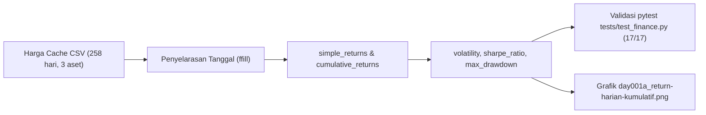

# Penjelasan Proyek — day001a: Return Harian & Kumulatif (Python)

## 1. Identitas dan Ringkasan Proyek
- **ID Progress**: `day001a` (Hari 1, Sesi a; direname dari `day001` pada pemeliharaan `2026-11-21`)
- **Tanggal**: 2026-11-19 (WITA) · **Topik No**: `001` (ROADMAP) · **Jenis**: `quant` · **Bahasa**: Python
- **Notebook**: [days/day001a_quant_return-harian-kumulatif.ipynb](../../days/day001a_quant_return-harian-kumulatif.ipynb)
- **Ringkasan**: Menghitung simple return harian, return kumulatif (*wealth index*), volatilitas tahunan, Sharpe ratio, dan *maximum drawdown* pada deret harga penutupan tahun 2024 untuk tiga aset lintas bursa (`BBCA.JK`, `^JKSE`, `AAPL`).

## 2. Masalah dan Tujuan
Harga nominal antar instrumen keuangan tidak dapat dibandingkan secara langsung karena perbedaan satuan mata uang (IDR vs USD), skala harga, serta kebijakan pembagian dividen dan *stock split*. Tanpa normalisasi berbasis imbal hasil relatif, investor tidak dapat menilai aset mana yang memberikan kompensasi risiko terbaik.

Proyek ini menjawab pertanyaan fundamental manajemen portofolio kuantitatif: bagaimana mengubah deret harga penutupan harian menjadi return satu-periode, menggabungkannya secara geometrik menjadi pertumbuhan kekayaan kumulatif sepanjang tahun 2024, dan meringkas profil risiko-imbal hasil melalui volatilitas tahunan, Sharpe ratio, serta *maximum drawdown*. Ruang lingkup dibatasi pada data harian 2024 (`258` hari bursa gabungan setelah penyelarasan kalender) dan *simple return* tanpa biaya transaksi atau pajak.

## 3. Apa yang Dikerjakan Proyek
Notebook `day001a` membaca data historis harian dari cache lokal/yfinance melalui `qb100.data.get_prices`, menyelaraskan indeks tanggal bursa Indonesia (`BBCA.JK`, `^JKSE`) dan AS (`AAPL`) dengan *forward-fill*, menghitung deret *simple return* dan return kumulatif melalui `qb100.finance`, menyusun tabel metrik tahunan (mean harian, volatilitas tahunan, Sharpe ratio, dan *maximum drawdown*), serta menyimpan grafik dua panel ke [day001a_return-harian-kumulatif.png](../../outputs/figures/day001a_return-harian-kumulatif.png).

## 4. Uraian Kode
- [src/qb100/data.py](../../src/qb100/data.py) — fungsi `cache_path`, `get_prices`, `get_close`: mengunduh data OHLCV `yfinance` dengan penyimpanan cache CSV di `data/cache/` (`AAPL_2024-01-01_2024-12-31_1d.csv`, `BBCA.JK_...`, `_JKSE_...`) agar eksekusi ulang bersifat deterministik.
- [src/qb100/finance.py](../../src/qb100/finance.py) — fungsi `simple_returns`: menghitung $(P_t - P_{t-1})/P_{t-1}$ via `pct_change().dropna()`. Fungsi `log_returns`: menyediakan pembanding logaritmik $\ln(P_t/P_{t-1})$.
- [src/qb100/finance.py](../../src/qb100/finance.py) — fungsi `cumulative_returns`: menghitung indeks pertumbuhan modal $(1+R_t) = \prod_{s=1}^t (1+r_s) - 1$ untuk membandingkan kinerja kumulatif dari basis 0%.
- [src/qb100/finance.py](../../src/qb100/finance.py) — fungsi `volatility`, `sharpe_ratio`, `drawdown`, `max_drawdown`: mengukur standar deviasi tahunan ($\times\sqrt{252}$), imbal hasil per unit risiko ($r_f=0$), serta penurunan terdalam dari puncak berjalan.
- [src/qb100/plotting.py](../../src/qb100/plotting.py) — fungsi `set_style` dan `save_figure`: menerapkan gaya grafik seragam 100QB dan menulis PNG 150 DPI ke `outputs/figures/`.
- [days/day001a_quant_return-harian-kumulatif.ipynb](../../days/day001a_quant_return-harian-kumulatif.ipynb) — sel 5 (muat 258 baris harga), sel 7 (simple return), sel 8 (return kumulatif), sel 9 (tabel ringkasan Sharpe/Vol), dan sel 11 (plot & `save_figure("day001a_return-harian-kumulatif")`).
- [tests/test_finance.py](../../tests/test_finance.py) — 17 unit test pytest yang menguji seluruh rumus di `qb100.finance` terhadap kasus analitik.

## 5. Metode dan Alur Kerja
Parameter utama: `tickers = ["BBCA.JK", "^JKSE", "AAPL"]`, rentang `2024-01-01` s.d. `2024-12-31`, `periods_per_year = 252`, `risk_free_rate = 0.0`. Rumus inti:
$$r_t = \frac{P_t - P_{t-1}}{P_{t-1}}, \qquad R_t = \prod_{s=1}^{t}(1 + r_s) - 1, \qquad \sigma_{\text{ann}} = s_r \sqrt{252}, \qquad \text{MDD} = \min_{t} \left(\frac{W_t}{\max_{s \le t} W_s} - 1\right).$$

## 6. Output yang Ditargetkan
Target keberhasilan: (1) notebook tereksekusi bersih dari atas ke bawah via `scripts/run_all.py`; (2) tabel return kumulatif akhir 2024 dan metrik risiko tercetak lengkap untuk `BBCA.JK`, `^JKSE`, dan `AAPL`; (3) grafik PNG tersimpan di `outputs/figures/day001a_return-harian-kumulatif.png`; (4) seluruh 17 tes di `tests/test_finance.py` lulus.

## 7. Status Pencapaian

| Tujuan / Kriteria | Status | Bukti Spesifik (Artefak & Verifikasi) |
|---|---|---|
| Eksekusi penuh notebook `day001a` setelah rename | `tercapai` | `python scripts/run_all.py --day 1 --inplace` (sesi pemeliharaan `2026-11-21`): `[OK] days/day001a_quant_return-harian-kumulatif.ipynb (1.3s)` |
| Pemuatan dan penyelarasan data 3 aset tahun 2024 | `tercapai` | Output sel 5 notebook: `Baris: 258`, kolom `BBCA.JK`, `^JKSE`, `AAPL` tanpa nilai hilang |
| Perhitungan simple return & return kumulatif akhir 2024 | `tercapai` | Output sel 8 notebook: `BBCA.JK = 5.54%`, `^JKSE = -3.33%`, `AAPL = 38.35%` |
| Perhitungan volatilitas tahunan & Sharpe ratio | `tercapai` | Output sel 9 notebook: Vol tahunan `BBCA.JK 21.34% (SR 0.35)`, `^JKSE 12.54% (SR -0.20)`, `AAPL 22.14% (SR 1.49)` |
| Penyimpanan grafik visualisasi dengan nama baru `day001a_*` | `tercapai` | Berkas [outputs/figures/day001a_return-harian-kumulatif.png](../../outputs/figures/day001a_return-harian-kumulatif.png) dihasilkan saat eksekusi ulang sel 11 |
| Unit test `tests/test_finance.py` & `tests/test_data_plotting.py` | `tercapai` | `pytest -q` (sesi pemeliharaan `2026-11-21`): 17/17 tes `test_finance.py` dan 3/3 tes `test_data_plotting.py` lulus |

## 8. Jika Belum Tercapai atau Belum Diketahui (Fakta vs Hipotesis)
Tidak ada kriteria yang gagal atau belum diketahui pada `day001a`. **FAKTA**: Baik unit test modul (`pytest -q`) maupun eksekusi penuh notebook (`scripts/run_all.py --day 1 --inplace`) telah dijalankan langsung pada sesi pemeliharaan `2026-11-21` setelah rename ke `day001a`, dengan hasil `1.3s` dan exit code `0`.

## 9. Landasan Teori (Minimal 10 Poin)
1. **Simple Return Satu Periode**: Simple return mengukur perubahan relatif kekayaan selama satu interval waktu diskrit: $r_t = (P_t - P_{t-1})/P_{t-1}$. Keunggulan utamanya adalah sifat aditif lintas aset (*cross-sectional additivity*): return portofolio berbobot $w_i$ tepat sama dengan $\sum_i w_i r_{i,t}$. Namun simple return tidak aditif lintas waktu dan terbatas di bawah pada $-100\%$ (tanggung jawab terbatas saham). Dalam proyek ini, fungsi `simple_returns` di `src/qb100/finance.py` menghitung deret ini untuk sel 7 notebook dan seluruh metrik lanjutan.
2. **Return Kumulatif dan Compounding Geometrik**: Untuk menggabungkan imbal hasil dari $t=1$ hingga $T$, investor tidak boleh menjumlahkan simple return secara aritmetik karena basis modal berubah setiap hari. Hubungan eksak pertumbuhan kekayaan adalah perkalian geometrik $1 + R_T = \prod_{t=1}^T (1 + r_t) = P_T / P_0$. Perbedaan antara penjumlahan aritmetik dan compounding geometrik disebut *volatility drag* yang besarnya mendekati $\frac{1}{2}\sigma^2 T$. Fungsi `cumulative_returns` di `src/qb100/finance.py` mengimplementasikan `(1 + r).cumprod() - 1` yang menghasilkan `38.35%` untuk AAPL di sel 8.
3. **Indeks Kekayaan (Wealth Index)**: Indeks kekayaan menormalisasi nilai investasi awal $W_0 = 1$ (atau $0\%$ return kumulatif) sehingga deret pertumbuhan $W_t = \prod_{s=1}^t (1 + r_s)$ dapat dibandingkan secara visual antar aset yang berdenominasi mata uang berbeda (rupiah pada `BBCA.JK` dan indeks poin pada `^JKSE` vs dolar AS pada `AAPL`). Tanpa normalisasi ini, fluktuasi harga Rp8.400 tidak sebanding dengan USD183. Sel 11 notebook memplot indeks kekayaan kumulatif ketiga aset pada panel atas grafik `day001a_return-harian-kumulatif.png`.
4. **Asimetri Keuntungan dan Kerugian Persentase**: Kerugian relatif sebesar $p \in (0,1)$ menurunkan modal menjadi $(1-p)W_0$, sehingga untuk kembali ke titik impas $W_0$ diperlukan kenaikan sebesar $g = \frac{1}{1-p} - 1 = \frac{p}{1-p} > p$. Sebagai contoh, penurunan $-50\%$ menuntut kenaikan $+100\%$ untuk impas. Asimetri ini membuat volatilitas tinggi tanpa arah tren menekan pertumbuhan geometrik jangka panjang. Prinsip ini mendasari pentingnya mengawasi *drawdown* di samping mean return harian pada tabel sel 9.
5. **Volatilitas Harian dan Annualisasi Akar Waktu**: Risiko total diukur melalui standar deviasi sampel tak-bias (`ddof=1`) dari return harian $s_r = \sqrt{\frac{1}{T-1}\sum_{t=1}^T (r_t - \bar{r})^2}$. Di bawah asumsi return harian tidak berkorelasi serial (*i.i.d.*) dan ada $252$ hari bursa per tahun, variansi tumbuh linear terhadap waktu sehingga standar deviasi diskalakan dengan $\sigma_{\text{ann}} = s_r \sqrt{252}$. Fungsi `volatility` di `src/qb100/finance.py` menghitung angka ini (`21.34%` untuk `BBCA.JK`, `12.54%` untuk `^JKSE`, `22.14%` untuk `AAPL`).
6. **Sharpe Ratio Tahunan**: Sharpe ratio (Sharpe 1966) mengukur imbal hasil berlebih rata-rata per unit volatilitas total: $\text{SR} = \frac{\bar{r} - r_f/252}{s_r}\sqrt{252}$, dengan $r_f$ adalah suku bunga bebas risiko tahunan. Rasio ini invarian terhadap leverage dan memungkinkan pemeringkatan kinerja yang adil antara saham volatil dan indeks pasar. Fungsi `sharpe_ratio` di `src/qb100/finance.py` menunjukkan bahwa pada 2024 `AAPL` mencapai `1.49`, jauh melampaui `BBCA.JK` (`0.35`) dan `^JKSE` (`-0.20`).
7. **Maximum Drawdown (MDD) dan Risiko Ekor Jalur**: Berbeda dari volatilitas yang simetris terhadap kenaikan dan penurunan, *maximum drawdown* mengukur kerugian puncak-ke-lembah terdalam yang benar-benar dialami investor selama periode pengamatan: $\text{MDD} = \min_{t} (W_t / \max_{s \le t} W_s - 1)$. Metrik ini sensitif terhadap autokorelasi kerugian beruntun (*losing streaks*). Fungsi `drawdown` dan `max_drawdown` di `src/qb100/finance.py` menghitung profil penurunan berjalan dari indeks kekayaan kumulatif.
8. **Penyelarasan Kalender Bursa Berbeda (Forward-Fill)**: Bursa Efek Indonesia (`BBCA.JK`, `^JKSE`) dan NASDAQ (`AAPL`) memiliki hari libur nasional yang berbeda, sehingga penggabungan (*outer join*) indeks tanggal memunculkan nilai hilang (`NaN`) pada hari salah satu bursa tutup. Strategi `ffill()` setelah `dropna(how='all')` pada fungsi `get_close` di `src/qb100/data.py` mengasumsikan harga terakhir yang diketahui tetap berlaku pada hari libur mitra tanpa mengintroduksi *look-ahead bias*.
9. **Harga Penutupan Tersesuaikan (Adjusted Close)**: Pembagian dividen tunai dan pemecahan saham (*stock split*) menyebabkan harga nominal turun secara mekanis pada tanggal *ex-date* tanpa mencerminkan kerugian ekonomi pemegang saham. Parameter `auto_adjust=True` pada `yfinance` di `src/qb100/data.py` memastikan kolom `Close` telah dikalikan faktor penyesuaian dividen dan split sehingga `simple_returns` mencerminkan *total return* yang sebenarnya.
10. **Determinisme Caching Data Keuangan Lokal**: Ketergantungan penuh pada API jaringan eksternal membuat notebook rapuh terhadap perubahan data historis atau gangguan koneksi. Fungsi `cache_path` dan `get_prices` di `src/qb100/data.py` menyimpan hasil unduhan ke berkas CSV lokal di `data/cache/` dan memprioritaskan pembacaan cache saat tersedia, menjamin eksekusi `scripts/run_all.py` selalu reprodusibel.

## 10. Kesimpulan dan Batasan
Proyek `day001a` membangun fondasi analisis deret waktu keuangan di paket `qb100` (`data.py`, `finance.py`, `plotting.py`) dan memvalidasi perbedaan kinerja risiko-imbal hasil tiga aset pada 2024. Keterbatasan utamanya adalah asumsi *i.i.d.* pada penskalaan $\sqrt{252}$ dan belum memodelkan log return (yang disiapkan untuk topik 003 ROADMAP).

## 11. Referensi dan Jejak Bukti
- Sharpe, W. F. (1966). *Mutual fund performance*. Journal of Business, 39(1), 119–138.
- Campbell, J. Y., Lo, A. W., & MacKinlay, A. C. (1997). *The Econometrics of Financial Markets*. Princeton University Press.
- Artefak: [day001a_quant_return-harian-kumulatif.ipynb](../../days/day001a_quant_return-harian-kumulatif.ipynb), [src/qb100/finance.py](../../src/qb100/finance.py), [src/qb100/data.py](../../src/qb100/data.py), [day001a_return-harian-kumulatif.png](../../outputs/figures/day001a_return-harian-kumulatif.png).
