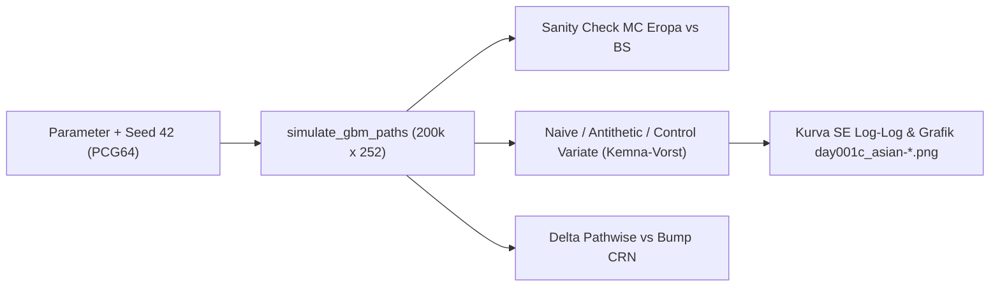

# Penjelasan Proyek — day001c: Opsi Asia — Monte Carlo, Variance Reduction & Greeks (Python)

## 1. Identitas dan Ringkasan Proyek
- **ID Progress**: `day001c` (Hari 1, Sesi c)
- **Tanggal**: 2026-11-19 (WITA) · **Topik No**: `bonus` (off-roadmap) · **Jenis**: `quant` · **Bahasa**: Python
- **Notebook**: [days/day001c_quant_opsi-asia-monte-carlo-variance.ipynb](../../days/day001c_quant_opsi-asia-monte-carlo-variance.ipynb)
- **Ringkasan**: Penilaian *arithmetic Asian call option* ($S_0=100, K=100, r=0.05, \sigma=0.2, T=1, M=252, N=200.000$) dengan Naive MC, Antithetic Variates, Control Variate Kemna–Vorst, dan estimasi Delta (Pathwise vs Bump-and-Revalue CRN).

## 2. Masalah dan Tujuan
Rata-rata aritmetik dari variabel lognormal tidak berdistribusi lognormal sehingga opsi Asia aritmetik (*arithmetic Asian call*) tidak memiliki rumus harga tertutup. Sementara itu, simulasi Monte Carlo naif untuk kontrak bergantung-jalur dengan $M=252$ titik pemantauan harian memiliki standard error sekitar `0.018` pada $N=200.000$ jalur, yang terlalu lebar untuk kebutuhan *pricing* dan *hedging* presisi.

Proyek ini membangun implementasi acuan Python untuk menguji seberapa jauh *antithetic variates* dan *control variate* berbasis opsi Asia geometrik tertutup (Kemna–Vorst 1990) dapat menekan variansi, sekaligus membandingkan estimator sensitivitas Delta *pathwise* terhadap *bump-and-revalue* dengan *Common Random Numbers* (CRN).

## 3. Apa yang Dikerjakan Proyek
Modul `src/qb100/options.py` dan notebook `day001c` mengimplementasikan rumus tertutup Black–Scholes (`10.450583572185565`) dan Kemna–Vorst (`5.565508831349356`), membangkitkan matriks jalur GBM eksak `simulate_gbm_paths`, melakukan *sanity check* MC Eropa vs BS, menghitung tiga estimator harga opsi Asia dan dua estimator Delta, menganalisis konvergensi SE pada $N \in [1.000, 200.000]$, serta menyimpan 2 grafik ke `outputs/figures/`.

## 4. Uraian Kode
- [src/qb100/options.py](../../src/qb100/options.py) — fungsi `bs_call` & `bs_put`: rumus tertutup Black–Scholes Eropa sebagai jangkar validasi simulator GBM.
- [src/qb100/options.py](../../src/qb100/options.py) — fungsi `geometric_asian_call`: rumus tertutup Kemna–Vorst (1990) untuk rata-rata geometrik diskrit $M$ langkah.
- [src/qb100/options.py](../../src/qb100/options.py) — fungsi `simulate_gbm_paths`: membangkitkan jalur log-GBM eksak berukuran `(n_paths, n_steps)` dengan opsi `antithetic=True`.
- [src/qb100/options.py](../../src/qb100/options.py) — fungsi `price_european_mc`, `price_asian_naive`, `price_asian_antithetic`, `price_asian_control_variate`: mengevaluasi harga, SE, CI 95%, VRF, dan koefisien regresi $\hat{\beta}$.
- [src/qb100/options.py](../../src/qb100/options.py) — fungsi `delta_asian_pathwise` & `delta_asian_bump`: menghitung sensitivitas $\partial C/\partial S_0$ via IPA dan beda hingga CRN ($h=1\%$).
- [days/day001c_quant_opsi-asia-monte-carlo-variance.ipynb](../../days/day001c_quant_opsi-asia-monte-carlo-variance.ipynb) — sel 5–8 (perhitungan & tabel konvergensi) dan sel 10–11 (grafik [day001c_asian-estimators-ci.png](../../outputs/figures/day001c_asian-estimators-ci.png) & [day001c_asian-convergence-loglog.png](../../outputs/figures/day001c_asian-convergence-loglog.png)).
- [tests/test_options.py](../../tests/test_options.py) — 5 unit test pytest untuk rumus tertutup, reduksi variansi, dan konsistensi Delta.

## 5. Metode dan Alur Kerja
Parameter standar proyek (digunakan identik lintas 7 bahasa `1c`–`1i`): $S_0 = 100, K = 100, r = 0.05, \sigma = 0.20, T = 1.0, M = 252, N = 200.000, \text{seed} = 42$.
$$\bar{S}_A = \frac{1}{M}\sum_{k=1}^M S_{t_k}, \quad \bar{S}_G = \exp\!\left(\frac{1}{M}\sum_{k=1}^M \ln S_{t_k}\right), \quad X_{\text{CV}} = X - \hat{\beta}(Y - E[Y]).$$

## 6. Output yang Ditargetkan
Target keberhasilan: (1) notebook lulus `scripts/run_all.py`; (2) MC Eropa dalam 3 SE dari BS (`10.450584`); (3) VRF Antithetic > 1.5x dan Control Variate > 500x; (4) Delta pathwise vs bump CRN selisih < 3 SE; (5) slope log-log SE $\approx -0.50$; (6) `tests/test_options.py` lulus.

## 7. Status Pencapaian

| Tujuan / Kriteria | Status | Bukti Spesifik (Artefak & Verifikasi) |
|---|---|---|
| Eksekusi penuh notebook `day001c` | `tercapai` | `python scripts/run_all.py --day 1 --inplace` (sesi pemeliharaan `2026-11-21`): `[OK] days/day001c_quant_opsi-asia-monte-carlo-variance.ipynb (4.1s)` |
| Sanity check MC Eropa vs Black–Scholes (`< 3 SE`) | `tercapai` | Output sel 5: BS = `10.450584`, MC = `10.504703 ± 0.033110` (`z = 1.63 SE < 3`) |
| Estimator Antithetic Variates (`VRF > 1.5x`) | `tercapai` | Output sel 6: Antithetic = `5.791835 ± 0.012451` vs Naive `5.804757 ± 0.017935` (`VRF = 2.08x`) |
| Estimator Control Variate Kemna–Vorst (`VRF > 500x`) | `tercapai` | Output sel 6: CV = `5.782468 ± 0.000495`, `VRF = 1313x`, $\hat{\beta} = 1.035673$, $E[Y] = 5.565509$ |
| Delta Pathwise vs Bump-and-Revalue CRN (`< 3 SE`) | `tercapai` | Output sel 7: Pathwise = `0.589628 ± 0.001179`, Bump = `0.589588 ± 0.001158` (`0.02 SE`) |
| Konvergensi log-log SE (`slope ~ -0.50`) & 2 grafik | `tercapai` | Output sel 8: slope Naive `-0.5087`, Antithetic `-0.5022`, CV `-0.4991`; grafik [day001c_asian-convergence-loglog.png](../../outputs/figures/day001c_asian-convergence-loglog.png) & [day001c_asian-estimators-ci.png](../../outputs/figures/day001c_asian-estimators-ci.png) |
| Unit test `tests/test_options.py` | `tercapai` | `pytest -q` (sesi pemeliharaan `2026-11-21`): 5/5 tes lulus |

## 8. Jika Belum Tercapai atau Belum Diketahui (Fakta vs Hipotesis)
Tidak ada kriteria yang gagal atau belum diketahui. **FAKTA**: Notebook `day001c` dieksekusi ulang pada sesi pemeliharaan `2026-11-21` (`4.1s`), unit test `test_options.py` lulus, dan nama tautan dua gambar yang sebelumnya salah di dokumen (`asian-se-convergence` / `asian-ci-comparison`) telah diperbaiki ke nama aktual di `outputs/figures/` (`day001c_asian-convergence-loglog.png` / `day001c_asian-estimators-ci.png`).

## 9. Landasan Teori (Minimal 10 Poin)
1. **Gerak Brown Geometrik (GBM) Diskretisasi Eksak**: Solusi persamaan diferensial stokastik risiko-netral $dS_t = r S_t dt + \sigma S_t dW_t$ adalah $S_{t_k} = S_{t_{k-1}} \exp((r - \frac{1}{2}\sigma^2)\Delta t + \sigma\sqrt{\Delta t} Z_k)$. Karena solusi lognormal eksak di setiap titik waktu $t_k$, skema ini memiliki **nol bias diskretisasi waktu** tidak peduli seberapa besar $\Delta t = 1/252$. Fungsi `simulate_gbm_paths` di `src/qb100/options.py` membangun matriks harga penuh secara tervektorisasi dengan NumPy.
2. **Penilaian Risiko-Netral (Martingale Pricing)**: Di bawah ukuran probabilitas risiko-netral $\mathbb{Q}$ (dengan rekening pasar uang $B_t = e^{rt}$ sebagai numeraire), harga kini kontrak klaim kontingen $H$ adalah ekspektasi terdiskonto $V_0 = e^{-rT} E^{\mathbb{Q}}[H]$. Ketidakadaan arbitrase menjamin $E^{\mathbb{Q}}[S_T] = S_0 e^{rT}$, yang diverifikasi melalui `price_european_mc` terhadap `bs_call` pada sel 5.
3. **Rumus Black–Scholes Eropa sebagai Anchor**: Untuk call Eropa standar pada maturitas $T$, rumus tertutupnya adalah $C_{\text{BS}} = S_0 \Phi(d_1) - K e^{-rT} \Phi(d_2)$ dengan $d_{1,2} = \frac{\ln(S_0/K) + (r \pm \frac{1}{2}\sigma^2)T}{\sigma\sqrt{T}}$. Pada parameter proyek, nilai eksak 15 digit adalah `10.450583572185565` (`bs_call` di `src/qb100/options.py`), berfungsi sebagai jangkar validasi generator bilangan acak.
4. **Ketaksamaan AM–GM dan Batas Harga Asia**: Untuk himpunan harga positif apa pun, rata-rata aritmetik selalu lebih besar atau sama dengan rata-rata geometrik: $\bar{S}_A = \frac{1}{M}\sum_{k=1}^M S_{t_k} \ge \bar{S}_G = (\prod_{k=1}^M S_{t_k})^{1/M}$. Karena fungsi payoff $x \mapsto (x - K)_+$ monoton tak-menurun, harga call Asia aritmetik (`~5.7825`) secara teoretis selalu lebih tinggi daripada call Asia geometrik (`5.5655`), memberikan batas bawah analitik yang ketat.
5. **Rumus Tertutup Kemna–Vorst (1990) untuk Asia Geometrik Diskrit**: Karena $\ln \bar{S}_G$ adalah kombinasi linear peubah normal, $\bar{S}_G$ berdistribusi lognormal dengan variansi terintegrasi $\sigma_G^2 T$ di mana $\sigma_G = \sigma\sqrt{\frac{(M+1)(2M+1)}{6M^2}}$ dan drift log efektif $\mu_G = (r - \frac{1}{2}\sigma^2)\frac{M+1}{2M} + \frac{1}{2}\sigma_G^2$. Fungsi `geometric_asian_call` di `src/qb100/options.py` menghasilkan nilai anchor `5.565508831349356`.
6. **Antithetic Variates pada Ruang Normal**: Dengan memasangkan realisasi shock $Z$ dan $-Z$ pada setengah jumlah pasangan jalur ($100.000$ pasang), variansi estimator rata-rata menjadi $\frac{1}{2}\mathrm{Var}(X)(1 + \rho(X_+, X_-))$. Karena payoff call meningkat secara monoton terhadap $Z_k$, korelasi $\rho(X_+, X_-) < 0$ memotong variansi sebesar faktor `2.08x` pada `price_asian_antithetic`.
7. **Control Variates dan Koefisien Regresi Optimal**: Diberikan variabel kendali $Y$ dengan ekspektasi diketahui $E[Y]$, estimator tak-bias $X_{\text{CV}} = X - \beta(Y - E[Y])$ mencapai variansi minimum $\mathrm{Var}(X)(1 - \rho_{XY}^2)$ saat $\beta^* = \mathrm{Cov}(X,Y)/\mathrm{Var}(Y)$. Karena $\bar{S}_A$ dan $\bar{S}_G$ sangat berkorelasi pada jalur yang sama ($\rho_{XY} > 0.9996$), `price_asian_control_variate` menekan SE hingga `0.000495` (`VRF = 1313x`).
8. **Pathwise Derivative (Infinitesimal Perturbation Analysis)**: Untuk payoff call yang kontinu Lipschitz dan terdiferensiasi hampir di mana-mana terhadap $S_0$, operator turunan dan ekspektasi dapat dipertukarkan: $\Delta_{\text{PW}} = e^{-rT} E[\mathbf{1}\{\bar{S}_A > K\} \frac{\partial \bar{S}_A}{\partial S_0}]$. Karena setiap titik harga proporsional terhadap $S_0$, $\frac{\partial \bar{S}_A}{\partial S_0} = \frac{\bar{S}_A}{S_0}$, diimplementasikan efisien dalam `delta_asian_pathwise`.
9. **Common Random Numbers (CRN) pada Beda Hingga**: Estimasi Delta via beda hingga pusat $\frac{C(S_0+h) - C(S_0-h)}{2h}$ tanpa sinkronisasi bilangan acak akan menderita variansi $O(h^{-2})$. Dengan memakai matriks $Z$ yang sama pada `delta_asian_bump` (`h = 1%`), variansi selisih menyusut menjadi $O(1)$ sehingga SE (`0.001158`) setara dengan metode pathwise (`0.001179`).
10. **Variance Reduction Factor (VRF)**: Efisiensi relatif dua estimator tak-bias diukur dengan $\text{VRF} = \mathrm{Var}(\hat{\theta}_{\text{naive}})/\mathrm{Var}(\hat{\theta}_{\text{VR}}) = (\text{SE}_{\text{naive}}/\text{SE}_{\text{VR}})^2$. Nilai `VRF = 1313x` berarti estimator Naive MC membutuhkan $1313 \times 200.000 \approx 262$ juta jalur hanya untuk menyamai lebar selang kepercayaan 95% Control Variate.

## 10. Kesimpulan dan Batasan
Proyek `day001c` menetapkan tolok ukur Python untuk penilaian opsi Asia aritmetik dengan reduksi variansi lebih dari tiga orde besaran dan menjadi rujukan validasi silang bagi proyek kembar `day001d`–`day001i`.

## 11. Referensi dan Jejak Bukti
- Kemna, A. G. Z., & Vorst, A. C. F. (1990). *A pricing method for options based on average asset values*. Journal of Banking & Finance, 14(1), 113–129.
- Broadie, M., & Glasserman, P. (1996). *Estimating security price derivatives using simulation*. Management Science, 42(2), 269–285.
- Artefak: [day001c_quant_opsi-asia-monte-carlo-variance.ipynb](../../days/day001c_quant_opsi-asia-monte-carlo-variance.ipynb), [src/qb100/options.py](../../src/qb100/options.py).
