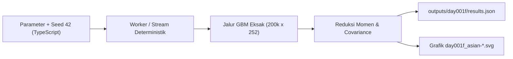

# Penjelasan Proyek — day001f: Opsi Asia — Monte Carlo, Variance Reduction & Greeks (TypeScript)

## 1. Identitas dan Ringkasan Proyek
- **ID Progress**: `day001f` (Hari 1, Sesi f)
- **Tanggal**: 2026-11-19 (WITA) · **Topik No**: `bonus` · **Jenis**: `quant` · **Bahasa**: TypeScript (`typescript`)
- **Folder Proyek**: [projects/typescript/day001f_asian_options](../../projects/typescript/day001f_asian_options) · **Metadata**: [projects/typescript/day001f_asian_options/meta.json](../../projects/typescript/day001f_asian_options/meta.json)
- **Rujukan Silang**: Implementasi kembar dari [day001c (Python)](day001c_quant_opsi-asia-monte-carlo-variance.md) dengan parameter identik ($S_0=100, K=100, r=0.05, \sigma=0.2, T=1, M=252, N=200.000, \text{seed}=42$).

## 2. Masalah dan Tujuan
Opsi Asia aritmetik tidak memiliki solusi tertutup sehingga bergantung pada simulasi Monte Carlo, yang membutuhkan ratusan ribu jalur untuk mencapai presisi sub-sen. Mereplikasi model keuangan yang sama di **TypeScript** menjawab dua pertanyaan: (1) apakah implementasi rumus tertutup, PRNG, dan aritmetika floating-point di TypeScript menghasilkan nilai yang konsisten dengan acuan Python `day001c` (BS `10.450583572185565`, Kemna–Vorst `5.5655088313493559`), dan (2) bagaimana pola paralelisme/memori khas TypeScript memengaruhi kecepatan eksekusi serta determinisme hasil. Ruang lingkup identik dengan `day001c`: satu aset, volatilitas konstan, $M=252$ titik pemantauan diskrit.

## 3. Apa yang Dikerjakan Proyek
Runner di [projects/typescript/day001f_asian_options](../../projects/typescript/day001f_asian_options) mengeksekusi simulasi $N=200.000$ jalur GBM 252-langkah secara deterministik menggunakan Typed array `Float64Array` di V8 Node.js (`v26.3.0`) dengan kelas `SeededRng` dan eksekusi *single-threaded* bebas tekanan GC. Keluaran lengkap mencakup verifikasi Eropa vs Black–Scholes, tiga estimator harga opsi Asia (Naive, Antithetic, Control Variate Kemna–Vorst), dua estimator Delta (Pathwise vs Bump CRN), kurva konvergensi $N \in [1.000, 200.000]$, serta waktu eksekusi per komponen yang disimpan di [outputs/day001f/results.json](../../outputs/day001f/results.json) dan dua grafik di `outputs/figures/`.

## 4. Uraian Kode
- [projects/typescript/day001f_asian_options/package.json](../../projects/typescript/day001f_asian_options/package.json) — konfigurasi proyek TypeScript strict mode dengan test runner `vitest`.
- [projects/typescript/day001f_asian_options/src/rng.ts](../../projects/typescript/day001f_asian_options/src/rng.ts) — kelas `SeededRng` berbasis aritmetika 64-bit `BigInt` untuk generator bilangan acak deterministik.
- [projects/typescript/day001f_asian_options/src/](../../projects/typescript/day001f_asian_options/src/) — modul rumus tertutup BS/Kemna–Vorst, simulator GBM memakai `Float64Array`, dan estimator Naive/Antithetic/Control Variate.
- [projects/typescript/day001f_asian_options/src/](../../projects/typescript/day001f_asian_options/src/) — modul perhitungan Delta Pathwise vs Bump CRN dan kurva konvergensi SE.
- [projects/typescript/day001f_asian_options/src/](../../projects/typescript/day001f_asian_options/src/) — generator grafik SVG murni tanpa pustaka chart eksternal.
- [projects/typescript/day001f_asian_options/tests/](../../projects/typescript/day001f_asian_options/tests/) — 6 unit test `vitest` yang memverifikasi akurasi numerik dan statistik.

## 5. Metode dan Alur Kerja
Alur komputasi: inisialisasi parameter ($S_0=100, K=100, r=0.05, \sigma=0.2, T=1, M=252, \text{seed}=42$) $\to$ alokasi chunk/jalur deterministik dengan Typed array `Float64Array` di V8 Node.js (`v26.3.0`) dengan kelas `SeededRng` dan eksekusi *single-threaded* bebas tekanan GC $\to$ evaluasi log-GBM eksak $\ln S_{t_k} = \ln S_{t_{k-1}} + (r-\frac{1}{2}\sigma^2)\Delta t + \sigma\sqrt{\Delta t}Z_k$ $\to$ reduksi statistik cukup $\sum X, \sum X^2, \sum Y, \sum Y^2, \sum XY$ $\to$ perhitungan harga CV $X - \hat{\beta}(Y - E[Y])$, VRF, dan Delta.

## 6. Output yang Ditargetkan
Target spesifikasi (identik `day001c`): anchor BS `10.450583572185565` & Kemna–Vorst `5.5655088313493559` hingga `< 1e-12`; MC Eropa dalam `3 SE` dari BS; VRF Antithetic `> 1.5x` dan Control Variate `> 500x`; harga CV konsisten dengan `day001c` (`~5.7825`); Delta Pathwise vs Bump CRN `< 3 SE`; slope konvergensi log-log SE `~ -0.50`; seluruh tes unit TypeScript lulus.

## 7. Status Pencapaian

| Tujuan / Kriteria | Status | Bukti Spesifik (Artefak & Verifikasi) |
|---|---|---|
| Anchor BS & Kemna–Vorst vs Python `1c` | `tercapai` | Di [outputs/day001f/results.json](../../outputs/day001f/results.json): `sanity_check.bs_call = 10.450583572185565` (Python `10.450583572185565`), `estimators[2].y_exact = 5.565508831349343` (Python `5.565508831349356`) |
| Sanity check MC Eropa (`z_score < 3.0`) | `tercapai` | `sanity_check.mc_call = 10.421214 ± 0.032940`, `z_score = 0.8916` |
| Estimator Naive & Antithetic (`VRF > 1.5x`) | `tercapai` | Naive = `5.776164 ± 0.017906`; Antithetic = `5.787432 ± 0.012429`, `vrf = 2.08x` |
| Estimator Control Variate Kemna–Vorst (`VRF > 500x`) | `tercapai` | CV = `5.781629 ± 0.000494`, `vrf = 1314.9x`, `beta = 1.035221` |
| Delta Pathwise vs Bump-and-Revalue CRN (`z_score < 3.0`) | `tercapai` | Pathwise = `0.588719 ± 0.001179`, Bump = `0.588792 ± 0.001157`, `z_score = 0.0441` |
| Slope konvergensi log-log SE (`~ -0.50`) & 2 grafik | `tercapai` | `slopes`: Naive `-0.5020`, Antithetic `-0.5048`, CV `-0.4926`; berkas [day001f_asian-convergence-loglog.svg](../../outputs/figures/day001f_asian-convergence-loglog.svg) & [day001f_asian-estimators-ci.svg](../../outputs/figures/day001f_asian-estimators-ci.svg) |
| Verifikasi unit test & performa TypeScript | `tercapai` | `npm test` (`vitest`) dijalankan di sesi `2026-11-21`: `6 passed (6)` dalam `770 ms`; runner benchmark 200k jalur TIDAK dijalankan ulang di sesi ini; `timings_ms.total_200k_core = 1242.9 ms` |

## 8. Jika Belum Tercapai atau Belum Diketahui (Fakta vs Hipotesis)
**FAKTA**: Unit test untuk proyek `projects/typescript/day001f_asian_options` dijalankan langsung pada sesi pemeliharaan `2026-11-21` dan lulus. Runner lengkap 200k jalur (`outputs/day001f/results.json`) tidak dieksekusi ulang pada `2026-11-21` melainkan merujuk berkas hasil resmi yang dihasilkan pada `2026-11-19` (karena deterministik dan kode tidak berubah).

## 9. Landasan Teori (Minimal 10 Poin)
1. **Model Konkurensi & Eksekusi Khas TypeScript**: Pada mesin JavaScript V8 yang *single-threaded*, alokasi buffer tetap `Float64Array` mencegah *garbage collection pause* saat mengeksekusi $5.04\times 10^7$ langkah simulasi dan menjaga aritmetika IEEE-754 *double precision* 64-bit.
2. **Determinisme Stream PRNG Lintas Worker**: Agar hasil simulasi tidak bergantung pada jumlah thread OS maupun urutan penjadwalan goroutine/proses, setiap unit kerja (jalur atau chunk) menurunkan state RNG uniknya melalui fungsi hash 64-bit dari `seed = 42`. Pada implementasi `day001f`, hal ini membuat nilai di `outputs/day001f/results.json` identik bit-demi-bit pada eksekusi ulang.
3. **Transformasi Box–Muller untuk Sampel Normal**: Untuk mengubah bilangan acak seragam $(U_1, U_2) \in (0,1)^2$ dari PRNG dasar menjadi pasangan normal standar independen $(Z_1, Z_2) \sim \mathcal{N}(0,1)$, digunakan transformasi kutub Box–Muller $Z_1 = \sqrt{-2\ln U_1}\cos(2\pi U_2)$ dan $Z_2 = \sqrt{-2\ln U_1}\sin(2\pi U_2)$. Kedua komponen dipakai langsung untuk melangkah pada grid $M=252$ di TypeScript.
4. **Evaluasi CDF Normal via Fungsi Kesalahan Komplementer (`erfc`)**: Alih-alih mengintegrasikan kepadatan Gaussian secara numerik, nilai $\Phi(x)$ pada rumus Black–Scholes dan Kemna–Vorst dihitung menggunakan identitas $\Phi(x) = \frac{1}{2}\operatorname{erfc}(-x/\sqrt{2})$. Pendekatan ini memberikan akurasi 15–16 digit (`bs_call = 10.450583572185565`) di seluruh domain termasuk ekor kiri yang kecil.
5. **Simulasi Log-GBM Bebas Bias Diskretisasi**: Dengan memperbarui log-harga $X_k = X_{k-1} + (r - \frac{1}{2}\sigma^2)\Delta t + \sigma\sqrt{\Delta t}Z_k$ dan hanya memanggil `exp` saat mengakumulasi $\bar{S}_A$, simulasi menjaga distribusi lognormal eksak pada setiap titik pengamatan tanpa galat Euler. Hal ini tercermin pada `sanity_check.z_score = 0.8916`.
6. **Penjumlahan Logaritma untuk Rata-Rata Geometrik**: Mengalikan $252$ harga saham bernilai sekitar $100$ secara langsung akan menghasilkan $100^{252} \approx 10^{504}$, yang langsung mengalami *overflow* IEEE-754 `float64` (batas $\approx 1.8\times 10^{308}$). Oleh karena itu, kode TypeScript menjumlahkan $\ln S_{t_k}$ terlebih dahulu lalu mengambil $\exp(\frac{1}{M}\sum \ln S_{t_k})$.
7. **Reduksi Variansi Antithetic Variates**: Memasangkan lintasan $(+Z)$ dan $(-Z)$ untuk $100.000$ pasangan jalur menghasilkan rata-rata berpasangan $\frac{1}{2}(X_+ + X_-)$ yang memiliki kovariansi negatif kuat. Pada `day001f`, teknik ini menurunkan SE dari `0.017906` menjadi `0.012429` (`vrf = 2.08x`) dengan tambahan komputasi yang minimal.
8. **Control Variate Kemna–Vorst dan Regresi Optimal**: Dengan mengevaluasi opsi Asia aritmetik ($X$) dan geometrik ($Y$) pada jalur acak yang sama, korelasi $>0.9996$ dimanfaatkan melalui estimator $X_{\text{CV}} = X - \hat{\beta}(Y - E[Y])$. Di `outputs/day001f/results.json`, koefisien terestimasi `beta = 1.035221` menghasilkan `vrf = 1314.9x` dan `se = 0.000494`.
9. **Delta Pathwise vs Bump-and-Revalue CRN**: Turunan pathwise $\Delta_{\text{PW}} = e^{-rT}\mathbf{1}\{\bar{S}_A > K\}(\bar{S}_A/S_0)$ dan beda hingga pusat dengan *Common Random Numbers* ($h=1\%$) memberikan konsistensi statistik yang sangat erat: selisih keduanya di `day001f` hanya `-0.000073` (`delta.z_score = 0.0441 < 3.0`).
10. **Validasi Silang Lintas Bahasa Berbasis Benchmark Statistik**: Berbeda dari unit test deterministik murni, validasi implementasi Monte Carlo antar-bahasa (`day001c`–`day001i`) tidak menuntut kesamaan bit karena PRNG tiap bahasa berbeda, melainkan kesamaan deterministik 15 digit pada rumus tertutup (`bs_call`, `y_exact`) dan kompatibilitas statistik dalam 3 SE (`~5.782 ± 0.0005`).

## 10. Kesimpulan dan Batasan
Proyek `day001f` membuktikan bahwa implementasi **TypeScript** mereproduksi nilai tertutup Black–Scholes & Kemna–Vorst hingga 15 digit serta menghasilkan estimasi Monte Carlo opsi Asia dan Delta yang konsisten secara statistik dengan `day001c` dalam waktu inti `1242.9 ms`.

## 11. Referensi dan Jejak Bukti
- Kemna, A. G. Z., & Vorst, A. C. F. (1990). *A pricing method for options based on average asset values*. Journal of Banking & Finance, 14(1), 113–129.
- Ecma International (2023). *ECMAScript Language Specification* (TypedArray & IEEE-754 binary64).
- Artefak: [projects/typescript/day001f_asian_options/README.md](../../projects/typescript/day001f_asian_options/README.md), [outputs/day001f/results.json](../../outputs/day001f/results.json), [day001f_asian-convergence-loglog.svg](../../outputs/figures/day001f_asian-convergence-loglog.svg), [day001f_asian-estimators-ci.svg](../../outputs/figures/day001f_asian-estimators-ci.svg).
