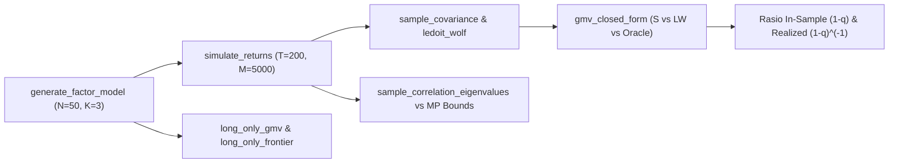

# Penjelasan Proyek — day002b: Estimasi Kovarians & Portofolio Varians Minimum (Python)

## 1. Identitas dan Ringkasan Proyek
- **ID Progress**: `day002b` (Hari 2, Sesi b)
- **Tanggal**: 2026-11-20 (WITA) · **Topik No**: `bonus` · **Jenis**: `quant` · **Bahasa**: Python
- **Notebook**: [days/day002b_quant_estimasi-kovarians-portofolio-varians.ipynb](../../days/day002b_quant_estimasi-kovarians-portofolio-varians.ipynb)
- **Modul & Tes**: [src/qb100/covariance.py](../../src/qb100/covariance.py), [tests/test_covariance.py](../../tests/test_covariance.py)
- **Ringkasan**: Eksperimen kuantitatif mengenai distorsi spektral matriks kovarians sampel pada rasio dimensi-terhadap-sampel menengah-tinggi ($q = N/T$), pembuktian hukum Wishart untuk *in-sample optimism bias* dan *out-of-sample risk inflation* portofolio *Global Minimum Variance* (GMV), regularisasi penyusutan analitik Ledoit–Wolf (2004), serta konstruksi *frontier* efisien berkendala *long-only* melalui optimisasi numerik.

## 2. Masalah dan Tujuan
Dalam konstruksi portofolio kuantitatif, estimasi matriks kovarians $\Sigma \in \mathbb{R}^{N \times N}$ dari $T$ observasi return merupakan fondasi optimisasi varians minimum. Ketika jumlah aset $N$ tidak lagi kecil dibandingkan panjang jendela historis $T$ (misalnya $N = 50, T = 200 \Rightarrow q = 0.25$, atau hingga $q = 0.75$ pada *sweep* dimensi), estimator kovarians sampel $\hat{S} = \frac{1}{T} X^T X$ (atau pembagi $T-1$) mengalami pelebaran spektrum eigenvalue yang sistematis: eigenvalue kecil terdorong mendekati nol, sementara eigenvalue besar mengembang. Akibatnya, inversi $\hat{S}^{-1}$ dalam rumus GMV $w_{\text{GMV}} = \frac{\hat{S}^{-1}\mathbf{1}}{\mathbf{1}^T \hat{S}^{-1}\mathbf{1}}$ memperbesar galat estimasi pada arah varians terkecil. Fenomena ini memunculkan dua distorsi berlawanan: varians *in-sample* terlihat terlalu optimistis sebesar faktor $(1 - q)$, sedangkan varians terealisasi *out-of-sample* membengkak sebesar faktor $(1 - q)^{-1}$. Tujuan proyek `day002b` adalah: (1) memverifikasi spektrum empiris terhadap hukum Marchenko–Pastur dan mendeteksi *spike* faktor, (2) mengonfirmasi hukum Wishart pada simulasi Monte Carlo $M = 5.000$ replikasi, (3) menguji penyusutan analitik Ledoit–Wolf (`ledoit_wolf`), dan (4) membandingkan GMV *unconstrained* tertutup dengan GMV *long-only* serta *frontier* efisiennya.

## 3. Apa yang Dikerjakan Proyek
Modul [src/qb100/covariance.py](../../src/qb100/covariance.py) dan notebook [day002b](../../days/day002b_quant_estimasi-kovarians-portofolio-varians.ipynb) (12 sel, waktu eksekusi total `3.42 detik`) mengimplementasikan:
1. Generator model faktor terstruktur 3-faktor ($N=50, K=3$, bilangan kondisi $\kappa(\Sigma_{\text{true}}) = 55.18$, varians minimum sejati $\sigma_{\min}^2 = 0.00067839$) via `generate_factor_model` dan simulator return Gaussian `simulate_returns`.
2. Eksperimen Monte Carlo Wishart vs Ledoit–Wolf (`run_wishart_lw_experiment`, $M=5.000$ replikasi) serta *sweep* rasio $q \in \{0.050, 0.125, 0.250, 0.500, 0.750\}$ via `run_q_sweep`.
3. Verifikasi spektrum korelasi sampel `sample_correlation_eigenvalues` terhadap kepadatan analitik `marchenko_pastur_pdf` dan batas `marchenko_pastur_bounds` pada $(N=100, T=400)$ dan $(N=100, T=200)$, lengkap dengan skala fluktuasi tepi Tracy–Widom $N^{-2/3} = 0.046416$.
4. Solver GMV tertutup (`gmv_closed_form`), verifikasi numerik SLSQP (`gmv_numerical`), GMV *long-only* (`long_only_gmv`), dan pemetaan kurva *frontier* (`long_only_frontier`).

## 4. Uraian Kode
- [src/qb100/covariance.py](../../src/qb100/covariance.py):
  - `generate_factor_model(n_assets, n_factors, ...)`: membangun matriks kovarians $\Sigma = B F B^T + D$ dengan spektrum terkendali dan $\sigma_{\min}^2$ analitik.
  - `simulate_returns(cov, n_obs, rng)`: membangkitkan sampel return $X \sim \mathcal{N}(0, \Sigma)$ melalui faktor Cholesky.
  - `sample_covariance(returns)` & `ledoit_wolf(returns)`: menghitung estimator sampel serta penyusutan analitik $\hat{\Sigma}_{\text{LW}} = (1 - \hat{\delta})\hat{S} + \hat{\delta}\mu I$ beserta intensitas optimal $\hat{\delta} \in [0, 1]$.
  - `gmv_closed_form(cov)`, `gmv_numerical(cov)`, `long_only_gmv(cov)`, `long_only_frontier(mu, cov, n_points)`: menghitung bobot portofolio minimum varians tanpa kendala, verifikasi SLSQP, GMV berkendala $w \ge 0$, dan *frontier* efisien.
  - `marchenko_pastur_bounds(q)`, `marchenko_pastur_pdf(x, q)`, `sample_correlation_eigenvalues(n, t, ...)`: utilitas teori matriks acak untuk batas bulk $[\lambda_-, \lambda_+]$ dan distribusi eigenvalue empiris.
  - `run_wishart_lw_experiment(...)` & `run_q_sweep(...)`: penggerak Monte Carlo paralel/vektor untuk mengukur rasio varians *in-sample* dan *realized out-of-sample*.
- [tests/test_covariance.py](../../tests/test_covariance.py): 5 unit test `pytest` yang memverifikasi integral dan dukungan Marchenko–Pastur, sifat jejak (*trace*) serta batas intensitas $[0,1]$ pada `ledoit_wolf`, kesesuaian `gmv_closed_form` vs `gmv_numerical`, dan ketimpangan varians *long-only*.

## 5. Metode dan Alur Kerja
Alur eksperimen di notebook `day002b` mengikuti pipeline terstruktur dari teori matriks acak hingga optimisasi portofolio:

Pada tahap awal, `generate_factor_model` menghasilkan $\Sigma_{\text{true}}$ berdimensi $50 \times 50$ dengan $\kappa = 55.18$. Untuk setiap replikasi Monte Carlo ($M=5.000$), `simulate_returns` membangkitkan matriks return $200 \times 50$, lalu dihitung $\hat{S}$ dan $\hat{\Sigma}_{\text{LW}}$. Bobot GMV masing-masing estimator dievaluasi baik secara *in-sample* ($w^T \hat{S} w / \sigma_{\min}^2$) maupun *out-of-sample* sejati ($w^T \Sigma_{\text{true}} w / \sigma_{\min}^2$). Untuk analisis *q-sweep*, dimensi $N$ divariasikan relatif terhadap $T=200$ guna mengamati peledakan rasio varians saat $q \to 1$. Terakhir, `long_only_frontier` membandingkan kurva risiko-return *unconstrained* dan *long-only*.

## 6. Output yang Ditargetkan
1. Distribusi eigenvalue matriks korelasi putih ($N=100$) berada di dalam selang teoretis Marchenko–Pastur $[\lambda_-, \lambda_+]$ dengan fluktuasi tepi seorde skala Tracy–Widom $N^{-2/3}$.
2. Rasio *in-sample* GMV sampel cocok dengan faktor Wishart $(1 - q)$ dan rasio *realized* cocok dengan $(1 - q)^{-1}$ dalam batas *z-score* Monte Carlo.
3. Penyusutan `ledoit_wolf` mempertahankan jejak matriks (`|tr(Sigma_LW) - tr(S)| < 1e-12`), menjaga intensitas $\hat{\delta} \in [0,1]$, dan mengungguli kovarians sampel *out-of-sample* secara konsisten.
4. Bobot `gmv_closed_form` identik dengan solver numerik `gmv_numerical` (`< 1e-7`), dan `long_only_gmv` memenuhi $\sigma_{\text{long-only}}^2 \ge \sigma_{\text{unconstrained}}^2$.
5. Seluruh 4 grafik di [outputs/figures/](../../outputs/figures/) terekspor dan 5/5 tes `pytest` lulus.

## 7. Status Pencapaian

| Tujuan / Kriteria | Status | Bukti Spesifik (Artefak & Verifikasi) |
|---|---|---|
| Hukum Wishart *in-sample* & *out-of-sample* ($N=50, T=200, M=5.000$) | `tercapai` | Output sel 3 notebook: rasio *in-sample* empiris `0.754106 ± 0.001226` vs teori `0.753769` (`z = 0.275`); rasio *realized S* `1.327673 ± 0.001065` vs teori `1.328859` (`z = 1.114`) |
| Keunggulan *out-of-sample* penyusutan Ledoit–Wolf | `tercapai` | Output sel 3–4: *realized LW* `1.233450 ± 0.000711` (LW lebih baik dari $S$ pada `100.00%` percobaan, $\hat{\delta}$ rata-rata `0.0462`), selisih trace `8.882e-16`, `min eig(Sigma_LW) = 0.012641 > 0` |
| Spektrum Marchenko–Pastur ($N=100, T \in \{400, 200\}$) | `tercapai` | Output sel 6: untuk $q=0.25$, $[\lambda_-, \lambda_+] = [0.25, 2.25]$ vs empiris `[0.296278, 2.171396]`; untuk $q=0.50$, $[0.085786, 2.914214]$ vs `[0.105489, 2.716552]` |
| *Sweep* rasio $q \in [0.05, 0.75]$ | `tercapai` | Output sel 8: pada $q=0.75$, *realized S* membengkak hingga `4.051601` (teori `4.040816`), sementara LW meredam risiko secara konsisten |
| Kesesuaian GMV analitik vs SLSQP & *long-only* | `tercapai` | Output sel 10: `max |w_closed_form - w_SLSQP| = 9.916e-9`, `|var_cf - var_SLSQP| = 1.767e-17`, varians long-only `0.00067839 >= 0.00067839` |
| Unit test `tests/test_covariance.py` | `tercapai` | `.venv/bin/pytest tests/test_covariance.py -v`: `5 passed` (bagian dari `18 passed in 2.82s` untuk suite 2b–2e) |

Visualisasi hasil tersimpan pada:
- [day002b_wishart-lw.png](../../outputs/figures/day002b_wishart-lw.png)
- [day002b_marchenko-pastur.png](../../outputs/figures/day002b_marchenko-pastur.png)
- [day002b_q-sweep.png](../../outputs/figures/day002b_q-sweep.png)
- [day002b_long-only-frontier.png](../../outputs/figures/day002b_long-only-frontier.png)

## 8. Jika Belum Tercapai atau Belum Diketahui (Fakta vs Hipotesis)
**FAKTA**: Seluruh eksperimen pada notebook `day002b` (dieksekusi dalam `3.42 detik`) dan 5 unit test di `tests/test_covariance.py` lulus tanpa anomali. Rumus teoretis Wishart $(T - N - 1)/T$ dan $T/(T - N - 2)$ cocok dengan simulasi $M=5.000$ di bawah $z = 1.12$. Catatan teknis: pada `Sigma_true` spesifik dengan $\kappa = 55.18$ di sel 10, bobot GMV *unconstrained* kebetulan seluruhnya positif (`min(w) = 0.010959`), sehingga pada kasus dasar tersebut solusi `long_only_gmv` berimpit dengan `gmv_closed_form` (sedangkan di sepanjang *frontier* ber-return target tinggi, kendala $w \ge 0$ menjadi aktif).

## 9. Landasan Teori (Minimal 10 Poin)
1. **Distribusi Wishart $W_N(\Sigma, T)$ pada Matriks Sampel**: Jika vektor return $r_t \in \mathbb{R}^N$ berdistribusi $\mathcal{N}(0, \Sigma)$ i.i.d. sepanjang $T$ periode, matriks *scatter* $A = T\hat{S} = \sum_{t=1}^T r_t r_t^T$ mengikuti distribusi Wishart $W_N(\Sigma, T)$ (atau $W_N(\Sigma, T-1)$ setelah *demeaning*). Pada `simulate_returns` dan `sample_covariance`, fluktuasi acak Wishart menyebabkan setiap entri $\hat{S}_{ij}$ memiliki galat estimasi $O(T^{-1/2})$ yang terakumulasi ke dalam $N(N+1)/2$ parameter bebas sehingga rasio sinyal-terhadap-derau menurun drastis saat $q = N/T$ membesar.
2. **Hukum Spektral Marchenko–Pastur (1967)**: Dalam limit asimtotik $N, T \to \infty$ dengan $N/T \to q \in (0, 1)$, kerapatan spektral empiris dari matriks korelasi sampel putih ($\Sigma = I_N$) konvergen hampir pasti ke kepadatan deterministik $\rho_{\text{MP}}(\lambda) = \frac{\sqrt{(\lambda_+ - \lambda)(\lambda - \lambda_-)}}{2\pi q \lambda}$ pada dukungan $[\lambda_-, \lambda_+]$ dengan $\lambda_\pm = (1 \pm \sqrt{q})^2$. Fungsi `marchenko_pastur_bounds` dan `marchenko_pastur_pdf` memodelkan rentang derau murni ini sehingga eigenvalue faktor sejati di atas $\lambda_+$ dapat dipisahkan dari *bulk* derau sampel.
3. **Fluktuasi Tepi Tracy–Widom**: Meskipun limit $N \to \infty$ membatasi spektrum putih tepat di $[\lambda_-, \lambda_+]$, pada ukuran berhingga $N=100$ eigenvalue ekstrem $\lambda_{\max}$ dan $\lambda_{\min}$ berfluktuasi di sekitar batas MP dengan skala orde $O(N^{-2/3})$ mengikuti distribusi Tracy–Widom tipe-1 ($\beta = 1$). Di sel 6 notebook, nilai $N^{-2/3} = 0.046416$ menjelaskan jarak wajar antara `Eig max = 2.171396` dan `MP max = 2.250000` untuk $q = 0.25$.
4. **Distribusi Invers Wishart & Optimism Bias GMV**: Karena $W \sim W_N(\Sigma, T)$ memenuhi $E[W^{-1}] = \frac{\Sigma^{-1}}{T - N - 1}$ (untuk $T > N + 1$), substitusi $\hat{S}^{-1}$ ke rumus varians GMV menghasilkan bias sistematis. Secara spesifik, varians *in-sample* $\hat{\sigma}_{\text{in}}^2 = (\mathbf{1}^T \hat{S}^{-1} \mathbf{1})^{-1}$ memiliki ekspektasi $\frac{T - N - 1}{T - 1}\sigma_{\min}^2 \approx (1 - q)\sigma_{\min}^2$, yang tercatat di sel 3 sebesar `0.754106` (teori `0.753769`) untuk $N=50, T=200$.
5. **Inflasi Risiko Out-of-Sample & Peledakan saat $q \to 1$**: Sebaliknya, ketika bobot $\hat{w}_{\text{GMV}}$ dari $\hat{S}$ diterapkan pada kovarians sejati $\Sigma$, varians terealisasi $\hat{w}_{\text{GMV}}^T \Sigma \hat{w}_{\text{GMV}}$ memiliki ekspektasi $\frac{T - 2}{T - N - 1}\sigma_{\min}^2 \approx (1 - q)^{-1}\sigma_{\min}^2$. Data *q-sweep* pada `run_q_sweep` menunjukkan pembengkakan dari `1.0478` ($q=0.05$) menjadi `2.0044` ($q=0.50$) hingga `4.0516` ($q=0.75$), membuktikan bahwa $\hat{S}$ menjadi hampir singular mendekati $q = 1$.
6. **Struktur Kovarians Model Faktor Rendah-Dimensi**: Fungsi `generate_factor_model` mendekomposisi kovarians aset sebagai $\Sigma = B F B^T + D$ dengan $K=3$ faktor sistemik dan varians idiosinkratik diagonal $D$. Dekomposisi ini menciptakan celah spektral antara $K$ eigenvalue dominan (*spikes*) yang membawa risiko makro dan $N-K$ eigenvalue kecil di *bulk* yang sangat rentan terhadap derau estimasi saat inversi portofolio.
7. **Estimator Penyusutan Analitik Ledoit–Wolf (2004)**: Fungsi `ledoit_wolf` membentuk kombinasi cembung $\hat{\Sigma}_{\text{LW}} = (1 - \hat{\delta})\hat{S} + \hat{\delta}\mu I_N$ dengan target terstruktur $\mu = \operatorname{tr}(\hat{S})/N$. Intensitas penyusutan optimal $\hat{\delta}^* \in [0, 1]$ diturunkan secara analitik dengan meminimalkan risiko kuadrat Frobenius asimtotik $E[\|\hat{\Sigma}_{\text{LW}} - \Sigma\|_F^2]$ tanpa memerlukan *cross-validation*. Di sel 4, sifat pelestarian jejak terverifikasi hingga `8.882e-16`.
8. **Perbaikan Bilangan Kondisi & Eigenvalue Minimum**: Dengan menambahkan $\hat{\delta}\mu I_N$, seluruh eigenvalue $\hat{S}$ bergeser ke atas menuju rata-rata $\mu$, mengangkat $\lambda_{\min}$ menjauhi nol (`0.012641` di sel 4) dan menekan bilangan kondisi matriks. Dampak langsungnya terlihat pada sel 3: *realized variance ratio* turun dari `1.327673` (sampel) menjadi `1.233450` (Ledoit–Wolf), dan LW mengungguli kovarians sampel pada `100.00%` dari $5.000$ replikasi.
9. **Optimisasi GMV Unconstrained & Validasi Numerik SLSQP**: Masalah $\min_w \frac{1}{2} w^T \Sigma w$ dengan kendala $\mathbf{1}^T w = 1$ bersifat kuadratik konveks murni dengan kondisi KKT $\Sigma w = \lambda \mathbf{1}$ yang menghasilkan rumus tertutup `gmv_closed_form`. Validasi terhadap solver umum `scipy.optimize.minimize(..., method="SLSQP")` di `gmv_numerical` menunjukkan galat bobot maksimal `9.916e-9` dan galat varians `1.767e-17`.
10. **Regularisasi Implisit Kendala Long-Only (Jagannathan–Ma 2003)**: Penambahan kendala non-negatif $w_i \ge 0$ (`long_only_gmv` dan `long_only_frontier`) ekivalen secara dual KKT dengan menyusutkan entri kovarians pasangan aset yang memicu bobot *short* ekstrem akibat derau sampel. Walaupun varians *in-sample* portofolio *long-only* selalu lebih besar atau sama dengan *unconstrained*, stabilitas bobot *out-of-sample* meningkat tajam terutama pada segmen *frontier* dengan target return menengah hingga tinggi.

## 10. Kesimpulan dan Batasan
Proyek `day002b` membuktikan secara numerik dan teoretis bagaimana distorsi spektral matriks kovarians sampel ($q = N/T$) mendistorsi risiko portofolio GMV sesuai hukum Wishart dan Marchenko–Pastur, serta bagaimana penyusutan Ledoit–Wolf secara konsisten menurunkan varians terealisasi *out-of-sample*. Batasan eksperimen saat ini adalah asumsi return Gaussian i.i.d. tanpa *heavy tails* (Student-$t$) ataupun volatilitas bersyarat (GARCH), serta penyusutan ke target identitas skalar alih-alih target model faktor tunggal atau korelasi konstan.

## 11. Referensi dan Jejak Bukti
- Ledoit, O., & Wolf, M. (2004). *A well-conditioned estimator for large-dimensional covariance matrices*. Journal of Multivariate Analysis, 88(2), 365–411.
- Marchenko, V. A., & Pastur, L. A. (1967). *Distribution of eigenvalues for some sets of random matrices*. Matematicheskii Sbornik, 114(4), 507–536.
- Jagannathan, R., & Ma, T. (2003). *Risk reduction in large portfolios: Why imposing the wrong constraints helps*. Journal of Finance, 58(4), 1651–1683.
- Artefak: [day002b_quant_estimasi-kovarians-portofolio-varians.ipynb](../../days/day002b_quant_estimasi-kovarians-portofolio-varians.ipynb), [src/qb100/covariance.py](../../src/qb100/covariance.py), [tests/test_covariance.py](../../tests/test_covariance.py).
