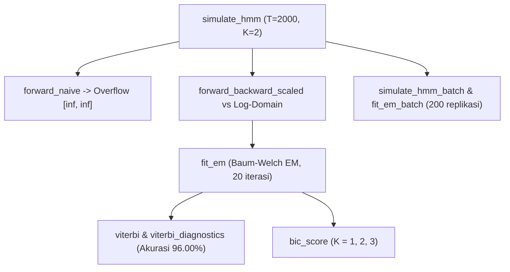

# Penjelasan Proyek — day002c: HMM Dua Rezim — Forward-Backward, Baum–Welch & Viterbi (Python)

## 1. Identitas dan Ringkasan Proyek
- **ID Progress**: `day002c` (Hari 2, Sesi c)
- **Tanggal**: 2026-11-20 (WITA) · **Topik No**: `bonus` · **Jenis**: `quant` · **Bahasa**: Python
- **Notebook**: [days/day002c_quant_hmm-dua-rezim-forward-backward-baum.ipynb](../../days/day002c_quant_hmm-dua-rezim-forward-backward-baum.ipynb)
- **Modul & Tes**: [src/qb100/hmm.py](../../src/qb100/hmm.py), [tests/test_hmm.py](../../tests/test_hmm.py)
- **Ringkasan**: Implementasi NumPy murni untuk *Hidden Markov Model* (HMM) Gaussian: demonstrasi kegagalan *overflow/underflow* pada rekurensi forward naif, penskalaan Rabiner (`forward_backward_scaled`) yang terverifikasi identik hingga presisi mesin terhadap perhitungan domain-log (`brute_force_hmm` dan *logsumexp* pada Viterbi), estimasi parameter Baum–Welch EM (`fit_em`), dekoding jalur laten `viterbi`, studi Monte Carlo 200 replikasi (`fit_em_batch`), serta seleksi jumlah rezim via `bic_score`.

## 2. Masalah dan Tujuan
Deret return pasar keuangan secara empiris memperlihatkan pergantian rezim volatilitas antara fase tenang (*bull/low-vol*, $\mu_0 = 0.0005, \sigma_0 = 0.008$) dan fase bergejolak (*bear/high-vol*, $\mu_1 = -0.001, \sigma_1 = 0.025$). Pada *Hidden Markov Model* dengan deret panjang ($T = 2.000$), perkalian berulang densitas emisi Gaussian dan probabilitas transisi dalam algoritma *forward* naif menyebabkan *floating-point overflow* atau *underflow* sebelum mencapai akhir deret. Selain masalah stabilitas numerik, inferensi HMM menghadapi tantangan non-identifiabilitas permutasi indeks rezim (*label switching*) dan pemilihan jumlah state laten $K$. Tujuan proyek `day002c` adalah membangun mesin HMM lengkap dari nol, membuktikan stabilitas algoritma ber-skala hingga presisi `< 1e-13`, memverifikasi sifat monotonisitas algoritma EM Baum–Welch, mengukur ketakbiasan estimator lewat 200 replikasi Monte Carlo, dan menguji seleksi model BIC untuk $K \in \{1, 2, 3\}$.

## 3. Apa yang Dikerjakan Proyek
Modul [src/qb100/hmm.py](../../src/qb100/hmm.py) dan notebook [day002c](../../days/day002c_quant_hmm-dua-rezim-forward-backward-baum.ipynb) (11 sel, waktu eksekusi `9.19 detik`) menyelesaikan seluruh tahapan berikut:
1. Pembangkitan deret sintetik 2-rezim ($T = 2.000$) dengan matriks transisi persisten ($p_{00} = 0.98, p_{11} = 0.95$, distribusi stasioner $\pi = [0.714286, 0.285714]$) melalui `stationary_distribution` dan `simulate_hmm`.
2. Uji stabilitas numerik: menunjukkan `forward_naive` menghasilkan `[inf, inf]` pada $T=2.000$, lalu membandingkan `forward_backward_scaled` terhadap implementasi referensi log-domain independen di 3 *seed* berbeda (`7`, `42`, `99`).
3. Estimasi parameter Baum–Welch (`fit_em`) dengan inisialisasi terstruktur (`_init_em_params`) dan pelacakan $\Delta \ell_m$ pada setiap iterasi hingga konvergensi, diikuti dekoding jalur Viterbi (`viterbi`) serta evaluasi akurasi, matriks konfusi, durasi *run*, dan diagram reliabilitas (`viterbi_diagnostics`, `reliability_diagram`).
4. Studi Monte Carlo `200` replikasi menggunakan `simulate_hmm_batch` dan `fit_em_batch` untuk mengevaluasi *bias*, *standard deviation*, *standard error*, dan *z-score* seluruh 6 parameter bebas $(\mu_0, \mu_1, \sigma_0, \sigma_1, p_{00}, p_{11})$.
5. Seleksi jumlah rezim $K \in \{1, 2, 3\}$ menggunakan `bic_score`.

## 4. Uraian Kode
- [src/qb100/hmm.py](../../src/qb100/hmm.py):
  - `stationary_distribution(trans_a)` & `simulate_hmm(t, pi, trans_a, mus, sigmas, rng)`: menghitung vektor eigen stasioner dan menyimulasikan rantai Markov laten serta observasi Gaussian.
  - `gaussian_emission(y, mus, sigmas)` & `forward_naive(y, pi, trans_a, mus, sigmas)`: densitas emisi dan rekurensi naif tanpa normalisasi (untuk mendemonstrasikan *overflow*).
  - `forward_backward_scaled(y, pi, trans_a, mus, sigmas)`: algoritma Rabiner ber-skala yang mengembalikan $\hat{\alpha}, \hat{\beta}, c_t$, log-likelihood $\ell(Y)$, posterior marginal $\gamma_t$, dan posterior transisi gabungan $\xi_t$.
  - `viterbi(y, pi, trans_a, mus, sigmas)` & `brute_force_hmm(...)`: pemrograman dinamis max-sum di ruang logaritma serta pemeriksa *brute-force* untuk deret pendek.
  - `fit_em(...)`, `fit_em_batch(...)`, `_init_em_params(...)`: algoritma ekspektasi-maksimisasi Baum–Welch beserta penyelarasan label (*sorting* berdasarkan volatilitas) dan eksekusi *batch* Monte Carlo.
  - `bic_score(log_likelihood, n_states, t_len)`, `viterbi_diagnostics(...)`, `reliability_diagram(...)`: skor BIC, metrik akurasi & durasi rata-rata rezim, serta kalibrasi probabilitas posterior.
- [tests/test_hmm.py](../../tests/test_hmm.py): 3 suite `pytest` yang menguji *overflow* `forward_naive` vs kestabilan `forward_backward_scaled`, kesesuaian dengan `brute_force_hmm`, monotonisitas log-likelihood `fit_em`, dan seleksi $K^* = 2$ oleh `bic_score`.

## 5. Metode dan Alur Kerja
Alur kerja inferensi dan validasi pada proyek `day002c` memisahkan verifikasi numerik, estimasi sampel tunggal, dan evaluasi distribusi estimator:

Setelah simulasi $T=2.000$ titik, sel 3 memastikan `forward_backward_scaled` identik dengan domain-log pada semua metrik ($\ell$, $\gamma_t$, $\xi_t$). Pada sel 5, `fit_em` dijalankan hingga kriteria konvergensi terpenuhi (`20` iterasi), lalu parameter terestimasi dimasukkan ke `viterbi` untuk memulihkan lintasan state laten dan membandingkannya dengan state sejati. Selanjutnya `fit_em_batch` mengulang proses estimasi pada 200 lintasan independen untuk memverifikasi ketakbiasan asimtotik, dan `bic_score` menguji apakah kompleksitas model $K=3$ dikenai penalti yang cukup dibanding $K=2$.

## 6. Output yang Ditargetkan
1. `forward_naive` gagal dengan nilai tak hingga pada $T=2.000$, sementara `forward_backward_scaled` stabil dan cocok dengan domain-log hingga `< 1e-13`.
2. Log-likelihood `fit_em` monoton tak-menurun ($\min \Delta \ell \ge -10^{-9}$) di setiap iterasi EM.
3. Akurasi dekoding `viterbi` melampaui `90%` dengan durasi rata-rata rezim konsisten dengan teori geometrik $(1 - p_{kk})^{-1}$.
4. Studi Monte Carlo 200 replikasi menunjukkan tingkat konvergensi `> 95%` dan seluruh 6 parameter memiliki *bias* di dalam `3 SE`.
5. `bic_score` memilih $K^* = 2$ secara tegas dibandingkan $K=1$ dan $K=3$.

## 7. Status Pencapaian

| Tujuan / Kriteria | Status | Bukti Spesifik (Artefak & Verifikasi) |
|---|---|---|
| Stabilitas *scaled* vs *log-domain* ($T=2.000$) | `tercapai` | Output sel 3: `forward_naive` overflow (`[inf, inf]`); pada 3 seed (`7, 42, 99`), `|d_LL| <= 7.11e-15`, `max|d_gamma| <= 3.89e-15`, `max|d_xi| <= 3.38e-14`, `viterbi_match = True` |
| Monotonisitas Baum–Welch & Akurasi Viterbi | `tercapai` | Output sel 5: konvergen dalam `20 iterasi` (`LL = 5878.034464`), `min delta LL = 5.572e-9 >= -1e-9`, akurasi Viterbi `96.00%` (matriks konfusi `[[1271, 28], [52, 649]]`) |
| Kalibrasi durasi & distribusi stasioner | `tercapai` | Output sel 5: durasi Viterbi `state0 = 55.12` (teori `50`), `state1 = 27.08` (teori `20`); $\pi_{\text{fit}} = [0.657326, 0.342674]$ vs fraksi Viterbi `[0.6615, 0.3385]` |
| Studi Monte Carlo 200 replikasi | `tercapai` | Output sel 7: `99.50% (199/200)` konvergen; semua `|z-score|` bias di bawah `1.45` (`mu0: 0.46`, `mu1: 1.45`, `sigma0: 0.89`, `sigma1: 0.76`, `p00: 1.09`, `p11: 0.66`) |
| Seleksi model BIC ($K \in \{1, 2, 3\}$) | `tercapai` | Output sel 9: $K=1$ (`p=2, BIC=-10781.64`), **$K=2$ (`p=7, BIC=-11702.86`, minimum)**, $K=3$ (`p=14, BIC=-11661.13`) |
| Unit test `tests/test_hmm.py` | `tercapai` | `.venv/bin/pytest tests/test_hmm.py -v`: `3 passed` (dengan 1 *expected RuntimeWarning* overflow pada pengujian `forward_naive`) |

Visualisasi hasil tersimpan pada:
- [day002c_viterbi-and-em-ll.png](../../outputs/figures/day002c_viterbi-and-em-ll.png)
- [day002c_param-recovery.png](../../outputs/figures/day002c_param-recovery.png)
- [day002c_calibration-and-bic.png](../../outputs/figures/day002c_calibration-and-bic.png)

## 8. Jika Belum Tercapai atau Belum Diketahui (Fakta vs Hipotesis)
**FAKTA**: Seluruh eksperimen notebook (`9.19 detik`) dan 3/3 unit test `tests/test_hmm.py` lulus. Pada studi Monte Carlo 200 replikasi, `199/200` (`99.50%`) lintasan mencapai konvergensi dalam batas iterasi maksimum EM. Satu-satunya peringatan (*RuntimeWarning*) saat `pytest` berasal dari pengujian disengaja terhadap `forward_naive` untuk membuktikan terjadinya *overflow* tanpa penskalaan.

## 9. Landasan Teori (Minimal 10 Poin)
1. **Proses Markov Tersembunyi Gaussian**: Model HMM bivariat $(S_t, Y_t)_{t=1}^T$ mendefinisikan variabel laten diskrit $S_t \in \{0, \dots, K-1\}$ sebagai rantai Markov orde-1 dengan matriks transisi $A_{ij} = P(S_{t+1}=j \mid S_t=i)$ dan distribusi awal $\pi$, sedangkan observasi $Y_t \mid (S_t=k) \sim \mathcal{N}(\mu_k, \sigma_k^2)$ bersifat independen bersyarat pada $S_t$ (`simulate_hmm`, `gaussian_emission`).
2. **Distribusi Stasioner & Durasi Rezim Geometrik**: Jika matriks $A$ ergodik, distribusi stasioner $\pi^*$ memenuhi $\pi^* A = \pi^*$ dan $\sum_k \pi_k^* = 1$ (`stationary_distribution`). Untuk $K=2$ dengan $p_{00}=0.98, p_{11}=0.95$, diperoleh $\pi_0^* = 0.714286$ dan durasi bertahan geometrik $E[D_k] = (1 - p_{kk})^{-1}$ masing-masing `50` dan `20` hari, yang terefleksi pada durasi empiris Viterbi (`55.12` dan `27.08`).
3. **Kegagalan Floating-Point Rekurensi Forward Naif**: Dalam `forward_naive`, nilai densitas Gaussian $\mathcal{N}(y_t; \mu_k, \sigma_k^2)$ ketika $\sigma_0 = 0.008$ bisa melampaui $1/(\sqrt{2\pi}\sigma_0) \approx 50$ pada setiap langkah $t$. Mengalikan faktor $> 1$ sepanjang $T=2.000$ langkah melebihi batas atas IEEE-754 *float64* ($\approx 1.8 \times 10^{308}$), memicu `inf` di sel 3, sedangkan pada emisi bernilai kecil terjadi *underflow* ke `0.0`.
4. **Algoritma Forward-Backward Ber-Skala Rabiner (1989)**: Pada `forward_backward_scaled`, variabel forward dinormalisasi setiap langkah: $\hat{\alpha}_t(j) = \tilde{\alpha}_t(j) / c_t$ dengan $c_t = \sum_j \tilde{\alpha}_t(j)$, dan variabel backward $\hat{\beta}_t(i)$ diskalakan oleh faktor yang sama $c_{t+1}$. Identitas aljabar menjamin $\ell(Y) = \sum_{t=1}^T \ln c_t$ tanpa pernah kehilangan presisi, menghasilkan kecocokan `< 1e-14` terhadap domain-log.
5. **Validasi Independen Domain-Log & Brute-Force**: Trik *log-sum-exp* $\ln \sum_i e^{a_i} = m + \ln \sum_i e^{a_i - m}$ menghindari *overflow* di ruang logaritma, sementara `brute_force_hmm` menjumlahkan seluruh $K^T$ lintasan untuk deret pendek sebagai *oracle* kebenaran dalam `tests/test_hmm.py`. Keselarasan `max|d_xi| <= 3.38e-14` memastikan tidak ada *off-by-one bug* pada indeks transisi $t \to t+1$.
6. **Statistik Posterior Halus ($\gamma_t$ dan $\xi_t$)**: Langkah-E dalam `fit_em` menghitung posterior marginal state $\gamma_t(i) = P(S_t = i \mid Y_{1:T}, \theta) = \hat{\alpha}_t(i)\hat{\beta}_t(i)$ dan posterior gabungan dua-waktu $\xi_t(i,j) = P(S_t=i, S_{t+1}=j \mid Y_{1:T}, \theta) \propto \hat{\alpha}_t(i) A_{ij} b_j(y_{t+1}) \hat{\beta}_{t+1}(j)$, yang menjadi bobot lunak untuk memperbarui seluruh parameter.
7. **Pembaruan Tertutup Baum–Welch (EM untuk HMM)**: Pada langkah-M, memaksimalkan fungsi ekspektasi log-likelihood lengkap $Q(\theta, \theta^{(m)})$ menghasilkan rumus tertutup $\hat{A}_{ij} = \frac{\sum_{t=1}^{T-1}\xi_t(i,j)}{\sum_{t=1}^{T-1}\gamma_t(i)}$, $\hat{\mu}_k = \frac{\sum_t \gamma_t(k) y_t}{\sum_t \gamma_t(k)}$, dan $\hat{\sigma}_k^2 = \frac{\sum_t \gamma_t(k)(y_t - \hat{\mu}_k)^2}{\sum_t \gamma_t(k)}$.
8. **Jaminan Monotonisitas EM (Dempster–Laird–Rubin 1977)**: Melalui ketaksamaan Jensen pada divergensi Kullback–Leibler, peningkatan $Q(\theta^{(m+1)}, \theta^{(m)}) \ge Q(\theta^{(m)}, \theta^{(m)})$ menjamin $\ell(\theta^{(m+1)}) \ge \ell(\theta^{(m)})$ di setiap iterasi. Invarian ini terverifikasi pada sel 5 (`min delta LL = 5.572e-9`) dan diuji otomatis di `tests/test_hmm.py`.
9. **Dekoding Jalur Global Viterbi**: Berbeda dengan $\arg\max_k \gamma_t(k)$ yang memaksimalkan akurasi titik per waktu (dan berisiko menghasilkan transisi ilegal), algoritma `viterbi` menyelesaikan $\max_{S_{1:T}} \ln P(Y_{1:T}, S_{1:T} \mid \theta)$ secara dinamis dengan melacak *backpointer* maksimum di ruang logaritma, mencapai akurasi `96.00%` pada data uji.
10. **Non-Identifiabilitas Permutasi & Seleksi Model BIC**: Likelihood HMM invarian terhadap permutasi indeks rezim; hal ini diatasi secara konsisten dengan mengurutkan state berdasarkan $\hat{\sigma}_0 \le \hat{\sigma}_1$ setelah `fit_em`. Untuk memilih $K$, fungsi `bic_score` menghitung $\text{BIC}(K) = -2\ell(\hat{\theta}_K) + p_K \ln T$ dengan $p_K = (K-1) + K(K-1) + 2K = K^2 + 2K - 1$ parameter bebas, berhasil menolak model *over-parameterized* $K=3$ (`BIC = -11661.13 > -11702.86`).

## 10. Kesimpulan dan Batasan
Proyek `day002c` menghasilkan implementasi HMM Gaussian yang stabil secara numerik hingga presisi `1e-14`, terverifikasi tak-bias pada studi Monte Carlo 200 replikasi, dan mampu memilih jumlah rezim secara akurat menggunakan BIC. Batasan model saat ini adalah asumsi emisi Gaussian bersyarat (yang dapat melewatkan *fat tails* di dalam satu rezim) dan probabilitas transisi homogen waktu (*time-homogeneous*).

## 11. Referensi dan Jejak Bukti
- Rabiner, L. R. (1989). *A tutorial on hidden Markov models and selected applications in speech recognition*. Proceedings of the IEEE, 77(2), 257–286.
- Hamilton, J. D. (1989). *A new approach to the economic analysis of nonstationary time series and the business cycle*. Econometrica, 57(2), 357–384.
- Schwarz, G. (1978). *Estimating the dimension of a model*. Annals of Statistics, 6(2), 461–464.
- Artefak: [day002c_quant_hmm-dua-rezim-forward-backward-baum.ipynb](../../days/day002c_quant_hmm-dua-rezim-forward-backward-baum.ipynb), [src/qb100/hmm.py](../../src/qb100/hmm.py), [tests/test_hmm.py](../../tests/test_hmm.py).
