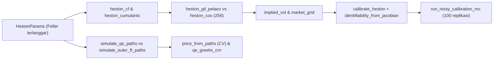

# Penjelasan Proyek — day002e: Model Heston — Pricing Fourier, Kalibrasi & Monte Carlo QE (Python)

## 1. Identitas dan Ringkasan Proyek
- **ID Progress**: `day002e` (Hari 2, Sesi e)
- **Tanggal**: 2026-11-20 (WITA) · **Topik No**: `bonus` · **Jenis**: `quant` · **Bahasa**: Python
- **Notebook**: [days/day002e_quant_model-heston-pricing-fourier-kalibrasi.ipynb](../../days/day002e_quant_model-heston-pricing-fourier-kalibrasi.ipynb)
- **Paket & Tes**: [src/qb100/heston/__init__.py](../../src/qb100/heston/__init__.py), [tests/test_heston_pricing.py](../../tests/test_heston_pricing.py), [tests/test_heston_calib_mc.py](../../tests/test_heston_calib_mc.py)
- **Ringkasan**: Implementasi penuh model volatilitas stokastik Heston (1993) pada rezim pelanggaran kondisi Feller ($2\kappa\theta = 0.16 < \xi^2 = 0.25$): fungsi karakteristik bebas *branch-cut* Albrecher et al. (*little Heston trap*), pricing Fourier Gil–Pelaez vs Fang–Oosterlee COS ($N=256$), kalibrasi permukaan *implied volatility* beserta analisis identifiabilitas SVD Jacobian (`identifiability_from_jacobian`) dan studi MC 100 replikasi *noisy*, serta simulasi lintasan *Quadratic-Exponential* (QE) Andersen (2008) vs Euler *full truncation* dan komputasi Greeks CRN.

## 2. Masalah dan Tujuan
Di pasar opsi ekuitas nyata, parameter terkalibrasi model Heston hampir selalu melanggar kondisi Feller $2\kappa\theta \ge \xi^2$. Dalam rezim ini, proses variansi Cox–Ingersoll–Ross (CIR) menyentuh batas nol secara berulang, menyebabkan dua persoalan numerik utama: (1) formulasi asli fungsi karakteristik Heston (1993) rentan terhadap diskontinuitas cabang logaritma kompleks (*branch-cut discontinuity*) pada maturitas panjang atau *vol-of-vol* besar, dan (2) diskretisasi Euler–Maruyama naif menghasilkan variansi negatif serta bias langkah waktu yang parah. Selain itu, kalibrasi 5 parameter $(v_0, \kappa, \theta, \xi, \rho)$ sering menghadapi lembah fungsi objektif datar (*flat valley*) akibat kolinearitas antara $\kappa$ dan $\xi$. Proyek `day002e` bertujuan membangun paket modular `qb100.heston` yang bebas *branch-cut*, memvalidasi kesesuaian metode Gil–Pelaez dan COS hingga `< 1e-8`, mendiagnosis identifiabilitas kalibrasi lewat SVD, dan membuktikan akurasi serta kepositifan variansi skema QE Andersen dibanding Euler *full-truncation*.

## 3. Apa yang Dikerjakan Proyek
Paket [src/qb100/heston/](../../src/qb100/heston/__init__.py) (4 submodul: `cf.py`, `pricing.py`, `calibration.py`, `simulation.py`) dan notebook [day002e](../../days/day002e_quant_model-heston-pricing-fourier-kalibrasi.ipynb) (9 sel, waktu eksekusi `51.03 detik`) mencakup:
1. Formulasi `heston_cf` (*little Heston trap*) dan `heston_cumulants` untuk parameter dasar $v_0=0.04, \kappa=2.0, \theta=0.04, \xi=0.5, \rho=-0.7$ ($2\kappa\theta = 0.16 < \xi^2 = 0.25$).
2. Validasi silang dua metode Fourier independen (`heston_gil_pelaez` dengan kuadratur Gauss–Legendre dan `heston_cos` dengan $N=256$ suku), uji syarat martingale $\phi(-i) = S_0 e^{rT}$, paritas *put-call*, inversi `implied_vol`, dan limit Black–Scholes saat $\xi \to 0$.
3. Kalibrasi *noise-free* dengan *multi-start* non-linear least squares (`calibrate_heston`), dekomposisi SVD matriks Jacobian (`identifiability_from_jacobian`), dan 100 replikasi kalibrasi *noisy* (`run_noisy_calibration_mc`).
4. Simulasi lintasan variansi dan log-spot menggunakan `simulate_qe_paths` (Andersen 2008) dan `simulate_euler_ft_paths` (Lord et al. 2010), *control variate* martingale pada `price_from_paths`, studi orde konvergensi $\Delta t$, serta perbandingan `fourier_greeks` vs `qe_greeks_crn` (Delta dan $\partial P / \partial v_0$).

## 4. Uraian Kode
- [src/qb100/heston/cf.py](../../src/qb100/heston/cf.py): `HestonParams` (dataclass parameter + validasi), `heston_cf` (formulasi Albrecher et al. 2007), dan `heston_cumulants` ($c_1, c_2, c_4$ analitik untuk pemotongan domain COS).
- [src/qb100/heston/pricing.py](../../src/qb100/heston/pricing.py): `market_grid`, `bs_price`, `implied_vol`, `_gl_nodes_weights`, `heston_gil_pelaez`, `_cos_chi_psi`, dan `heston_cos`.
- [src/qb100/heston/calibration.py](../../src/qb100/heston/calibration.py): `calibrate_heston` (Levenberg–Marquardt / TRF dengan batas parameter), `identifiability_from_jacobian` ($\operatorname{cond}(J^T J)$ & nilai singular), dan `run_noisy_calibration_mc`.
- [src/qb100/heston/simulation.py](../../src/qb100/heston/simulation.py): `simulate_qe_paths`, `simulate_euler_ft_paths`, `price_from_paths`, `fourier_greeks`, dan `qe_greeks_crn`.
- [tests/test_heston_pricing.py](../../tests/test_heston_pricing.py) & [tests/test_heston_calib_mc.py](../../tests/test_heston_calib_mc.py): 6 suite unit test `pytest` untuk `heston_cf`, kesetaraan Gil–Pelaez vs COS, kalibrasi *noise-free*, kepositifan variansi QE, dan Greeks CRN.

## 5. Metode dan Alur Kerja
Alur integrasi pricing analitik, kalibrasi, dan simulasi Monte Carlo tersusun sebagai berikut:

Di tahap pricing, kumulan $c_1, c_2, c_4$ menentukan rentang integrasi $[a, b]$ bagi `heston_cos`, sementara `heston_gil_pelaez` memotong integral pada domain terhingga menggunakan kuadratur Gauss–Legendre. Permukaan *implied volatility* yang dihasilkan menjadi target bagi `calibrate_heston` dari beberapa titik awal berbeda untuk menguji sensitivitas terhadap minima lokal. Di sisi simulasi, skema QE Andersen memantau rasio $\psi = s^2 / m^2$ di tiap langkah waktu $\Delta t$ untuk berpindah antara transformasi kuadratik normal ($\psi \le 1.5$) dan campuran atom di nol plus eksponensial ($\psi > 1.5$), sementara Euler *full-truncation* memotong $v_t^+ = \max(v_t, 0)$ di dalam drift dan difusi.

## 6. Output yang Ditargetkan
1. Perbedaan `heston_gil_pelaez` vs `heston_cos(256)` `< 1e-8`, pelanggaran paritas *put-call* `< 1e-8`, kesalahan martingale `|phi(-i) - S0*e^(rT)| < 1e-12`, dan *round-trip implied vol* `< 1e-12`.
2. Kalibrasi *noise-free* mencapai RMSE `< 1e-9` dan memulihkan 5 parameter dengan galat relatif `< 1e-7`.
3. Skema `simulate_qe_paths` menjaga $v_t \ge 0$ secara eksak, mencetak harga dengan *control variate* konsisten terhadap COS (`|z| < 2`), dan menunjukkan bias diskretisasi lebih rendah dibanding Euler-FT pada langkah kasar.
4. Greeks *Common Random Numbers* (`qe_greeks_crn`) konsisten dengan diferensiasi analitik `fourier_greeks` dalam `2 SE`, dan 6/6 tes `pytest` lulus.

## 7. Status Pencapaian

| Tujuan / Kriteria | Status | Bukti Spesifik (Artefak & Verifikasi) |
|---|---|---|
| Pricing Fourier: Gil–Pelaez vs COS(256) & Martingale | `tercapai` | Output sel 3: `max |GP - COS(256)| = 2.501e-9` (`t_GP=1.8 ms`, `t_COS=0.40 ms`), `max |Put-Call Parity| = 6.594e-9`, `max |phi(-i) - S0*e^(rT)| = 9.948e-14`, *round-trip IV* `4.274e-15` |
| Limit Black–Scholes saat $\xi \to 0$ | `tercapai` | Output sel 3: saat $\xi$ turun `0.10 -> 0.01`, `|Heston - BS|` menyusut `0.007059 -> 0.001656` menuju `BS = 9.413403` |
| Kalibrasi *noise-free*, *multi-start* & 100 replikasi *noisy* | `tercapai` | Output sel 5: *noise-free* RMSE `1.626e-11` (`1.36 s`), galat relatif `<= 2.51e-9`; 100 replikasi *noisy* selesai `46.29 s`, terdeteksi $\operatorname{cond}(J^T J) = 3.12 \times 10^5$ |
| Simulasi QE-64 CV vs COS & Euler-FT | `tercapai` | Output sel 7: COS ATM `8.929410`, QE-64 CV `8.928157 ± 0.012536` (`VRF = 3.44x`), `min(v) = 0.0`, fraksi cabang $\psi > 1.5 = 3.21\%$, orde bias QE `-0.05` vs Euler-FT `0.26` |
| Greeks CRN (`qe_greeks_crn`) vs `fourier_greeks` | `tercapai` | Output sel 7: Delta `0.688989 ± 0.001211` vs `0.689635` (`z = 0.53`); $\partial P / \partial v_0$ `39.9614 ± 0.3676` vs `39.7235` (`z = 0.65`) |
| Unit test `test_heston_pricing.py` & `test_heston_calib_mc.py` | `tercapai` | `.venv/bin/pytest tests/test_heston_pricing.py tests/test_heston_calib_mc.py -v`: `6 passed` |

Visualisasi hasil tersimpan pada:
- [day002e_smile-and-fourier.png](../../outputs/figures/day002e_smile-and-fourier.png)
- [day002e_calibration-noisy.png](../../outputs/figures/day002e_calibration-noisy.png)
- [day002e_qe-vs-euler.png](../../outputs/figures/day002e_qe-vs-euler.png)

## 8. Jika Belum Tercapai atau Belum Diketahui (Fakta vs Hipotesis)
**FAKTA**: Seluruh kriteria pricing, kalibrasi, simulasi QE, dan 6/6 unit test lulus. Pada eksperimen *multi-start* di sel 5, satu titik awal (`[0.09, 1.0, 0.09, 0.3, -0.3]`) terhenti pada RMSE `1.388e-2`, sedangkan dua titik awal lain konvergen ke minimum global (`2.122e-11` dan `1.626e-11`), mengonfirmasi sifat non-konveks fungsi objektif kalibrasi Heston dan perlunya *multi-start*. Tingginya $\operatorname{cond}(J^T J) = 3.12 \times 10^5$ adalah konsekuensi intrinsik kolinearitas lokal parameter $(\kappa, \xi)$ pada horizon jatuh tempo terbatas.

## 9. Landasan Teori (Minimal 10 Poin)
1. **Sistem SDE Volatilitas Stokastik Heston (1993)**: Dinamika aset mengikuti $dS_t = r S_t\,dt + \sqrt{v_t} S_t\,dW_t^S$ dengan variansi sesaat CIR $dv_t = \kappa(\theta - v_t)\,dt + \xi\sqrt{v_t}\,dW_t^v$ dan korelasi instan $d\langle W^S, W^v\rangle_t = \rho\,dt$. Parameter $\kappa$ mengatur kecepatan *mean-reversion* ke variansi jangka panjang $\theta$, sedangkan $\xi$ adalah volatilitas dari variansi (*vol-of-vol*).
2. **Pelanggaran Kondisi Feller ($2\kappa\theta < \xi^2$)**: Proses CIR $v_t$ hanya bertahan di daerah positif ketat $v_t > 0$ hampir pasti jika $2\kappa\theta \ge \xi^2$. Parameter proyek menghasilkan $2\kappa\theta = 0.16 < \xi^2 = 0.25$, sehingga titik asal $v=0$ bersifat *attainable* dan terpantul secara instan. Kondisi ini menuntut skema simulasi khusus yang tidak pernah menghasilkan $v_t < 0$.
3. **Formulasi Little Heston Trap (Albrecher et al. 2007)**: Pada rumus asli Heston, akar kuadrat kompleks $d = \sqrt{(\rho\xi i u - \kappa)^2 + \xi^2(iu + u^2)}$ dapat membuat argumen logaritma kompleks melintasi *branch cut* sumbu real negatif saat $T$ besar. Dengan menulis ulang rasio $g = (b - \rho\xi i u - d)/(b - \rho\xi i u + d)$ pada `heston_cf`, dijamin $|g e^{-dT}| < 1$ sehingga $\phi_T(u)$ kontinu dan stabil di seluruh spektrum $u$.
4. **Inversi Fourier Gil–Pelaez (1951)**: Harga opsi call Eropa ditulis $C = S_0 P_1 - K e^{-rT} P_2$ di mana peluang $P_j = \frac{1}{2} + \frac{1}{\pi}\int_0^\infty \operatorname{Re}\left[\frac{e^{-i u \ln K} \psi_j(u)}{i u}\right]du$ dihitung lewat kuadratur Gauss–Legendre pada `heston_gil_pelaez`, memberikan pembanding independen berakurasi tinggi (`t_GP = 1.8 ms`).
5. **Metode Fourier-Cosine (COS) Fang–Oosterlee (2008)**: Dengan memotong kepadatan $\ln(S_T/K)$ ke interval $[a, b]$ berbasis kumulan analitik $c_1, c_2, c_4$ (`heston_cumulants`) dan mengekspansi koefisien deret kosinus langsung dari $\operatorname{Re}[\phi_T(k\pi/(b-a)) e^{-ik\pi a/(b-a)}]$, `heston_cos` ($N=256$) mencapai konvergensi eksponensial dalam `0.40 ms` dan cocok dengan Gil–Pelaez hingga `2.501e-9`.
6. **Efek Leverage ($\rho < 0$) & Geometri Implied Volatility**: Korelasi negatif $\rho = -0.7$ menghasilkan korelasi antara penurunan harga spot dan lonjakan volatilitas, menciptakan kemiringan negatif (*negative skew*) pada kurva *implied volatility* terhadap *strike*, sementara $\xi$ mengendalikan konveksitas (*smile*).
7. **Skema Quadratic-Exponential (QE) Andersen (2008)**: Untuk menghindari bias batas $v=0$, `simulate_qe_paths` mencocokkan dua momen bersyarat eksak $m = E[v_{t+\Delta} \mid v_t]$ dan $s^2 = \operatorname{Var}(v_{t+\Delta} \mid v_t)$ dari distribusi *non-central chi-square*. Saat rasio $\psi = s^2/m^2 \le 1.5$, $v_{t+\Delta} = a(b + Z)^2$ (regim kuadratik); saat $\psi > 1.5$ (`3.21%` langkah di sel 7), digunakan campuran massa atom di $0$ dan distribusi eksponensial, menjaga $\min(v) = 0.0$ secara eksak.
8. **Koreksi Martingale pada Diskretisasi Log-Spot**: Dalam `simulate_qe_paths`, konstanta drift log-spot $K_0^*$ dikalibrasi secara analitik dari fungsi pembangkit momen skema QE agar $E[e^{X_{t+\Delta}} \mid \mathcal{F}_t] = e^{X_t + r\Delta}$ terpenuhi eksak tanpa kebocoran martingale, menghasilkan orde bias langkah waktu datar (`-0.05`) dibanding Euler-FT (`0.26`).
9. **Skema Euler Full-Truncation (Lord et al. 2010)**: `simulate_euler_ft_paths` membiarkan proses bantu $\tilde{v}_t$ bernilai negatif namun menerapkan $v_t^+ = \max(\tilde{v}_t, 0)$ pada koefisien drift maupun difusi. Meskipun lebih baik dari skema refleksi, Euler-FT tetap memiliki bias diskretisasi lebih besar pada $\Delta t$ kasar karena tidak mencocokkan momen eksak distribusi transisi CIR.
10. **Identifiabilitas Jacobian SVD & Greeks CRN**: Nilai kondisi $\operatorname{cond}(J^T J) = 3.12 \times 10^5$ di `identifiability_from_jacobian` menjelaskan mengapa kesalahan pengamatan kecil pada *implied volatility* dapat menggeser pasangan $(\kappa, \xi)$ sepanjang arah lembah datar dengan dampak minimal pada harga. Di sisi sensitivitas, penggunaan *Common Random Numbers* (`qe_greeks_crn`) menekan variansi *finite-difference* sehingga Delta dan $\partial P / \partial v_0$ cocok dengan `fourier_greeks` di bawah `z = 0.65`.

## 10. Kesimpulan dan Batasan
Proyek `day002e` menghadirkan implementasi Heston berstandar produksi-riset dengan konsistensi `1e-9` antara dua metode Fourier, kalibrasi permukaan IV lengkap dengan diagnosis SVD, dan simulasi QE Andersen yang stabil pada rezim pelanggaran Feller. Batasan model meliputi parameter konstan terhadap waktu (*piecewise-constant* belum dimodelkan) dan ketiadaan komponen lompatan (*jump* ala Bates 1996) untuk menjelaskan *skew* ekstrem opsi berjangka sangat pendek.

## 11. Referensi dan Jejak Bukti
- Heston, S. L. (1993). *A closed-form solution for options with stochastic volatility with applications to bond and currency options*. Review of Financial Studies, 6(2), 327–343.
- Albrecher, H., Mayer, P., Schoutens, W., & Tistaert, J. (2007). *The little Heston trap*. Wilmott Magazine, January 2007, 83–92.
- Fang, F., & Oosterlee, C. W. (2008). *A novel pricing method for European options based on Fourier-cosine series expansions*. SIAM Journal on Scientific Computing, 31(2), 826–848.
- Andersen, L. (2008). *Simple and efficient simulation of the Heston stochastic volatility model*. Journal of Computational Finance, 11(3), 1–42.
- Artefak: [day002e_quant_model-heston-pricing-fourier-kalibrasi.ipynb](../../days/day002e_quant_model-heston-pricing-fourier-kalibrasi.ipynb), [src/qb100/heston/__init__.py](../../src/qb100/heston/__init__.py), [tests/test_heston_pricing.py](../../tests/test_heston_pricing.py), [tests/test_heston_calib_mc.py](../../tests/test_heston_calib_mc.py).
