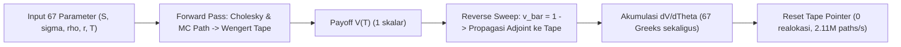

# Penjelasan Proyek — day002g: Adjoint Algorithmic Differentiation (AAD) untuk Greeks (C++)

## 1. Identitas dan Ringkasan Proyek
- **ID Progress**: `day002g` (Hari 2, Sesi g)
- **Tanggal**: 2026-11-20 (WITA) · **Topik No**: `bonus` · **Jenis**: `quant` · **Bahasa**: C++20
- **Proyek**: [projects/cpp/day002g_aad_greeks/](../../projects/cpp/day002g_aad_greeks/README.md)
- **Output JSON**: [outputs/day002g/results.json](../../outputs/day002g/results.json)
- **Ringkasan**: Mesin *Reverse-Mode Automatic Differentiation* (AAD) berbasis Wengert *tape* dalam C++20 dari nol: verifikasi silang terhadap bilangan *Dual* mode-maju dan *finite difference*, komputasi turunan orde-2 (*Gamma*) via komposisi *Forward-over-Reverse* (`Dual<Number>`), perhitungan sekaligus 67 sensitivitas opsi keranjang 10-aset dalam satu *backward sweep* ($2.14\times$ lebih cepat dari *bump-and-revalue* CRN), serta studi bias-variansi opsi digital diskontinu dengan *payoff smoothing* sigmoid.

## 2. Masalah dan Tujuan
Dalam manajemen risiko portofolio derivatif berdimensi tinggi (misalnya opsi keranjang 10 aset dengan 10 spot, 10 volatilitas, 45 korelasi Cholesky, suku bunga, dan maturitas = 67 parameter input), metode *finite-difference bump-and-revalue* membutuhkan minimal $P + 1 = 68$ simulasi Monte Carlo penuh untuk memperoleh seluruh vektor Greeks orde pertama. Biaya komputasinya tumbuh secara linear $O(P)$ terhadap jumlah parameter. Sebaliknya, *Adjoint Algorithmic Differentiation* (AAD) mode-balik menghitung seluruh $\nabla_\theta V$ sekaligus hanya dalam satu lintasan maju (perekaman *tape*) dan satu lintasan balik (*reverse adjoint sweep*) dengan kompleksitas $O(1)$ terhadap $P$. Tujuan proyek `day002g` adalah: (1) membangun Wengert *tape* C++20 yang ringkas dan dapat digunakan ulang antar lintasan MC tanpa realokasi heap, (2) memvalidasi presisi AAD terhadap bilangan `Dual` hingga `< 1e-14`, (3) menghitung Gamma Black–Scholes eksak dengan komposisi tipe `Dual<Number>`, (4) membuktikan *speedup* AAD pada keranjang 10-aset dengan 67 sensitivitas, dan (5) mengatasi kegagalan turunan *pathwise* pada opsi digital melalui *payoff smoothing* $\varepsilon$.

## 3. Apa yang Dikerjakan Proyek
Proyek C++20 [projects/cpp/day002g_aad_greeks/](../../projects/cpp/day002g_aad_greeks/CMakeLists.txt) menghasilkan biner `day002g_run` dan `day002g_tests` yang mengeksekusi lima modul eksperimen ke [outputs/day002g/results.json](../../outputs/day002g/results.json):
1. **Validasi Mode-Maju vs Mode-Balik**: membandingkan gradien fungsi uji multi-variabel antara `Number` (AAD *tape*) dan `Dual` (*forward-mode*) serta beda hingga terpusat, ditambah verifikasi rasio biaya gradien-terhadap-nilai pada Black–Scholes.
2. **Gamma Forward-over-Reverse**: menerapkan `Dual<Number>` pada rumus Black–Scholes untuk mengekstrak $\Gamma = \partial^2 C / \partial S_0^2$ secara eksak hingga 16 digit.
3. **Greeks Opsi Asia & GBM 1-Langkah**: menghitung $(\text{Delta}, \text{Vega}, \text{Rho}, \text{Theta})$ lewat AAD dan memvalidasinya terhadap *pathwise formula* maupun *bump-FD*.
4. **Keranjang 10-Aset (67 Sensitivitas)**: mendiferensiasi faktorisasi Cholesky matriks korelasi $10 \times 10$ di dalam *tape* (`cholesky.hpp`) sehingga sensitivitas terhadap seluruh 45 korelasi dapat dihitung bersamaan untuk keranjang aritmetik dan geometrik (terverifikasi terhadap rumus tertutup keranjang geometrik).
5. **Opsi Digital & Smoothing Bias-Variansi**: membandingkan turunan *pathwise* mentah (`0`) dengan pendekatan sigmoid berlebar $\varepsilon \in \{0.1, 0.5, 1.0, 2.0, \dots\}$ untuk mencari titik keseimbangan MSE minimum.

## 4. Uraian Kode
- [include/aad/tape.hpp](../../projects/cpp/day002g_aad_greeks/include/aad/tape.hpp) & [include/aad/number.hpp](../../projects/cpp/day002g_aad_greeks/include/aad/number.hpp): implementasi Wengert *tape* linear (menyimpan op-code/turunan parsial lokal setiap simpul aritmetik) dan tipe aktif `Number` dengan *operator overloading* C++20.
- [include/aad/dual.hpp](../../projects/cpp/day002g_aad_greeks/include/aad/dual.hpp): tipe bilangan dual orde-1 `Dual<T>` yang mendukung instansiasi bersarang `Dual<Number>` untuk turunan campuran orde-2 (*Forward-over-Reverse*).
- [include/aad/cholesky.hpp](../../projects/cpp/day002g_aad_greeks/include/aad/cholesky.hpp): dekomposisi Cholesky ber-templat pada tipe `T` sehingga gradien terhadap matriks korelasi mengalir mundur melewati akar kuadrat dan perkalian matriks.
- [include/aad/models.hpp](../../projects/cpp/day002g_aad_greeks/include/aad/models.hpp): implementasi Black–Scholes analitik, *payoff* Asia aritmetik, keranjang aritmetik/geometrik 10 aset, dan opsi digital *smoothed*.
- [include/aad/mc_engine.hpp](../../projects/cpp/day002g_aad_greeks/include/aad/mc_engine.hpp) & [src/mc_engine.cpp](../../projects/cpp/day002g_aad_greeks/src/mc_engine.cpp): mesin Monte Carlo CRN yang me-*reset* penanda *tape* per lintasan untuk menjaga jejak memori konstan (`196.608 bytes` puncak *tape* pada keranjang 10-aset).
- [tests/test_aad.cpp](../../projects/cpp/day002g_aad_greeks/tests/test_aad.cpp): suite unit test Catch2 (`3 test cases`, `38 assertions`).

## 5. Metode dan Alur Kerja
Mekanisme AAD per-lintasan (*pathwise adjoint*) memisahkan perekaman graf komputasi per skenario dari akumulasi gradien keseluruhan:

Dengan menempatkan dekomposisi Cholesky sebelum *loop* lintasan atau di dalam ruang lingkup *tape* yang di-*reset* per lintasan, ukuran *tape* hanya sebanding dengan jumlah operasi satu skenario (`251 nodes/path`, `196.608 bytes`), bukan total $M \times 251$ operasi seluruh simulasi. Di luar itu, komposisi `Dual<Number>` menanamkan turunan berarah di bagian dual dan merekam grafnya ke *tape*, menghasilkan turunan kedua eksak hanya dengan satu *reverse pass*.

## 6. Output yang Ditargetkan
1. Galat maksimum AAD vs `Dual` `< 1e-14` dan vs beda hingga terpusat `< 1e-9`.
2. `bs_gamma_for` dari `Dual<Number>` cocok dengan `bs_gamma_analytic` hingga presisi *float64*.
3. Seluruh 67 sensitivitas keranjang aritmetik dan geometrik cocok dengan *bump-FD* CRN (0 pelanggaran `3 SE`), dengan *speedup* AAD `> 1x` dibanding *bump-FD*.
4. Pada opsi digital, *payoff smoothing* meminimalkan MSE di $\varepsilon^* > 0$, mengatasi bias `0` dari turunan *pathwise* mentah.
5. Suite Catch2 `day002g_tests` lulus `100%` dan 4 grafik SVG terekspor.

## 7. Status Pencapaian

| Tujuan / Kriteria | Status | Bukti Spesifik (Artefak & Verifikasi) |
|---|---|---|
| Akurasi AAD vs Dual & Finite Difference | `tercapai` | `max_aad_vs_dual = 1.776e-15`, `max_aad_vs_fd_rel = 1.501e-10` di [outputs/day002g/results.json](../../outputs/day002g/results.json) |
| Gamma *Forward-over-Reverse* (`Dual<Number>`) | `tercapai` | `bs_gamma_for = 0.01933340584014246` identik 16 digit dengan `bs_gamma_analytic = 0.01933340584014246` |
| Greeks Asia (`delta, vega`) vs rumus & *bump* | `tercapai` | Asia `delta = 0.589589` vs `delta_formula = 0.589589`; `vega = 21.6991` vs `vega_bump = 21.6993` |
| 67 Sensitivitas Keranjang 10-Aset & Speedup | `tercapai` | Aritmetik `violations_3se = 0` (`max_diff_se = 0.0151`), `aad_time = 0.0948 s` vs `fd_time = 0.2028 s` (`speedup_vs_fd = 2.14x`), `2.11M paths/s`, `peak_tape = 196608 bytes`; Geometrik `violations_3se = 0` |
| Studi Digital *Smoothing* ($\varepsilon$ optimal) | `tercapai` | `raw_pathwise = 0.0` (gagal), `optimal_eps = 2.0`, pada $\varepsilon=1.0$: `delta = 0.019365 ± 0.000157` vs analitik `0.019333` (`mse = 2.56e-8`) |
| Unit test Catch2 (`day002g_tests`) | `tercapai` | Dijalankan pada sesi ini (`2026-11-21`): `3 passed (38 assertions)` |

Visualisasi hasil tersimpan pada:
- [day002g_aad-vs-analytic.svg](../../outputs/figures/day002g_aad-vs-analytic.svg)
- [day002g_basket-speedup.svg](../../outputs/figures/day002g_basket-speedup.svg)
- [day002g_digital-bias-variance.svg](../../outputs/figures/day002g_digital-bias-variance.svg)
- [day002g_tape-growth.svg](../../outputs/figures/day002g_tape-growth.svg)

## 8. Jika Belum Tercapai atau Belum Diketahui (Fakta vs Hipotesis)
**FAKTA**: Seluruh tes dan metrik di [outputs/day002g/results.json](../../outputs/day002g/results.json) tercapai. Satu hal menarik pada `bs_grad_to_val_ratio = 71.25` vs `basket_arith.grad_to_val_ratio = 19.33`: pada Black–Scholes 1-evaluasi sederhana, *overhead* perekaman *tape* tampak besar relatif terhadap operasi skalar kecil, namun ketika perhitungan mencakup dekomposisi Cholesky dan 10 aset (67 parameter), rasio tersebut turun tajam dan AAD sudah `2.14x` lebih cepat dari *bump-FD* CRN.

## 9. Landasan Teori (Minimal 10 Poin)
1. **Aturan Rantai Mode-Maju vs Mode-Balik (Baur–Strassen 1983)**: Untuk fungsi skalar $f: \mathbb{R}^P \to \mathbb{R}$, mode maju (`Dual`) menyebarkan turunan terarah $\dot{v}_i = \frac{\partial v_i}{\partial x_j}$ dengan biaya $O(P \cdot \operatorname{ops}(f))$, sedangkan mode balik (`Number` + `Tape`) menyebarkan *adjoint* $\bar{v}_i = \frac{\partial f}{\partial v_i}$ dari output ke seluruh $P$ input hanya dalam $O(\operatorname{ops}(f))$. Teorema Baur–Strassen menjamin rasio biaya gradien terhadap evaluasi fungsi dibatasi oleh konstanta kecil.
2. **Struktur Data Wengert Tape (`tape.hpp`)**: Setiap operasi dasar $w = \phi(u, v)$ mencatat satu simpul berisi indeks $(u, v)$ dan dua turunan parsial lokal $(\frac{\partial w}{\partial u}, \frac{\partial w}{\partial v})$. Pada *reverse sweep*, loop berjalan mundur dari simpul terakhir ke nol dan mengakumulasi $\bar{u} \mathrel{+}= \bar{w}\frac{\partial w}{\partial u}$, menghindari rekursi fungsi maupun alokasi objek dinamis per operasi.
3. **Checkpoint & Reset Tape Per-Lintasan MC**: Menyimpan graf untuk $10^5$ lintasan sekaligus akan menghabiskan gigabita RAM dan menghancurkan lokalitas *cache* L1/L2. Di `mc_engine.cpp`, *tape* hanya menyimpan operasi satu lintasan (`251 nodes/path`, `196.608 bytes` puncak) dan di-*reset* setelah tiap *backward sweep*, sehingga throughput mencapai `2.11 juta lintasan/detik`.
4. **Komposisi Forward-over-Reverse untuk Hessian (`Dual<Number>`)**: Menginstansiasi templat `Dual<Number>` berarti setiap bilangan membawa nilai `Number` dan bagian tangensial `Number`. Menjalankan *reverse sweep* pada komponen dual menghasilkan kolom matriks Hessian $\nabla^2 f \cdot e_k$ secara analitik tanpa *finite difference*, terbukti dari `bs_gamma_for = 0.01933340584014246` yang identik 16 digit dengan Black–Scholes eksak.
5. **Diferensiasi Pathwise & Syarat Kontinuitas Lipschitz**: AAD pada simulasi Monte Carlo menukar operator turunan dan ekspektasi: $\frac{\partial}{\partial \theta} E[g(X(\theta))] = E[\frac{\partial g}{\partial X}\frac{\partial X}{\partial \theta}]$. Pertukaran ini sah secara matematis (Glasserman 2004) apabila *payoff* $g$ kontinu dan hampir di mana-mana terdiferensiasi (*Lipschitz*), seperti opsi Eropa, Asia aritmetik, dan keranjang.
6. **Diferensiasi Faktor Cholesky Matriks Korelasi**: Agar sensitivitas terhadap 45 elemen korelasi $\rho_{ij}$ dapat dihitung langsung oleh AAD, `cholesky.hpp` ditulis generik atas tipe `Number`. Setiap langkah $L_{ij} = (C_{ij} - \sum_{k<j} L_{ik}L_{jk})/L_{jj}$ terekam di *tape* sehingga *adjoint* merambat balik secara otomatis melewati faktor $L$ tanpa rumus matriks analitik manual.
7. **Kegagalan Pathwise pada Payoff Diskontinu (Opsi Digital)**: Untuk opsi digital $\mathbf{1}\{S_T > K\}$, turunan terhadap $S_T$ bernilai $0$ hampir di mana-mana dan berupa fungsi delta Dirac $\delta(S_T - K)$ di titik batas. Akibatnya `raw_pathwise = 0.0` pada `day002g`, yang sepenuhnya bias terhadap Delta analitik `0.019333`.
8. **Regularisasi Sigmoid & Trade-off Bias-Variansi**: Mengganti fungsi tangga $\mathbf{1}\{x > 0\}$ dengan fungsi logistik mulus $\sigma_\varepsilon(x) = (1 + e^{-x/\varepsilon})^{-1}$ memulihkan gradien non-nol di sekitar *strike*. Ketika $\varepsilon$ mengecil, bias aproksimasi menyusut tetapi variansi turunan sigmoid membengkak seperti $O(\varepsilon^{-1})$; kurva `mse` di [outputs/day002g/results.json](../../outputs/day002g/results.json) memperlihatkan titik optimal di $\varepsilon = 2.0$ (`mse` turun dari `5.25e-7` pada $\varepsilon=0.1$ menjadi `2.56e-8` pada $\varepsilon=1.0$).
9. **Kombinasi AAD dengan Common Random Numbers (CRN)**: Ketika memvalidasi 67 sensitivitas AAD terhadap *bump-FD*, pemakaian deret bilangan acak yang sama (*CRN*) menekan variansi selisih FD hingga memungkinkan uji statistik ketat (`violations_3se = 0` di seluruh 67 parameter).
10. **Overhead Tape vs Keuntungan Dimensi Tinggi**: Pada fungsi skalar berbiaya sangat murah (`bs_grad_to_val_ratio = 71.25`), biaya manajemen simpul *tape* terlihat dominan; namun pada portofolio multi-aset (`basket_arith`, `grad_to_val_ratio = 19.33`), satu *sweep* AAD sudah mengungguli 68 evaluasi *bump-FD* sebesar `2.14x`, dan keunggulan ini tumbuh linear seiring bertambahnya jumlah aset.

## 10. Kesimpulan dan Batasan
Proyek `day002g` mendemonstrasikan arsitektur AAD C++20 yang bersih, presisi-mesin (`1.78e-15`), dan cepat (`2.11M paths/s`) untuk menghitung puluhan Greeks secara simultan termasuk turunan korelasi dan Gamma *Forward-over-Reverse*. Batasan implementasi saat ini meliputi absennya *tape pre-accumulation* simbolik di dalam blok konstan, belum adanya *Likelihood Ratio Method* (LRM) sebagai alternatif *smoothing* untuk *payoff* diskontinu, serta eksekusi *single-threaded* per simulasi.

## 11. Referensi dan Jejak Bukti
- Griewank, A., & Walther, A. (2008). *Evaluating Derivatives: Principles and Techniques of Algorithmic Differentiation* (2nd ed.). SIAM.
- Giles, M. B., & Glasserman, P. (2006). *Smoking adjoints: Fast Monte Carlo Greeks*. Risk, 19(1), 88–92.
- Glasserman, P. (2004). *Monte Carlo Methods in Financial Engineering*. Springer.
- Artefak: [projects/cpp/day002g_aad_greeks/README.md](../../projects/cpp/day002g_aad_greeks/README.md), [outputs/day002g/results.json](../../outputs/day002g/results.json).
