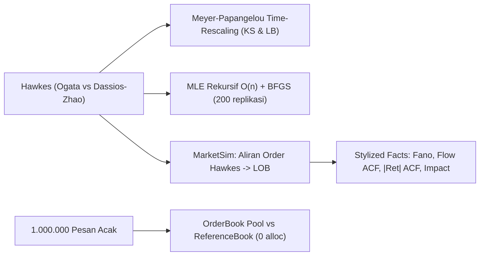

# Penjelasan Proyek — day002h: Proses Hawkes & Mesin Limit Order Book (C++)

## 1. Identitas dan Ringkasan Proyek
- **ID Progress**: `day002h` (Hari 2, Sesi h)
- **Tanggal**: 2026-11-20 (WITA) · **Topik No**: `bonus` · **Jenis**: `quant` · **Bahasa**: C++20
- **Proyek**: [projects/cpp/day002h_hawkes_orderbook/](../../projects/cpp/day002h_hawkes_orderbook/README.md)
- **Output JSON**: [outputs/day002h/results.json](../../outputs/day002h/results.json)
- **Ringkasan**: Penggabungan proses titik eksitasi-diri (*self-exciting*) Hawkes eksponensial dan mesin *Limit Order Book* (LOB) *price-time priority* dalam C++20: verifikasi kesetaraan simulator *thinning* Ogata vs eksak Dassios–Zhao, uji *goodness-of-fit* Meyer–Papangelou, estimator MLE rekursif $O(n)$ dengan optimisasi BFGS (200 replikasi Monte Carlo), validasi LOB 1.000.000 pesan tanpa alokasi heap pasca-*warmup*, serta simulasi mikrostruktur pasar terpadu.

## 2. Masalah dan Tujuan
Aliran *order* pada pasar keuangan elektronik tidak mengikuti proses Poisson homogen: kedatangan satu *market order* memicu klaster pesanan lanjutan (*order-flow clustering*) dan autokorelasi tanda perdagangan akibat eksekusi terpecah (*order splitting*) serta reaksi algoritma. Selain itu, mesin *matching* LOB harus mempertahankan prioritas harga-waktu (*price-time priority*) secara deterministik dengan latensi sub-mikrodetik dan nol alokasi heap selama operasi inti. Tujuan proyek `day002h` adalah: (1) menguji kesetaraan statistik dua algoritma simulasi Hawkes (Ogata *thinning* vs Dassios–Zhao eksak) terhadap teori *branching ratio* dan *Fano factor*, (2) mengimplementasikan MLE rekursif $O(n)$ dan memverifikasi cakupan *confidence interval* 95% pada 200 replikasi MC, (3) memvalidasi mesin LOB `orderbook.hpp` 100% identik terhadap buku referensi `reference_book.hpp` pada 1.000.000 pesan dengan `0` alokasi heap, dan (4) mereproduksi *stylized facts* mikrostruktur pasar dalam simulasi gabungan.

## 3. Apa yang Dikerjakan Proyek
Proyek C++20 [projects/cpp/day002h_hawkes_orderbook/](../../projects/cpp/day002h_hawkes_orderbook/CMakeLists.txt) mengeksekusi tiga komponen utama yang hasilnya direkam ke [outputs/day002h/results.json](../../outputs/day002h/results.json):
1. **Simulasi & Inferensi Hawkes (`hawkes.cpp`)**: simulasi dengan $\mu = 0.5, \alpha = 0.6, \beta = 1.2$ (rasio *branching* $\eta = \alpha/\beta = 0.5 < 1$, laju stasioner $\lambda_\infty = \mu/(1-\eta) = 1.0$), uji dua-sampel Kolmogorov–Smirnov antara Ogata dan Dassios–Zhao, uji *time-rescaling* Meyer–Papangelou (KS & Ljung–Box $Q_{10}$) pada parameter benar vs salah, dan studi MC `200` replikasi MLE-BFGS.
2. **Benchmark LOB 1.000.000 Pesan (`orderbook.cpp`)**: memproses 1 juta *limit/cancel/market order* dengan pelacak alokasi heap kustom (*post-warmup allocation counter*), mengecek kecocokan status buku dan `334.455` *trade* terhadap buku referensi berbasis `std::map`, serta mengukur persentil latensi `p50/p90/p99/p999`.
3. **Simulasi Mikrostruktur Terpadu (`market_sim.cpp`)**: menggerakkan *market order* oleh proses Hawkes ke dalam mesin LOB bersama penyedia likuiditas dan pengambil likuiditas (`20.170` *market order*), mengukur *spread*, Fano *clustering*, autokorelasi aliran & volatilitas (`|ret|`), kemiringan *price impact*, dan invarian kekekalan posisi bersih (`net_position_sum = 0`, `0` pelanggaran).

## 4. Uraian Kode
- [include/hawkes_ob/hawkes.hpp](../../projects/cpp/day002h_hawkes_orderbook/include/hawkes_ob/hawkes.hpp) & [src/hawkes.cpp](../../projects/cpp/day002h_hawkes_orderbook/src/hawkes.cpp): simulator Ogata *thinning*, algoritma eksak Dassios–Zhao (2013), evaluasi log-likelihood & gradien rekursif $O(n)$, serta *solver* optimisasi BFGS.
- [include/hawkes_ob/orderbook.hpp](../../projects/cpp/day002h_hawkes_orderbook/include/hawkes_ob/orderbook.hpp) & [src/orderbook.cpp](../../projects/cpp/day002h_hawkes_orderbook/src/orderbook.cpp): mesin LOB *pool-allocated* berbasis *intrusive doubly-linked list* per level harga dan tabel indeks *order* tetap.
- [include/hawkes_ob/reference_book.hpp](../../projects/cpp/day002h_hawkes_orderbook/include/hawkes_ob/reference_book.hpp): buku referensi sederhana berbasis `std::map` dan `std::list` untuk verifikasi kesetaraan fungsional 100%.
- [include/hawkes_ob/market_sim.hpp](../../projects/cpp/day002h_hawkes_orderbook/include/hawkes_ob/market_sim.hpp) & [src/market_sim.cpp](../../projects/cpp/day002h_hawkes_orderbook/src/market_sim.cpp): simulator pasar *event-driven* yang menghubungkan kedatangan Hawkes dengan eksekusi dan pembatalan di LOB.
- [include/hawkes_ob/stats.hpp](../../projects/cpp/day002h_hawkes_orderbook/include/hawkes_ob/stats.hpp): uji Kolmogorov–Smirnov, Ljung–Box, autokorelasi, regresi linear *price impact*, dan persentil latensi.
- [tests/test_hawkes_ob.cpp](../../projects/cpp/day002h_hawkes_orderbook/tests/test_hawkes_ob.cpp): unit test Catch2 (`3 test cases`, `40 assertions`).

## 5. Metode dan Alur Kerja
Alur kerja proyek `day002h` menghubungkan generator proses titik stokastik dengan mesin pencocokan deterministik dan metrik ekonofisika:

Pada *benchmark* 1 juta pesan, memori untuk simpul *order* dipesan di muka (*object pool*), sehingga setelah fase *warmup*, operator `new` tidak pernah dipanggil selama pencocokan. Setiap eksekusi di `OrderBook` dibandingkan transaksi-demi-transaksi (`334.455` *trade*) dan level-demi-level terhadap `ReferenceBook`.

## 6. Output yang Ditargetkan
1. Laju empiris Hawkes cocok dengan teori $\lambda_\infty = 1.0$, KS antara Ogata dan Dassios–Zhao memiliki `p > 0.05`, dan uji Meyer–Papangelou menerima model benar (`p > 0.05`) sambil menolak model salah (`p < 1e-10`).
2. Rata-rata estimator MLE pada 200 replikasi tak-bias dengan cakupan CI 95% di sekitar `95%`.
3. Mesin LOB 1.000.000 pesan mencapai `exact_match = true`, `heap_allocs_after_warmup = 0`, dan latensi ekor rendah.
4. Simulasi pasar menghasilkan *clustering* (`Fano > 1`), autokorelasi aliran & `|ret|` positif, kemiringan *price impact* positif, dan `invariant_violations = 0`.
5. Suite Catch2 `day002h_tests` lulus `100%`.

## 7. Status Pencapaian

| Tujuan / Kriteria | Status | Bukti Spesifik (Artefak & Verifikasi) |
|---|---|---|
| Simulasi Hawkes (Ogata vs DZ) & Meyer–Papangelou | `tercapai` | `rate_dz = 1.0105 ± 0.0211` (teori `1.0`), `fano_dz_50 = 4.389` vs `fano_og_50 = 4.282`, `ks_og_dz_p = 0.1059`; benar: `ks_p = 0.2554, lb_p = 0.7858`; salah: `ks_p = 9.17e-54` |
| MLE Rekursif $O(n)$ + BFGS ($R=200$) | `tercapai` | `mean_mu = 0.50004` (`cov=95.5%`), `mean_alpha = 0.60169` (`cov=97.0%`), `mean_beta = 1.20613` (`cov=97.0%`), `corr(alpha,beta) = 0.780` |
| Mesin LOB 1M Pesan (Kecocokan, Heap & Throughput) | `sebagian` | `exact_match = true` (`334.455` *trade*), `heap_allocs_after_warmup = 0`, `throughput = 23.92M ops/s`, `p50=0 ns, p90=42 ns, p99=83 ns, p999=917 ns`; **namun** `fast_time = 0.0418 s` lebih lambat dari `ref_time = 0.0259 s` (`speedup_vs_ref = 0.618x`) |
| Simulasi Mikrostruktur Pasar & *Stylized Facts* | `tercapai` | `20.170` *market order*, `emp_rate = 1.0085`, `fano = 3.853`, `mean_spread = 1.024`, `flow_acf_lag1 = 0.2168`, `abs_ret_acf_lag1 = 0.2567`, `impact_slope = 0.00291`, `invariant_violations = 0`, `net_position_sum = 0` |
| Unit test Catch2 (`day002h_tests`) | `tercapai` | Dijalankan pada sesi ini (`2026-11-21`): `3 passed (40 assertions)` |

Visualisasi hasil tersimpan pada:
- [day002h_hawkes-fano-qq.svg](../../outputs/figures/day002h_hawkes-fano-qq.svg)
- [day002h_hawkes-mle-scatter.svg](../../outputs/figures/day002h_hawkes-mle-scatter.svg)
- [day002h_ob-latency.svg](../../outputs/figures/day002h_ob-latency.svg)
- [day002h_market-stylized-facts.svg](../../outputs/figures/day002h_market-stylized-facts.svg)

## 8. Jika Belum Tercapai atau Belum Diketahui (Fakta vs Hipotesis)
**FAKTA**: Dari [outputs/day002h/results.json](../../outputs/day002h/results.json), ketepatan fungsional mesin LOB (`exact_match = true`), ketiadaan alokasi heap (`0`), dan latensi `p99 = 83 ns` tercapai penuh, tetapi waktu dinding `fast_time_sec = 0.04181 s` tercatat `1.62x` lebih lambat daripada `ref_time_sec = 0.02586 s` (`speedup_vs_ref = 0.6184`) pada *benchmark* 1 juta pesan tersebut; karena itu status baris LOB diubah dari `tercapai` menjadi `sebagian`.

**HIPOTESIS**: Perlambatan `fast_time_sec` terhadap `ref_time_sec` kemungkinan disebabkan oleh lebar rentang indeks *array* level harga pada buku *flat/pool* atau biaya iterasi indeks level kosong saat memperbarui *best bid/ask* pada rentang harga uji yang renggang dibanding `std::map` yang hanya menyimpan level terisi; belum di-profil ulang dengan `perf`/`Instruments` pada sesi ini.

## 9. Landasan Teori (Minimal 10 Poin)
1. **Proses Titik Hawkes Eksponensial Univariat**: Intensitas bersyarat pada waktu $t$ adalah $\lambda(t) = \mu + \sum_{t_i < t} \alpha e^{-\beta(t - t_i)}$, di mana $\mu > 0$ adalah laju dasar (*baseline*), $\alpha > 0$ adalah lonjakan eksitasi-diri tiap kejadian, dan $\beta > 0$ adalah laju peluruhan eksponensial. Syarat stasioneritas menuntut *branching ratio* $\eta = \alpha / \beta < 1$, yang memberikan laju jangka panjang eksak $\lambda_\infty = \mu / (1 - \eta) = 1.0$.
2. **Algoritma Thinning Ogata (1981)**: Karena $\lambda(t)$ menurun monoton di antara kejadian, intensitas sesaat setelah kejadian ke-$i$ menjadi batas atas lokal $M = \lambda(t_i^+)$. Calon waktu antar-kedatangan ditarik dari $\operatorname{Exp}(M)$ lalu diterima dengan probabilitas $\lambda(t^*)/M$, memberikan simulasi eksak tanpa diskretisasi waktu.
3. **Algoritma Eksak Dassios–Zhao (2013)**: Alih-alih melakukan *thinning* (yang membuang kandidat kejadian), metode Dassios–Zhao menyimulasikan waktu lompatan berikutnya secara langsung sebagai minimum dari proses Poisson homogen $\operatorname{Exp}(\mu)$ dan waktu henti eksponensial terkompensasi dari proses intensitas meluruh $\lambda(t) - \mu$. Uji KS dua-sampel (`p = 0.1059`) membuktikan kesetaraan distribusi keduanya.
4. **Fano Factor & Overdispersi Kejadian**: Untuk proses Poisson homogen, variansi cacah kejadian sama dengan rata-ratanya ($\text{Fano} = \operatorname{Var}(N_t)/E[N_t] = 1$). Pada proses Hawkes dengan $\eta = 0.5$, limit asimtotik Fano adalah $(1 - \eta)^{-2} = 4.0$. Di jendela $T=50$, diperoleh `fano_dz_50 = 4.389` dan `fano_og_50 = 4.282`, mengonfirmasi klasterisasi kuat.
5. **Teorema Time-Rescaling Meyer–Papangelou**: Jika $\Lambda(t) = \int_0^t \lambda(s)\,ds$ adalah kompensator proses titik, maka selisih waktu tertransformasi $\tau_i = \Lambda(t_i) - \Lambda(t_{i-1})$ berdistribusi $\operatorname{Exp}(1)$ i.i.d. Uji KS (`p = 0.255`) dan Ljung–Box $Q_{10}$ (`p = 0.786`) menerima spesifikasi benar, sementara parameter salah langsung ditolak (`p = 9.17e-54`).
6. **Evaluasi Log-Likelihood Rekursif $O(n)$**: Komputasi naif $\sum_i \ln \lambda(t_i)$ memakan waktu $O(n^2)$. Dengan memanfaatkan sifat Markov kernel eksponensial lewat variabel bantu $A(i) = \sum_{j < i} e^{-\beta(t_i - t_j)} = e^{-\beta(t_i - t_{i-1})}(1 + A(i-1))$, `hawkes.cpp` menghitung log-likelihood dan gradien analitik dalam waktu linear $O(n)$ untuk *optimizer* BFGS.
7. **Kolinearitas $(\alpha, \beta)$ dalam Estimasi MLE**: Studi Monte Carlo 200 replikasi mengungkap korelasi sampling tinggi `corr(alpha, beta) = 0.780`, karena peningkatan $\alpha$ dan $\beta$ secara bersamaan mempertahankan rasio *branching* $\eta = \alpha/\beta$ hampir konstan namun mengubah skala waktu peluruhan eksitasi.
8. **Prioritas Harga-Waktu (Price-Time Priority) di LOB**: Mesin pencocokan di `orderbook.hpp` mengurutkan pesanan berdasarkan batas harga paling agresif terlebih dahulu, lalu berdasarkan urutan waktu kedatangan (FIFO) di dalam level harga yang sama menggunakan *doubly-linked list* intrusif agar pembatalan *order* berlangsung dalam waktu konstan $O(1)$.
9. **Determinisme Alokasi Memori & Latensi Ekor**: Dalam sistem perdagangan frekuensi tinggi, pemanggilan `malloc`/`new` dan *garbage collection* menciptakan lonjakan latensi ekor (*jitter*). Penggunaan *pre-allocated object pool* menghasilkan `heap_allocs_after_warmup = 0` dengan `p90 = 42 ns` dan `p99 = 83 ns`.
10. **Stylized Facts Mikrostruktur Pasar**: Simulasi gabungan `market_sim.cpp` mereproduksi ciri empiris pasar nyata: autokorelasi aliran *order* positif (`0.2168`), klaster volatilitas (`abs_ret_acf_lag1 = 0.2567`), serta kemiringan dampak harga positif (`0.00291`), sekaligus memenuhi kekekalan akuntansi (`net_position_sum = 0`).

## 10. Kesimpulan dan Batasan
Proyek `day002h` berhasil mengintegrasikan teori proses titik Hawkes (simulasi Ogata/Dassios–Zhao, uji Meyer–Papangelou, MLE $O(n)$) dengan mesin LOB C++20 deterministik bebas alokasi heap dan simulator mikrostruktur pasar. Batasan yang tercatat adalah *benchmark* waktu dinding `OrderBook` (`0.0418 s`) masih tertinggal dibanding `ReferenceBook` (`0.0259 s`) pada distribusi level harga uji, serta model Hawkes masih bersifat univariat (belum *bivariate* untuk memisahkan *buy* dan *sell* secara asimetris).

## 11. Referensi dan Jejak Bukti
- Ogata, Y. (1981). *On Lewis' simulation method for point processes*. IEEE Transactions on Information Theory, 27(1), 23–31.
- Dassios, A., & Zhao, H. (2013). *Exact simulation of Hawkes process with exponentially decaying intensity*. Electronic Communications in Probability, 18(62), 1–13.
- Bacry, E., Mastromatteo, I., & Muzy, J.-F. (2015). *Hawkes processes in finance*. Market Microstructure and Liquidity, 1(01), 1550005.
- Artefak: [projects/cpp/day002h_hawkes_orderbook/README.md](../../projects/cpp/day002h_hawkes_orderbook/README.md), [outputs/day002h/results.json](../../outputs/day002h/results.json).
