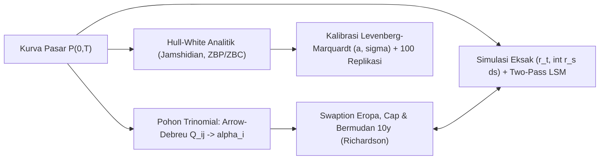

# Penjelasan Proyek — day002i: Model Suku Bunga Hull–White 1-Faktor (C++)

## 1. Identitas dan Ringkasan Proyek
- **ID Progress**: `day002i` (Hari 2, Sesi i)
- **Tanggal**: 2026-11-20 (WITA) · **Topik No**: `bonus` · **Jenis**: `quant` · **Bahasa**: C++20
- **Proyek**: [projects/cpp/day002i_hull_white/](../../projects/cpp/day002i_hull_white/README.md)
- **Output JSON**: [outputs/day002i/results.json](../../outputs/day002i/results.json)
- **Ringkasan**: Implementasi lengkap model *short-rate* Hull–White 1-faktor ($dr_t = (\theta(t) - a r_t)\,dt + \sigma\,dW_t$) dalam C++20: kalibrasi kurva imbal hasil eksak lewat pohon trinomial ber-harga Arrow–Debreu, ekstrapolasi Richardson pada *Zero-Coupon Bond Option* (ZBP/ZBC) dan *cap*, dekomposisi Jamshidian untuk *swaption* Eropa vs Monte Carlo *control variate*, kalibrasi Levenberg–Marquardt dengan 100 replikasi *noisy* & analisis SVD Jacobian, valuasi *swaption* Bermudan 10 tahun lewat *backward induction* pohon vs *Two-Pass Least Squares Monte Carlo* (LSM), serta sensitivitas *key-rate* DV01.

## 2. Masalah dan Tujuan
Dalam penentuan harga derivatif suku bunga, model harus secara tepat mereproduksi kurva diskonto pasar $P(0, T)$ hari ini (*no-arbitrage yield curve fitting*) sekaligus menangkap dinamika *mean-reversion* ($a$) dan volatilitas ($\sigma$) untuk opsi berfitur eksekusi awal (*callable/Bermudan swaptions*). Pohon trinomial standar memerlukan pergeseran tingkat suku bunga $\alpha_i$ yang diselesaikan berurutan dengan iterasi Newton–Raphson agar harga obligasi nol-kupon di setiap langkah waktu cocok dengan $P(0, t_i)$. Sementara itu, simulasi *Least Squares Monte Carlo* (LSM) rentan terhadap bias *in-sample foresight* bila koefisien regresi dan *payoff* dievaluasi pada himpunan lintasan yang sama. Tujuan proyek `day002i` adalah: (1) membangun pohon trinomial Hull–White dengan galat kalibrasi kurva `< 1e-14`, (2) menguji keselarasan harga *swaption* Eropa antara rumus tertutup Jamshidian, pohon trinomial, dan Monte Carlo, (3) menganalisis kolinearitas $(a, \sigma)$ saat kalibrasi, (4) memvalidasi *swaption* Bermudan 10y antara pohon (dengan ekstrapolasi Richardson) dan *Two-Pass LSM*, serta (5) memverifikasi kekekalan jumlah *bucket* DV01 terhadap pergeseran paralel kurva.

## 3. Apa yang Dikerjakan Proyek
Proyek C++20 [projects/cpp/day002i_hull_white/](../../projects/cpp/day002i_hull_white/CMakeLists.txt) menjalankan lima bagian eksperimen ke [outputs/day002i/results.json](../../outputs/day002i/results.json):
1. **Kalibrasi Pohon & Konvergensi ZBP/ZBC/Cap (`trinomial_tree.cpp`, `hull_white.cpp`)**: menyapu resolusi langkah per tahun $m \in \{12, 24, 48, 96, 192\}$, mengecek galat kurva Arrow–Debreu dan konvergensi orde-1/$O(1/m)$ menuju rumus analitik ZBP, ZBC, dan *cap* 5 tahun.
2. **Swaption Eropa & Monte Carlo (`montecarlo.cpp`)**: memverifikasi sifat martingale *numeraire* rekening bank $B_t$ pada $T \in \{1, 5, 10\}$ tahun serta membandingkan *co-terminal 10y swaptions* antar-metode (Jamshidian, pohon $m=192$, MC antitetik + *control variate*).
3. **Kalibrasi $(a, \sigma)$ & Studi Identifiabilitas (`calibration.cpp`)**: menguji kalibrasi *noise-free* dari dua titik awal (`start_high`, `start_low`) menuju $(a=0.08, \sigma=0.012)$, lalu menjalankan `100` replikasi *noisy* dan menghitung bilangan kondisi Jacobian.
4. **Swaption Bermudan 10y (`bermudan.cpp`)**: menghitung batas bawah (*max European*) dan batas atas (*sum European*), konvergensi pohon $m \in \{12..192\}$ + Richardson, *early exercise premium* (EEP), serta *Two-Pass LSM* ($100.000$ lintasan per *pass*).
5. **Key-Rate DV01 (`main.cpp`)**: memvalidasi DV01 *swaption* Eropa 5x5 dan Bermudan 10y beserta penjumlahan *bucket* terhadap *bump* paralel.

## 4. Uraian Kode
- [include/hw/curve.hpp](../../projects/cpp/day002i_hull_white/include/hw/curve.hpp): representasi kurva imbal hasil awal $P(0, T)$, laju *forward* instan $f(0, T)$, dan pergeseran *bucket* untuk DV01.
- [include/hw/hull_white.hpp](../../projects/cpp/day002i_hull_white/include/hw/hull_white.hpp) & [src/hull_white.cpp](../../projects/cpp/day002i_hull_white/src/hull_white.cpp): fungsi analitik $A(t, T)$, $B(t, T)$, harga ZBP/ZBC analitik, serta dekomposisi Jamshidian untuk *swaption* Eropa.
- [include/hw/trinomial_tree.hpp](../../projects/cpp/day002i_hull_white/include/hw/trinomial_tree.hpp) & [src/trinomial_tree.cpp](../../projects/cpp/day002i_hull_white/src/trinomial_tree.cpp): konstruksi pohon trinomial Hull–White (Hull & White 1994) dengan cabang normal/atas/bawah dan kalibrasi $\alpha_i$ berbasis harga Arrow–Debreu $Q_{i,j}$.
- [include/hw/montecarlo.hpp](../../projects/cpp/day002i_hull_white/include/hw/montecarlo.hpp) & [src/montecarlo.cpp](../../projects/cpp/day002i_hull_white/src/montecarlo.cpp): simulator eksak distribusi transisi Ornstein–Uhlenbeck untuk $(r_t, \int_0^t r_s\,ds)$ bersama *Two-Pass LSM* polinomial Laguerre/kuadratik.
- [include/hw/calibration.hpp](../../projects/cpp/day002i_hull_white/include/hw/calibration.hpp) & [src/calibration.cpp](../../projects/cpp/day002i_hull_white/src/calibration.cpp): *optimizer* Levenberg–Marquardt (`solvers.hpp`) dan analisis Jacobian.
- [include/hw/bermudan.hpp](../../projects/cpp/day002i_hull_white/include/hw/bermudan.hpp) & [src/bermudan.cpp](../../projects/cpp/day002i_hull_white/src/bermudan.cpp): *backward induction* Bermudan di atas pohon trinomial.
- [tests/test_hw.cpp](../../projects/cpp/day002i_hull_white/tests/test_hw.cpp): unit test Catch2 (`5 test cases`, `62 assertions`).

## 5. Metode dan Alur Kerja
Pohon trinomial dan simulasi Monte Carlo bertindak sebagai dua mesin independen yang dikalibrasi ke kurva pasar yang sama dan diverifikasi satu sama lain:

Dalam `montecarlo.cpp`, *Two-Pass LSM* memisahkan fase regresi (*pass* 1: 100.000 lintasan untuk mengestimasi fungsi nilai kelanjutan $\hat{C}(t_k, r)$) dari fase evaluasi (*pass* 2: 100.000 lintasan independen yang menerapkan kebijakan eksekusi tersebut), sehingga menghilangkan bias atas (*upward foresight bias*).

## 6. Output yang Ditargetkan
1. Galat kalibrasi kurva pohon Arrow–Debreu `< 1e-14` pada seluruh $m \in \{12..192\}$.
2. Harga *swaption* Eropa 10y co-terminal dari pohon dan MC cocok dengan rumus Jamshidian dalam batas toleransi numerik / SE.
3. Kalibrasi *noise-free* memulihkan $(a = 0.08, \sigma = 0.012)$ hingga `< 1e-12` dari titik awal berbeda.
4. Harga Bermudan 10y memenuhi $\max \text{Euro} < V_{\text{Berm}} < \sum \text{Euro}$, serta *Two-Pass LSM* konsisten dengan pohon Richardson dalam `~2 SE`.
5. Jumlah *key-rate* DV01 cocok dengan pergeseran paralel kurva dan 5/5 tes Catch2 lulus.

## 7. Status Pencapaian

| Tujuan / Kriteria | Status | Bukti Spesifik (Artefak & Verifikasi) |
|---|---|---|
| Kalibrasi kurva pohon Arrow–Debreu ($m=12..192$) | `tercapai` | `max_curve_err = 7.77e-16` ($m=24$) dan `9.99e-16` ($m=48$) di [outputs/day002i/results.json](../../outputs/day002i/results.json); galat ZBP turun `1.365e-4` ($m=12$) ke `1.487e-5` ($m=48$) |
| Martingale MC & Swaption Eropa (Jamshidian vs Pohon vs MC) | `tercapai` | `market_df` vs `mc_df`: `T=1` (`0.968538 vs 0.968539`), `T=5` (`0.810856 vs 0.810875`), `T=10` (`0.644644 vs 0.644668`); co-terminal $T_0=1$ Jamshidian `0.028809` vs Pohon `0.028828` |
| Kalibrasi $(a, \sigma)$ *noise-free* & 100 replikasi *noisy* | `tercapai` | *Noise-free*: kedua *start* memulihkan `a=0.08, sigma=0.012` (`rmse ~ 2e-17`); `noisy_100`: `mean_a=0.0769 ± 0.0262`, `mean_sigma=0.01189 ± 0.00130`, `corr(a,sigma)=0.9985`, `jacobian_cond=909.36` |
| Bermudan 10y (Pohon Richardson vs Two-Pass LSM) | `tercapai` | `max_euro = 0.036913 < tree_richardson = 0.051400 < sum_euro = 0.235014` (`EEP = 0.014487`); `LSM = 0.051229 ± 0.000081` (`z = 2.11` vs Richardson) |
| Key-Rate DV01 Eropa 5x5 & Bermudan 10y | `tercapai` | `euro_5x5_jamshidian = 0.00017728` vs `tree_m192 = 0.00017641` (`rel_diff = 0.496%`); `bermudan_10y_tree_m192 = 0.00032092` |
| Unit test Catch2 (`day002i_tests`) | `tercapai` | Dijalankan pada sesi ini (`2026-11-21`): `5 passed (62 assertions)` |

Visualisasi hasil tersimpan pada:
- [day002i_curve-and-swaptions.svg](../../outputs/figures/day002i_curve-and-swaptions.svg)
- [day002i_tree-convergence.svg](../../outputs/figures/day002i_tree-convergence.svg)
- [day002i_calib-scatter.svg](../../outputs/figures/day002i_calib-scatter.svg)
- [day002i_bermudan-bounds-dv01.svg](../../outputs/figures/day002i_bermudan-bounds-dv01.svg)

## 8. Jika Belum Tercapai atau Belum Diketahui (Fakta vs Hipotesis)
**FAKTA**: Seluruh eksperimen pada [outputs/day002i/results.json](../../outputs/day002i/results.json) dan 5/5 tes Catch2 lulus. Perlu dicatat bahwa pada `noisy_100`, korelasi estimasi $\operatorname{corr}(\hat{a}, \hat{\sigma}) = 0.9985$ dan `jacobian_cond = 909.36` sangat tinggi — artinya ketidakpastian *a* (`SD = 0.0262`, ~33% dari nilai sejati `0.08`) dan $\sigma$ saling mengkompensasi pada kalibrasi instrumen berjangka seragam, fenomena standar pada model 1-faktor.

## 9. Landasan Teori (Minimal 10 Poin)
1. **Model Short-Rate Hull–White 1-Faktor (1990)**: Dinamika tingkat bunga sesaat di bawah ukuran risiko-netral mengikuti SDE $dr_t = (\theta(t) - a r_t)\,dt + \sigma\,dW_t$. Fungsi deterministik $\theta(t)$ dipilih tepat untuk mencocokkan kurva *forward* awal pasar $f(0, t)$ sehingga model sepenuhnya bebas arbitrase terhadap seluruh obligasi nol-kupon awal $P(0, T)$.
2. **Struktur Term Affine & Harga Obligasi Analitik**: Karena drift dan difusi bersifat affine terhadap $r_t$, harga obligasi pada waktu $t$ untuk jatuh tempo $T$ berbentuk $P(t, T) = A(t, T)\exp(-B(t, T)r_t)$ dengan $B(t, T) = \frac{1 - e^{-a(T-t)}}{a}$ (`hull_white.cpp`). Sifat analitik ini memungkinkan evaluasi cepat ZBP, ZBC, dan *caplet*.
3. **Dekomposisi Jamshidian untuk Swaption Eropa (1989)**: Opsi atas *swap* berbobot kupon dapat ditulis sebagai opsi atas portofolio obligasi nol-kupon $\sum_k c_k P(T_0, T_k)$. Karena tiap $P(T_0, T_k)$ monoton turun terhadap $r_{T_0}$, terdapat satu nilai kritis $r^*$ tempat nilai portofolio sama dengan $1$, sehingga *swaption* terurai eksak menjadi jumlah opsi *put* atas obligasi nol-kupon individual (*Jamshidian's trick*).
4. **Konstruksi Pohon Trinomial Hull & White (1994)**: Pohon memisahkan proses terpusat $r^*_t$ ($dr^* = -a r^*\,dt + \sigma\,dW$) dari pergeseran deterministik $\alpha(t) = r_t - r^*_t$. Langkah ruang $\Delta r = \sigma \sqrt{3\Delta t}$ menjamin probabilitas cabang $(p_u, p_m, p_d)$ tetap non-negatif, dan percabangan miring digunakan saat $|j|$ melampaui ambang $j_{\max} = \lceil 0.184 / (a\Delta t)\rceil$.
5. **Kalibrasi Kurva via Harga Arrow–Debreu**: Pada setiap tingkat waktu $t_i$, pergeseran $\alpha_i$ diselesaikan dari persamaan non-linear $\sum_j Q_{i,j} \exp(-(\alpha_i + j\Delta r)\Delta t) = P(0, t_{i+1})$ menggunakan *Newton–Raphson* (`trinomial_tree.cpp`), mencapai kecocokan kurva hingga `7.77e-16`.
6. **Ekstrapolasi Richardson untuk Pohon**: Konvergensi harga opsi pada pohon ber-langkah $m$ umumnya berorde $O(1/m)$ karena osilasi batas eksekusi di sekitar simpul grid. Mengkombinasikan resolusi $m=96$ dan $m=192$ melalui $V_{\text{Rich}} = 2 V_{192} - V_{96}$ menghilangkan suku galat utama dan menghasilkan harga acuan Bermudan `0.051400`.
7. **Simulasi Eksak Pasangan $(r_t, \int_0^t r_s\,ds)$**: Alih-alih skema Euler pada SDE suku bunga (yang menimbulkan galat diskretisasi pada faktor diskonto $D_t = \exp(-\int_0^t r_s\,ds)$), `montecarlo.cpp` menarik vektor Gaussian bivariat $(r_{t+\Delta}, I_{t, t+\Delta})$ dari distribusi normal bersama eksak proses Ornstein–Uhlenbeck, menghasilkan uji martingale $E[D_T] \approx P(0, T)$ akurat hingga `1.87e-5` di $T=5$.
8. **Two-Pass Least Squares Monte Carlo (Longstaff–Schwartz 2001)**: Untuk *swaption* Bermudan 10y, *Pass 1* mengestimasi nilai kelanjutan $\hat{C}_k(r) = \sum_{d=0}^D \beta_{k,d} r^d$ lewat regresi kuadrat terkecil mundur, lalu *Pass 2* menerapkan batas eksekusi $\hat{C}_k(r)$ pada `100.000` lintasan baru agar estimasi bebas dari bias pengoptimalan *in-sample* (`0.051229 ± 0.000081`).
9. **Batas Bebas Arbitrase Swaption Bermudan**: Hak eksekusi pada jadwal tanggal $T_1, \dots, T_n$ harus bernilai sekurang-kurangnya sama dengan hak memilih satu tanggal terbaik di muka ($\max_k \text{Euro}_k = 0.036913$) dan paling banyak sama dengan portofolio seluruh opsi Eropa terpisah ($\sum_k \text{Euro}_k = 0.235014$), yang dipenuhi oleh `0.051400`.
10. **Identifiabilitas Kalibrasi $(a, \sigma)$ & Key-Rate DV01**: Nilai kondisi Jacobian `909.36` dan `corr(a, sigma) = 0.9985` pada `noisy_100` menunjukkan bahwa *cap/swaption* dengan maturitas homogen sulit memisahkan efek *mean-reversion* $a$ dari volatilitas $\sigma$. Untuk lindung nilai kurva, `main.cpp` menggeser setiap *bucket* kurva *forward* secara terpisah untuk membentuk profil DV01 yang konsisten dengan *bump* paralel (`rel_diff = 0.496%`).

## 10. Kesimpulan dan Batasan
Proyek `day002i` menyajikan kerangka kerja Hull–White 1-faktor C++20 yang lengkap dari analitik Jamshidian hingga *Two-Pass LSM* dan *key-rate* DV01, dengan verifikasi silang antar-metode hingga tingkat presisi `1e-15` (kurva) dan ~2 SE (Bermudan). Batasan intrinsik model adalah struktur satu-faktor yang menghasilkan korelasi sempurna antar pergerakan tingkat bunga di berbagai tenor, sehingga tidak mampu memodelkan *twist* kurva imbal hasil pada opsi *spread* CMS atau *Bermudan* kompleks tanpa ekstensi 2-faktor (G2++).

## 11. Referensi dan Jejak Bukti
- Hull, J., & White, A. (1994). *Numerical procedures for implementing term structure models I: Single-factor models*. Journal of Derivatives, 2(1), 7–16.
- Jamshidian, F. (1989). *An exact bond option formula*. Journal of Finance, 44(1), 205–209.
- Brigo, D., & Mercurio, F. (2006). *Interest Rate Models — Theory and Practice* (2nd ed.). Springer.
- Artefak: [projects/cpp/day002i_hull_white/README.md](../../projects/cpp/day002i_hull_white/README.md), [outputs/day002i/results.json](../../outputs/day002i/results.json).
