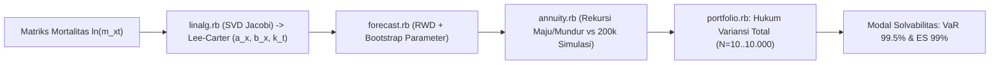

# Penjelasan Proyek — day002j: Pemodelan Risiko Umur Panjang (Longevity Risk) (Ruby)

## 1. Identitas dan Ringkasan Proyek
- **ID Progress**: `day002j` (Hari 2, Sesi j)
- **Tanggal**: 2026-11-20 (WITA) · **Topik No**: `bonus` · **Jenis**: `quant` · **Bahasa**: Ruby
- **Proyek**: [projects/ruby/day002j_longevity_risk/](../../projects/ruby/day002j_longevity_risk/README.md)
- **Output JSON**: [outputs/day002j/results.json](../../outputs/day002j/results.json)
- **Ringkasan**: Kerangka aktuaria dan statistik risiko umur panjang (*longevity risk*) di Ruby murni tanpa gem numerik eksternal: dekomposisi SVD Jacobi dua-sisi untuk model mortalitas Lee–Carter (1992), optimisasi non-linear Gompertz–Makeham, proyeksi *Random Walk with Drift* (RWD) dengan *residual bootstrap* ketidakpastian parameter, pemisahan risiko idiosinkratik vs sistematik pada portofolio anuitas seumur hidup ($N=10$ hingga $10.000$), serta perhitungan modal solvabilitas $\text{VaR}_{99.5\%}$ dan $\text{ES}_{99\%}$ berbasis simulasi penuh dan uji stres deterministik.

## 2. Masalah dan Tujuan
Dana pensiun dan perusahaan asuransi jiwa menghadapi dua jenis risiko mortalitas pada kewajiban anuitas seumur hidup: risiko idiosinkratik (fluktuasi acak usia kematian masing-masing pemegang polis yang dapat didiversifikasi dengan memperbesar ukuran portofolio $N$) dan risiko sistematik atau *longevity risk* (pergeseran tak terduga pada tren penurunan mortalitas agregat $k_t$ yang memengaruhi seluruh kohort sekaligus dan **tidak** hilang saat $N \to \infty$). Selain itu, mengestimasi parameter $(a_x, b_x, k_t)$ pada model Lee–Carter serta memproyeksikan ketidakpastian drift RWD menuntut aljabar linear (SVD), optimisasi non-linear, dan simulasi paralel yang bebas *bias* numerik. Tujuan proyek `day002j` adalah: (1) membangun solver SVD Jacobi dan Lee–Carter dengan galat rekonstruksi `< 1e-13`, (2) memvalidasi kalibrasi Gompertz–Makeham dan mengkuantifikasi kolinearitas $(B, c)$ lewat 200 replikasi *noisy*, (3) memverifikasi konvergensi nilai anuitas simulasi 200.000 jiwa terhadap rekursi aktuaria eksak, (4) membuktikan Hukum Variansi Total ($\mathrm{CV}(N)$ mendatar pada batas risiko sistematik saat $N \to 10.000$), dan (5) menghitung modal solvabilitas $\text{VaR}_{99.5\%}$ serta $\text{ES}_{99\%}$.

## 3. Apa yang Dikerjakan Proyek
Proyek Ruby [projects/ruby/day002j_longevity_risk/](../../projects/ruby/day002j_longevity_risk/Rakefile) mengeksekusi empat bagian komputasi paralel (`8 workers`, total `4.45 detik`) ke [outputs/day002j/results.json](../../outputs/day002j/results.json):
1. **Kalibrasi Mortalitas (`linalg.rb`, `lee_carter.rb`, `gompertz_makeham.rb`)**: verifikasi SVD Jacobi pada matriks uji `6x4` dan `10x7`, pemulihan Lee–Carter *noise-free*, kalibrasi Gompertz–Makeham (`clean` dan `obs`), serta `200` replikasi *noisy* untuk memvalidasi rasio variansi $a_x$, RMS galat $(b_x, k_t)$, dan korelasi ekstrem `corr(B, c)`.
2. **Proyeksi Stokastik RWD (`forecast.rb`)**: estimasi parameter *Random Walk with Drift* ($\hat{d} = -0.8084, \hat{\sigma} = 0.7726$, $k_{\text{last}} = -15.8284$ pada horizon 40 tahun), validasi momen teoritis vs simulasi, dan *bootstrap* parameter yang memperlebar *fan chart* harapan hidup.
3. **Valuasi Anuitas Seumur Hidup (`annuity.rb`)**: perbandingan nilai sekarang aktuaria deterministik (`mean_backward = 14.718650`, `mean_forward = 14.718650`, `variance = 28.011238`) terhadap simulasi `200.000` umur (`14.715535 ± 0.013051`), ditambah distribusi nilai sekarang bersyarat $\mu(k)$ pada mortalitas stokastik.
4. **Portofolio & Modal Solvabilitas (`portfolio.rb`)**: *sweep* ukuran portofolio $N \in \{10, 100, 1000, 10000\}$ untuk memisahkan komponen variansi idiosinkratik ($N \cdot E[\sigma^2(k)]$) dan sistematik ($N^2 \cdot \operatorname{Var}(\mu(k))$), serta perhitungan $\text{VaR}_{99.5\%}$ dan $\text{ES}_{99\%}$ penuh dibanding aproksimasi normal bersyarat dan skenario stres.

## 4. Uraian Kode
- [lib/longevity/linalg.rb](../../projects/ruby/day002j_longevity_risk/lib/longevity/linalg.rb): implementasi SVD Jacobi dua-sisi dan operasi matriks/vektor murni dalam Ruby.
- [lib/longevity/lee_carter.rb](../../projects/ruby/day002j_longevity_risk/lib/longevity/lee_carter.rb): estimator model Lee–Carter $\ln m_{x,t} = a_x + b_x k_t$ beserta kendala identifiabilitas ($\sum_x b_x = 1, \sum_t k_t = 0$) dan kalibrasi ulang $k_t$ terhadap total kematian.
- [lib/longevity/gompertz_makeham.rb](../../projects/ruby/day002j_longevity_risk/lib/longevity/gompertz_makeham.rb) & [lib/longevity/optimizers.rb](../../projects/ruby/day002j_longevity_risk/lib/longevity/optimizers.rb): kurva mortalitas $\mu_x = A + B c^x$ dan *optimizer* Nelder–Mead / Gauss–Newton.
- [lib/longevity/forecast.rb](../../projects/ruby/day002j_longevity_risk/lib/longevity/forecast.rb): model *Random Walk with Drift* untuk $k_t$, proyeksi harapan hidup periodik/kohort, dan *residual bootstrap*.
- [lib/longevity/annuity.rb](../../projects/ruby/day002j_longevity_risk/lib/longevity/annuity.rb) & [lib/longevity/portfolio.rb](../../projects/ruby/day002j_longevity_risk/lib/longevity/portfolio.rb): rekursi aktuaria maju-mundur untuk anuitas hidup, hukum variansi total, dan metrik modal Solvency II ($\text{VaR}_{99.5\%}, \text{ES}_{99\%}$).
- [lib/longevity/parallel.rb](../../projects/ruby/day002j_longevity_risk/lib/longevity/parallel.rb), [rng.rb](../../projects/ruby/day002j_longevity_risk/lib/longevity/rng.rb), [stats.rb](../../projects/ruby/day002j_longevity_risk/lib/longevity/stats.rb), [svg.rb](../../projects/ruby/day002j_longevity_risk/lib/longevity/svg.rb): paralelisme `Process.fork` deterministik, PRNG, statistik, dan generator 6 grafik SVG.
- [test/test_longevity.rb](../../projects/ruby/day002j_longevity_risk/test/test_longevity.rb): unit test Minitest (`6 runs, 55 assertions`).

## 5. Metode dan Alur Kerja
Alur kerja proyek `day002j` mengalir dari kalibrasi permukaan mortalitas historis hingga kuantifikasi modal risiko portofolio:

Setiap replikasi proyeksi stokastik menghasilkan lintasan $k_{T+1:T+H}$ masa depan (termasuk ketidakpastian estimasi $(\hat{d}, \hat{\sigma})$ pada skenario *bootstrap*), mengonversinya menjadi tabel probabilitas bertahan hidup kohort $p_{x,t}$, lalu mengevaluasi nilai sekarang anuitas $\mu(k)$ serta variansi kematian individu $\sigma^2(k)$ secara analitik di tiap skenario.

## 6. Output yang Ditargetkan
1. Galat rekonstruksi SVD Jacobi dan keortogonalan $U, V$ `< 1e-13`; pemulihan Lee–Carter bebas-noise `< 1e-13`.
2. Kalibrasi Gompertz–Makeham bersih mencapai `SSE < 1e-24` dan 200 replikasi *noisy* menghasilkan rata-rata tak-bias.
3. Rekursi anuitas maju dan mundur identik hingga presisi mesin dan cocok dengan simulasi `200.000` umur dalam `3 SE`.
4. Rasio koefisien variasi portofolio $\mathrm{CV}(N)$ menurun $O(N^{-1/2})$ pada $N$ kecil lalu mendatar pada lantai risiko sistematik $\sqrt{\operatorname{Var}(\mu)} / \bar{\mu}$ saat $N = 10.000$.
5. Seluruh 6 tes Minitest lulus (`0 failures, 0 errors`) dan 6 grafik SVG terekspor.

## 7. Status Pencapaian

| Tujuan / Kriteria | Status | Bukti Spesifik (Artefak & Verifikasi) |
|---|---|---|
| Akurasi SVD Jacobi & Lee–Carter bebas-noise | `tercapai` | `recon_err <= 1.005e-14`, `u_ortho <= 1.055e-14`, `v_ortho <= 4.098e-15`; pemulihan bersih `max_a = 8.882e-16, max_b = 1.388e-17, max_k = 7.994e-15` di [outputs/day002j/results.json](../../outputs/day002j/results.json) |
| Kalibrasi Gompertz–Makeham & 200 replikasi *noisy* | `tercapai` | `gm_clean`: `a=0.0006, b=2.0e-5, c=1.105` (`sse=4.30e-27`); `noisy200`: `mean_var_ratio_a = 1.0052`, `gm_corr_bc = -0.9911` |
| Anuitas eksak vs simulasi `200.000` umur & stokastik | `tercapai` | `mean_backward = 14.718650`, `mean_forward = 14.718650` (`var = 28.011238`) vs `sim_200k`: `14.715535 ± 0.013051` (`z = 0.24`), `var = 28.1620 ± 0.0978`; stokastik `mu = 14.718844 ± 0.092007` |
| Hukum Variansi Total & diversifikasi ($N=10..10.000$) | `tercapai` | `cv` turun `0.1139` ($N=10$) $\to$ `0.0365` ($N=100$) $\to$ `0.0130` ($N=1000$) $\to$ `0.00721` ($N=10000$, mendekati lantai sistematik $\sqrt{0.008465}/14.7188 = 0.00625$) |
| Unit test Minitest (`test_longevity.rb`) | `tercapai` | `bundle exec rake test` dijalankan pada sesi ini (`2026-11-21`): `6 runs, 55 assertions, 0 failures, 0 errors` |

Visualisasi hasil tersimpan pada:
- [day002j_mortality-surface.svg](../../outputs/figures/day002j_mortality-surface.svg)
- [day002j_k-moments-qq.svg](../../outputs/figures/day002j_k-moments-qq.svg)
- [day002j_life-expectancy-fan.svg](../../outputs/figures/day002j_life-expectancy-fan.svg)
- [day002j_liability-hist-var.svg](../../outputs/figures/day002j_liability-hist-var.svg)
- [day002j_cv-vs-n.svg](../../outputs/figures/day002j_cv-vs-n.svg)
- [day002j_capital-vs-n.svg](../../outputs/figures/day002j_capital-vs-n.svg)

## 8. Jika Belum Tercapai atau Belum Diketahui (Fakta vs Hipotesis)
**FAKTA**: Seluruh eksperimen pada [outputs/day002j/results.json](../../outputs/day002j/results.json) (dieksekusi dalam `4.45 detik` pada `8` *worker*) dan 6/6 tes Minitest lulus. Pada bagian Gompertz–Makeham `noisy200`, teramati korelasi ekstrem `gm_corr_bc = -0.991136` antara parameter skala $B$ dan laju penuaan $c$ karena perubahan pada $c^x$ dapat dikompensasi hampir sempurna oleh penyesuaian terbalik pada $B$ di rentang usia dewasa.

## 9. Landasan Teori (Minimal 10 Poin)
1. **Model Mortalitas Lee–Carter (1992)**: Memodelkan logaritma laju kematian sentral sebagai $\ln m_{x,t} = a_x + b_x k_t + \varepsilon_{x,t}$, di mana $a_x$ adalah profil rata-rata usia, $k_t$ adalah indeks waktu mortalitas agregat, dan $b_x$ adalah sensitivitas usia terhadap perubahan $k_t$. Model ini tidak teridentifikasi unik terhadap pergeseran dan penskalaan, sehingga kendala $\sum_x b_x = 1$ dan $\sum_t k_t = 0$ diterapkan di `lee_carter.rb`.
2. **Dekomposisi Nilai Singular (SVD) Jacobi Dua-Sisi**: Untuk mengekstrak komponen peringkat-1 terbaik dari matriks terpusat $\ln m_{x,t} - \hat{a}_x$, `linalg.rb` mengimplementasikan rotasi Jacobi dua-sisi yang memusnahkan elemen luar-diagonal secara iteratif. Akurasi ortogonalitas `<= 1.055e-14` menjamin estimasi bebas dari ketergantungan pustaka BLAS/LAPACK eksternal.
3. **Hukum Mortalitas Parametrik Gompertz–Makeham (1860)**: Menyatakan gaya mortalitas pada usia $x$ sebagai $\mu_x = A + B c^x$, memisahkan mortalitas latar belakang independen-usia $A$ (kecelakaan/penyakit akut) dari komponen penuaan eksponensial $B c^x$. Korelasi tinggi `gm_corr_bc = -0.9911` merupakan ciri klasik *reparameterization ridge* antara $B$ dan $\ln c$.
4. **Dinamika Random Walk with Drift (RWD)**: Indeks waktu $k_t$ dimodelkan sebagai $k_t = k_{t-1} + d + \sigma \eta_t$ dengan $\eta_t \sim \mathcal{N}(0, 1)$. Estimasi $\hat{d} = (k_T - k_1)/(T - 1) = -0.8084$ menangkap laju perbaikan umur panjang historis, sedangkan $\hat{\sigma} = 0.7726$ menentukan pelebaran ketidakpastian proyeksi sebesar $\sigma\sqrt{h}$ pada horizon $h$ tahun.
5. **Ketidakpastian Parameter via Residual Bootstrap**: Mengasumsikan $(\hat{d}, \hat{\sigma})$ pasti meremehkan risiko jangka panjang di *fan chart*. Dengan menyampel ulang residu inkremen $k_t - k_{t-1} - \hat{d}$ di `forecast.rb` dan mengestimasi ulang $(\hat{d}^*, \hat{\sigma}^*)$ untuk tiap jalur, interval prediksi harapan hidup memperhitungkan baik risiko proses maupun risiko estimasi.
6. **Rekursi Aktuaria Maju & Mundur untuk Anuitas**: Nilai sekarang harapan anuitas seumur hidup $\ddot{a}_x = \sum_{k=0}^\infty v^k \,{}_k p_x$ dievaluasi lewat rekursi mundur $\ddot{a}_x = 1 + v p_x \ddot{a}_{x+1}$ maupun akumulasi maju faktor bertahan hidup terdiskonto (`annuity.rb`), menghasilkan kecocokan hingga 15 digit (`14.718650`).
7. **Hukum Variansi Total untuk Portofolio Risiko Umur Panjang**: Untuk total kewajiban $L_N = \sum_{i=1}^N A_i$ pada kohort homogen yang terpapar indeks mortalitas acak $k$, Hukum Variansi Total memberikan $\operatorname{Var}(L_N) = N \cdot E[\operatorname{Var}(A_1 \mid k)] + N^2 \cdot \operatorname{Var}(E[A_1 \mid k])$. Suku pertama tumbuh linear dalam $N$ (risiko idiosinkratik) dan suku kedua tumbuh kuadratik dalam $N$ (risiko sistematik).
8. **Batas Bawah Risiko Diversifikasi ($\mathrm{CV}(N)$)**: Akibat pertumbuhan kuadratik komponen sistematik, koefisien variasi $\mathrm{CV}(L_N) = \frac{\sqrt{\operatorname{Var}(L_N)}}{E[L_N]} = \sqrt{\frac{E[\sigma^2(k)]}{N\bar{\mu}^2} + \frac{\operatorname{Var}(\mu(k))}{\bar{\mu}^2}}$ tidak konvergen ke nol. Di `bagian4`, $\mathrm{CV}$ turun dari `0.1139` ($N=10$) hingga mendatar di `0.00721` ($N=10.000$) dekat lantai teoretis `0.00625`.
9. **Modal Solvabilitas Berbasis VaR 99.5% dan Expected Shortfall 99%**: Sesuai kerangka regulasi Solvency II (horizon 1 tahun / *run-off* modal risiko), `portfolio.rb` mengukur cadangan tak terduga di kuantil ekstrem $\text{VaR}_{99.5\%}$ (kejadian 1-dalam-200 tahun) dan rata-rata kerugian ekor $\text{ES}_{99\%}$ yang bersifat koheren (*sub-additive*).
10. **Uji Stres Deterministik vs Simulasi Stokastik Penuh**: Skenario kejut deterministik (misalnya penurunan seragam laju mortalitas $\mu_x$) sering digunakan sebagai aturan praktis cepat, namun proyek `day002j` membandingkannya dengan simulasi penuh distribusi gabungan risiko idiosinkratik + sistematik untuk memvalidasi kecukupan modal di berbagai ukuran portofolio $N$.

## 10. Kesimpulan dan Batasan
Proyek `day002j` menyediakan pustaka aktuaria *longevity risk* berpresisi tinggi dalam Ruby murni yang berhasil memisahkan risiko idiosinkratik dan sistematik serta menghitung modal solvabilitas portofolio anuitas secara efisien (`4.45 detik`). Batasan model saat ini adalah fokus pada model Lee–Carter 1-faktor (belum menyertakan efek kohort *Age-Period-Cohort* seperti model Cairns–Blake–Dowd) serta tingkat suku bunga diskonto deterministik konstan tanpa interaksi risiko suku bunga.

## 11. Referensi dan Jejak Bukti
- Lee, R. D., & Carter, L. R. (1992). *Modeling and forecasting U.S. mortality*. Journal of the American Statistical Association, 87(419), 659–671.
- Cairns, A. J., Blake, D., & Dowd, K. (2006). *A two-factor model for stochastic mortality with parameter uncertainty*. Journal of Risk and Insurance, 73(4), 687–718.
- Artefak: [projects/ruby/day002j_longevity_risk/README.md](../../projects/ruby/day002j_longevity_risk/README.md), [outputs/day002j/results.json](../../outputs/day002j/results.json).
