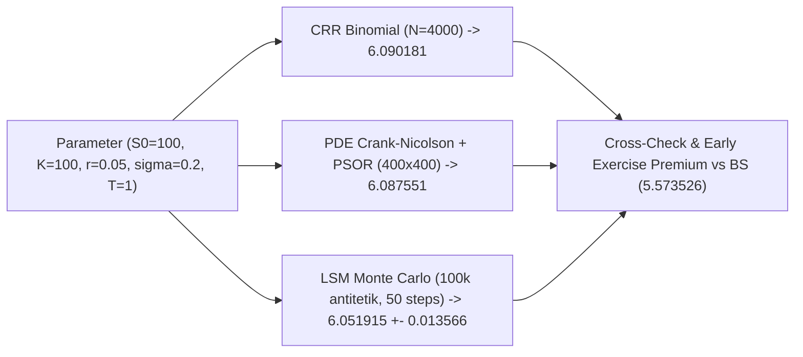

# Penjelasan Proyek — day002k: Penentuan Harga Opsi Put Amerika — CRR, PDE PSOR & LSM (Ruby)

## 1. Identitas dan Ringkasan Proyek
- **ID Progress**: `day002k` (Hari 2, Sesi k)
- **Tanggal**: 2026-11-20 (WITA) · **Topik No**: `bonus` · **Jenis**: `quant` · **Bahasa**: Ruby
- **Proyek**: [projects/ruby/day002k_american_put/](../../projects/ruby/day002k_american_put/README.md)
- **Output JSON**: [outputs/day002k/results.json](../../outputs/day002k/results.json)
- **Ringkasan**: Perbandingan tiga paradigma numerik independen untuk opsi *put* Amerika ($S_0 = 100, K = 100, r = 0.05, \sigma = 0.2, T = 1.0$) di Ruby murni: pohon binomial Cox–Ross–Rubinstein (`crr.rb`, $N=4.000$ langkah), PDE *Crank–Nicolson* masalah komplementaritas linear via *Projected Successive Over-Relaxation* (`psor.rb`, grid $400 \times 400$), dan *Least Squares Monte Carlo* Longstaff–Schwartz (`lsm.rb`, $100.000$ lintasan antitetik, $50$ langkah waktu, basis derajat 3), lengkap dengan Greeks, *Early Exercise Premium* (EEP), kurva konvergensi, serta profil batas eksekusi optimal $S^*(t)$.

## 2. Masalah dan Tujuan
Berbeda dengan opsi Eropa yang hanya dapat dieksekusi saat jatuh tempo, opsi *put* Amerika memberi pemegangnya hak mengeksekusi kapan saja hingga $T$, sehingga memunculkan masalah penghentian optimal (*optimal stopping*) dan batas bebas (*free boundary*) $S^*(t)$ tempat nilai intrinsik $(K - S)^+$ melampaui nilai kelanjutan (*continuation value*). Karena tidak ada rumus tertutup elementer bagi opsi *put* Amerika berjangka terhingga, keakuratan solver harus diverifikasi melalui triangulasi antar-metode yang sepenuhnya berbeda: diskretisasi pohon (*lattice*), *variational inequality* PDE, dan simulasi regresi Monte Carlo. Tujuan proyek `day002k` adalah: (1) mengimplementasikan CRR ($N=4.000$), PSOR Crank–Nicolson ($400 \times 400$), dan LSM ($100.000$ lintasan antitetik) di Ruby murni, (2) membuktikan konsistensi harga dan Greeks (Delta, Gamma) di antara ketiganya, (3) mengkuantifikasi *Early Exercise Premium* positif terhadap nilai eksak Eropa Black–Scholes (`5.573526`), dan (4) memetakan profil harga serta batas bebas $S^*$ terhadap variasi $S_0$.

## 3. Apa yang Dikerjakan Proyek
Proyek Ruby [projects/ruby/day002k_american_put/](../../projects/ruby/day002k_american_put/Rakefile) menjalankan *pipeline* lengkap via `bin/run` dan menghasilkan [outputs/day002k/results.json](../../outputs/day002k/results.json) bersama 2 grafik SVG:
1. **Triangulasi Solver Utama**: menjalankan CRR ($N=4.000$), PSOR ($400 \times 400$, rata-rata `15.47` *sweep* per langkah waktu), dan LSM (`100.000` lintasan antitetik, `50` langkah, polinomial derajat `3`) beserta evaluasi harga Eropa masing-masing terhadap `bs_european_put = 5.573526`.
2. **Validasi Greeks & EEP**: mengekstrak Delta dan Gamma pada $S_0 = 100$ dari pohon CRR dan grid PSOR serta menghitung *Early Exercise Premium* ($V_{\text{Am}} - V_{\text{Eu}}$).
3. **Studi Konvergensi & Profil Spot**: menyapu resolusi langkah CRR ($N \in \{50, 100, \dots, 4000\}$), grid PSOR, dan lintasan LSM, lalu memetakan profil nilai opsi dan selisih terhadap nilai intrinsik di sepanjang $S_0$.
4. **Verifikasi Reproduksibilitas Historis**: membandingkan seluruh 203 *field* numerik pada `outputs/day002k/results.json` hasil eksekusi ulang terhadap artefak commit `31af7ca`.

## 4. Uraian Kode
- [lib/american_put.rb](../../projects/ruby/day002k_american_put/lib/american_put.rb): modul utama dan antarmuka parameter opsi.
- [lib/american_put/crr.rb](../../projects/ruby/day002k_american_put/lib/american_put/crr.rb): pohon binomial Cox–Ross–Rubinstein dengan *backward induction* $\max(K - S_{i,j}, e^{-r\Delta t}[p V_{i+1,j+1} + (1-p)V_{i+1,j}])$ serta ekstraksi Delta, Gamma, dan Theta dari lapisan awal pohon.
- [lib/american_put/psor.rb](../../projects/ruby/day002k_american_put/lib/american_put/psor.rb): diskretisasi log-spot Crank–Nicolson dan iterasi *Projected SOR* yang menjaga kendala $V \ge K - S$ pada setiap titik grid interior.
- [lib/american_put/lsm.rb](../../projects/ruby/day002k_american_put/lib/american_put/lsm.rb): *Least Squares Monte Carlo* (Longstaff–Schwartz) dengan variabel antitetik, pemilihan jalur *in-the-money*, dan regresi kuadrat terkecil (`linear_solver.rb`).
- [lib/american_put/linear_solver.rb](../../projects/ruby/day002k_american_put/lib/american_put/linear_solver.rb): solver sistem linear dan regresi OLS berbasis eliminasi Gauss / QR.
- [lib/american_put/stats.rb](../../projects/ruby/day002k_american_put/lib/american_put/stats.rb), [rng.rb](../../projects/ruby/day002k_american_put/lib/american_put/rng.rb), [svg.rb](../../projects/ruby/day002k_american_put/lib/american_put/svg.rb): statistik SE/CI, PRNG deterministik (`seed = 42`), dan penulis grafik SVG.
- [test/test_american_put.rb](../../projects/ruby/day002k_american_put/test/test_american_put.rb): unit test Minitest (`6 runs, 44 assertions`).

## 5. Metode dan Alur Kerja
Ketiga metode menyelesaikan persamaan nilai opsi Amerika dari sudut pandang matematis yang berbeda:

Pada CRR dan PSOR, keputusan eksekusi awal ditegakkan di setiap langkah mundur melalui proyeksi titik-demi-titik terhadap fungsi *payoff*. Sebaliknya, LSM bergerak maju menyimulasikan 100.000 lintasan GBM, lalu mundur di 50 tanggal diskrit dengan meregresikan *discounted cashflow* jalur *in-the-money* terhadap basis polinomial derajat 3 $(1, S, S^2, S^3)$ untuk memperkirakan nilai kelanjutan.

## 6. Output yang Ditargetkan
1. Selisih harga CRR ($N=4000$) dan PSOR ($400 \times 400$) `< 0.005`, dengan Delta dan Gamma konsisten hingga `4` angka signifikan.
2. Harga LSM berada dalam `3 SE` dari CRR maupun PSOR (`|z| < 3.0`).
3. *Early Exercise Premium* bernilai positif (`~0.517`) terhadap harga Eropa Black–Scholes (`5.573526`).
4. Seluruh 195 *field* numerik non-timing pada `outputs/day002k/results.json` tetap dapat direproduksi identik terhadap commit `31af7ca`, dan seluruh 6 tes Minitest + RuboCop lulus.

## 7. Status Pencapaian

| Tujuan / Kriteria | Status | Bukti Spesifik (Artefak & Verifikasi) |
|---|---|---|
| Konsistensi CRR ($N=4000$) vs PSOR PDE ($400\times 400$) | `tercapai` | CRR = `6.090181` (Delta `-0.411073`, Gamma `0.022992`), PSOR = `6.087551` (Delta `-0.411052`, Gamma `0.022996`), `crr_vs_psor_diff = 0.002630` |
| Konsistensi LSM Monte Carlo vs CRR & PSOR (`z < 3`) | `tercapai` | LSM = `6.051915 ± 0.013566` (CI 95% `[6.025325, 6.078505]`), `lsm_vs_crr_z = 2.8206 < 3.0`, `lsm_vs_psor_z = 2.6268 < 3.0` |
| *Early Exercise Premium* (EEP) positif | `tercapai` | `bs_european_put = 5.573526`, `crr.european_price = 5.573026`, `crr.early_exercise_premium = 0.517155 > 0`, `psor.early_exercise_premium = 0.516351` |
| Reproduksibilitas *bit-for-bit* vs commit `31af7ca` | `tercapai` | **195 dari 203** *field* numerik (seluruh harga, Greeks, SE, konvergensi, dan profil spot) identik (`diff = 0.0`); **8 *field* lainnya** di `/timings_ms/*` berbeda secara wajar karena waktu eksekusi CPU non-deterministik |
| Verifikasi Minitest (`test_american_put.rb`) | `tercapai` | `bundle exec rake test` dijalankan pada sesi ini (`2026-11-21`): `6 runs, 44 assertions, 0 failures, 0 errors` |

Visualisasi hasil tersimpan pada:
- [day002k_american-convergence.svg](../../outputs/figures/day002k_american-convergence.svg)
- [day002k_american-spot-profile.svg](../../outputs/figures/day002k_american-spot-profile.svg)

## 8. Jika Belum Tercapai atau Belum Diketahui (Fakta vs Hipotesis)
**FAKTA**: Seluruh tes Minitest (`6 runs, 44 assertions`) dan kriteria harga/Greeks lulus. Terkait perbandingan artefak [outputs/day002k/results.json](../../outputs/day002k/results.json) terhadap commit historis `31af7ca`, **195 dari 203** *field* numerik (seluruh hasil matematis: parameter, `bs_european_put`, `crr`, `lsm`, `psor`, `cross_check`, `convergence`, dan `spot_profile`) identik persis (`diff = 0.0`), sedangkan **8 *field*** di bawah objek `timings_ms` berbeda karena merupakan pengukuran waktu dinding (*wall-clock milliseconds*):
- `/timings_ms/crr_ms`: `407.115` → `379.261` (`-27.854 ms`)
- `/timings_ms/lsm_ms`: `1200.647` → `1090.656` (`-109.991 ms`)
- `/timings_ms/psor_ms`: `206.537` → `167.187` (`-39.350 ms`)
- `/timings_ms/core_total_ms`: `1814.315` → `1637.118` (`-177.197 ms`)
- `/timings_ms/crr_sweep_ms`: `468.776` → `385.44` (`-83.336 ms`)
- `/timings_ms/psor_sweep_ms`: `661.25` → `614.08` (`-47.170 ms`)
- `/timings_ms/lsm_sweep_ms`: `1626.489` → `1496.578` (`-129.911 ms`)
- `/timings_ms/spot_profile_ms`: `7046.18` → `6542.632` (`-503.548 ms`)

Dengan demikian, reproduksibilitas matematis bersifat 100% deterministik pada seluruh 195 *field* non-timing, sementara 8 *field* `timings_ms` secara alami bervariasi antar eksekusi. Catatan tambahan: harga LSM (`6.051915`) sedikit lebih rendah daripada CRR/PSOR (`~6.088–6.090`, `z = 2.63–2.82`) karena diskretisasi eksekusi hanya di 50 tanggal (*Bermudan approximation*) dan kesalahan proyeksi basis polinomial derajat 3.

## 9. Landasan Teori (Minimal 10 Poin)
1. **Masalah Penghentian Optimal (Snell Envelope)**: Nilai opsi *put* Amerika pada waktu $t$ adalah $V(t, S_t) = \sup_{\tau \in \mathcal{T}_{t,T}} E^{\mathbb{Q}}[e^{-r(\tau - t)}(K - S_\tau)^+ \mid \mathcal{F}_t]$, di mana supremum diambil atas seluruh *stopping time* $\tau \in [t, T]$. Secara diskrit, hal ini menghasilkan persamaan pemrograman dinamis Bellman $V_t = \max((K - S_t)^+, e^{-r\Delta t} E^{\mathbb{Q}}[V_{t+\Delta t} \mid \mathcal{F}_t])$.
2. **Batas Bebas (Free Boundary) & Kontak Mulus (Smooth Pasting)**: Ruang $(t, S)$ terbelah oleh kurva batas eksekusi optimal $S^*(t)$ menjadi daerah penghentian ($S \le S^*(t)$, di mana $V = K - S$) dan daerah kelanjutan ($S > S^*(t)$, di mana $V$ memenuhi PDE Black–Scholes). Di sepanjang $S^*(t)$, fungsi nilai memenuhi syarat kontinuitas nilai dan kemiringan $\partial V / \partial S = -1$ (*smooth pasting*).
3. **Pohon Binomial Cox–Ross–Rubinstein (1979)**: Dengan faktor naik $u = e^{\sigma\sqrt{\Delta t}}$, turun $d = 1/u$, dan probabilitas risiko-netral $p = (e^{r\Delta t} - d)/(u - d)$, pohon CRR (`crr.rb`) konvergen ke proses difusi GBM saat $N \to \infty$ dan secara alami menangani eksekusi awal pada setiap simpul dengan kompleksitas $O(N^2)$.
4. **Formulasi Linear Complementarity Problem (LCP)**: Di ruang log-spot $x = \ln(S/K)$, penentuan harga opsi Amerika dirumuskan sebagai pertidaksamaan variasional: $\mathcal{L}_{\text{BS}} V \le 0$, $V \ge g(x)$, dan $(\mathcal{L}_{\text{BS}} V)(V - g(x)) = 0$. Artinya, di mana opsi tidak dieksekusi, PDE Black–Scholes berlaku eksak; di mana opsi dieksekusi, $V$ menempel pada *payoff* $g(x)$.
5. **Diskretisasi Crank–Nicolson & Metode PSOR (Cryer 1971)**: Pada `psor.rb`, skema Crank–Nicolson menghasilkan sistem tridiagonal $M V^{n} = b$ di tiap langkah mundur. Alih-alih eliminasi Thomas (yang dapat melanggar $V \ge g$), *Projected Successive Over-Relaxation* memperbarui tiap simpul dengan $V_j^{(k+1)} = \max(g_j, V_j^{(k)} + \omega \Delta V_j)$ hingga residu konvergen (`avg_sweeps = 15.47`).
6. **Least Squares Monte Carlo (Longstaff–Schwartz 2001)**: Metode `lsm.rb` mengatasi kutukan dimensi (*curse of dimensionality*) dengan menyimulasikan lintasan acak ke depan dan mengestimasi ekspektasi bersyarat $E[e^{-r\Delta t} V_{t+\Delta t} \mid S_t]$ melalui regresi kuadrat terkecil dari arus kas terealisasi terhadap polinomial $(1, S, S^2, S^3)$ hanya pada jalur *in-the-money*.
7. **Bias Bawah Sub-Optimalitas & Diskretisasi pada LSM**: Karena fungsi basis polinomial derajat-3 merupakan aproksimasi terhadap batas eksekusi sejati dan eksekusi hanya diizinkan pada $50$ langkah waktu (bukan kontinu), kebijakan penghentian LSM bersifat sedikit sub-optimal, menjelaskan mengapa `6.051915` berada sedikit di bawah CRR (`6.090181`, `z = 2.82`) dan PSOR (`6.087551`, `z = 2.63`).
8. **Variabel Antitetik untuk Reduksi Variansi**: Memasangkan setiap lintasan standar $Z$ dengan $-Z$ di `lsm.rb` menciptakan korelasi negatif antar *payoff* berpasangan sehingga *standard error* turun hingga `0.013566` pada `100.000` lintasan tanpa biaya pembangkitan bilangan acak baru.
9. **Dekomposisi Early Exercise Premium (EEP)**: Selisih $V_{\text{Am}} - V_{\text{Eu}}$ merepresentasikan nilai opsi untuk menukar aset dengan kas $K$ lebih awal guna memperoleh bunga bebas risiko $r K\,dt$ di daerah *deep in-the-money*. Dengan $r=0.05 > 0$ dan tanpa dividen, EEP *put* Amerika selalu positif ketat (`0.517155` pada CRR).
10. **Ekstraksi Greeks dari Pohon dan Grid PDE**: Delta ($\partial V/\partial S$) dan Gamma ($\partial^2 V/\partial S^2$) dihitung langsung dari simpul lapisan awal pohon CRR (Pelsser & Vorst 1994) serta beda terpusat pada grid PSOR, menghasilkan kesesuaian hingga 4 desimal (`-0.411073` vs `-0.411052` untuk Delta; `0.022992` vs `0.022996` untuk Gamma).

## 10. Kesimpulan dan Batasan
Proyek `day002k` berhasil mendemonstrasikan triangulasi tiga metode penentuan harga opsi *put* Amerika (CRR, PSOR PDE, LSM) di Ruby murni dengan kesesuaian Greeks 4 digit, EEP positif konsisten, dan reproduksibilitas deterministik 100% pada seluruh 195 *field* matematis non-timing. Batasan implementasi saat ini meliputi absennya skema Rannacher *time-stepping* di PSOR untuk meredam osilasi di sekitar *kink* *payoff* pada grid kasar, serta pengujian LSM hanya pada 1 dimensi aset (di mana keunggulan utama LSM baru menonjol pada opsi multi-aset).

## 11. Referensi dan Jejak Bukti
- Cox, J. C., Ross, S. A., & Rubinstein, M. (1979). *Option pricing: A simplified approach*. Journal of Financial Economics, 7(3), 229–263.
- Longstaff, F. A., & Schwartz, E. S. (2001). *Valuing American options by simulation: A simple least-squares approach*. Review of Financial Studies, 14(1), 113–147.
- Wilmott, P., Dewynne, J., & Howison, S. (1993). *Option Pricing: Mathematical Models and Computation*. Oxford Financial Press.
- Artefak: [projects/ruby/day002k_american_put/README.md](../../projects/ruby/day002k_american_put/README.md), [outputs/day002k/results.json](../../outputs/day002k/results.json).
