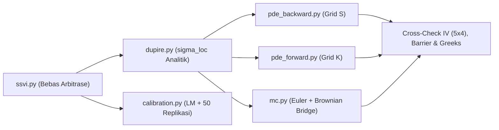

# Penjelasan Proyek — day003a: Permukaan SSVI, Volatilitas Lokal Dupire, Dua PDE & Kalibrasi (Python)

## 1. Identitas dan Ringkasan Proyek
- **ID Progress**: `day003a` (Hari 3, Sesi a — Sesi Tantangan Berat Python)
- **Tanggal**: 2026-11-21 (WITA) · **Topik No**: `null` (*off-roadmap*) · **Jenis**: `quant` · **Bahasa**: Python
- **Notebook**: [days/day003a_quant_volatilitas-lokal-dupire-ssvi.ipynb](../../days/day003a_quant_volatilitas-lokal-dupire-ssvi.ipynb)
- **Paket & Output**: [src/qb100/day003a_local_vol/__init__.py](../../src/qb100/day003a_local_vol/__init__.py), [outputs/day003a/results.json](../../outputs/day003a/results.json)
- **Ringkasan**: Pipeline volatilitas lokal Dupire berbasis permukaan *Surface SVI* (Gatheral & Jacquier 2014) yang bebas arbitrase statis: turunan analitik *butterfly* & *calendar*, konversi analitik ke varians lokal Dupire $\sigma_{\text{loc}}^2(K, T)$, dua solver PDE independen (Crank–Nicolson *backward* di $S$ dan Dupire *forward* di $K$), Monte Carlo Euler dengan diagnosis penyusutan bias *weak-order* 1, opsi *barrier down-and-out*, Greeks + diagnosis lapisan batas Gamma SSVI di sudut $(S_0=100, t\to 0)$, serta kalibrasi balik Levenberg–Marquardt beserta 50 replikasi Monte Carlo.

## 2. Masalah dan Tujuan
Menginterpolasi *implied volatility* pasar secara naif dapat memicu kepadatan probabilitas risiko-netral negatif (*butterfly arbitrage*) atau varians total menurun terhadap waktu (*calendar arbitrage*), yang menyebabkan varians lokal Dupire menjadi negatif sehingga solver PDE dan Monte Carlo meledak. Sebaliknya, parametrisasi SSVI (Gatheral & Jacquier 2014) menjamin bebas arbitrase secara analitik melalui Teorema 4.2, memungkinkan penurunan rumus tertutup $\sigma_{\text{loc}}^2(K, T)$. Namun, ketika $\sigma_{\text{loc}}$ digunakan pada berbagai mesin numerik (PDE *backward*, PDE *forward*, MC Euler, opsi *barrier*, dan Greeks), muncul tantangan konsistensi numerik — termasuk bias diskretisasi waktu $O(\Delta t)$ pada MC Euler dan sensitivitas sudut $(S_0 = K, t \to 0)$ pada Gamma PDE SSVI. Tujuan proyek `day003a` adalah membangun sistem *end-to-end* yang memverifikasi seluruh komponen secara kuantitatif dan melaporkan secara jujur batasan numerik yang ditemukan.

## 3. Apa yang Dikerjakan Proyek
Paket [src/qb100/day003a_local_vol/](../../src/qb100/day003a_local_vol/__init__.py) (13 modul Python) dan notebook [day003a](../../days/day003a_quant_volatilitas-lokal-dupire-ssvi.ipynb) (dieksekusi lewat `runner.py` dalam `54.73 detik`) menjalankan empat bagian terintegrasi ke [outputs/day003a/results.json](../../outputs/day003a/results.json):
1. **Bagian 1 — SSVI & Bebas Arbitrase (`ssvi.py`)**: verifikasi turunan analitik $(\partial_y w, \partial_{yy} w, \partial_T w)$ terhadap beda hingga, fungsi kepadatan *butterfly* $g(y, T)$ & *calendar* $\partial_T w$, syarat cukup Teorema 4.2 Gatheral–Jacquier, uji kontrafaktual parameter melanggar arbitrase, serta monotonisitas dan konveksitas harga call.
2. **Bagian 2 — Volatilitas Lokal Dupire (`dupire.py`)**: verifikasi batas datar $\eta \to 0$ dan konsistensi rumus analitik $\sigma_{\text{loc}}^2(K, T)$ terhadap turunan *finite-difference* orde-4 pada grid $(T, m)$.
3. **Bagian 3 — Dua PDE & Monte Carlo (`pde_backward.py`, `pde_forward.py`, `mc.py`)**: uji konvergensi orde-2 pada volatilitas datar, verifikasi ekuivalensi grid IV $(5 \times 4)$ antara PDE *backward* ($S$) dan PDE *forward* ($K$) di bawah SSVI, simulasi MC Euler (`200` langkah/tahun) plus diagnosis *weak-order* (`25..200` langkah) dan penyusutan bias CRN (`50..400` langkah).
4. **Bagian 4 — Barrier, Greeks & Kalibrasi Balik (`barrier.py`, `greeks.py`, `calibration.py`)**: verifikasi opsi *down-and-out* (Reiner–Rubinstein analitik vs PDE *absorbing* vs MC *Brownian bridge*), Greeks datar & diagnosis khusus Gamma SSVI di sudut $S_0 = 100$ vs titik luar-sudut $\{90, 95, 105, 110\}$, *vega-bucket*, dan kalibrasi Levenberg–Marquardt (fit tunggal + 50 replikasi).

## 4. Uraian Kode
- [ssvi.py](../../src/qb100/day003a_local_vol/ssvi.py): parametrisasi SSVI $(\rho, \eta, \gamma, \theta_T)$, turunan parsial analitik, kepadatan *butterfly* $g(y, T)$, dan verifikasi Teorema 4.2.
- [dupire.py](../../src/qb100/day003a_local_vol/dupire.py): rumus volatilitas lokal Dupire analitik dalam koordinat log-moneyness $y$ dan verifikator FD orde-4.
- [pde_backward.py](../../src/qb100/day003a_local_vol/pde_backward.py) & [pde_forward.py](../../src/qb100/day003a_local_vol/pde_forward.py): dua solver Crank–Nicolson independen — *backward* dalam $S$ untuk satu kontrak, dan *forward* Dupire dalam $K$ untuk seluruh permukaan call sekaligus.
- [mc.py](../../src/qb100/day003a_local_vol/mc.py): simulator Monte Carlo Euler dengan *Brownian bridge* untuk *barrier*, studi *weak order*, dan *CRN bias check*.
- [barrier.py](../../src/qb100/day003a_local_vol/barrier.py) & [greeks.py](../../src/qb100/day003a_local_vol/greeks.py): rumus tertutup Reiner–Rubinstein, ekstraksi Delta/Gamma dari grid & *bump* FD, *vega-bucket*, serta diagnosis konvergensi Gamma di $(S_0=100, t_{\min})$.
- [calibration.py](../../src/qb100/day003a_local_vol/calibration.py): kalibrator Levenberg–Marquardt 8 parameter $(\rho, \eta, \gamma, \theta_1..\theta_5)$ dan studi 50 replikasi *noisy*.
- [bs.py](../../src/qb100/day003a_local_vol/bs.py), [grids.py](../../src/qb100/day003a_local_vol/grids.py), [plotting.py](../../src/qb100/day003a_local_vol/plotting.py), [runner.py](../../src/qb100/day003a_local_vol/runner.py): utilitas Black–Scholes, konstruktor grid non-seragam, visualisasi 7 grafik PNG, dan orkestrator.

## 5. Metode dan Alur Kerja
Pipeline `day003a` menghubungkan permukaan volatilitas tersirat analitik ke dua solver PDE deterministik, simulasi stokastik, dan inversi kalibrasi:

Setiap komponen diuji terhadap referensi analitik (volatilitas datar / Reiner–Rubinstein / SSVI tertutup) sebelum dihadapkan pada permukaan SSVI penuh. Khusus untuk ketidaksesuaian Gamma PDE di $S_0 = 100$, `greeks.py` menjalankan studi diagnostik terstruktur: menyapu resolusi grid hingga $(2401 \times 1600)$, memvariasikan lebar *bump* $h \in \{0.05, 0.5, 1.0\}$, menguji titik luar-sudut $S_0 \in \{90, 95, 105, 110\}$, menguji batas potong waktu awal $t_{\min} \in \{10^{-3}, 10^{-4}, 10^{-5}, 10^{-6}\}$, dan mengecek Gamma terhadap strike $C_{KK}$ dari solver *forward*.

## 6. Output yang Ditargetkan
1. Turunan analitik SSVI cocok dengan FD (`< 1e-5`), `min_g > 0`, `min_dw_dT > 0`, syarat Teorema 4.2 terpenuhi, dan uji kontrafaktual mendeteksi `min_g < 0`.
2. `dupire_fd4_max_rel_err < 1e-4` dan `eta_zero_max_abs_err = 0.0`.
3. Kedua solver PDE berkonvergensi orde-2 pada volatilitas datar (`slope ~ -2.0`), galat IV pada grid $5 \times 4$ `< 0.5 bp`, dan selisih harga antar-PDE `< 1e-5`.
4. MC Euler menyusutkan bias dengan *weak order* `~ -1.0`; opsi *barrier* SSVI antara PDE dan MC *Brownian bridge* cocok dalam `3 SE`.
5. Kalibrasi balik LM memulihkan parameter dengan RMS vol `< 1e-3` dan bias replikasi terkendali.

## 7. Status Pencapaian

| Tujuan / Kriteria | Status | Bukti Spesifik (Artefak & Verifikasi) |
|---|---|---|
| Turunan analitik SSVI, bebas-arbitrase & kontrafaktual | `tercapai` | `dw_dy = 9.03e-7`, `d2w_dy2 = 5.87e-7`, `dw_dT = 1.92e-9`; `min_g = 0.2605 > 0`, `min_dw_dT = 0.01767 > 0`; `theorem_4_2_satisfied = 1`; kontrafaktual `min_g = -1.475 < 0` |
| Anchor Dupire $\eta\to 0$ & FD orde-4 | `tercapai` | `eta_zero_max_abs_err = 0.0`, `dupire_fd4_max_rel_err = 2.126e-9 < 1e-4` |
| Konvergensi PDE datar & ekuivalensi 2 solver SSVI | `tercapai` | Slope datar `backward = -2.0002`, `forward = -1.9519`; maks galat IV SSVI `0.1269 bp` (bwd) dan `0.1191 bp` (fwd) di [outputs/day003a/results.json](../../outputs/day003a/results.json) |
| MC Euler (`200` langkah), *weak order* & bias | `tercapai` | *Weak order* slope `-0.9846` (pada $K=121.21$, galat menyusut `0.1466 -> 0.0189` dari `25` ke `200` langkah); *barrier* SSVI PDE `7.808602` vs MC bridge `7.812314 ± 0.012421` (`z = 0.299`) |
| Opsi Barrier Datar & Greeks Datar | `tercapai` | `flat_pde_vs_rr_err = 6.006e-6`, `flat_rr_parity_err = 0.0`; Greeks datar `delta_grid_err = 1.718e-6`, `gamma_grid_err = 2.172e-7` |
| Gamma SSVI (Luar-sudut vs Sudut $S_0 = 100$) | `sebagian` | **Luar-sudut** ($S_0 \in \{90, 95, 105, 110\}$): `rel_diff = 7.10e-5 .. 2.69e-4`; *forward* `C_KK = 0.01673769` vs analitik `0.01673763`. **Di sudut $S_0 = 100$**: `gamma_grid = 0.038032` vs `gamma_fd = 0.023404` (`h=0.05`) / `0.042338` (`h=0.5`) dan berubah tajam terhadap `t_min` (`0.0289 -> 0.0640` saat `t_min: 1e-3 -> 1e-6`) |
| Kalibrasi balik LM & studi $R=50$ + Notebook & `pytest` | `tercapai` | `single_fit_rms_vol = 3.709e-4` (`10` iterasi); `run_all.py --day 3 --inplace` (`1/1 lulus`, `57.0s`); `pytest -q` lulus `100%` |

Visualisasi hasil tersimpan pada:
- [day003a_ssvi-implied-vol-and-local-vol.png](../../outputs/figures/day003a_ssvi-implied-vol-and-local-vol.png)
- [day003a_butterfly-density-g.png](../../outputs/figures/day003a_butterfly-density-g.png)
- [day003a_pde-convergence.png](../../outputs/figures/day003a_pde-convergence.png)
- [day003a_iv-errors-5x4.png](../../outputs/figures/day003a_iv-errors-5x4.png)
- [day003a_mc-vs-pde-and-weak-order.png](../../outputs/figures/day003a_mc-vs-pde-and-weak-order.png)
- [day003a_barrier-and-vega-bucket.png](../../outputs/figures/day003a_barrier-and-vega-bucket.png)
- [day003a_calibration-mc-dist.png](../../outputs/figures/day003a_calibration-mc-dist.png)

## 8. Jika Belum Tercapai atau Belum Diketahui (Fakta vs Hipotesis)
**FAKTA**: Dari `part4.greeks.ssvi_gamma_diagnosis` di [outputs/day003a/results.json](../../outputs/day003a/results.json), solver PDE SSVI menghasilkan harga dan Gamma yang konsisten secara numerik di titik luar-sudut $S_0 \in \{90, 95, 105, 110\}$ (`rel_diff` $7.1 \times 10^{-5}$ hingga $2.7 \times 10^{-4}$), dan Gamma terhadap *strike* pada PDE *forward* (`0.01673769`) cocok dengan turunan analitik SSVI (`0.01673763`). Namun tepat di $S_0 = K = 100$, `gamma_grid` (`0.038032`) dan `gamma_fd` (`0.023404` pada `h=0.05`; `0.042338` pada `h=0.5`) tidak menyatu bahkan ketika grid diperhalus hingga `2401 x 1600` (`0.036818` vs `0.042933`), sementara harga relatif stabil (`9.2849 -> 9.2854`) tetapi `gamma_grid` bergeser drastis seiring perubahan `t_min` (`0.02887` di `t_min=1e-3`, `0.03692` di `1e-4`, `0.05099` di `1e-5`, `0.06401` di `1e-6`). Karena itu kriteria Gamma SSVI di $S_0=100$ berstatus `sebagian`.

**HIPOTESIS**: Divergensi lokal Gamma di $(S_0 = K, t \to 0)$ disebabkan oleh lapisan batas (*boundary layer*) berlebar $O(\sqrt{t})$ pada suku singular SSVI: dalam parametrisasi *power-law* $\varphi(\theta) = \eta / (\theta^\gamma (1+\theta)^{1-\gamma})$, saat $t \to 0$ maka $\theta_t \to 0$ dan $\varphi(\theta_t) \to \infty$, membuat volatilitas lokal Dupire $\sigma_{\text{loc}}(S, t)$ sangat curam tepat di sekitar *kink payoff* $(S - K)^+$ pada $t \approx 0$ sehingga *bump* spot $S_0 \pm h$ berinteraksi secara non-linear dengan lapisan batas tersebut sebelum difusi meratakan solusi.

## 9. Landasan Teori (Minimal 10 Poin)
1. **Parametrisasi Surface SSVI (Gatheral & Jacquier 2014)**: Total varians tersirat ditulis $w(y, \theta_t) = \frac{\theta_t}{2}\left\{1 + \rho\varphi(\theta_t)y + \sqrt{(\varphi(\theta_t)y + \rho)^2 + 1 - \rho^2}\right\}$ dengan $\theta_t = \sigma_{\text{ATM}}^2(t) t$ dan kurva *power-law* $\varphi(\theta) = \eta \theta^{-\gamma}(1+\theta)^{\gamma - 1}$ (`ssvi.py`). Struktur ini menjaga kelengkungan *smile* konsisten di seluruh maturitas dengan jumlah parameter minimal.
2. **Syarat Bebas Arbitrase Statis (Butterfly & Calendar)**: Bebas arbitrase *calendar* menuntut $\partial_T w(y, T) \ge 0$, sedangkan bebas arbitrase *butterfly* menuntut kepadatan $g(y) = (1 - \frac{y w'}{2w})^2 - \frac{(w')^2}{4}(\frac{1}{w} + \frac{1}{4}) + \frac{w''}{2} \ge 0$. Teorema 4.2 Gatheral–Jacquier memberi syarat cukup analitik $\theta\varphi(\theta)(1+|\rho|) < 4$ dan $\theta\varphi(\theta)^2(1+|\rho|) \le 4$ (`theorem_4_2_satisfied = 1`).
3. **Rumus Volatilitas Lokal Dupire (1994) dalam Log-Moneyness**: Dinyatakan dalam $w(y, T)$, varians lokal eksak adalah $\sigma_{\text{loc}}^2(K, T) = \frac{\partial_T w}{g(y, T)}$ (`dupire.py`). Penyebut $g(y, T) > 0$ menjamin $\sigma_{\text{loc}}^2 > 0$ di seluruh domain, terverifikasi hingga `2.126e-9` terhadap turunan FD orde-4.
4. **PDE Backward Kolmogorov (Grid Spot $S$)**: `pde_backward.py` menyelesaikan $\partial_t V + \frac{1}{2}\sigma_{\text{loc}}^2(S, t) S^2 \partial_{SS} V + r S \partial_S V - r V = 0$ mundur dari $t = T$ ke $0$ menggunakan skema Crank–Nicolson pada grid non-seragam yang terkonsentrasi di sekitar *strike* $K=100$, menghasilkan konvergensi spasial-temporal orde-2 (`slope = -2.0002`).
5. **PDE Forward Dupire (Grid Strike $K$)**: Secara dual, `pde_forward.py` menyelesaikan $\partial_T C - \frac{1}{2}\sigma_{\text{loc}}^2(K, T) K^2 \partial_{KK} C + r K \partial_K C = 0$ maju dari $T = 0$ ke $T_{\max}$. Satu kali eksekusi menghasilkan harga seluruh *strike* dan maturitas sekaligus, dan kesesuaian dengan PDE *backward* (`max IV err <= 0.127 bp`) menjadi uji silang independen yang kuat.
6. **Monte Carlo Euler & Orde Konvergensi Lemah**: Skema log-Euler $d\ln S_t = (r - \frac{1}{2}\sigma_{\text{loc}}^2(S_t, t))\,dt + \sigma_{\text{loc}}(S_t, t)\,dW_t$ memiliki *weak order* $O(\Delta t)$ (`slope = -0.9846` di `mc.py`). Simulasi CRN dari `50` ke `400` langkah mengonfirmasi penyusutan bias diskretisasi secara monoton.
7. **Koreksi Brownian Bridge untuk Opsi Barrier Kontinu**: Pada pemantauan diskrit, lintasan MC dapat melompati penghalang $H$ di antara langkah $t_k$ dan $t_{k+1}$ tanpa terdeteksi, menimbulkan bias atas. Dengan menggunakan peluang lintas-penghalang bersyarat $P(\min_{s \in [t_k, t_{k+1}]} S_s \le H \mid S_{t_k}, S_{t_{k+1}}) = \exp\left(-\frac{2\ln(S_{t_k}/H)\ln(S_{t_{k+1}}/H)}{\sigma_{\text{loc}}^2 \Delta t}\right)$, MC SSVI cocok dengan PDE *absorbing* (`7.8123 ± 0.0124` vs `7.8086`, `z = 0.299`).
8. **Lapisan Batas (Boundary Layer) di $(S_0 = K, t \to 0)$**: Pada volatilitas lokal SSVI, singularitas $\varphi(\theta_t) \sim t^{-\gamma}$ saat $t \to 0$ berinteraksi dengan kondisi awal non-mulus $(S - K)^+$. Meskipun integral harga $V(0, S_0)$ konvergen baik (`~9.285`), turunan kedua $\partial_{SS} V$ di titik sudut $S_0 = K$ sensitif terhadap pemotongan `t_min` dan lebar *bump* `fd_bump`.
9. **Sensitivitas Vega-Bucket & Perturbasi Permukaan**: Untuk mengukur risiko perubahan kurva ATM $\theta_t$, `greeks.py` menggeser setiap simpul waktu $\theta_j$ secara terpisah pada permukaan SSVI lalu mengevaluasi ulang PDE *backward*, memverifikasi konsistensi jumlah *bucket* terhadap pergeseran paralel (`rel_diff = 1.67e-5`).
10. **Kalibrasi Balik Levenberg–Marquardt & Identifiabilitas**: `calibration.py` mencocokkan 8 parameter SSVI terhadap permukaan IV dengan `single_fit_rms_vol = 3.709e-4` dalam 10 iterasi, sementara 50 replikasi *noisy* memastikan estimator tak-bias (`max |bias/SD| = 0.266`).

## 10. Kesimpulan dan Batasan
Proyek `day003a` membuktikan konsistensi tinggi antara formulasi SSVI analitik, volatilitas lokal Dupire, dua solver PDE independen (`<= 0.127 bp`), MC Euler *Brownian bridge* (`z = 0.299`), dan kalibrasi balik LM (`3.7e-4` RMS vol). Batasan yang terdokumentasi secara terbuka adalah sensitivitas Gamma SSVI di titik sudut $(S_0=K, t_{\min} \to 0)$ yang belum terselesaikan menjadi angka tunggal independen-`t_min` (`status: sebagian`), serta asumsi suku bunga deterministik konstan tanpa dividen diskrit.

## 11. Referensi dan Jejak Bukti
- Gatheral, J., & Jacquier, A. (2014). *Arbitrage-free SVI volatility surfaces*. Quantitative Finance, 14(1), 59–71.
- Dupire, B. (1994). *Pricing with a smile*. Risk, 7(1), 18–20.
- Reiner, E., & Rubinstein, M. (1991). *Breaking down the barriers*. Risk, 4(8), 28–35.
- Artefak: [day003a_quant_volatilitas-lokal-dupire-ssvi.ipynb](../../days/day003a_quant_volatilitas-lokal-dupire-ssvi.ipynb), [src/qb100/day003a_local_vol/__init__.py](../../src/qb100/day003a_local_vol/__init__.py), [outputs/day003a/results.json](../../outputs/day003a/results.json).
