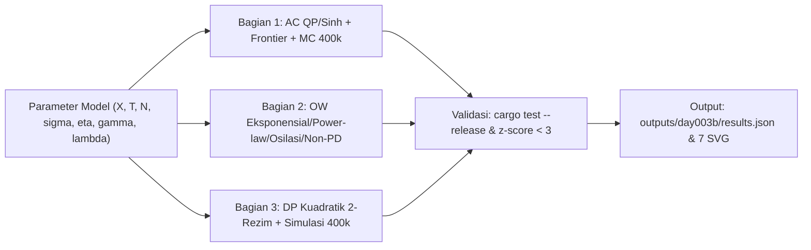

# Penjelasan Proyek — day003b: Eksekusi Optimal (Almgren–Chriss, Dampak Transien, dan Likuiditas Stokastik)

## 1. Identitas dan Ringkasan Proyek
- **ID Progress**: `day003b` (Hari 3, Sesi b)
- **Tanggal**: 2026-11-21 (WITA)
- **Topik**: Eksekusi optimal — Almgren–Chriss, dampak transien (Obizhaeva–Wang), dan likuiditas stokastik (DP)
- **Jenis**: `quant` (off-roadmap / `bonus`)
- **Bahasa**: Rust (edisi 2021, `#![forbid(unsafe_code)]`, nol crate eksternal runtime)
- **Lokasi Kode**: [projects/rust/day003b_optimal_execution/](../../projects/rust/day003b_optimal_execution/Cargo.toml)

Proyek ini mengimplementasikan dan memvalidasi tiga kerangka teori eksekusi optimal institusional dalam Rust murni tanpa dependensi eksternal: penyeimbangan *market impact* vs risiko volatilitas (Almgren–Chriss), peluruhan dampak sementara dalam buku order (*limit order book*) pada model Obizhaeva–Wang serta keragaman kernel dampaknya, dan pengendalian eksekusi adaptif di bawah rezim likuiditas Markov melalui *dynamic programming* (DP).

---

## 2. Masalah dan Tujuan
Ketika mengeksekusi pesanan besar ($X = 1.000.000$ saham dalam $T = 1$ hari), trader menghadapi dilema fundamental: menjual terlalu cepat menimbulkan biaya *market impact* yang besar, sedangkan menjual terlalu lambat mengekspos portofolio pada risiko fluktuasi harga (*timing risk*). Proyek ini menjawab:
1. Bagaimana jadwal penjualan optimal Almgren–Chriss menyeimbangkan ekspektasi biaya dan variansi biaya, dan bagaimana solusi QP KKT cocok dengan bentuk tertutup `sinh` diskrit serta limit kontinu?
2. Bagaimana struktur jadwal optimal berubah jika dampak sementara meluruh seiring waktu (kernel Obizhaeva–Wang), bagaimana efisiensi solver tridiagonal $O(N)$ dibanding Cholesky $O(N^3)$, dan kapan kernel yang melanggar sifat standar memicu manipulasi harga atau ketidakstabilan?
3. Seberapa besar nilai adaptivitas (*value of adaptivity*) ketika likuiditas pasar berpindah secara stokastik antara rezim likuid dan ilikuid?

Ruang lingkup dibatasi pada model waktu-diskrit $N$ langkah seragam (kecuali uji konvergensi kontinu hingga $N=400$ dan benchmark $N=2000$), tanpa biaya tetap transaksi atau pembatasan lot diskrit.

---

## 3. Apa yang Dikerjakan Proyek
Program biner `day003b_optimal_execution` mengeksekusi seluruh eksperimen Bagian 1–3 secara deterministik paralel menggunakan `std::thread` (10 thread pada mesin uji), lalu menghasilkan:
- Data numerik berpresisi penuh 17 digit signifikan di [results.json](../../outputs/day003b/results.json).
- Tujuh grafik SVG buatan sendiri di `outputs/figures/day003b_*.svg`.
- Ringkasan metrik dan waktu eksekusi per bagian di terminal.

---

## 4. Uraian Kode
Seluruh kode berada di [projects/rust/day003b_optimal_execution/src/](../../projects/rust/day003b_optimal_execution/src/lib.rs):
- **`linalg.rs`** ([linalg.rs](../../projects/rust/day003b_optimal_execution/src/linalg.rs)): `cholesky`, `solve_cholesky`, `solve_spd` untuk sistem simetris positif-definit; `solve_tridiagonal` (algoritma Thomas $O(N)$); dan `jacobi_min_eigenvalue` untuk menghitung eigenvalue minimum dan eigenvector matriks simetris.
- **`rng.rs`** ([rng.rs](../../projects/rust/day003b_optimal_execution/src/rng.rs)): `Xoshiro256PlusPlus` dengan seeding `splitmix64` dan transformasi Box–Muller `next_normal`.
- **`parallel.rs`** ([parallel.rs](../../projects/rust/day003b_optimal_execution/src/parallel.rs)): `parallel_fixed_chunks` membagi pekerjaan ke sejumlah chunk tetap yang seed-nya hanya bergantung pada indeks chunk, menjamin hasil identik bit-demi-bit untuk 1 maupun banyak thread.
- **`stats.rs`** ([stats.rs](../../projects/rust/day003b_optimal_execution/src/stats.rs)): `mean`, `variance`, `mean_se`, dan `variance_se_batch_means`.
- **`json.rs` & `svg.rs`** ([json.rs](../../projects/rust/day003b_optimal_execution/src/json.rs), [svg.rs](../../projects/rust/day003b_optimal_execution/src/svg.rs)): penulis JSON (`{v:.16e}`) dan plotter SVG (*line chart* linear/log-log serta *bar chart*) tanpa crate eksternal.
- **`ac.rs`** ([ac.rs](../../projects/rust/day003b_optimal_execution/src/ac.rs)): `solve_ac_qp`, `solve_ac_sinh_discrete`, `ac_continuous_sup_error`, `ac_efficient_frontier`, dan `simulate_ac_mc`.
- **`transient.rs`** ([transient.rs](../../projects/rust/day003b_optimal_execution/src/transient.rs)): `solve_transient_general`, `solve_ow_exponential_analytic`, `benchmark_ow_cholesky_vs_analytic`, `analyze_oscillating_kernel`, `analyze_non_pd_kernel`, dan `solve_transient_with_risk`.
- **`dp_liquidity.rs`** ([dp_liquidity.rs](../../projects/rust/day003b_optimal_execution/src/dp_liquidity.rs)): `solve_liquidity_dp`, `verify_dp_bruteforce`, `simulate_dp_paths`, `evaluate_static_schedule_under_markov`, dan `compute_adaptivity_value`.
- **`main.rs`** ([main.rs](../../projects/rust/day003b_optimal_execution/src/main.rs)): orkestrator runner penuh.
- **`tests/integration_tests.rs`** ([integration_tests.rs](../../projects/rust/day003b_optimal_execution/tests/integration_tests.rs)): 5 suite tes integrasi untuk seluruh bagian dan invariansi thread.

---

## 5. Metode dan Alur Kerja

---

## 6. Output yang Ditargetkan
- **Bagian 1**: Galat QP vs `sinh` diskrit `< 1e-9`; konvergensi kontinu AC; limit $\lambda \to 0$ (TWAP) dan $\lambda \to \infty$; frontier monoton & konveks; MC `400.000` jalur dalam 3 SE.
- **Bagian 2**: Anchor OW eksak `< 1e-10`; konvergensi kontinu; kesamaan tridiagonal vs Cholesky hingga $N=2000$ (`< 1e-9`); kernel power-law $x^* \ge 0$; kernel osilasi PD dengan komponen negatif; kernel non-PD memicu kegagalan Cholesky; gabungan diagonal menyamai AC.
- **Bagian 3**: DP analitik vs brute-force $N=5$ (`< 1e-8`); simulasi `400.000` jalur dalam 3 SE; $J_{\mathrm{DP}} \le J_{\mathrm{statis}}$; sensitivitas persistensi $p_{11} \in \{0.5, 0.7, 0.95\}$.

---

## 7. Status Pencapaian

| Kriteria | Status | Bukti Spesifik (`results.json` & Eksekusi) |
|---|---|---|
| AC QP vs `sinh` diskrit (`< 1e-9`) | `tercapai` | `qp_vs_sinh_max_rel_err = 4.147e-16` |
| Limit kontinu AC ($N \in \{10..400\}$) | `tercapai` (konvergen; orde asimtotik 1) | Galat sup `1.616e-4` ($N=10$) → `1.979e-5` ($N=400$). Dua slope di `results.json`: seluruh rentang `continuous_log_log_slope = -0.601`; ekor $N \ge 100$ `continuous_log_log_slope_tail_n_ge_100 = -0.930`. Dekomposisi (lihat bagian 8) membuktikan penyebab slope seluruh rentang. |
| Limit $\lambda \to 0$ & $\lambda \to \infty$ | `tercapai` | `limit_lambda0_twap_max_rel_err = 2.337e-13`; `limit_lambda_inf_first_frac = 0.9932` |
| Frontier 40 titik monoton & konveks | `tercapai` | `frontier_monotone_convex = true` |
| MC AC `400.000` jalur: variansi (`z < 3`) dan mean tanpa antitetik | `tercapai` | Variansi: `mc_opt_z_var = 0.641`. Mean **tanpa antitetik** (jalur independen): optimal `mc_plain_opt_z_mean = 1.032`, TWAP `mc_plain_twap_z_mean = 0.945` (O(1), non-vakum). `mc_opt_z_mean = 3.09e-11` adalah uji VAKUM (antitetik; shortfall linear di $\xi$) dan tidak dihitung sebagai bukti statistik. Jadwal *sell-all-at-once*: uji deterministik (lihat bagian 8), bukan bukti statistik. |
| Anchor OW eksak (`< 1e-10`) | `tercapai` | `ow_anchor_max_rel_err = 1.373e-15` |
| Limit kontinu OW & $N=2000$ O(N) vs O(N³) | `tercapai` | `ow_cost_convergence_order = -1.041`; $N=2000$: galat `5.270e-13`, Cholesky `0.625 s` vs analitik `4 us` |
| Kernel power-law, osilasi PD, non-PD, gabungan | `tercapai` | Power-law `min_x = 12648.4 > 0`; osilasi ($\rho=0.2, \omega=6, \varepsilon=0.001$) `is_pd = true`, $\lambda_{\min}/\lambda_{ow} = 6.15\times10^{-3}$, $\lambda_{\max}/\lambda_{ow} = 9.88$, kondisi `1607`, `min_x = -24416.0`; scan 175 konfigurasi: semua PD, 33 punya $x^*$ negatif; kelas ini bertahan jauh dari batas PD: $\rho=0.5, \omega=3, \varepsilon=0.5$ memberi $\lambda_{\min}/\lambda_{ow}=0.513$, kondisi `20.07`, `min_x = -889.6`; non-PD `chol_failed = true`, `min_eig = -4.432e-6`, `perturbed_cost = -7.036e6`; gabungan vs AC `0.0` |
| DP brute-force $N=5$ (`< 1e-8`) | `tercapai` | `dp_bruteforce_n5_rel_err = 1.202e-16` |
| Simulasi DP `400.000` jalur (`z < 3`) & invariansi thread | `tercapai` | `sim_z_score = 1.641`, `v0_liquid_analytic = 5.5425e6`, `sim_mean_j = 5.5413e6 ± 758.6`; tes 1 vs 4 thread identik `0.0` |
| Nilai adaptivitas & sensitivitas $p_{11}$ | `tercapai` | Penghematan `14.090%` ($p_{11}=0.7$); sensitivitas: `11.465%` ($0.5$), `14.090%` ($0.7$), `18.546%` ($0.95$) |
| Toolchain & verifikasi (`fmt`, `clippy`, `test`, `run`) | `tercapai` | Semua lulus tanpa warning; total waktu `cargo run --release` = `0.791 s` (10 thread, setelah penambahan diagnosis A2) |

---

## 8. Catatan Diagnostik dan Koreksi (fakta vs hipotesis)
Tidak ada kriteria yang gagal. Koreksi terhadap versi awal dokumen ini (sesi `day003c`, bagian A2):

- **Uji mean AC dengan antitetik itu vakum (FAKTA).** Shortfall $C$ linear di $\xi_k$, sehingga rata-rata pasangan antitetik sama persis dengan rumus ($z \approx 3\times10^{-11}$). Versi awal menyajikannya sebagai bukti statistik; itu tidak benar. Kini ditambahkan uji mean tanpa antitetik (`simulate_ac_mc_plain` di `src/ac.rs`, $N=400.000$ jalur independen): $z = 1.032$ (optimal) dan $0.945$ (TWAP), berukuran O(1).
- **`sell-all-at-once` bersifat deterministik (FAKTA).** $y_1,\dots,y_{N-1}=0$ sehingga variansi teoretis $=0$ dan semua jalur memberi $C$ sama; `results.json` mencatatnya sebagai `sell_all_deterministic_check` (galat mean `1.49e-8`, variansi `0`), tanpa $z$. Ini uji deterministik, bukan bukti statistik.
- **Slope limit kontinu: dua slope (FAKTA).** Seluruh rentang $N\in\{10,\dots,400\}$: `-0.601`; ekor $N\ge100$: `-0.930`.
- **Penjelasan "pembatalan O($\Delta^2$) vs O($\Delta$)" kini TERBUKTI numerik.** Galat total diuraikan eksak menjadi $d_1+d_2$ dengan $d_1 = y^{\sinh}_j - y^{cont}(\tilde\eta)$ (murni diskretisasi) dan $d_2 = y^{cont}(\tilde\eta) - y^{cont}(\eta)$ (efek $\tilde\eta=\eta-\gamma\Delta/2$), fungsi `ac_error_decomposition` di `src/ac.rs`. Hasil (`results.json`, `continuous_decomp_*`): $\sup|d_1|$ berslope `-1.999` (orde 2), $\sup|d_2|$ berslope `-1.000` (orde 1); di titik galat total maksimum $d_1$ dan $d_2$ **berlawanan tanda untuk semua $N$**. Pada $N=10$: $\sup|d_1|=9.77\times10^{-4}$, $\sup|d_2|=8.15\times10^{-4}$, total $1.62\times10^{-4}$ (pembatalan kuat); pada $N\ge50$ suku orde 1 mendominasi sehingga slope ekor mendekati `-1`. Tes `test_ac_error_decomposition_identity` memeriksa identitas total $=d_1+d_2$.
- **Kernel osilasi: kondisi dan jarak dari batas PD (FAKTA).** Parameter awal ($\rho=0.2,\omega=6,\varepsilon=0.001$) dekat batas PD ($\lambda_{\min}/\lambda_{ow}=6.1\times10^{-3}$, kondisi `1607`). Scan 175 konfigurasi (grid dinyatakan sebelum dijalankan: $\rho\in\{0.2,0.5,1,2,5\}$, $\omega\in\{3,6,10,15,20\}$, $\varepsilon\in\{0,0.001,0.01,0.05,0.1,0.2,0.5\}$, $N=20$) menemukan 33 kasus PD dengan komponen negatif; yang terjauh dari batas PD adalah $\rho=0.5,\omega=3,\varepsilon=0.5$ ($\lambda_{\min}/\lambda_{ow}=0.513$, kondisi `20.07`, `min_x=-889.6`, hanya sekitar 0.09% dari $X$). Kelas "PD tetapi $x^*$ negatif" jadi bukan artefak kondisi buruk, tetapi magnitudonya mengecil ketika menjauh dari batas PD.

---

## 9. Landasan Teori (10 Konsep Kunci)
1. **Implementation Shortfall (Perold 1988; Almgren–Chriss 2000)**: Selisih antara nilai portofolio awal $X S_0$ dan total penerimaan eksekusi $\sum x_k \tilde{P}_k$. Diimplementasikan pada `evaluate_ac_moments` dan `simulate_ac_mc` di `src/ac.rs`.
2. **Dampak Permanen vs Sementara**: Dampak permanen $\gamma x_k$ menggeser harga dasar secara linear untuk seluruh perdagangan berikutnya, sedangkan dampak sementara $\eta x_k / \Delta$ hanya memengaruhi harga eksekusi langkah tersebut. Menjadi dasar matriks $H$ dan biaya di `src/ac.rs`.
3. **Optimisasi Kuadratik Berkendala Linear (KKT) & Cholesky**: Minimasi $\frac{1}{2} x^T H x$ dengan $\mathbf{1}^T x = X$ menghasilkan $x^* = X H^{-1}\mathbf{1} / (\mathbf{1}^T H^{-1}\mathbf{1})$. Diselesaikan oleh `cholesky` dan `solve_spd` di `src/linalg.rs`.
4. **Persamaan Euler–Lagrange Diskrit & Solusi Hiperbolik (`sinh`)**: Kondisi stasioner terhadap sisa holding $y_j$ menghasilkan beda hingga orde-2 $y_{j+1} - 2y_j + y_{j-1} = \kappa_{\mathrm{disc}}^2 \Delta^2 y_j$ dengan solusi tertutup $\sinh(\tilde{\kappa}(T-t_j))/\sinh(\tilde{\kappa}T)$ pada `solve_ac_sinh_discrete` di `src/ac.rs`.
5. **Frontier Efisien Mean–Variance**: Variasi parameter penghindaran risiko $\lambda \in [10^{-8}, 10^{-3}]$ memetakan kurva Pareto monoton dan konveks antara $E[C]$ dan $\mathrm{Var}[C]$ pada `ac_efficient_frontier` dan `day003b_ac-frontier.svg`.
6. **Model Dampak Transien Obizhaeva–Wang (2013)**: Dampak harga meluruh secara eksponensial $G(t) = \lambda_{\mathrm{ow}} e^{-\rho t}$ akibat ketahanan (*resiliency*) buku order. Diimplementasikan di `src/transient.rs`.
7. **Invers Tridiagonal Matriks Kac–Murdock–Szegö**: Matriks Toeplitz eksponensial $a^{|i-j|}$ memiliki invers tridiagonal eksplisit, menghasilkan solusi analitik $O(N)$ berbentuk blok awal/akhir dan laju interior konstan pada `solve_ow_exponential_analytic`.
8. **Teorema Bochner & Manipulasi Harga (Alfonsi–Schied–Slynko 2012)**: Kernel positif-definit menjamin biaya non-negatif, namun kernel berosilasi $e^{-\rho t}\cos(\omega t)$ yang tetap positif-definit dapat menghasilkan bobot negatif (*round-trip trading*), ditunjukkan oleh `analyze_oscillating_kernel`. Sebaliknya, kernel non-PD (`analyze_non_pd_kernel`) memiliki eigenvalue negatif sehingga biaya tidak terbatas ke bawah.
9. **Prinsip Optimalitas Bellman & DP Kuadratik**: Pada rantai Markov 2-rezim, fungsi nilai berbentuk kuadratik $V_k(y, s) = a_k(s) y^2$ dengan kebijakan linear $x_k = c_k(s) y_{k-1}$ yang diturunkan mundur pada `solve_liquidity_dp` di `src/dp_liquidity.rs` dan diverifikasi oleh `verify_dp_bruteforce`.
10. **Pengurangan Variansi Antitetik & Batch Means**: Pasangan jalur $(+Z, -Z)$ menghilangkan noise linear pada shortfall AC, sementara SE dari variansi sampel diestimasi dengan membagi jalur ke 100 batch (`variance_se_batch_means` di `src/stats.rs`).

---

## 10. Kesimpulan dan Batasan
Proyek `day003b` berhasil memverifikasi seluruh persamaan analitik dan sifat kualitatif eksekusi optimal: kesetaraan QP dan `sinh` diskrit hingga presisi mesin (`4.15e-16`), keunggulan kompleksitas solver analitik Obizhaeva–Wang $O(N)$ (`4 us` vs `0.625 s` di $N=2000$), munculnya *transaction-triggered manipulation* pada kernel berosilasi positif-definit, serta penghematan `14.09%` dari eksekusi adaptif DP di bawah rezim likuiditas stokastik. Batasan utama adalah asumsi eksekusi tanpa kendala *no-shorting* pada bagian kernel umum dan parameter Markov 2-rezim yang stasioner.

---

## 11. Referensi dan Jejak Bukti
- Almgren, R., & Chriss, N. (2000). *Optimal execution of portfolio transactions*. Journal of Risk, 3, 5–40.
- Obizhaeva, A. A., & Wang, J. (2013). *Optimal trading strategy and supply/demand dynamics*. Journal of Financial Markets, 16(1), 1–32.
- Alfonsi, A., Schied, A., & Slynko, A. (2012). *Order book resilience, price manipulation, and the positive portfolio problem*. SIAM Journal on Financial Mathematics, 3(1), 511–533.
- Artefak lokal: [results.json](../../outputs/day003b/results.json), [integration_tests.rs](../../projects/rust/day003b_optimal_execution/tests/integration_tests.rs), dan grafik `outputs/figures/day003b_*.svg`.
