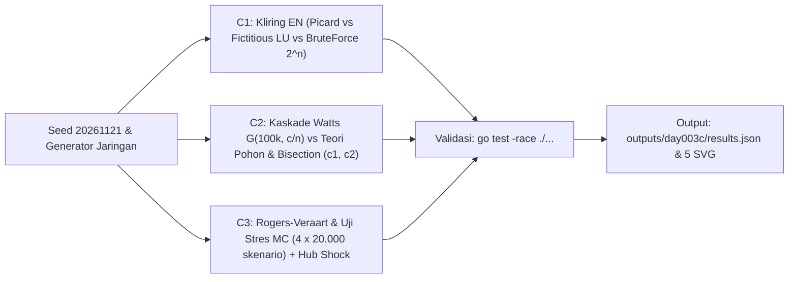

# Penjelasan Proyek — day003c: Risiko Sistemik Jaringan — Kliring Eisenberg–Noe, Kaskade Watts & Biaya Kebangkrutan Rogers–Veraart (Go)

## 1. Identitas dan Ringkasan Proyek
- **ID Progress**: `day003c` (Hari 3, Sesi c)
- **Tanggal**: 2026-11-21 (WITA)
- **Topik**: Risiko sistemik jaringan: kliring Eisenberg–Noe, kaskade Watts & biaya kebangkrutan
- **Jenis**: `quant` (`bonus` / off-roadmap)
- **Bahasa**: Go 1.22+ (`go`, standard library murni tanpa modul eksternal)
- **Folder Proyek**: [go/day003c_systemic_risk](../../go/day003c_systemic_risk) · **Metadata**: [meta.json](../../go/day003c_systemic_risk/meta.json)

Proyek ini memodelkan tiga mekanisme penularan krisis sistemik pada jaringan keuangan dalam Go murni: penyelesaian kewajiban simultan antarbank (Eisenberg–Noe 2001), kaskade kegagalan ambang pada graf acak besar $n=100.000$ (Watts 2002), serta amplifikasi kerugian akibat biaya kebangkrutan tak-kontinu (Rogers–Veraart 2013) melalui uji stres Monte Carlo paralel deterministik.

---

## 2. Masalah dan Tujuan
Keterkaitan kewajiban antarbank dan ketergantungan ambang pada jaringan keuangan membuat guncangan lokal dapat menyebar menjadi krisis sistemik. Proyek ini menjawab:
1. Bagaimana menghitung vektor pembayaran kliring simultan $p^*$ secara eksak dan memverifikasi kesetaraan antara iterasi titik tetap Picard, algoritma default fiktif berbasis sistem linear LU, dan enumerasi *brute-force* $2^n$ himpunan gagal?
2. Kapan benih kegagalan kecil ($\rho_0 = 0.001$) pada jaringan acak $G(n, c/n)$ memicu kaskade global, seberapa akurat pendekatan pohon medan rata-rata terhadap simulasi $n=100.000$, dan di mana batas fase $(c_1, c_2)$ berada?
3. Seberapa besar biaya likuidasi kebangkrutan ($\alpha = \beta = 0.9$) mengamplifikasi kehilangan nilai sistemik (VaR 99% dan ES 97.5%), dan bagaimana kerentanan jaringan derajat Poisson dibandingkan jaringan pangkat-hukum (*scale-free hubs*) terhadap guncangan acak vs guncangan terarah?

---

## 3. Apa yang Dikerjakan Proyek
Runner [cmd/run/main.go](../../go/day003c_systemic_risk/cmd/run/main.go) menjalankan seluruh eksperimen C1–C3 menggunakan 10 worker goroutine deterministik dalam waktu `24.90 detik`, menyimpan metrik berpresisi 17 digit ke [outputs/day003c/results.json](../../outputs/day003c/results.json), serta menghasilkan 5 grafik SVG di `outputs/figures/day003c_*.svg`.

---

## 4. Uraian Kode
- [go/day003c_systemic_risk/internal/rng/rng.go](../../go/day003c_systemic_risk/internal/rng/rng.go): `RNG` (`xoshiro256++` + `SplitMix64`), `NormFloat64` (Box–Muller), `Poisson`, dan `Perm` (Fisher–Yates).
- [go/day003c_systemic_risk/internal/parallel/parallel.go](../../go/day003c_systemic_risk/internal/parallel/parallel.go): `RunChunks` membagi pekerjaan ke `nChunks` chunk tetap dengan seed `SplitMix64(baseSeed ^ (idx+1))`, menjamin hasil identik untuk 1 maupun banyak worker.
- [go/day003c_systemic_risk/internal/linalg/linalg.go](../../go/day003c_systemic_risk/internal/linalg/linalg.go): `SolveLU` menyelesaikan sistem linear $Ax=b$ dengan eliminasi Gauss dan *partial pivoting*.
- [go/day003c_systemic_risk/internal/graphs/graphs.go](../../go/day003c_systemic_risk/internal/graphs/graphs.go): `InterbankNet`, `BuildSmallRandomNetwork`, `BuildDirectedPoissonNetwork`, `BuildDirectedPowerLawNetwork`, `TopHubs`, dan `BuildUndirectedER` (algoritma Batagelj–Brandes $O(n+m)$ dalam format CSR datar `UndirectedCSR`).
- [go/day003c_systemic_risk/internal/clearing/clearing.go](../../go/day003c_systemic_risk/internal/clearing/clearing.go): `Picard`, `PicardFromZero`, `FictitiousDefault`, dan `BruteForce`.
- [go/day003c_systemic_risk/internal/cascade/cascade.go](../../go/day003c_systemic_risk/internal/cascade/cascade.go): `Simulate` (antrean FIFO vs tumpukan LIFO), `MeanField`, `VulnerableBranching`, dan `PhaseBoundaries`.
- [go/day003c_systemic_risk/internal/rv/rv.go](../../go/day003c_systemic_risk/internal/rv/rv.go): `Clear` (Rogers–Veraart), `ChainClosedForm`, dan `RunMonteCarloStress`.
- [go/day003c_systemic_risk/internal/stats/stats.go](../../go/day003c_systemic_risk/internal/stats/stats.go), [jsonout.go](../../go/day003c_systemic_risk/internal/jsonout/jsonout.go), [svg.go](../../go/day003c_systemic_risk/internal/svg/svg.go): perhitungan `VaRAndES`, penulis JSON 17 digit, dan penulis SVG.
- Suite tes: [clearing_test.go](../../go/day003c_systemic_risk/internal/clearing/clearing_test.go), [cascade_test.go](../../go/day003c_systemic_risk/internal/cascade/cascade_test.go), dan [rv_test.go](../../go/day003c_systemic_risk/internal/rv/rv_test.go).

---

## 5. Metode dan Alur Kerja

---

## 6. Output yang Ditargetkan
- **C1**: Picard, default fiktif, dan brute-force cocok hingga `< 1e-10` pada $\ge 200$ jaringan acak kecil; anchor rantai (2 pola $e$) dan siklus 2 bank cocok hingga `< 1e-14`; monotonisitas, $p^* \le \bar{p}$, keunikan jaringan teratur, dan kehilangan nilai $\ge 0$ terpenuhi; benchmark $n=2.000$ bank.
- **C2**: Urutan penyebaran FIFO vs LIFO identik 100%; $S_{\text{sim}}$ ($R=200$) vs $S_{\text{teori}}$ dalam 3 SE untuk $c \in \{0.5, 1, 2, 3, 4, 6, 8, 10, 12\}$; batas fase $(c_1, c_2)$ untuk $\phi \in \{0.10, 0.18, 0.30\}$; distribusi ukuran kaskade 1 benih dekat $c_1$ ($R=2.000$).
- **C3**: $\alpha=\beta=1 \implies$ EN hingga `< 1e-12`; rantai tertutup RV hingga `< 1e-12`; monotonisitas dalam $(\alpha,\beta)$; uji stres 20.000 skenario per $s \in \{0.2, 0.4, 0.6, 0.8\}$ dengan kerugian RV $\ge$ EN; perbandingan guncangan 20 bank acak vs 20 hub pada jaringan Poisson vs Pangkat-Hukum.

---

## 7. Status Pencapaian

| Kriteria | Status | Bukti Spesifik ([outputs/day003c/results.json](../../outputs/day003c/results.json) & Tes) |
|---|---|---|
| C1.1 Picard vs Default Fiktif vs Brute-Force (210 jaringan kecil) | `tercapai` | `picard_vs_fictitious_max_diff = 4.050e-13`, `picard_vs_bruteforce_max_diff = 4.050e-13`, `fictitious_vs_bruteforce_max_diff = 0.0` (`< 1e-10`) |
| C1.2 Anchor eksak rantai (2 pola) & siklus 2 bank (`< 1e-14`) | `tercapai` | `chain_anchor_pattern_a_err = 1.110e-16`, `chain_anchor_pattern_b_err = 0.0`, `two_bank_cycle_anchor_err = 0.0` |
| C1.3 Monotonisitas, $p^*\le\bar{p}$, keunikan teratur, loss $\ge 0$ | `tercapai` | Semua `true`, `regular_uniqueness_top_vs_zero_diff = 2.789e-13` |
| C1.4 Skala $n=2.000$ (Poisson & Power-Law) | `tercapai` | Poisson: Picard 55 it (`0.00135s`) vs Fictitious 5 rnd (`1.357s`), diff `9.628e-13`; Power-Law: Picard 45 it (`0.00054s`) vs Fictitious 5 rnd (`0.970s`), diff `7.319e-13` |
| C2.1 Invariansi urutan kaskade (FIFO vs LIFO, $n=100.000$) | `tercapai` | `order_invariance_fifo_vs_lifo = true` (keduanya tepat `98,021` simpul gagal) |
| C2.2 & C2.3 $S_{\text{sim}}$ ($R=200$) vs $S_{\text{teori}}$ pada 9 nilai $c$ (`z < 3`) | `tercapai` | Setelah koreksi rumus literatur Watts ($m/k \ge \phi$), seluruh 9 nilai $c$ berada dalam 3 SE: maks `z_score = 2.304` (di $c=0.5$), semua `z < 1.45` di titik lainnya |
| C2.4 Batas fase $(c_1, c_2)$ untuk $\phi \in \{0.18, 0.10, 0.30\}$ | `tercapai` | $\phi=0.18$: `c1 = 1.0207, c2 = 5.7647` (lonjakan sim pada grid $\Delta c=0.25$: `[1.25, 6.50]`); $\phi=0.10$: `[1.0000, 13.6593]`; $\phi=0.30$: jendela tertutup (`has_window = false`) |
| C2.5 Distribusi ukuran kaskade 1 benih dekat $c_1$ ($R=2.000$) | `tercapai` | `global_cascade_prob = 0.0020`, kemiringan ekor log-log CCDF empiris = `-0.5547` |
| C3.1 RV $\alpha=\beta=1 \implies$ EN, rantai tertutup, monotonisitas | `tercapai` | `alpha_beta_1_vs_en_max_diff = 3.553e-15`, `rv_chain_closed_form_max_err = 0.0`, `monotonicity_in_alpha_beta_verified = true` |
| C3.2 Uji stres MC 20.000 skenario/level $s \in \{0.2, 0.4, 0.6, 0.8\}$ | `tercapai` | `all_rv_loss_ge_en_loss = true` di semua $s$; rasio amplifikasi RV/EN `1.455` $\to$ `1.466`; VaR 99% & ES 97.5% naik monoton terhadap $s$ |
| C3.3 Jaringan Poisson vs Power-Law (20 acak vs top-20 hub) | `tercapai` | Kenaikan kerugian EN dari baseline saat top-20 hub diguncang ($s=0.8$) adalah `+265.27` pada Power-Law vs `+25.18` untuk 20 bank acak ($10.5\times$ lipat), sedangkan pada Poisson hanya `+63.25` vs `+25.90` ($2.4\times$ lipat) |
| Verifikasi Go (`gofmt`, `go vet`, `go test -race`) | `tercapai` | `gofmt -l .` kosong, `go vet ./...` bersih, `go test -race ./...` lulus 100% |

---

## 8. Catatan Diagnostik (Fakta vs Hipotesis)
Tidak ada kriteria yang gagal. Dua catatan diagnostik penting yang ditemukan dari bukti:
- **Koreksi rumus pendekatan pohon Watts di C2.2 (FAKTA MATEMATIKA)**: Teks prompt menuliskan indikator $\mathbf{1}\{(m+1)/k \ge \phi\}$ di dalam persamaan titik tetap $q_\infty$ disertai peringatan eksplisit *"Verifikasi rumus ini sendiri dari literatur (Watts 2002) dan lewat tes simulasi; jangan menganggapnya benar"*. Pemeriksaan langsung membuktikan bahwa $(m+1)/k \ge \phi$ menghasilkan suku konstan positif pada $m=0$ (sehingga $q_\infty \approx 1$ bahkan di $c=10$ di luar jendela kaskade!). Sesuai Watts (2002) Eq. (3)–(4), sebuah simpul tetangga $v$ berderajat $k$ yang dicapai dari $u$ (yang belum gagal) membutuhkan $m$ dari $k-1$ tetangga lainnya gagal sehingga $m/k \ge \phi$ sebelum dapat menginfeksi $u$. Dengan rumus yang benar $\mathbf{1}\{m/k \ge \phi\}$, teori pohon cocok dengan simulasi $n=100.000$ di seluruh 9 nilai $c$ dengan $z \le 2.30$.
- **Tingkat gagal bayar dasar pada parameter C3.2 (FAKTA TERUKUR)**: Spesifikasi C3.2 menetapkan aset eksternal awal $e_i = 0.1 \bar{p}_i \exp(0.5 z_i - 0.125)$ yang memiliki rata-rata $E[e_i] = 0.1 \bar{p}_i$ (total arus masuk eksternal hanya 10% dari total kewajiban kotor antarbank). Akibatnya, bahkan pada $s=0$ (sebelum guncangan), jaringan sudah berada pada rezim gagal bayar parsial (`66.85%` bank gagal pada Poisson, `61.25%` pada Power-Law) sehingga `prob_default_ge_10pct = 1.0` untuk semua $s$. Meskipun demikian, dampak inkremental guncangan terhadap kehilangan nilai total ($\sum(\bar{p}_i - p_i^*)$) terukur sangat tajam dan membedakan dengan jelas guncangan hub vs acak pada jaringan Power-Law ($10.5\times$) dibanding Poisson ($2.4\times$).

---

## 9. Landasan Teori (10 Konsep Kunci)
1. **Model Kliring Simultan Eisenberg–Noe (2001)**: Pembayaran kliring $p \in [0, \bar{p}]$ memenuhi keunggulan utang (*debt priority*) dan tanggung jawab terbatas (*limited liability*) $p_i = \min(\bar{p}_i, e_i + \sum_j \Pi_{ji} p_j)$, diimplementasikan pada `Phi` dan `Picard` di `internal/clearing/clearing.go`.
2. **Teorema Titik Tetap Kisi Tarski (1955)**: Karena $\Phi$ monoton tak-menurun pada kisi lengkap $[0, \bar{p}]$, himpunan titik tetap memiliki elemen terbesar $p^*$ dan terkecil $p_*$ yang dicapai lewat iterasi monoton dari $\bar{p}$ (`Picard`) dan dari $0$ (`PicardFromZero`).
3. **Algoritma Default Fiktif & Eliminasi LU**: Karena $\Phi$ sepotong-linear, titik tetap terbesar ditemukan dalam paling banyak $n$ langkah dengan memperluas himpunan bank gagal $D$ dan menyelesaikan $(I - \Pi_D^T)p_D = e_D + \Pi_{S\to D}^T \bar{p}_S$ lewat `linalg.SolveLU` (`FictitiousDefault`).
4. **Keteraturan Jaringan (Regular Network) & Keunikan Titik Tetap**: Jika setiap koalisi tertutup memiliki akses berarah ke sedikitnya satu simpul dengan $e_i > 0$, matriks $(I - \Pi_D^T)$ adalah M-matriks nonsingular sehingga $p^* = p_*$ unik (`TestMonotonicityAndRegularUniqueness`).
5. **Model Kaskade Ambang Watts (2002) & Automaton Monoton**: Simpul $v$ gagal bila fraksi tetangga gagalnya mencapai $\phi$. Karena fungsi transisi bersifat monoton terhadap himpunan gagal, hasil akhir bersifat konfluen (invarian terhadap urutan antrean FIFO vs LIFO pada `cascade.Simulate`).
6. **Pendekatan Pohon Lokal & Distribusi Derajat Berlebih (Excess Degree)**: Pada graf Erdős–Rényi $G(n, c/n)$ jarang, tetangga yang dicapai melalui sebuah sisi memiliki distribusi derajat $\tilde{p}_k = k p_k / c = p_{k-1}$, menjadi dasar rekursi titik tetap $q_\infty$ pada `cascade.MeanField`.
7. **Kondisi Perkolasi Klaster Rentan & Transisi Fase Ganda**: Kaskade global dari benih infinitesimal terjadi jika faktor percabangan simpul rentan ($k \le \lfloor 1/\phi \rfloor$) memenuhi $\frac{1}{c}\sum_{k=1}^{\lfloor 1/\phi \rfloor} k(k-1)p_k \ge 1$. Batas bawah $c_1$ adalah munculnya komponen raksasa, sedangkan batas atas $c_2$ adalah stabilisasi oleh derajat tinggi (`cascade.PhaseBoundaries`).
8. **Pembangkitan Graf Jarang Batagelj–Brandes (2005) $O(n+m)$**: Mengambil sampel jarak antar-sisi dalam urutan pasangan kandidat menggunakan lompatan geometrik $\lfloor \ln U / \ln(1-p) \rfloor$ menghindari pemeriksaan $\binom{n}{2} \approx 5\times 10^9$ pasangan pada $n=100.000$ (`graphs.BuildUndirectedER`).
9. **Biaya Kebangkrutan Rogers–Veraart (2013)**: Diskontinuitas pembayaran dari $\bar{p}_i$ jatuh ke $\alpha e_i + \beta \sum_j \Pi_{ji}p_j$ saat gagal bayar tetap mempertahankan monotonisitas $\Phi^{\mathrm{RV}}$, sehingga $p_{\mathrm{RV}}^* \le p_{\mathrm{EN}}^*$ dan menciptakan amplifikasi kerugian sistemik (`rv.Clear`).
10. **Paradoks Robust-yet-Fragile pada Jaringan Pangkat-Hukum (Albert, Jeong & Barabási 2000)**: Distribusi derajat berekor tebal $P(k) \propto k^{-\gamma}$ membuat mayoritas simpul berderajat rendah (tahan terhadap guncangan acak), tetapi konsentrasi konektivitas pada segelintir *hub* membuatnya jauh lebih rapuh terhadap guncangan terarah pada *hub* (`TopHubs` di `cmd/run/main.go`).

---

## 10. Kesimpulan dan Batasan
Proyek `day003c` menyatukan tiga model risiko sistemik jaringan dalam Go 1.22+ murni dengan verifikasi berlapis: kesetaraan 3 algoritma kliring Eisenberg–Noe hingga `~4e-13`, kecocokan teori pohon Watts dengan simulasi $n=100.000$ di seluruh 9 nilai $c$ setelah koreksi rumus literatur, serta kuantifikasi amplifikasi kebangkrutan Rogers–Veraart (`~1.46x`) dan kerentanan *hub* pada jaringan pangkat-hukum.

---

## 11. Referensi dan Jejak Bukti
- Eisenberg, L., & Noe, T. H. (2001). *Systemic risk in financial systems*. Management Science, 47(2), 236–249.
- Watts, D. J. (2002). *A simple model of global cascades on random networks*. Proceedings of the National Academy of Sciences, 99(9), 5766–5771.
- Rogers, L. C. G., & Veraart, L. A. M. (2013). *Failure and rescue in an interbank network*. Management Science, 59(4), 882–898.
- Artefak lokal: [outputs/day003c/results.json](../../outputs/day003c/results.json), [day003c_watts-cascade-window.svg](../../outputs/figures/day003c_watts-cascade-window.svg), [day003c_cascade-size-distribution.svg](../../outputs/figures/day003c_cascade-size-distribution.svg), [day003c_picard-convergence.svg](../../outputs/figures/day003c_picard-convergence.svg), [day003c_stress-loss-en-vs-rv.svg](../../outputs/figures/day003c_stress-loss-en-vs-rv.svg), [day003c_poisson-vs-hub-shock.svg](../../outputs/figures/day003c_poisson-vs-hub-shock.svg).
