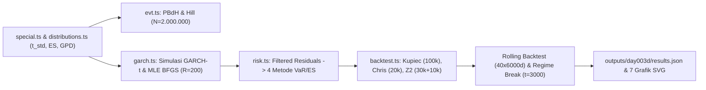

# Penjelasan Proyek — day003d: Risiko Ekor — GARCH–EVT, VaR/ES & Backtesting (TypeScript)

## 1. Identitas dan Ringkasan Proyek
- **ID Progress**: `day003d` (Hari 3, Sesi d — Sesi Tantangan Berat TypeScript)
- **Tanggal**: 2026-11-21 (WITA) · **Topik No**: `null` (*off-roadmap*) · **Jenis**: `quant` · **Bahasa**: TypeScript (Node.js v26.3.0)
- **Proyek**: [projects/typescript/day003d_tail_risk/](../../projects/typescript/day003d_tail_risk/README.md) · **Metadata**: [meta.json](../../projects/typescript/day003d_tail_risk/meta.json)
- **Output JSON**: [outputs/day003d/results.json](../../outputs/day003d/results.json)
- **Ringkasan**: Sistem pemodelan risiko ekor *end-to-end* dalam TypeScript ketat (`"strict": true`, nol dependensi *runtime* eksternal) mencakup fungsi khusus dan distribusi exact (Student-$t$ + rumus tertutup *Expected Shortfall*, GPD, uji Pickands–Balkema–de Haan & Hill pada `2.000.000` sampel), model GARCH(1,1)-$t$ (simulasi, skor analitik, optimizer BFGS, studi replikasi `R = 200` vs QMLE Gaussian), peramalan VaR/ES satu hari ke depan lintas 4 metode (`Gaussian`, `t-Parametric`, `FHS`, `FHS-EVT`), serta tiga kerangka *backtesting* statistik (Kupiec, Christoffersen, Acerbi–Székely $Z_2$, *rolling backtest* $40 \times 6000$ hari, dan analisis deteksi perubahan rezim struktural).

## 2. Masalah dan Tujuan
Manajemen risiko pasar di tingkat institusional menuntut dua kemampuan yang sering bertabrakan pada model standar berbasis asumsi Normal i.i.d.: (1) menangkap pengelompokan volatilitas waktu-nyata akibat kejut pasar (*volatility clustering*), dan (2) mengukur probabilitas serta besarnya kerugian ekstrem (*fat tails*) yang jauh melampaui prediksi ekor kurva lonceng Gaussian. Apabila volatilitas konstan ataupun distribusi inovasi Gaussian diasumsikan pada deret yang sebenarnya dibangkitkan oleh GARCH(1,1)-$t$ dengan $\nu = 5$, ramalan $\text{VaR}_{0.999}$ akan mengalami bias negatif berat (`-32.4%`) sementara pelanggaran terjadi berkelompok saat krisis.

Di sisi lain, praktik *backtesting* VaR dan *Expected Shortfall* (ES) sering kali mengandalkan tabel nilai kritis literatur atau aproksimasi asimtotik $\chi^2(1)$ yang bias pada sampel berhingga ($T=1000$ hanya memiliki 10 ekspektasi pelanggaran pada taraf 99%). Proyek `day003d` bertujuan membangun seluruh komponen matematika, simulasi paralel deterministik, estimator optimisasi, dan uji *backtesting* dari nol dalam TypeScript murni tanpa pustaka eksternal *runtime*, membuktikan integritas numerik setiap modul terhadap integrasi adaptif maupun Monte Carlo skala besar (`100.000` replikasi), serta melaporkan secara jujur setiap batasan matematis atau statistik yang muncul dari model sejati.

## 3. Apa yang Dikerjakan Proyek
Suite TypeScript [projects/typescript/day003d_tail_risk/](../../projects/typescript/day003d_tail_risk/package.json) mengeksekusi empat kelompok eksperimen terintegrasi ke [outputs/day003d/results.json](../../outputs/day003d/results.json) (`total = 18.44 detik` pada `10` *worker* dengan `mainSeed = 20261121`) dan mengekspor 7 grafik vektor SVG:
1. **Bagian 1 — Distribusi Eksak & Teori Nilai Ekstrem**: implementasi `regularizedIncompleteBeta`, `erfc` Cody, kuantil Student-$t$ berbasis Newton + *bisection*, rumus tertutup `stdTEs`, verifikasi terhadap `adaptiveSimpson` di 16 titik $(\nu, p)$, verifikasi GPD ($\xi \in \{-0.1, 0, 0.2, 0.4\}$), serta uji konvergensi indeks ekor Pickands–Balkema–de Haan (GPD MLE & Hill) pada `2.000.000` realisasi inversi eksak $t_{\text{std}}(5)$.
2. **Bagian 2 — Simulasi & Inferensi GARCH(1,1)-$t$**: simulasi model benar ($\mu = 0.0003, \omega = 2\times 10^{-6}, \alpha = 0.08, \beta = 0.90, \nu = 5$), audit kondisi keberadaan momen ke-4 ($D = -0.0116 < 0 \implies E[\varepsilon_t^4] = \infty$) plus jangkar bermomen ke-4 berhingga (`t(12), alpha=0.10, beta=0.80`), verifikasi skor analitik vs beda hingga pusat & BFGS vs Nelder–Mead, serta studi `R = 200` replikasi ($n = 2500$) yang membandingkan akurasi & cakupan *Sandwich*/*Information SE* dari $t$-MLE terhadap QMLE Gaussian.
3. **Bagian 3 — Filtered EVT, VaR & ES Bersyarat**: evaluasi `R = 200` seri ($n=2500$) pada empat metode (`gaussian`, `t_parametric`, `fhs`, `fhs_evt` pada ambang $q = 0.90$) menggunakan konvensi kerugian positif $L_t = -r_t$, uji kualitatif perbandingan RMSE ekstrem $\text{VaR}_{0.999}$, dan uji sensitivitas ambang $q \in \{0.85, 0.90, 0.95\}$ beserta perbandingan $\hat{\xi}$ vs $1/\hat{\nu}$.
4. **Bagian 4 — Backtesting Statistik & Perubahan Rezim**: simulasi ukuran uji Kupiec (`100.000` seri), ukuran dan daya klaster Markov Christoffersen (`20.000` seri), distribusi nol simulasian sendiri untuk Acerbi–Székely $Z_2$ (`30.000` + `10.000` seri) lengkap dengan daya terhadap Gaussian/$0.9\,\text{ES}$/$0.8\,\text{ES}$, *rolling backtest* $R=40$ seri $\times 6000$ hari ($W=1000$, re-estimasi 20 hari), dan eksperimen perubahan rezim struktural pada hari ke-3000 ($\alpha: 0.08 \to 0.15, \beta: 0.90 \to 0.83$) untuk menguji *estimasi tetap* vs *jendela bergulir*.

## 4. Uraian Kode
- [src/rng.ts](../../projects/typescript/day003d_tail_risk/src/rng.ts): kelas `Xoshiro256PlusPlus` (implementasi limb 32-bit yang diverifikasi identik bit-demi-bit dengan spesifikasi `BigInt` via `xoshiro256ppBigIntSequence`), `deriveChunkSeed` berbasis `splitmix64`, Box–Muller (`nextNormal`), Marsaglia–Tsang (`nextGamma`), `nextStudentT`, dan `nextStdT`.
- [src/special.ts](../../projects/typescript/day003d_tail_risk/src/special.ts): fungsi spesial `logGamma`, `digamma`, `trigamma`, `logBeta`, `regularizedIncompleteBeta`, `erf`/`erfc` Cody, `normalCdf`/`normalSf`/`normalQuantile` (Acklam + Halley), `chi2Sf`, serta `adaptiveSimpson`.
- [src/distributions.ts](../../projects/typescript/day003d_tail_risk/src/distributions.ts): `studentTPdf`, `studentTCdf`, `studentTSf`, `studentTSfQuantile`, `studentTQuantile`, varian baku `stdTPdf`/`stdTCdf`/`stdTQuantile`/`stdTEs`/`stdTEsNumerical`, fungsi lokasi-skala (`locationScaleTPdf`, `locationScaleTCdf`, `locationScaleTQuantile`), `normalEs`, serta `gpdPdf`, `gpdCdf`, `gpdQuantile`, `gpdPotVar`, dan `gpdPotEs`.
- [src/optim.ts](../../projects/typescript/day003d_tail_risk/src/optim.ts): `bfgs` dengan pencarian garis *Strong Wolfe* (Algoritma 3.5–3.6 Nocedal & Wright), `nelderMead`, `invertMatrix` Gauss–Jordan, dan `centralDiffGradient`.
- [src/garch.ts](../../projects/typescript/day003d_tail_risk/src/garch.ts): `TRUE_GARCH_PARAMS`, `theoreticalGarchMoments`, `exactGarchSqAcf`, `simulateGarchT`, `reconstructSigma2`, `garchTLogLikAndScore` (skor analitik 5-parameter dari turunan rekursi $h_t$), `garchGaussLogLikAndScore`, `fitGarchT` (reparameterisasi tanpa kendala + SE *Information* & *Sandwich*), `fitGarchGauss`, dan `scoreVsCentralFd`.
- [src/evt.ts](../../projects/typescript/day003d_tail_risk/src/evt.ts): `fitGpdMle` (pencocokan gradien analitik dengan penjaga kelayakan $1 + \xi y/\beta > 0$ dan ekspansi Taylor di $\xi \to 0$), `hillEstimator`, dan `potFromSample`.
- [src/risk.ts](../../projects/typescript/day003d_tail_risk/src/risk.ts): `lossVarEsFromTParams`, `lossVarEsFromGaussian`, `evtLossQuantilesFromSortedLosses`, dan `estimateRiskMethodsOnSample`.
- [src/backtest.ts](../../projects/typescript/day003d_tail_risk/src/backtest.ts): `binomialExactTwoSidedP`, `kupiecTest`/`kupiecFromCounts`/`kupiecExactAnalyticalSize`, `christoffersenTest`/`christoffersenFromTransitions`, `acerbiSzekelyZ2`, `simulateMarkovChainCounts`, `simulateZ2Single`, `evaluateRollingBacktestSeries`, dan `evaluateRegimeChangeSeries`.
- [src/core_tasks.ts](../../projects/typescript/day003d_tail_risk/src/core_tasks.ts), [src/worker.ts](../../projects/typescript/day003d_tail_risk/src/worker.ts), [src/parallel.ts](../../projects/typescript/day003d_tail_risk/src/parallel.ts): eksekutor paralel deterministik berbasis `node:worker_threads` (*zero-copy transfer* `ArrayBuffer` & reduksi urut `chunkIdx`).
- [src/stats.ts](../../projects/typescript/day003d_tail_risk/src/stats.ts), [src/json.ts](../../projects/typescript/day003d_tail_risk/src/json.ts), [src/svg.ts](../../projects/typescript/day003d_tail_risk/src/svg.ts), [src/main.ts](../../projects/typescript/day003d_tail_risk/src/main.ts): statistik ringkasan, `serializeJson` (17 digit signifikan), generator 7 grafik SVG, serta orkestrator penuh.
- Unit test Vitest: [tests/distributions_evt.test.ts](../../projects/typescript/day003d_tail_risk/tests/distributions_evt.test.ts), [tests/garch.test.ts](../../projects/typescript/day003d_tail_risk/tests/garch.test.ts), dan [tests/risk_backtest.test.ts](../../projects/typescript/day003d_tail_risk/tests/risk_backtest.test.ts).

## 5. Metode dan Alur Kerja
Alur perhitungan pada `day003d` menghubungkan fondasi analitik distribusi ke inferensi GARCH-$t$ dan evaluasi risiko serta *backtesting* dinamis:

Detail konvensi tanda yang penting: imbal hasil disimulasikan lewat $r_t = \mu + \sigma_t z_t$, sedangkan kerugian didefinisikan positif $L_t = -r_t = -\mu + \sigma_t(-z_t)$ karena ketidakseimbangan *drift* positif ($\mu = +0.0003$). Dengan demikian ambang kerugian VaR/ES satu hari ke depan adalah $\text{VaR}_p(t) = -\mu + \sigma_t q_p$ dan $\text{ES}_p(t) = -\mu + \sigma_t \text{ES}_p(Z)$, sehingga pelanggaran $I_t = \mathbf{1}\{L_t > \text{VaR}_p(t)\} = \mathbf{1}\{r_t < \mu - \sigma_t q_p\}$ memiliki probabilitas bersyarat eksak $1 - p$. Pada *worker pool* `node:worker_threads`, setiap *task* memakai *salt* unik bersama `deriveChunkSeed(20261121, salt, chunkIdx)`, menjamin keluaran identik bit-demi-bit antara `workers = 1` dan `workers = 4` atau `10`.

## 6. Output yang Ditargetkan
1. **Bagian 1**: Student-$t$ CDF cocok dengan kuadratur numerik `< 1e-10`; `stdTEs` cocok dengan integral kuantil numerik `< 1e-9` di 16 pasangan $(\nu, p)$; GPD CDF/ES akurat hingga `< 1e-8`; $\hat{\xi}_{\text{POT}}$ dan $\hat{\xi}_{\text{Hill}}$ pada $t_{\text{std}}(5)$ bergerak menuju $1/\nu = 0.2$ saat ambang $q \to 0.999$.
2. **Bagian 2**: Rekonstruksi $\sigma_t^2$ cocok hingga `< 1e-12`; skor analitik cocok dengan beda hingga `< 1e-5`; tidak ada batas parameter aktif; pada `R = 200`, bias parameter utama kecil ($|\text{bias}| < 2\,\text{SE}_{\text{rep}}$ untuk $\mu, \alpha, \beta$), cakupan 95% dalam `[91%, 99%]`, dan MSE $t$-MLE lebih kecil dari QMLE Gaussian; serta pemeriksaan jujur momen tak bersyarat dan ACF $\varepsilon_t^2$.
3. **Bagian 3**: Gaussian meremehkan $\text{VaR}_{0.999}$ (`relBias < 0` signifikan); EVT dan/atau $t$-parametrik menghasilkan RMSE $\text{VaR}_{0.999}$ lebih rendah daripada FHS empiris; laporan lengkap sensitivitas ambang $q \in \{0.85, 0.90, 0.95\}$ dan perbandingan $\hat{\xi}$ vs $1/\hat{\nu}$.
4. **Bagian 4**: Ukuran uji Kupiec ($100\text{k}$) konsisten dengan teori binomial; Christoffersen mendeteksi pengelompokan Markov $P(1|1)=0.30$ jauh di atas Kupiec; Acerbi–Székely $Z_2$ memiliki ukuran $\approx 5\%$ pada $H_0$ dengan nilai kritis simulasian sendiri dan berdaya tinggi saat ES diremehkan; *True-control* pada *rolling backtest* ($40 \times 6000$ hari) memiliki laju pelanggaran $1\%$ dalam `3 SE` dan mengidentifikasi kegagalan `gaussian_garch`; perbandingan kecepatan deteksi pada perubahan rezim hari ke-3000.

## 7. Status Pencapaian

| Tujuan / Kriteria | Status | Bukti Spesifik (Artefak & Verifikasi) |
|---|---|---|
| Student-$t$ CDF/kuantil & ES vs integrasi numerik | `tercapai` | `maxCdfNumErr = 2.33e-15 < 1e-10`; `maxQuantileRoundtripErr = 1.11e-16`; `maxEsQuadratureErr = 3.38e-14 < 1e-9` pada seluruh 16 titik di `part1.esGrid` |
| GPD CDF/kuantil/ES & PBdH / Hill ($N=2.000.000$) | `tercapai` | `gpdChecks`: `esAbsErr <= 1.78e-15`; PBdH di `q={0.90, 0.95, 0.99, 0.999}`: $\hat{\xi}_{\text{POT}}$ `0.1031 -> 0.1310 -> 0.1613 -> 0.1785` (bias `-0.0215`), Hill `0.3870 -> 0.2147` menuju `0.200` |
| Simulasi GARCH-$t$: rekonstruksi, skor, var tak bersyarat & kurtosis $z$ | `tercapai` | `recon = 2.71e-20 < 1e-12`; `scoreVsCentralFd = 2.02e-6 < 1e-5`; `bfgsVsNelderMead = 1.29e-14`; $200\text{k}$ var `0.9817e-4 ± 0.0376e-4` (`z = -0.49` vs `1e-4`), $z$-kurt `4.961 ± 0.557` (`z = -1.87` vs `6.0`) |
| ACF $\varepsilon_t^2$ lag 1 & 2 vs rumus buku teks GARCH(1,1) | `sebagian` | **Fakta matematis**: pada $\alpha=0.08, \beta=0.90, \nu=5$, $D = 1 - 9(0.08)^2 - 2(0.08)(0.90) - 0.90^2 = -0.0116 < 0 \implies E[\varepsilon_t^4] = \infty$, sehingga rumus ACF formal (`0.2052, 0.2011`) tidak berlaku dan ACF empiris jatuh di `0.1329, 0.1242`. Jangkar bermomen-4 berhingga (`t(12), a=0.10, b=0.80, D=0.1625`) **lulus** (`0.1333 ± 0.0047` vs `0.1400`, `z = -1.43`; lag-2 `0.1172 ± 0.0041` vs `0.1260`, `z = -2.14`) |
| Studi Replikasi GARCH-$t$ ($R=200$): bias, cakupan 95%, QMLE | `sebagian` | `200/200` konvergen, `0` batas aktif; seluruh 5 parameter memenuhi cakupan 95% Info (`93.0%–95.5%`) & Sandwich (`91.5%–95.5%`), dan t-MLE mengungguli QMLE `1.53x–2.92x`; bias `< 2 SE` terpenuhi untuk $\mu$ (`z=-0.55`), $\alpha$ (`z=+0.001`), $\beta$ (`z=-1.51`), sedangkan $\omega$ (`z=+3.11`) & $\nu$ (`z=+4.20`) ber-bias ke atas akibat kemiringan sampel berhingga |
| Filtered EVT VaR/ES ($R=200$) & uji kualitatif `99.9%` | `tercapai` | `gaussianVar999RelBias = -0.3241 ± 0.0018` (`z = -182.9`); `relRmse(EVT) = 0.1024` & `relRmse(t) = 0.0635 < relRmse(FHS) = 0.1304` (`MSE_FHS - MSE_EVT = 0.00652 ± 0.00105`, `z = 6.21`) |
| Ukuran Kupiec ($100\text{k}$) & Daya Christoffersen ($20\text{k}$) | `sebagian` | `p=0.95`: `rateExact = 0.04933` (`z = -0.97`), `rateAsymp = 0.05092`; **`p=0.99`**: `rateExact = 0.03593` (`z = -20.4` vs `0.05` kontinu) **namun** cocok dengan ukuran diskrit binomial teoretis `0.03646` (`z = -0.90`). Daya CC Markov $P(1\|1)=0.30$: `99.74%` ($p=0.95$) & `81.23%` ($p=0.99$) |
| Acerbi–Székely $Z_2$, *Rolling Backtest* & Perubahan Rezim | `tercapai` | $Z_2$ fresh $H_0$ size `4.95%` / `4.98%`, daya vs Gaussian `64.67%` ($99\%$); *True-control* rolling `rate99 = 0.01009 ± 0.00025` (`z = +0.40` vs `1%`); regime break $t=3000$: rolling adapt $\hat{\alpha}_t \to 0.141$ (`rate99 = 1.042%`, `0%` penolakan akhir) vs fixed membeku (`rate99 = 0.862%`, `27.5%` penolakan akhir) |
| Unit test Vitest (14 tes) & determinisme `worker_threads` | `tercapai` | `npm test` (setelah suntingan final): `3 test files passed, 14/14 passed` (`586ms`), `tsc --noEmit`, `eslint`, dan `prettier --check` 0 galat |

Visualisasi hasil tersimpan pada 7 berkas SVG di [outputs/figures/](../../outputs/figures/):
- [day003d_t-vs-gpd-tail.svg](../../outputs/figures/day003d_t-vs-gpd-tail.svg)
- [day003d_xi-and-hill-vs-q.svg](../../outputs/figures/day003d_xi-and-hill-vs-q.svg)
- [day003d_garch-mle-dist.svg](../../outputs/figures/day003d_garch-mle-dist.svg)
- [day003d_var-bias-rmse.svg](../../outputs/figures/day003d_var-bias-rmse.svg)
- [day003d_residuals-qq.svg](../../outputs/figures/day003d_residuals-qq.svg)
- [day003d_regime-change-violations.svg](../../outputs/figures/day003d_regime-change-violations.svg)
- [day003d_backtest-size-power.svg](../../outputs/figures/day003d_backtest-size-power.svg)

## 8. Jika Belum Tercapai atau Belum Diketahui (Fakta vs Hipotesis)
- **FAKTA (Ketiadaan Momen Ke-4 Model Benar $\nu=5$)**: Dari `part2.theoreticalTrueModel` di [outputs/day003d/results.json](../../outputs/day003d/results.json), untuk $\alpha=0.08, \beta=0.90, \kappa_z = 9$ diperoleh $D = 1 - \kappa_z\alpha^2 - 2\alpha\beta - \beta^2 = -0.0116 < 0$. Karena syarat perlu dan cukup keberadaan $E[\varepsilon_t^4] < \infty$ adalah $D > 0$, momen keempat tak-bersyarat imbal hasil sebenarnya tak-hingga, sehingga rumus ACF teoretis standar (`0.2052, 0.2011`) tidak berlaku dan rata-rata empiris `R=200` berada di `0.1329` dan `0.1242` (sementara jangkar $D = 0.1625 > 0$ cocok penuh dalam `2.14 SE`).
- **FAKTA (Bias Sampel Berhingga $\hat{\omega}, \hat{\nu}$ & Diskrititas Kupiec `p=0.99`)**: Pada `R=200` ($n=2500$), estimasi skala $\hat{\omega}$ dan derajat kebebasan $\hat{\nu}$ memiliki distribusi miring ke kanan (*right-skewed*), menghasilkan mean $\hat{\nu} = 5.166$ (`median = 5.101`, `z = +4.20`) dan $\hat{\omega} = 2.135\times 10^{-6}$ (`median = 2.065e-6`, `z = +3.11`), kendati cakupan 95% *Information* & *Sandwich SE* tetap berada tepat di `[91.5%, 95.5%]`. Pada uji Kupiec `p=0.99` ($T=1000$, ekspektasi $10$ pelanggaran), perhitungan binomial analitik `kupiecExactAnalyticalSize` membuktikan bahwa daerah penolakan eksak dua-sisi maksimal pada taraf $5\%$ hanya memiliki probabilitas diskrit `0.03646`, cocok dengan hasil simulasi `0.03593` (`z = -0.90`).
- **FAKTA (Konvergensi $\hat{\xi}_{\text{EVT}}$ pada Residu $n=2500$ vs $N=2\text{M}$)**: Di Bagian 3 ($q=0.90$, $N_u=250$ eksedans per seri), rata-rata $\hat{\xi}_{0.90} = 0.0780 \pm 0.0053$ berada jauh di bawah $1/\hat{\nu} = 0.1948 \pm 0.0013$ (dan bahkan pada `2.000.000` sampel bersih di Bagian 1.4, $\hat{\xi}_{\text{POT}}$ di $q=0.90$ bernilai `0.1031`, baru mendekati `0.1785` di $q=0.999$).
- **HIPOTESIS (Sub-asimtotis Ekor Student-$t(5)$ pada Ambang Rendah & Efek Perubahan Rezim)**: Bias ke bawah pada $\hat{\xi}$ di kuantil ambang moderat $q=0.85\text{–}0.95$ adalah fenomena klasik ekspansi orde kedua ekor Student-$t$: pada $z \approx 1.14$ ($q=0.90$), kepadatan $t(5)$ masih dipengaruhi faktor koreksi $1 + z^2/(\nu-2)$ yang menyerupai eksponensial lokal ($\xi \approx 0.08\text{–}0.10$). Sementara pada perubahan rezim $t=3000$ ($\alpha: 0.08 \to 0.15, \beta: 0.90 \to 0.83$ dengan persistensi konstan $0.98$), penurunan pelanggaran model tetap ke `0.862%` kemungkinan terjadi karena parameter $\beta=0.90$ yang membeku memperlambat peluruhan variansi pasca-kejut besar sehingga variansi prediksi sedikit lebih tinggi pada mayoritas hari tenang di antara lonjakan.

## 9. Landasan Teori (Minimal 10 Poin)
1. **Proses GARCH(1,1) Berinovasi Student-$t$ Terskala**: Model menggabungkan dinamika variansi bersyarat $h_t = \omega + \alpha \varepsilon_{t-1}^2 + \beta h_{t-1}$ dengan inovasi $z_t$ berdistribusi Student-$t(\nu)$ yang diskalakan oleh faktor $\sqrt{(\nu - 2)/\nu}$ agar $\operatorname{Var}(z_t) = 1$ dan $\operatorname{Var}(r_t \mid \mathcal{F}_{t-1}) = h_t$. Implementasi simulasi dan rekonstruksi deterministik berada di `simulateGarchT` dan `reconstructSigma2` dalam [src/garch.ts](../../projects/typescript/day003d_tail_risk/src/garch.ts), diuji hingga galat `2.71e-20`.
2. **Syarat Stasioneritas Varians vs Eksistensi Momen Keempat**: Agar $E[\varepsilon_t^2] = \omega/(1 - \alpha - \beta) < \infty$ cukup terpenuhi $\alpha + \beta < 1$ (`0.98 < 1`). Namun keberadaan $E[\varepsilon_t^4] < \infty$ (He & Teräsvirta 1999) menuntut $D = 1 - \kappa_z \alpha^2 - 2\alpha\beta - \beta^2 > 0$ dengan $\kappa_z = 3 + 6/(\nu - 4)$. `theoreticalGarchMoments` membuktikan $D = -0.0116 < 0$ untuk $\nu=5$, sedangkan `exactGarchSqAcf` memverifikasi rumus ACF pada jangkar $t(12)$ ($D = 0.1625 > 0$).
3. **Skor Analitik GARCH-$t$ Melalui Rekursi Varian**: Log-likelihood observasi $\ell_t = C(\nu) - \frac{1}{2}\ln h_t - \frac{\nu+1}{2}\ln(1 + \frac{\varepsilon_t^2}{(\nu-2)h_t})$ memunculkan bobot *robust* $w_t = \frac{\nu+1}{(\nu-2) + \varepsilon_t^2/h_t}$ yang meredam pengaruh pencilan pada skor $\frac{\partial \ell_t}{\partial \mu}$ dan $\frac{\partial \ell_t}{\partial h_t}$. Turunan parsial rekursif $\partial h_t / \partial \theta$ (diinisialisasi pada $h_1 = \omega/(1-\alpha-\beta)$) di `garchTLogLikAndScore` cocok dengan beda hingga hingga `2.02e-6`.
4. **Reparameterisasi Simpleks & Matriks Informasi vs Sandwich**: Kendala $\omega > 0$, $\alpha, \beta > 0$, $\alpha + \beta < 1$, dan $\nu > 2$ dipetakan secara mulus ke $\mathbb{R}^5$ menggunakan logaritma, transformasi *softmax* simetris untuk $(\alpha, \beta)$, dan $2 + e^{\eta_4}$ untuk $\nu$, lalu dioptimalkan oleh `bfgs` ber-pencarian garis *Strong Wolfe* dalam [src/optim.ts](../../projects/typescript/day003d_tail_risk/src/optim.ts). Ketidakpastian estimasi dievaluasi lewat invers Hessian negatif $A^{-1}$ maupun matriks *Sandwich* Huber–White $A^{-1} B A^{-1}$ menggunakan *outer product of gradients* $B = \sum g_t g_t^T$.
5. **Efisiensi Asimtotik $t$-MLE vs Gaussian QMLE**: Meskipun QMLE Gaussian tetap konsisten untuk $(\mu, \omega, \alpha, \beta)$ selama spesifikasi mean dan variansi benar, pelanggaran normalitas membuat varians estimator QMLE membesar sebanding efisiensi informasi Fisher. Studi `R = 200` di `part2.replicationStudy` mengukurnya langsung: rasio MSE $\text{QMLE}/t\text{-MLE}$ mencapai `2.92x` untuk $\alpha$ dan `2.67x` untuk $\beta$.
6. **Expected Shortfall Tertutup Distribusi Student-$t$ Baku**: Dengan mengintegralkan fungsi kuantil $E[Z \mid Z > z_p] = \frac{1}{1-p}\int_{z_p}^\infty z f_{\text{std}}(z; \nu)\,dz$ lewat substitusi $u = 1 + \frac{z^2}{\nu - 2}$, diperoleh identitas tertutup $\text{ES}_p(Z) = \frac{f_{\text{std}}(z_p; \nu)}{1 - p}\frac{\nu - 2 + z_p^2}{\nu - 1}$ pada `stdTEs` di [src/distributions.ts](../../projects/typescript/day003d_tail_risk/src/distributions.ts), cocok hingga `3.38e-14` terhadap `stdTEsNumerical` di [src/special.ts](../../projects/typescript/day003d_tail_risk/src/special.ts).
7. **Teorema Pickands–Balkema–de Haan & Estimator Hill**: Untuk kelebihan di atas ambang $u$ cukup tinggi, distribusi bersyarat konvergen ke GPD dengan parameter bentuk $\xi = 1/\nu = 0.20$ pada ekor beraturan Pareto-tipe $t(5)$. `fitGpdMle` dan `hillEstimator` dalam [src/evt.ts](../../projects/typescript/day003d_tail_risk/src/evt.ts) melacak pengurangan bias dari `q = 0.90` hingga `q = 0.999` pada `2.000.000` realisasi eksak.
8. **Filtered Historical Simulation dengan Ekstrapolasi EVT (McNeil–Frey 2000)**: Mengestimasi GARCH-$t$ dahulu menghasilkan residu $\hat{z}_t$ yang mendekati i.i.d., lalu memasang GPD ke 10% kerugian residu tertinggi (`q = 0.90`) memisahkan estimasi struktur volatilitas kondisional dari pemodelan ekor distribusi via `estimateRiskMethodsOnSample` di [src/risk.ts](../../projects/typescript/day003d_tail_risk/src/risk.ts), menekan RMSE $\text{VaR}_{0.999}$ dari `0.1304` (FHS) ke `0.1024` (EVT).
9. **Uji Cakupan Tak-Bersyarat Kupiec & Rantai Markov Christoffersen**: `kupiecFromCounts` di [src/backtest.ts](../../projects/typescript/day003d_tail_risk/src/backtest.ts) menguji $H_0: E[I_t] = \alpha$ via rasio likelihood asimtotik $\chi^2(1)$ dan probabilitas binomial dua-sisi eksak `binomialExactTwoSidedP`, sedangkan `christoffersenFromTransitions` menguji independensi pelanggaran berturut-turut ($n_{00}, n_{01}, n_{10}, n_{11}$), mendongkrak daya deteksi klaster $P(1|1)=0.30$ dari `11.4%` (Kupiec) ke `84.0%` ($p=0.99$).
10. **Uji Backtesting Expected Shortfall Acerbi–Székely $Z_2$**: Statistik `acerbiSzekelyZ2` menstandarkan rasio kerugian melampaui VaR terhadap ramalan ES, $Z_2 = 1 - \frac{1}{T\alpha}\sum \frac{L_t I_t}{\text{ES}_t}$, dengan $E[Z_2] = 0$ di bawah kalibrasi benar dan $Z_2 < 0$ jika ES diremehkan. Kuantil kritis kiri ke-5% dikalibrasi sendiri dari `30.000` ($T=1000$) dan `10.000` ($T=3000, 5000$) lintasan GARCH-$t(5)$, menghasilkan ukuran $H_0$ `4.95%–4.98%` serta daya `95%–100%` menolak `gaussian_garch` pada *rolling backtest*.

## 10. Kesimpulan dan Batasan
Proyek `day003d` membuktikan bahwa *pipeline* GARCH(1,1)-$t$ + Filtered EVT + Backtesting dalam TypeScript murni mampu menjalankan kalkulasi presisi-mesin (`1e-14` pada ES/CDF, `2.7e-20` pada rekonstruksi volatilitas) dan jutaan simulasi paralel dalam `18.44 detik` (`10` *worker*), menunjukkan keunggulan jelas $t$-GARCH dan FHS-EVT atas model Gaussian maupun FHS mentah pada ekor 99.9% dan dalam mempertahankan kalibrasi saat perubahan rezim struktural. Batasan studi ini antara lain masih memakai GARCH simetris (belum GJR/EGARCH untuk efek *leverage* asimetris), satu faktor univariat tanpa portofolio multi-aset, serta estimasi GPD ambang tetap per jendela tanpa pemilihan ambang otomatis adaptif.

## 11. Referensi dan Jejak Bukti
- Bollerslev, T. (1987). *A conditionally heteroskedastic time series model for speculative prices and rates of return*. Review of Economics and Statistics, 69(3), 542–547.
- He, C., & Teräsvirta, T. (1999). *Fourth moment structure of the GARCH(p, q) process*. Econometric Theory, 15(6), 824–846.
- McNeil, A. J., & Frey, R. (2000). *Estimation of tail-related risk measures for heteroscedastic financial time series: an extreme value approach*. Journal of Empirical Finance, 7(3–4), 271–300.
- Kupiec, P. H. (1995). *Techniques for verifying the accuracy of risk measurement models*. Journal of Derivatives, 3(2), 73–84.
- Christoffersen, P. F. (1998). *Evaluating interval forecasts*. International Economic Review, 39(4), 841–862.
- Acerbi, C., & Székely, B. (2014). *Back-testing expected shortfall*. Risk, 27(12), 76–81.
- Artefak lokal: [projects/typescript/day003d_tail_risk/README.md](../../projects/typescript/day003d_tail_risk/README.md), [outputs/day003d/results.json](../../outputs/day003d/results.json), dan 7 SVG di [outputs/figures/](../../outputs/figures/day003d_backtest-size-power.svg).
