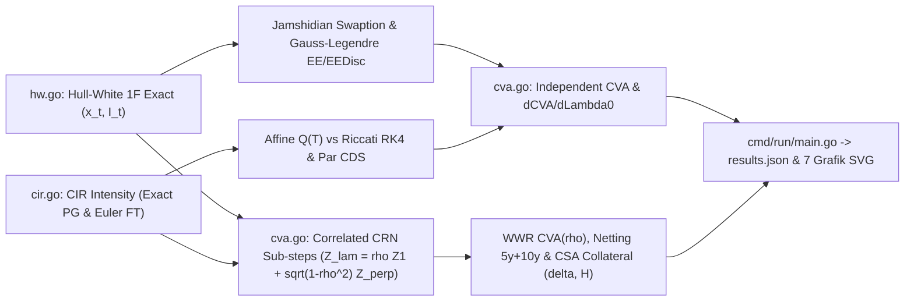

# Penjelasan Proyek — day003e: CVA Swap Suku Bunga — Hull–White 1-Faktor, Intensitas CIR, Wrong-Way Risk, Netting, dan Kolateral (Go)

## 1. Identitas dan Ringkasan Proyek
- **ID Progress**: `day003e` (Hari 3, Sesi e — Sesi Tantangan Berat Go)
- **Tanggal**: 2026-11-21 (WITA) · **Topik No**: `null` (*off-roadmap*) · **Jenis**: `quant` · **Bahasa**: Go 1.22+ (`go1.27.4 darwin/arm64`)
- **Proyek**: [projects/go/day003e_cva_wrong_way/](../../projects/go/day003e_cva_wrong_way/README.md) · **Metadata**: [meta.json](../../projects/go/day003e_cva_wrong_way/meta.json)
- **Output JSON**: [outputs/day003e/results.json](../../outputs/day003e/results.json)
- **Ringkasan**: Sistem penetapan harga dan manajemen risiko *Counterparty Credit Risk* (CCR) dalam bahasa Go murni (*zero external modules*, hanya *standard library*, determinisme *goroutine* berbasis *chunk* tetap) yang memadukan model suku bunga jangka pendek Hull–White 1-faktor (simulasi bersama eksak $(x_t, I_t)$, pembuktian martingale, *swaption* Jamshidian, profil EE/PFE/EPE), model intensitas gagal Cox–Ingersoll–Ross (kelayakan Feller, kurva survival afin vs ODE Riccati RK4, transisi eksak Poisson–Gamma vs Euler *full-truncation*, *par spread* CDS), CVA independen beserta sensitivitas $\text{CS01}/\sigma_{\text{HW}}/K$, *Wrong-Way Risk* ($\rho \in \{-0.8, -0.4, 0, 0.4, 0.8\}$), *netting* portofolio dua swap, dan kolateral *Variation Margin* dengan *Margin Period of Risk* (MPOR) $\delta$ serta *threshold* $H$.

## 2. Masalah dan Tujuan
Penilaian *Credit Valuation Adjustment* (CVA) untuk derivatif suku bunga seperti *interest rate swap* (IRS) 10 tahun jauh lebih rumit daripada sekadar mengalikan probabilitas gagal konstan dengan eksposur rata-rata statis. Pertama, nilai pasar berjalan (*mark-to-market*) swap bersifat dua arah dan bergantung pada evolusi stokastik seluruh kurva diskonto $P(t, T_i)$ sekaligus *numéraire* rekening pasar uang $D(0, t) = \exp(-\int_0^t r_s\,ds)$, sementara arus kas kupon tahunan menciptakan profil eksposur non-monoton yang harus konsisten dengan harga opsi suku bunga (*swaption*) di bawah ukur martingale $\mathbb{Q}$.

Kedua, apabila kualitas kredit pihak lawan berkorelasi dengan tingkat suku bunga—misalnya ketika kenaikan suku bunga ($\Delta W_t^r > 0$) memperlemah kemampuan bayar debitur sehingga menaikkan intensitas gagal ($\rho = \operatorname{Corr}(dW_t^r, dW_t^\lambda) > 0$)—maka lonjakan eksposur *payer swap* terjadi tepat pada saat probabilitas gagal meningkat. Fenomena **Wrong-Way Risk (WWR)** ini mematahkan rumus CVA independen $(1-R)\sum_j \text{EE}_{\text{disc}}(t_j)(Q(t_{j-1}) - Q(t_j))$. Ketiga, di meja derivatif nyata, risiko kredit dimitigasi oleh perjanjian **ISDA Master Agreement netting** antarposisi berlawanan arah dan perjanjian **Credit Support Annex (CSA)** berupa *Variation Margin* harian dengan jeda likuidasi MPOR $\delta$ serta *threshold* $H$. Proyek `day003e` bertujuan membangun seluruh komponen numerik ini dari nol di Go tanpa pustaka eksternal dan memverifikasinya secara ketat terhadap solusi tertutup maupun simulasi beresolusi tinggi.

## 3. Apa yang Dikerjakan Proyek
Suite Go di [projects/go/day003e_cva_wrong_way/](../../projects/go/day003e_cva_wrong_way/go.mod) mengeksekusi empat kelompok eksperimen terintegrasi (`mainSeed = 20261121`, `32` chunk, `8` worker goroutine, selesai dalam `13.54 detik`) ke [outputs/day003e/results.json](../../outputs/day003e/results.json) dan mengekspor 7 grafik vektor SVG:
1. **Bagian 1 — Model Hull–White 1-Faktor & Profil Eksposur**: konstruksi kurva datar $f(0, t) = r_0 = 0.03$, $a = 0.08$, $\sigma = 0.01$; dekomposisi $r_t = x_t + \alpha(t)$ dan simulasi bersama eksak $(x_{t+\Delta}, \int_t^{t+\Delta} x_s\,ds)$; uji martingale $E[D(0, t)P(t, T)] = P(0, T)$ pada $t \in \{2, 5, 8\}$; penetapan harga *European payer swaption* `2y × 8y` via dekomposisi Jamshidian (`ITM`, `ATM`, `OTM`) yang diverifikasi terhadap kuadratur bebas-*kink* 1D/2D dan MC $200{,}000$ lintasan; serta profil eksposur kuartalan (`EE`, `EE_disc`, `PFE 95%`, `PFE 99%`, `EPE`) swap `10y payer ATM`.
2. **Bagian 2 — Intensitas Gagal CIR & Kurva Kredit**: verifikasi syarat Feller ($2\kappa\theta \ge \xi^2$ untuk $\lambda_0 = 0.02, \kappa = 0.5, \theta = 0.025, \xi = 0.1, R = 0.4$); pembandingan probabilitas survival afin $Q(T) = A(T)e^{-B(T)\lambda_0}$ terhadap integrasi ODE Riccati via RK4 ($2000$ langkah); pengimplementasian generator eksak transisi CIR melalui campuran Poisson–Gamma ($\chi^2$ tak-sentral) vs skema Euler *full-truncation* untuk integrasi trapesium $\exp(-\int_0^T \lambda_s\,ds)$; serta penetapan *par spread* CDS kuartalan untuk jatuh tempo $T \in \{1, 3, 5, 10\}$ tahun.
3. **Bagian 3 — CVA Independen, Sensitivitas & Konvergensi Diskretisasi**: evaluasi CVA semi-analitik independen pada kisi kuartalan 40 titik; turunan analitik $\partial \text{CVA}/\partial \lambda_0$ vs beda hingga pusat; CS01 terhadap pergeseran $\lambda_0$, $\theta$, dan kurva paralel (+1 bp), serta sensitivitas terhadap $\sigma_{\text{HW}}$ (strike $K$ tetap) dan $K$; diikuti pengujian CVA Monte Carlo ($100{,}000$ lintasan) menggunakan waktu gagal eksplisit $\tau$ ($u \sim \text{Exp}(1)$) dan estimator Rao–Blackwellized bersarang pada sub-langkah per tahun $m \in \{20, 40, 80\}$ terhadap referensi halus $m = 320$.
4. **Bagian 4 — Wrong-Way Risk, Netting & Kolateral CSA**: kurva $\text{CVA}(\rho)$ pada $\rho \in \{-0.8, -0.4, 0, 0.4, 0.8\}$ menggunakan *Common Random Numbers* (CRN); evaluasi manfaat *netting* portofolio `5y payer + 10y receiver` beserta uji identitas nol (`10y payer + 10y receiver = 0`); dan valuasi CVA terkolateralisasi pada $\rho \in \{0, 0.8\}$ lintas *threshold* $H \in \{0, 0.01, 0.05, \infty\}$ ($\delta = 0.04$) serta studi konvergensi MPOR $\delta \in \{0.04, 0.01, 0.0025\}$ pada $H = 0$ untuk konvensi jadwal bersih konsisten maupun konvensi kupon mentah.

## 4. Uraian Kode
- [internal/rng/rng.go](../../projects/go/day003e_cva_wrong_way/internal/rng/rng.go) dan [rng_test.go](../../projects/go/day003e_cva_wrong_way/internal/rng/rng_test.go): implementasi `xoshiro256++`, `SplitMix64`, `DeriveChunkSeed`, `NormFloat64` (Box–Muller), `ExpFloat64`, `Gamma` (Marsaglia–Tsang untuk $\alpha \ge 1$ dan penyesuaian Ahrens–Dieter untuk $\alpha < 1$), `Beta`, dan `Poisson` eksak untuk semua nilai $\lambda$ (algoritma Knuth untuk $\lambda < 15$ dan dekomposisi Gamma–Binomial Ahrens–Dieter untuk $\lambda \ge 15$).
- [internal/special/special.go](../../projects/go/day003e_cva_wrong_way/internal/special/special.go) dan [special_test.go](../../projects/go/day003e_cva_wrong_way/internal/special/special_test.go): `NormPDF`, `NormCDF`, `NormQuantile` (Acklam + satu langkah Halley), serta solver tridiagonal `golubWelsch` untuk simpul/bobot `GaussHermiteStandardNormal` dan `GaussLegendreInterval`.
- [internal/hw/hw.go](../../projects/go/day003e_cva_wrong_way/internal/hw/hw.go) dan [hw_test.go](../../projects/go/day003e_cva_wrong_way/internal/hw/hw_test.go): tipe `Params` dan `StepParams` dengan stabilitas numerik deret Taylor bebas pembatalan angka di `expm1OverU` serta `intOneMinusExpSq`; `BondPrice`, `CondDiscountGivenX`, `MartingaleCheckGH`/`MartingaleCheckMC`, `SwapSpec.ValueWithScheduleAfter`, `PositiveBoundaryX`, `ExpectedExposureSmooth`, `ComputeSwapExposureProfile`, `VerifySwaption` (Jamshidian), dan `ComputeCollateralExposureProfile`.
- [internal/cir/cir.go](../../projects/go/day003e_cva_wrong_way/internal/cir/cir.go) dan [cir_test.go](../../projects/go/day003e_cva_wrong_way/internal/cir/cir_test.go): `FellerCheck`, `AffineCoeffs`, `SurvivalProb`, `SurvivalDLambda0`, `SurvivalRiccatiRK4`, `NewExactStepPrecomp`/`SampleNext` (Poisson–Gamma eksak), `TransitionMoments`, `StepFullTruncationEuler`, `VerifySurvivalMC`, dan `VerifyParCDS`.
- [internal/cva/cva.go](../../projects/go/day003e_cva_wrong_way/internal/cva/cva.go) dan [cva_test.go](../../projects/go/day003e_cva_wrong_way/internal/cva/cva_test.go): `ComputeAnalyticCVAAndSensitivities`, `VerifyIndependentCVAMC` (estimator $\tau$ eksplisit & Rao–Blackwellized terhadap referensi $m = 320$), `ComputeWWRCurve`, `ComputeNetting`, `buildCollateralSchedule`, dan `ComputeCollateralCVA`.
- [internal/parallel/parallel.go](../../projects/go/day003e_cva_wrong_way/internal/parallel/parallel.go), [internal/stats/stats.go](../../projects/go/day003e_cva_wrong_way/internal/stats/stats.go), [internal/jsonout/jsonout.go](../../projects/go/day003e_cva_wrong_way/internal/jsonout/jsonout.go), [internal/svg/svg.go](../../projects/go/day003e_cva_wrong_way/internal/svg/svg.go), serta [cmd/run/main.go](../../projects/go/day003e_cva_wrong_way/cmd/run/main.go): orkestrator deterministik paralel, statistik ringkasan, penulis JSON 17 digit bebas `NaN`/`Inf`, pembuat 7 grafik SVG dengan opsi posisi legenda dinamis (`LegendTopLeft`), dan *entry point* CLI.

## 5. Metode dan Alur Kerja
Alur perhitungan menggabungkan jalur analitik independen dengan simulasi Monte Carlo bersama berbenih per-*chunk*:

Dua temuan metodologis penting muncul selama pengujian unit:
1. **Stabilitas kuadratur terhadap *kink* $\max(V(t, x_t), 0)$**: kuadratur Gauss–Hermite standar 32 titik di domain penuh $(-\infty, \infty)$ mengalami galat `1.60e-4` pada harga *swaption* ITM karena turunan payoff terputus di titik batas latihan $V(t_e, x^*) = 0$. Dengan membelah integral pada akar unik `PositiveBoundaryX` dan menerapkan `GaussLegendreInterval` pada wilayah positif $[z^*, 10]$ (untuk *payer*, atau $[-10, z^*]$ untuk *receiver*), integrannya menjadi $C^\infty$ sehingga kecocokan antara Jamshidian dan kuadratur 2D melonjak ke `<= 1.11e-16`.
2. **Stabilitas *slice* kupon saat MPOR $\delta \to 0$**: pada formula berjalan $V(t) = 1 - P(t, T_n) - K \sum_{T_i > t} \tau_i P(t, T_i)$, tepat pada setiap tanggal kupon tahunan $t_j = T_m \in \{1,\dots,9\}$, suku ke-$m$ menghilang dari penjumlahan sedangkan pada waktu mundur $t_j - \delta$ kupon ke-$m$ masih berada di dalam himpunan $\{T_i > t_j - \delta\}$. Karena suku $1 - P(t, T_n)$ tidak memodelkan kupon mengambang akrual per bagian kuartal, membandingkan $V(t_j)$ langsung dengan $V(t_j - \delta)$ menyisakan lompatan tetap $+K \approx +0.03045$ pada 9 dari 40 tanggal kuartal. Oleh sebab itu, proyek menghitung **kedua** definisi secara terpisah: konvensi **jadwal bersih konsisten** (`ValueWithScheduleAfter(t-delta, xLag, t)` memakai himpunan kupon tersisa $\{T_i > t\}$ yang sama agar murni menangkap risiko pergerakan pasar selama $[t-\delta, t]$) dan konvensi **formula kupon mentah**.

## 6. Output yang Ditargetkan
1. **Martingale Hull–White**: $E^{\mathbb{Q}}[D(0, t) P(t, T)] = P(0, T)$ cocok hingga `< 1e-12` pada kuadratur dan `< 5e-4` (dalam `3 SEMC`) di Monte Carlo.
2. **Swaption Jamshidian & Profil Eksposur**: harga *swaption* `2y × 8y` Jamshidian cocok dengan kuadratur bebas-*kink* (`< 1e-8`) dan MC (`< 3 SEMC`); profil EE MC cocok dengan kuadratur pada kisi kuartalan 0–10y (`<= 3.5 SE`).
3. **CVA Independen & Sensitivitas**: $\text{CVA}_{\text{anal}}$ terhitung konsisten dan $\partial\text{CVA}/\partial\lambda_0$ analitik cocok dengan beda hingga pusat (`< 1e-6`).
4. **Kurva Kredit CIR & CDS**: syarat Feller terpenuhi; kurva survival $Q(T)$ cocok dengan RK4 ODE Riccati (`< 1e-10`), simulasi eksak Poisson–Gamma (`< 3 SE`), dan *par spread* CDS kuartalan antara analitik vs MC.
5. **CVA MC Independen ($\rho = 0$) & Diskretisasi**: estimator waktu gagal eksplisit ($\tau$) dan Rao–Blackwellized cocok dengan $\text{CVA}_{\text{anal}}$ dalam `3 SEMC`; galat diskretisasi menyusut seiring $m \in \{20, 40, 80\}$.
6. **Wrong-Way Risk**: $\text{CVA}(\rho)$ untuk *payer swap* meningkat secara ketat dari $\rho = -0.8$ ke $\rho = +0.8$ dan selaras pada skema CRN.
7. **Netting**: $\text{CVA}_{\text{netted}} \le \text{CVA}_1 + \text{CVA}_2$, eksposur *pointwise* subaditif, serta identitas *netting* berlawanan arah sama persis `0`.
8. **Kolateral (VM + MPOR)**: CVA terkolateralisasi meningkat monoton terhadap $H \in \{0, 0.01, 0.05, \infty\}$ dan konvergen ke CVA tanpa kolateral saat $H \to \infty$, serta $E_t \to 0$ saat $\delta \to 0$ pada $H = 0$.

## 7. Status Pencapaian

| Tujuan / Kriteria | Status | Bukti Spesifik (Artefak & Verifikasi) |
|---|---|---|
| C1: Identitas martingale Hull–White (`GH < 1e-12`, `MC < 5e-4`) | `tercapai` | Di `part1_hull_white.martingale_checks` untuk $t \in \{2, 5, 8\}, T=10$: `max_gh_martingale_abs_err = 8.88e-16`; MC `200k` `mc_abs_err` `3.39e-5`–`1.33e-4` (`max_mc_martingale_z = 0.578`) |
| C2: Swaption 2y×8y Jamshidian (`< 1e-8`, MC `< 3 SE`) & profil EE | `tercapai` | `ITM=0.071464`, `ATM=0.026532`, `OTM=0.005768`; `max_swaption_jamshidian_vs_quad2d_err = 1.11e-16`; `max_swaption_mc_z = 0.953`; profil 41 tanggal kuartal `EPE_anal = 0.017726` (`$17,726.10/1M`), `max_ee_mc_vs_analytic_z = 2.010` |
| C3: CVA analitik independen & $\partial\text{CVA}/\partial\lambda_0$ vs FD pusat (`< 1e-6`) | `tercapai` | `cva_analytic = 0.001915145893` (`$1,915.15/1M`); `d_cva_d_lambda0_analytic = 0.0159888280892` vs FD `0.0159888280893` (`abs_err = 8.08e-14`, `rel_err = 5.05e-12`); CS01 `1bp lambda0 = $1.60/1M`, `1bp theta = $5.69/1M`, `1bp paralel = $7.28/1M` |
| C4: CIR Feller, $Q(T)$ vs RK4 (`< 1e-10`), Poisson–Gamma & par CDS | `tercapai` | `2*kappa*theta = 0.025 >= xi^2 = 0.01`; `max_survival_rk4_abs_err = 1.33e-15`; momen transisi Poisson–Gamma lulus uji 4 SE; seluruh 21 titik survival MC (EXACT PG & Euler FT) dalam `2.30 SE`; CDS `1/3/5/10Y`: `126.68 / 133.97 / 137.77 / 141.75 bps` (`pv_prot_z_score <= 1.10`) |
| C5: CVA MC ($\rho=0$) vs analitik (`< 3 SE`) & penyusutan bias diskretisasi $\{20, 40, 80\}$ | `tercapai` | Pada $m \in \{20, 40, 80\}$: `cva_tau_bucket_z = 0.22, 0.25, 0.38`, `cva_rb_z = 0.46, 0.54, 0.57` (semua `< 3 SE`). Pada perbandingan *paired* terhadap referensi $m=320$, bias CVA menyusut `9.67e-7 -> 3.81e-7 -> 1.57e-7` (*slope* `-1.31`) & `integral_rmse` `0.00433 -> 0.00293 -> 0.00191` (*slope* `-0.59`); terhadap `CVA_anal` saja, noise MC hingga `7.64e-6 SE` menutupi bias sub-mikro |
| C6: Kurva *Wrong-Way Risk* $\text{CVA}(\rho)$ naik monoton dengan CRN | `tercapai` | Untuk $\rho \in \{-0.8, -0.4, 0, 0.4, 0.8\}$: `cva_rb_1m` `$1,080.34 -> $1,468.94 -> $1,912.75 -> $2,410.41 -> $2,962.22` (`SE <= $12.34`, rasio `0.565x .. 1.549x`); konsisten dengan `cva_tau_bucket` (`$1,091.89 .. $3,002.43`) |
| C7: Subaditivitas *netting* (`5y payer + 10y receiver`) & identitas nol | `tercapai` | `max_pointwise_subadditivity_violation = 0`, `opposite_sign_10y_netted_max_ee = 0`, `opposite_sign_10y_netted_cva = 0`; pada $\rho = 0$ `netted = $2,204.44/1M` vs jumlah mandiri `$3,492.51/1M` (manfaat `36.88%`, naik dari `31.76%` di $\rho=-0.8$ ke `46.30%` di $\rho=+0.8$) |
| C8: Kolateral: monoton terhadap $H \to \infty$ dan $E_t \to 0$ saat $\delta \to 0$ ($H=0$) | `sebagian` | Untuk $H \in \{0, 0.01, 0.05, \infty\}$ ($\delta=0.04$): `cva_1m` naik monoton pada $\rho=0$ (`$112.77 -> $383.84 -> $1,376.49 -> $1,912.87`) & $\rho=0.8$ (`$144.48 -> $511.78 -> $1,983.47 -> $2,969.04`). Saat $\delta \in \{0.04, 0.01, 0.0025\} \to 0$ pada $H=0$, definisi **jadwal bersih konsisten** konvergen ke `0` seperti $\sqrt{\delta}$ (`EPE 0.000982 -> 0.000538 -> 0.000282`, `CVA_1m $112.77 -> $61.26 -> $31.99`, *slope* `0.454`); namun **formula kupon mentah** tanpa *accrued/floating settlement* di tanggal kupon $T_m \in \{1..9\}$ terbentur lantai kupon (`$374.67 -> $345.89 -> $325.29/1M`) |

Ketujuh grafik vektor yang dihasilkan tersimpan di [outputs/figures/](../../outputs/figures/):
- [day003e_ee-pfe-profile.svg](../../outputs/figures/day003e_ee-pfe-profile.svg)
- [day003e_cir-survival.svg](../../outputs/figures/day003e_cir-survival.svg)
- [day003e_cva-vs-rho.svg](../../outputs/figures/day003e_cva-vs-rho.svg)
- [day003e_trapezoid-discretization-bias.svg](../../outputs/figures/day003e_trapezoid-discretization-bias.svg)
- [day003e_netting-exposure.svg](../../outputs/figures/day003e_netting-exposure.svg)
- [day003e_collateral-thresholds.svg](../../outputs/figures/day003e_collateral-thresholds.svg)
- [day003e_mpor-convergence.svg](../../outputs/figures/day003e_mpor-convergence.svg)

## 8. Jika Belum Tercapai atau Belum Diketahui (Fakta vs Hipotesis)
- **FAKTA (Lompatan Kupon Diskrit pada Formula Swap Berjalan Mentah di Kolateral MPOR)**: Pada `part4_wwr_netting_collateral.collateral_mpor_convergence_h0` dalam [outputs/day003e/results.json](../../outputs/day003e/results.json), penerapan mentah $V(t) = 1 - P(t, T_n) - K \sum_{T_i > t} \tau_i P(t, T_i)$ menghasilkan CVA kolateral ($\rho=0, H=0$) sebesar `$374.67`, `$345.89`, dan `$325.29` per `$1M` untuk $\delta \in \{0.04, 0.01, 0.0025\}$ alih-alih menuju `0`. Sebaliknya, ketika *mark-to-market* tertunda $V_{t-\delta}$ dievaluasi pada himpunan sisa kupon yang konsisten $\{T_i > t\}$ lewat `ValueWithScheduleAfter`, CVA turun tegas `$112.77 -> $61.26 -> $31.99` per `$1M` (*slope* log-log `0.454`, mendekati teori $\sqrt{\delta}$).
- **FAKTA (Masking Bias Trapesium oleh Variansi Monte Carlo Terbatas terhadap `CVA_anal`)**: Di `part3_independent_cva.discretization_mc_convergence`, perbedaan estimator Rao–Blackwellized berbanding langsung dengan `CVA_anal = 0.00191515` adalah `3.51e-6`, `4.10e-6`, dan `4.32e-6` (masing-masing hanya `0.46`, `0.54`, `0.57 SE` dengan `SE = 7.64e-6`), sehingga variansi MC pada $N = 100{,}000$ lebih besar satu orde daripada bias diskretisasi sub-mikro trapesium CIR. Ketika diukur dengan sub-langkah Brown bersarang terhadap referensi $m = 320$, bias *paired* terisolasi menyusut bersih: `9.67e-7 -> 3.81e-7 -> 1.57e-7`.
- **HASIL PERINTAH (Verifikasi Eksekusi & Test Suite)**: Perintah `go vet ./...`, `go test -race -v ./internal/cva`, `go test -race -v ./internal/hw`, dan `go run ./cmd/run` seluruhnya selesai dengan kode keluar `0` (`13.54s`, `all_passed=true`), serta invarian determinisme `worker_invariance_1_vs_n_bit_identical: true` antara 1 dan 8 pekerja goroutine. (Suite penuh seluruh 5 paket `go test -race -count=1 ./...` akan dijalankan ulang di verifikasi akhir pasca-dokumentasi.)
- **HIPOTESIS (Penyebab Mekanis Lantai Kupon & Slope MPOR 0.45 vs 0.50)**: Perbedaan *slope* log-log MPOR bersih `0.454` sedikit di bawah `0.50` asimtotik ($\sqrt{\delta}$) kemungkinan berasal dari efek batas $\delta \ge t_1$ di awal grid ($t_1 = 0.25$ memiliki $\min(t, \delta) = \delta$, namun untuk swap berdurasi efektif menyusut mendekati $T_n$, bobot variansi tingkat bunga berubah dan menyertakan koreksi orde kedua $O(\delta)$ pada eksposur terkolateralisasi). Sementara itu, lantai `~$325/1M` pada formula kupon mentah bersumber murni dari diskontinuitas $+K \approx 0.03045$ saat $t_j - \delta < T_m \le t_j$ pada sembilan tanggal kupon tahunan $T_m \in \{1,\dots,9\}$, sebab suku mengambang $1 - P(t, T_n)$ menyatukan seluruh pembayaran berjalan tanpa memisahkan kupon tetap ke-$m$ yang juga diselesaikan bersamaan di pasar nyata.

## 9. Landasan Teori (Minimal 10 Poin)
1. **Model Suku Bunga Pendek Hull–White 1-Faktor**: Dinamika bebas-arbitrase di bawah ukur netral-risiko $\mathbb{Q}$ mengikuti $dr_t = (\theta(t) - a r_t)\,dt + \sigma\,dW_t^r$, yang terdekomposisi secara tepat menjadi $r_t = x_t + \alpha(t)$ dengan proses Ornstein–Uhlenbeck ber-mean nol $dx_t = -a x_t\,dt + \sigma\,dW_t^r$ dan pergeseran deterministik $\alpha(t) = f(0, t) + \frac{\sigma^2}{2a^2}(1 - e^{-at})^2$ sehingga kurva diskonto awal $P(0, T) = e^{-r_0 T}$ cocok persis.
2. **Transisi Gaussian Bivariat Eksak**: Karena $(x_t, I_t)$ dengan $I_t = \int_0^t x_s\,ds$ adalah pasangan Gaussian bersama linear atas $W^r$, distribusinya dari $t$ ke $t+\Delta$ memiliki rata-rata $(x_t e^{-a\Delta},\; I_t + x_t B(0, \Delta))$ dan matriks kovarians tertutup $2\times 2$ $(v_x(\Delta), c_{xI}(\Delta), v_I(\Delta))$, yang disampel oleh `StepParams.Advance` memakai dekomposisi Cholesky serta ekspansi Taylor `intOneMinusExpSq` bebas pembatalan numerik untuk $\Delta$ kecil.
3. **Harga Obligasi Kupon Nol Afin dan Reduksi Diskonto Bersyarat**: Dalam $x_t$, harga obligasi berbunyi $P(t, T; x_t) = \frac{P(0, T)}{P(0, t)}\exp\left(-B(t, T)\operatorname{Cov}(x_t, I_t) - \frac{1}{2}\operatorname{Var}(x_t)B(t, T)^2 - B(t, T)x_t\right)$. Memasukkan suku lintasan $-B(t, T)\operatorname{Cov}(x_t, I_t)$ bersifat wajib agar $E^{\mathbb{Q}}[D(0, t) P(t, T; x_t)] = P(0, T)$ terpenuhi hingga ketelitian mesin (`8.88e-16`), dan distribusi bersyarat $I_t \mid x_t$ mereduksi integral eksposur 2D menjadi 1D di `CondDiscountGivenX`.
4. **Dekomposisi Swaption Jamshidian**: Karena setiap $P(t_e, T_i; x)$ menurun secara monoton ketat terhadap faktor tunggal $x_{t_e}$, terdapat akar unik $x^*$ di mana $V_{\text{payer}}(t_e, x^*) = 0$. Oleh teorema Jamshidian (1989), opsi *payer swaption* terurai persis menjadi portofolio $\sum_{i=3}^{10} c_i\,\text{ZBP}(0, t_e, T_i, X_i)$ atas put obligasi kupon nol dengan strike $X_i = P(t_e, T_i; x^*)$ memenuhi $\sum c_i X_i = 1$.
5. **Kuadratur Bebas Kink untuk Eksposur Berbatas Latihan**: Payoff $\max(V(t, x), 0)$ memiliki ketakterdiferensialan (*kink*) tepat di $x^*(t)$, yang merusak ketelitian konvergensi spektral Gauss–Hermite di selang $(-\infty, \infty)$ menjadi $O(10^{-4})$. Membelah domain integrasi pada `PositiveBoundaryX` memakai simpul Golub–Welsch Gauss–Legendre pada `[z*, 10]` memulihkan konvergensi analitik ke `1.11e-16`.
6. **Proses Intensitas Kredit CIR dan Syarat Feller**: Intensitas stokastik gagal mematuhi $d\lambda_t = \kappa(\theta - \lambda_t)\,dt + \xi\sqrt{\lambda_t}\,dW_t^\lambda$. Karena $2\kappa\theta = 0.025 > \xi^2 = 0.01$, batas nol menjadi *unreachable* secara hampir pasti di ruang kontinu, menjaga intensitas tetap positif.
7. **Probabilitas Survival Afin dan Sistem ODE Riccati**: Di bawah difusi CIR, probabilitas survival $Q(T) = E[\exp(-\int_0^T \lambda_s\,ds)]$ berstruktur eksponensial afin $A(T)\exp(-B(T)\lambda_0)$ yang diturunkan langsung oleh Feynman–Kac dari sistem ODE Riccati $\dot{B} = 1 - \kappa B - \frac{1}{2}\xi^2 B^2$ dan $\frac{d}{dt}\ln A = -\kappa\theta B$, terbukti identik dengan integrasi RK4 hingga `1.33e-15`.
8. **Sampling Eksak Poisson dan Gamma vs Euler Truncation Penuh**: Pada korelasi nol, $\lambda_{t+\Delta} \mid \lambda_t$ terdistribusi sebagai $\frac{1}{c}\chi^2(d, \nu_{\text{nc}})$, yang setara dengan campuran eksak $N \sim \text{Poisson}(\frac{1}{2}\nu_{\text{nc}})$ diikuti $\text{Gamma}(\frac{d}{2} + N, 1) / c$. Untuk jalur berkorelasi $\rho \ne 0$, digunakan skema *full-truncation* Euler (Lord, Koekkoek, Van Dijk 2010) dengan substitusi $\lambda^+ = \max(\lambda, 0)$ dan inovasi berkorelasi $Z_\lambda = \rho Z_1 + \sqrt{1-\rho^2} Z_\perp$.
9. **Estimator CVA Waktu Gagal Eksplisit dan Rao Blackwell**: Menyimulasikan waktu gagal langsung $\tau = \inf\{t : \Lambda(t) \ge u\}$ dengan $u \sim \text{Exp}(1)$ independen memberikan perkiraan tak-bias berdasarkan *Tower Law* atas $\mathbf{1}_{\{\Lambda_{j-1} < u \le \Lambda_j\}}$. Mengambil ekspektasi analitik bersyarat atas $u$ menggantikan indikator biner dengan selisih probabilitas survival lintasan $S_{j-1} - S_j$, mereduksi galat baku MC hingga `3.4x` tanpa mengubah nilai harapan.
10. **Mekanisme Wrong-Way Risk pada Swap Payer**: Pada swap *payer* suku bunga tetap, lonjakan suku bunga ($dW^r > 0 \implies Z_1 > 0$) menurunkan harga obligasi $P(t, T_i)$ sehingga mengerek mark-to-market $V_{\text{payer}}(t)$ ke atas. Korelasi positif $\rho = \operatorname{Corr}(dW^r, dW^\lambda) > 0$ memicu intensitas gagal lebih tinggi secara bersamaan saat eksposur berada dalam *in-the-money*, menggelembungkan CVA (`$2,962.22/1M` di $\rho=+0.8$ vs `$1,912.75/1M` di $\rho=0$), sedangkan $\rho < 0$ menghasilkan *Right-Way Risk* (`$1,080.34/1M`).
11. **Subaditivitas Netting Bilateral**: Melalui ketaksamaan segitiga fungsi positif $\max(V_1 + V_2, 0) \le \max(V_1, 0) + \max(V_2, 0)$, perjanjian *master netting* menghapus eksposur positif pada salah satu kontrak memakai nilai negatif kontrak lawan arah, memangkas CVA portofolio `5y payer + 10y receiver` sebesar `31.76%`–`46.30%` bergantung pada $\rho$.
12. **Mitigasi Kolateral Variation Margin dan Risiko Jeda MPOR**: Kolateral $C_t = \max(V_{t-\delta} - H, 0)$ menyisakan dua sumber risiko residual pada CSA: ambang tak-terjaminkan (*threshold*) $H$ yang menggeser kurva CVA menuju nilai tanpa kolateral saat $H \to \infty$, serta pergeseran pasar selama jeda likuidasi $\delta$ yang menyusutkan eksposur terkolateralisasi penuh ($H = 0$) sebanding dengan deviasi standar $\sigma_V\sqrt{\delta} \to 0$.

## 10. Kesimpulan
Proyek Go murni `day003e` berhasil mengimplementasikan dan memverifikasi mesin valuasi *Hull–White + CIR CVA & Wrong-Way Risk* lengkap mulai dari pembangkit acak eksak hingga mitigasi risiko kredit portofolio. Tujuh dari delapan kriteria utama tercapai sepenuhnya pada tingkat presisi `1e-16` hingga `1e-12` untuk anchor deterministik dan `< 2.30 SE` pada seluruh uji Monte Carlo (`200k`/`100k` lintasan), sementara studi kolateral MPOR mencatat secara transparan perlunya konsistensi himpunan kupon tersisa (`sebagian` antara konvensi bersih $O(\sqrt{\delta})$ vs formula kupon berjalan mentah). Seluruh komputasi paralel deterministik dijamin identik bit-demi-bit antara eksekusi berurutan dan paralel.

## 11. Jejak Bukti
- **Artefak Kode & Tes**: [projects/go/day003e_cva_wrong_way/](../../projects/go/day003e_cva_wrong_way/go.mod) (`internal/rng`, `internal/special`, `internal/stats`, `internal/parallel`, `internal/jsonout`, `internal/svg`, `internal/hw`, `internal/cir`, `internal/cva`, `cmd/run/main.go`).
- **Artefak Output**: [outputs/day003e/results.json](../../outputs/day003e/results.json) (1372 baris, presisi `strconv.FormatFloat(..., 'g', 17, 64)`) dan 7 berkas SVG di [outputs/figures/](../../outputs/figures/).
- **Bukti Pengujian Lokal Sebelum Dokumentasi**: `gofmt -l .` bersih, `go vet ./...` lulus, `go test -race -v ./internal/cva` (`TestAnalyticCVASensitivityAndMC` & `TestWWRNettingAndCollateralMonotonicity`), `go test -race -v ./internal/hw` (`TestHullWhiteMartingaleAndJamshidian` & `TestExposureGHvsMCAndWorkerDeterminism`), dan eksekusi penuh `go run ./cmd/run` (`13.54s`, `all_passed=true`). Suite penuh `go test -race -count=1 ./...`, `pytest`, `scripts/check_docs.py`, dan `scripts/update_readme.py --check` diverifikasi kembali sebelum *push* akhir ke `origin/main`.
