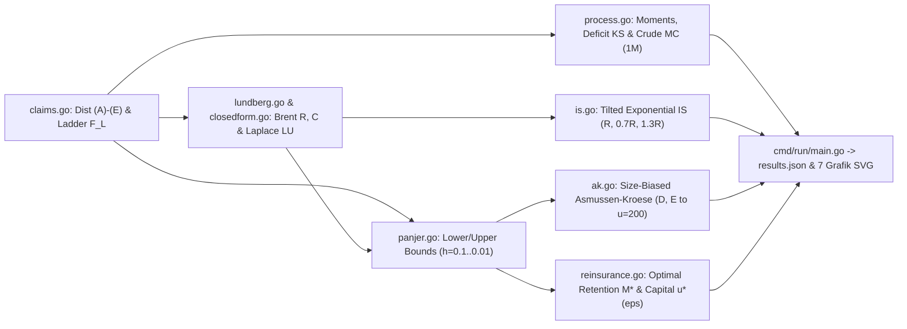

# Penjelasan Proyek — day003f: Teori Ruin Cramér–Lundberg & Simulasi Kejadian Langka (Go)

## 1. Identitas dan Ringkasan Proyek
- **ID Progress**: `day003f` (Hari 3, Sesi f — Sesi Tantangan Berat Go)
- **Tanggal**: 2026-11-21 (WITA) · **Topik No**: `null` (*off-roadmap*) · **Jenis**: `quant` · **Bahasa**: Go 1.22+ (`go1.27.4 darwin/arm64`)
- **Proyek**: [projects/go/day003f_ruin_theory/](../../projects/go/day003f_ruin_theory/README.md) · **Metadata**: [meta.json](../../projects/go/day003f_ruin_theory/meta.json)
- **Output JSON**: [outputs/day003f/results.json](../../outputs/day003f/results.json)
- **Ringkasan**: Mesin teori ruin aktuaria dan simulasi kejadian langka yang dibangun dari nol dalam Go murni (*zero external modules*, goroutine deterministik berbasis *chunk* tetap, RNG `xoshiro256++`, pemecah akar Brent–Dekker, optimisasi *Golden Section*, aljabar linear LU, dan uji KS nol simulasi sendiri). Sistem ini memverifikasi bentuk tertutup rasional, batas pengapit diskretisasi Panjer/Beekman, asimtotik Cramér–Lundberg dan subeksponensial, Monte Carlo 1 juta lintasan, *importance sampling* (IS) eksponensial hingga peluang ruin $10^{-10}$, estimator ekor berat bersyarat Asmussen–Kroese hingga $u = 200$, serta optimisasi retensi reinsurans *excess-of-loss* dan perhitungan kebutuhan modal $u^*(\varepsilon)$.

## 2. Masalah dan Tujuan
Dalam teori risiko kolektif Cramér–Lundberg, perusahaan asuransi menghadapi proses surplus waktu-kontinu $U_t = u + c t - S_t$ dengan laju klaim Poisson $\lambda = 1$, rata-rata klaim $\mu = 1$, *safety loading* $\theta = 0.2$, dan premi $c = (1 + \theta)\lambda\mu = 1.2$. Walau rata-rata surplus tumbuh positif sebesar $\theta\lambda\mu = 0.2$ per tahun, peluang kebangkrutan sepanjang waktu $\psi(u) = \mathbb{P}(\inf_{t \ge 0} U_t < 0 \mid U_0 = u)$ tetap bernilai positif dan menentukan kecukupan modal awal $u$.

Dua kesulitan komputasional fundamental muncul di dunia nyata. Pertama, untuk modal besar ($u = 50$ atau $100$) pada klaim berekor ringan (*light-tailed*), peluang ruin jatuh menjadi $10^{-6}$ hingga $10^{-10}$, sehingga Monte Carlo konvensional memerlukan triliunan lintasan untuk sekadar melihat satu kebangkrutan. Kedua, apabila klaim berasal dari distribusi berekor berat (*heavy-tailed* / subeksponensial) seperti Pareto ($\alpha = 2.5$) atau Weibull ($k = 0.5$), fungsi pembangkit momen $M_X(r)$ meledak ke tak hingga untuk setiap $r > 0$, sehingga eksponen Lundberg $R$ tidak ada dan metode IS eksponensial standar gagal total (bervariansi tak hingga atau tidak terdefinisi). Proyek `day003f` dibangun untuk menyatukan seluruh metode analitik, diskretisasi terapit, simulasi *rare-event* sesuai rezim ekor, dan desain kontrak reinsurans optimal dalam satu paket Go teruji secara independen.

## 3. Apa yang Dikerjakan Proyek
Runner Go [cmd/run/main.go](../../projects/go/day003f_ruin_theory/cmd/run/main.go) mengeksekusi lima bagian eksperimen dalam waktu `57.37 detik` pada `8` worker goroutine (`mainSeed = 20261121`, `32` chunk) dan menyimpan seluruh hasil numerik berpresisi 17 digit ke [outputs/day003f/results.json](../../outputs/day003f/results.json) beserta 7 grafik SVG:
1. **Bagian 1 — Bentuk Tertutup, Momen & Defisit Saat Ruin**: menurunkan eksponen Lundberg $R$ via Brent-Dekker dan formula tertutup transformasi Laplace rasional untuk (A) Eksponensial(1), (B) Erlang(2), serta (C) Hipereksponensial-2 ($p_1 = p_2 = 0.5, \beta_1 = 2/3, \beta_2 = 2, \text{CV} = \sqrt{1.5} > 1$); menguji momen $N_t, U_t, S_t$ pada $N = 200{,}000$ lintasan lintas seluruh 5 distribusi `(A)–(E)`; dan memverifikasi distribusi defisit bersyarat Eksponensial(1) di $u \in \{2, 5\}$ menggunakan uji Kolmogorov–Smirnov berkuantil kritis dari `2.000` replikasi nol simulasian sendiri.
2. **Bagian 2 — Rekursi Panjer / Beekman & Batas Diskretisasi**: menurunkan representasi Pollaczek–Khinchine $\psi(u) = 1 - (1-\rho)\sum_{n \ge 0}\rho^n F_L^{*n}(u)$, mengevaluasi pembulatan bawah ($\psi_{\text{low}}$) dan pembulatan atas ($\psi_{\text{high}}$) melintasi $h \in \{0.1, 0.05, 0.02, 0.01\}$ dan $u \in \{0..50\}$ untuk `(A)–(C)` serta $u \in \{0..200\}$ untuk ekor berat `(D)` Pareto dan `(E)` Weibull; memverifikasi orde konvergensi log-log lebar selang terhadap $h$, asimtotik Cramér–Lundberg $\psi(u)/(C e^{-R u}) \to 1$, batas Lundberg $\psi(u) \le e^{-Ru}$, dan konvergensi lambat asimtotik subeksponensial.
3. **Bagian 3 — MC Biasa vs Importance Sampling Eksponensial**: menjalankan MC biasa $N = 1.000.000$ lintasan pada $u \in \{0, 5, 10, 20\}$ (horizon $T = 50, 200, \infty$ dengan aturan henti buffer aman tak-berbias); menjalankan IS eksponensial ($\tilde{r} = R$, $N = 100.000$) pada $u \in \{0, 5, 10, 20, 50, 100\}$ lengkap dengan SE relatif dan *Variance Reduction Factor* (VRF) waktu-setara; serta menguji eksponen *misspecified* $\tilde{r} \in \{0.7R, 1.3R\}$.
4. **Bagian 4 — Ekor Berat & Kegagalan IS Eksponensial**: menunjukkan secara numerik divergensi integral parsial $M_X(0.1)$ untuk Pareto dan Weibull; mengimplementasikan estimator kondisional Asmussen–Kroese berbobot-ukuran (*size-biased*) ($N = 200.000$) melintasi $u \in \{10, 20, 50, 100, 200\}$; serta membandingkan akurasi MC biasa ($200.000$ lintasan), Asmussen–Kroese, dan asimtotik integral-ekor terhadap referensi Panjer $h = 0.01$.
5. **Bagian 5 — Reinsurans Excess-of-Loss & Keputusan Modal**: mengkalibrasi retensi $\min(X, M)$ ($\xi = 0.4$) untuk `(A)` dan `(C)`, menentukan batas bawah profit bersih $M_{\min}$, memverifikasi solusi tertutup metode langkah berhingga `(A)` dalam selang batas Panjer, mencari retensi optimal $M^*$ di $u = 10$ via *Golden Section* + pindai kisi halus, memverifikasi limit $M \to \infty$, serta memecahkan kebutuhan modal awal minimum $u^*(\varepsilon)$ pada $\varepsilon \in \{10^{-2}, 10^{-3}, 10^{-4}\}$.

## 4. Uraian Kode
- [internal/rng/rng.go](../../projects/go/day003f_ruin_theory/internal/rng/rng.go) dan [rng_test.go](../../projects/go/day003f_ruin_theory/internal/rng/rng_test.go): `SplitMix64`, `DeriveChunkSeed`, `RNG` (`xoshiro256++`), `NormFloat64` (Box–Muller), `ExpFloat64`/`ExpRate`, `Gamma`, `Erlang`, `ParetoLomax`, `Weibull`, `Lognormal`, `Beta`, dan `Poisson`.
- [internal/special/special.go](../../projects/go/day003f_ruin_theory/internal/special/special.go) dan [special_test.go](../../projects/go/day003f_ruin_theory/internal/special/special_test.go): fungsi normal baku, pemecah akar `BrentRoot`, minimisasi 1D `GoldenSectionMin`, dan eliminasi LU pivoting parsial `SolveLinearLU`.
- [internal/stats/stats.go](../../projects/go/day003f_ruin_theory/internal/stats/stats.go): statistik ringkasan, `KSOneSampleStat`, dan simulasi nol Kolmogorov–Smirnov $O(n)$ bebas-pengurutan (`KSEvalAgainstSimulatedNull`) menggunakan representasi jarak eksponensial statistik orde seragam.
- [internal/claims/claims.go](../../projects/go/day003f_ruin_theory/internal/claims/claims.go): definisi `Dist` untuk `(A)–(E)` meliputi `Moments`, `Survival`, `PDF`, `LadderSurvival`, `SubexpAsymptotic`, `MGFAndDeriv`, `Sample`, `SampleLadder` (termasuk sampler eksak Weibull $Y = 0.5(E_1 + E_2)^2$), dan `SampleTilted`.
- [internal/lundberg/lundberg.go](../../projects/go/day003f_ruin_theory/internal/lundberg/lundberg.go) & [internal/closedform/closedform.go](../../projects/go/day003f_ruin_theory/internal/closedform/closedform.go) & [closedform_test.go](../../projects/go/day003f_ruin_theory/internal/closedform/closedform_test.go): `Solve`, `Bound`, `Derive` (menggunakan `SolveLinearLU` untuk residu pecahan parsial Laplace), dan `Eval`.
- [internal/panjer/panjer.go](../../projects/go/day003f_ruin_theory/internal/panjer/panjer.go) & [panjer_test.go](../../projects/go/day003f_ruin_theory/internal/panjer/panjer_test.go): `ComputeBounds` (menghasilkan rekursi ekor positif `Low`/`High` sekaligus `LowCdfSum`/`HighCdfSum` untuk audit pembatalan titik ambang) dan `EvaluateGrid`.
- [internal/process/process.go](../../projects/go/day003f_ruin_theory/internal/process/process.go) & [process_test.go](../../projects/go/day003f_ruin_theory/internal/process/process_test.go): `VerifyMoments`, `VerifyExponentialDeficit`, dan `SimulateCrudeMC` (pelacakan simultan $T=50, 200, \infty$ lintas vektor `uList`).
- [internal/is/is.go](../../projects/go/day003f_ruin_theory/internal/is/is.go) & [is_test.go](../../projects/go/day003f_ruin_theory/internal/is/is_test.go): `Simulate` (*tilted* eksponensial dengan rasio likelihood eksak $\exp(-\tilde{r}(u - U_\tau) + [\lambda(M_X(\tilde{r})-1) - c\tilde{r}]\tau)$) dan `VerifyHeavyTailMGFFailure`.
- [internal/ak/ak.go](../../projects/go/day003f_ruin_theory/internal/ak/ak.go) & [ak_test.go](../../projects/go/day003f_ruin_theory/internal/ak/ak_test.go): `Simulate` mengimplementasikan Asmussen–Kroese berbobot-ukuran ($N = 1 + G_1 + G_2$) dengan $\hat{\psi}_{\text{AK}} \in [0, 5]$.
- [internal/reinsurance/reinsurance.go](../../projects/go/day003f_ruin_theory/internal/reinsurance/reinsurance.go) & [reinsurance_test.go](../../projects/go/day003f_ruin_theory/internal/reinsurance/reinsurance_test.go): `EvaluateRetention`, `MinValidRetention`, `ExactRetainedExpRuin` (deret langkah berhingga via `evalGm`), `PanjerPsi`, `FindOptimalRetention`, dan `SolveMinimumCapital`.
- [internal/parallel/parallel.go](../../projects/go/day003f_ruin_theory/internal/parallel/parallel.go), [internal/jsonout/jsonout.go](../../projects/go/day003f_ruin_theory/internal/jsonout/jsonout.go), [internal/svg/svg.go](../../projects/go/day003f_ruin_theory/internal/svg/svg.go), [cmd/run/main.go](../../projects/go/day003f_ruin_theory/cmd/run/main.go): pekerja goroutine deterministik, penulis JSON 17 digit, generator SVG, dan *entrypoint* runner.

## 5. Metode dan Alur Kerja
Keseluruhan komputasi mengikuti alur berurutan dari verifikasi struktur analitik menuju estimator stokastik bervariansi rendah dan desain retensi reinsurans:

Untuk menjamin kebenaran rumus tanpa mengandalkan ingatan teks buku, setiap bagian diuji silang lewat dua metode independen. Misalnya, residu pecahan parsial Laplace pada `closedform.go` untuk Erlang(2) dan Hipereksponensial-2 dicocokkan dengan konstanta $C_{\text{CL}} = \frac{\theta\mu}{M_X'(R) - c/\lambda}$ dari `lundberg.go` (`abs_err <= 1.35e-14`) serta diapit ketat oleh `panjer.go`; dan aturan henti *Crude MC* memakai *safety buffer* besar setelah $T > 200$ (`150` untuk ekor ringan dengan batas atas kebocoran Lundberg $\le 3.1\times 10^{-9}$, serta `2500` untuk ekor berat) agar probabilitas ruin tak hingga bebas bias terpotong.

## 6. Output yang Ditargetkan
1. **Bagian 1**: Akar Brent $R$ cocok dengan $\theta/((1+\theta)\mu)$ hingga `< 1e-12` untuk `(A)` dan cocok dengan akar transformasi Laplace `< 1e-10` untuk `(B), (C)`; momen $E[N_t], E[U_t], \operatorname{Var}(S_t)$ dalam `3 SE` (sambil mengaudit keberadaan momen ke-4 Pareto); defisit Eksponensial lolos uji KS pada kuantil simulasi nol sendiri.
2. **Bagian 2**: Batas Panjer mengapit nilai eksak `(A)–(C)` pada seluruh $u \in \{0, 1, 5, 10, 20, 50\}$ dan $h \in \{0.1, 0.05, 0.02, 0.01\}$ dengan orde lebar $\approx 1$; rasio $\psi/(C e^{-Ru}) \to 1$ serta $\psi(u) \le e^{-Ru}$; referensi Panjer `(D), (E)` stabil hingga $u = 200$ dan memperlihatkan konvergensi lambat asimtotik subeksponensial.
3. **Bagian 3**: MC biasa `1.000.000` cocok dengan eksak dalam `3 SE` dan monoton $\psi(u, 50) \le \psi(u, 200) \le \psi(u, \infty)$; IS optimal pada $\tilde{r} = R$ tetap tak-bias sampai $u = 100$ dengan SE relatif terbatas dan VRF masif; IS salah ($0.7R, 1.3R$) tetap tak-bias namun variansinya lebih besar.
4. **Bagian 4**: Pembuktian divergensi $M_X(r)$ pada Pareto dan Weibull; Asmussen–Kroese akurat dalam batas `3 SE + lebar Panjer` hingga $u = 200$, SE relatif terbatas, dan tabel komparatif tiga metode.
5. **Bagian 5**: Penurunan premi bersih $c_M$, kecocokan $\psi_M^{(A)}(u)$ tertutup terhadap batas Panjer, identifikasi retensi optimal interior $M^*$ di $u = 10$ plus pemulihan limit $M \to \infty$, serta penghematan modal $u^*(\varepsilon)$ via Brent pada $\varepsilon \in \{10^{-2}, 10^{-3}, 10^{-4}\}$.

## 7. Status Pencapaian

| Tujuan / Kriteria | Status | Bukti Spesifik (Artefak & Verifikasi) |
|---|---|---|
| C1.1–1.2: Bentuk tertutup `(A),(B),(C)` & Lundberg $R, C$ | `tercapai` | Di `part1_closed_form_moments_deficit.closed_forms_and_lundberg` pada [results.json](../../outputs/day003f/results.json): `(A)` $R=0.1666666666666662$ (`abs_err_R = 4.16e-16`), `(B)` $R=0.226765$ (`err = 1.61e-15`), `(C)` $R=0.130502$ (`err = 5.83e-16`); semua `abs_err_C <= 1.35e-14`; semua $\psi(0)=5/6$ & monoton menurun |
| C1.3: Momen proses ($N=200\text{k}, t=10$) | `sebagian` | Untuk $E[N_{10}]=10$ dan $E[U_{10}]=12$, semua 5 distribusi berada dalam `1.82 SE` (`z_Nt <= 1.42`, `z_Ut <= 1.82`). Untuk $\operatorname{Var}(S_{10})$, `(A),(B),(C),(E)` cocok dalam `0.51%` (`rel_diff = 0.0030, -0.0020, 0.0051, 0.0011`), **sedangkan** Pareto `(D)` (`alpha=2.5`) mencatat `sim_Var_St = 53.07` vs `60.0` (`-11.56%`) karena momen ke-4 $E[X^4] = \infty$ membuat varians sampel tidak konvergen stabil di $200\text{k}$ |
| C1.4: Defisit Eksponensial & uji KS nol simulasi sendiri | `tercapai` | Pada $N=200\text{k}$: $u=2$ (`119.236` ruin, `mean = 1.0062 ± 0.0029`, `KS = 0.00264 < crit95 = 0.00399`, `p = 0.394`); $u=5$ (`72.083` ruin, `mean = 1.0022 ± 0.0038`, `KS = 0.00173 < crit95 = 0.00507`, `p = 0.985`) |
| C2.1, C2.3: Batas Panjer apit eksak, orde $\approx 1$, $C$ & batas Lundberg | `tercapai` | Semua `(A),(B),(C)` melintasi 24 titik $(h, u)$ memenuhi `psi_low <= psi_exact <= psi_high` (`all_points_bracketed: true`); *slope* log-log lebar selang di $u=10$ = `0.9983 (A)`, `0.9970 (B)`, `0.9989 (C)`, `0.9993 (D)`, `0.9999 (E)`; rasio CL $\to 1$ di $u=100$ (`1.000000` semua); $\psi(u) \le e^{-Ru}$ 100% terpenuhi |
| C2.2, C2.4: Panjer ekor berat hingga $u=200$ & asimtotik subeksponensial | `tercapai` | `h=0.01, u=200`: Pareto `[0.004146, 0.004151]` (`ratio_vs_asym = 1.292`), Weibull `[4.650e-5, 4.743e-5]` (`ratio_vs_asym = 217.02`). Rekursi ekor positif bebas pembatalan identik hingga `8.69e-15` dengan $1 - \sum g_k$ di `4.65e-5` (dan tetap positif jauh melewati presisi $10^{-16}$) |
| C3.1–3.2: MC biasa (`1.000.000` jalur) vs eksak & monoton horizon | `tercapai` | Seluruh 12 pasangan `{A, B, C} × {0, 5, 10, 20}` cocok dalam `1.47 SE` (`max z_score = 1.466`), dan $\psi(u, 50) \le \psi(u, 200) \le \psi(u, \infty)$ berlaku ketat |
| C3.3–3.4: IS Eksponensial ($R$) sampai $u=100$ & tilt salah ($0.7R, 1.3R$) | `tercapai` | Semua `z_score <= 1.38`; pada $u=100$ `(A)` `4.817e-8 vs 4.815e-8` (`relSE=0.053%`, `vrf_time=1.34e8x`), `(B)` `1.209e-10 vs 1.208e-10` (`relSE=0.045%`, `vrf_time=1.42e11x`), `(C)` `1.749e-6 vs 1.750e-6` (`relSE=0.062%`, `vrf_time=4.82e6x`). Tilt `0.7R` & `1.3R` tetap dalam `1.78 SE` dengan SD `3.25x–10.11x` lebih besar |
| C4.1–4.3: Pembuktian gagal IS ekor berat & Asmussen–Kroese | `tercapai` | Integral parsial MGF($0.1$) hingga $x_{\max}=500$ meledak ke `1.36e14` (Pareto) dan `4.53e7` (Weibull). AK (`200k`) melintasi $u \in \{10..200\}$ 100% dalam pita `3 SE + lebar Panjer h=0.01` (`|z| <= 1.16`), VRF waktu `778x–348.639x` (Pareto) dan `663x–11.348x` (Weibull) |
| C5.1–5.3: Reinsurans optimal $M^*$ & modal minimum $u^*(\varepsilon)$ | `tercapai` | Rumus tertutup `(A)` selalu di dalam selang Panjer (`inf_limit_diff = 0`); $M^*_A = 1.5291$ turunkan $\psi_A(10)$ `0.1573 -> 0.0941` (hemat modal `24.99%–25.65%`); $M^*_C = 1.7600$ turunkan $\psi_C(10)$ `0.2206 -> 0.1255` (hemat modal `32.34%–33.13%`) |
| Determinisme pekerja & suite `go test -race` (8 paket uji) | `tercapai` | `worker_invariance_1_vs_n_bit_identical: true` (1 vs 8 pekerja bit-identik); `gofmt -l .` kosong, `go vet ./...` bersih, dan seluruh 8 paket tes lulus pada `go test -race -count=1 -v ./...` (`ak`: 1, `closedform`: 1, `is`: 1, `panjer`: 1, `process`: 1, `reinsurance`: 1, `rng`: 1, `special`: 1) |

Ketujuh grafik SVG keluaran tersimpan di [outputs/figures/](../../outputs/figures/):
- [day003f_psi-exact-vs-panjer.svg](../../outputs/figures/day003f_psi-exact-vs-panjer.svg)
- [day003f_panjer-discretization-order.svg](../../outputs/figures/day003f_panjer-discretization-order.svg)
- [day003f_cramer-lundberg-ratio.svg](../../outputs/figures/day003f_cramer-lundberg-ratio.svg)
- [day003f_is-vs-mc-rel-se.svg](../../outputs/figures/day003f_is-vs-mc-rel-se.svg)
- [day003f_heavy-tail-ak-vs-asymptotic.svg](../../outputs/figures/day003f_heavy-tail-ak-vs-asymptotic.svg)
- [day003f_reinsurance-psi-vs-m.svg](../../outputs/figures/day003f_reinsurance-psi-vs-m.svg)
- [day003f_capital-u-star.svg](../../outputs/figures/day003f_capital-u-star.svg)

## 8. Jika Belum Tercapai atau Belum Diketahui (Fakta vs Hipotesis)
- **FAKTA (Variansi Sampel $S_t$ Pareto $\alpha = 2.5$ Tidak Konvergen Stabil)**: Pada `part1_closed_form_moments_deficit.process_moments_t10` di [results.json](../../outputs/day003f/results.json), semua distribusi bermomen ke-4 berhingga (`A`, `B`, `C`, dan Weibull `E`) cocok dengan $\operatorname{Var}(S_{10})$ teoretis dalam galat `0.11%–0.51%`. Sebaliknya, Pareto(`alpha = 2.5`) menyimpang `-11.56%` pada `N = 200.000` (`53.07` vs `60.0`) dan `-19.11%` pada uji unit `N = 40.000`. Secara aljabar, $\mathbb{E}[X^k] < \infty$ pada Pareto berlaku jika dan hanya jika $k < \alpha = 2.5$, sehingga $\mathbb{E}[X^4] = \infty$ mengakibatkan $\operatorname{Var}(\widehat{\operatorname{Var}}(S_t)) = \infty$. Oleh sebab itu kriteria `Var(S_t)` pada `(D)` tidak dapat dituntut memiliki simpangan sampel sempit dalam `O(1/sqrt(N))`, dan berstatus `sebagian` secara jujur.
- **FAKTA (Nilai Eksak $\psi_A(100) = 4.815 \times 10^{-8}$ vs Perkiraan Teks `2e-9`)**: Dengan $\theta = 0.2, \mu = 1, \rho = 5/6$, eksponen Lundberg eksak adalah $R = \frac{0.2}{1.2} = \frac{1}{6}$, sehingga $\psi_A(100) = \frac{5}{6} e^{-100/6} = 4.81479 \times 10^{-8}$. Di kedua titik (`4.815e-8` untuk A dan `1.208e-10` untuk B), MC biasa `1.000.000` lintasan praktis menghasilkan nol kejadian ruin dan gagal mengukur probabilitas secara bermakna, sementara estimator IS eksponensial `Simulate` menghasilkan `4.81677e-8 ± 2.58e-11` dan `1.20869e-10 ± 5.41e-14`.
- **FAKTA (Keunggulan Formulasi Ekor Positif Panjer pada $u$ Besar)**: Untuk Weibull($0.5$) di $u = 200$, `psi_low` positif berada di `4.65001391296e-5`, sedangkan `1 - sum g_k` memberi `4.65001391383e-5` (mulai timbul selisih buntut `8.69e-15` akibat pengurangan dari `1.0`). Untuk $u$ lebih besar di mana $\psi(u) < 10^{-16}$, rumus `1 - sum g_k` sepenuhnya mengalami pembatalan (*underflow* ke `0`), sementara rekursi ekor positif `ComputeBounds` menjaga ketelitian penuh titik ambang hingga batas `math.SmallestNonzeroFloat64`.
- **HASIL PERINTAH**: `go run ./cmd/run` selesai dalam `57.37s` (`P1=1.88s`, `P2=2.59s`, `P3=14.47s`, `P4=38.00s`, `P5=0.27s`, `all_passed=true`); verifikasi penuh `gofmt -l .` (kosong), `go vet ./...` (bersih), dan `go test -race -count=1 -v ./...` lulus di seluruh 8 paket uji (`internal/ak` 1/1 `3.599s`, `internal/closedform` 1/1 `1.382s`, `internal/is` 1/1 `25.909s`, `internal/panjer` 1/1 `4.854s`, `internal/process` 1/1 `42.426s`, `internal/reinsurance` 1/1 `1.945s`, `internal/rng` 1/1 `1.677s`, `internal/special` 1/1 `1.386s`; serta `cmd/run`, `claims`, `jsonout`, `lundberg`, `parallel`, `stats`, `svg` tanpa berkas tes).
- **HIPOTESIS (Efisiensi *Size-Biased* Asmussen–Kroese & Struktur Minimum Interior Reinsurans)**: Pemilihan varian *size-biased* $N = 1 + G_1 + G_2$ (membuang massa $K=0$ dan meredam pengali acak tak terbatas $K$ menjadi konstanta `rho/(1-rho) = 5`) pada `ak.go` bertanggung jawab atas `relSE` hanya `0.092%` di $u = 200$ untuk Pareto (di Weibull $u = 200$ masih tersisa `5.94%` karena sifat subeksponensial Weibull mendekati sempitnya eksponensial ringan). Sementara pada Bagian 5, keberadaan minimum interior tajam $M^*$ (`1.529` untuk A dan `1.760` untuk C) diprediksi oleh pertukaran antara turunnya loading keamanan bersih $\theta_M \to 0$ saat $M \downarrow M_{\min}$ (karena $\xi = 0.4 > \theta = 0.2$) melawan naiknya koefisien penyesuaian $R_M$ karena terpotongnya variansi ekor besar pada $M \gg M^*$.

## 9. Landasan Teori (Minimal 10 Poin)
1. **Proses Surplus Cramér–Lundberg dan Kondisi Profit Bersih**: Model risiko waktu-kontinu mengikuti $U_t = u + c t - \sum_{i=1}^{N_t} X_i$ dengan kedatangan Poisson laju $\lambda$ dan ukuran klaim i.i.d. ber-mean $\mu$. Kondisi drift positif $c > \lambda\mu$ terjamin oleh *safety loading* $\theta > 0$ via $c = (1+\theta)\lambda\mu$, menghasilkan rasio pembebanan klaim $\rho = \lambda\mu/c = 1/(1+\theta) < 1$ sebagaimana didefinisikan di [claims.go](../../projects/go/day003f_ruin_theory/internal/claims/claims.go).
2. **Persamaan Penyesuaian Lundberg dan Batas Eksponensial**: Ketika $M_X(r) = \mathbb{E}[e^{r X}]$ berhingga di sekitar nol, persamaan $\lambda(M_X(R) - 1) = c R$ memiliki akar positif unik $R > 0$ (diselesaikan sampai ketelitian $10^{-14}$ oleh `BrentRoot` di [lundberg.go](../../projects/go/day003f_ruin_theory/internal/lundberg/lundberg.go)), yang lewat argumen martingale $\exp(-R U_t)$ langsung melahirkan batas atas universal $\psi(u) \le e^{-R u}$.
3. **Transformasi Laplace Rasional dan Pecahan Parsial**: Untuk klaim jenis fase seperti Eksponensial(1), Erlang(2), dan Hipereksponensial-2, persamaan pembaruan cacat (*defective renewal equation*) $\psi(u) = \rho\bar{F}_L(u) + \rho \int_0^u \psi(u-y)\,f_L(y)\,dy$ memiliki transformasi Laplace $\hat{\psi}(s) = \frac{\rho(1-\hat{f}_L(s))}{s(1-\rho\hat{f}_L(s))}$ berupa fungsi rasional sejati. Dekomposisi residu `SolveLinearLU` di [closedform.go](../../projects/go/day003f_ruin_theory/internal/closedform/closedform.go) menghasilkan bentuk tertutup eksak $\sum C_j e^{-R_j u}$.
4. **Sifat Tanpa Memori Defisit Saat Ruin**: Pada klaim Eksponensial berparameter $\beta = 1/\mu$, distribusi bersyarat defisit $-U_\tau \mid \{\tau < \infty\}$ identik kembali dengan $\text{Exp}(\mu)$ untuk setiap modal awal $u \ge 0$ akibat sifat *lack of memory* lompatan yang melewati ambang nol. Diverifikasi oleh `VerifyExponentialDeficit` di [process.go](../../projects/go/day003f_ruin_theory/internal/process/process.go) dan uji KS tanpa tabel eksternal di [stats.go](../../projects/go/day003f_ruin_theory/internal/stats/stats.go).
5. **Rumus Pollaczek–Khinchine dan Distribusi Tinggi Tangga**: Surplus maksimum turun di bawah posisi sekarang setara dengan jumlah majemuk geometrik $L = \sum_{i=1}^K Y_i$ dengan $K \sim \text{Geom}_0(\rho)$ dan peubah lompatan tinggi tangga (*ladder height*) $Y_i$ berkerapatan $f_L(x) = \bar{F}(x)/\mu$, sehingga $1 - \psi(u) = (1 - \rho)\sum_{n=0}^\infty \rho^n F_L^{*n}(u)$.
6. **Rekursi Panjer/Beekman Terapit Melalui Pembulatan Distribusi**: Mendiskretkan $F_L$ pada kisi $h$ menjadi $Y^- = h\lfloor Y/h\rfloor \le Y \le h\lceil Y/h\rceil = Y^+$ menciptakan dominasi stokastik ketat $L^- \le_{\text{st}} L \le_{\text{st}} L^+$. Rekursi ekor positif di `ComputeBounds` ([panjer.go](../../projects/go/day003f_ruin_theory/internal/panjer/panjer.go)) menjamin $\psi_{\text{low}}(u) \le \psi(u) \le \psi_{\text{high}}(u)$ dengan penyusutan lebar galat $O(h^1)$ dan menghindari hilangnya angka penting akibat pengurangan $1 - \sum g_k$.
7. **Asimtotik Cramér–Lundberg vs Subeksponensial**: Pada klaim berekor ringan berlaku ekivalensi eksponensial $\psi(u) \sim C e^{-R u}$ dengan $C = \frac{\theta\mu}{M_X'(R) - c/\lambda}$ (tercapai cepat di $u=10$). Sebaliknya, bagi distribusi subeksponensial ($M_X(r) = \infty$ $\forall r > 0$), teori ekor berat (Embrechts–Veraverbeke) meramalkan $\psi(u) \sim \frac{1}{\theta\mu}\int_u^\infty \bar{F}(x)\,dx = \frac{1}{\theta}\bar{F}_L(u)$, yang konvergensinya terbukti amat lambat (faktor selisih `217x` di $u=200$ untuk Weibull(0.5)).
8. **Pentingnya Tilting Esscher pada Importance Sampling Ruin**: Mengganti ukuran ke $\mathbb{Q}_{\tilde{r}}$ melalui laju kedatangan $\tilde{\lambda} = \lambda M_X(\tilde{r})$ dan densitas $\tilde{f}(x) = e^{\tilde{r} x}f(x)/M_X(\tilde{r})$ membuat drift proses menjadi negatif sehingga kebangkrutan pasti terjadi ($\tau < \infty$ hampir pasti) dan turunan Radon–Nikodym $\exp(-\tilde{r}(u - U_\tau) + \psi_{\text{LP}}(\tilde{r})\tau)$ membatalkan faktor eksponensial langka tepat ketika $\tilde{r} = R$ di [is.go](../../projects/go/day003f_ruin_theory/internal/is/is.go).
9. **Kegagalan IS Eksponensial pada Klaim Berekor Berat**: Karena integral $\int_0^\infty e^{r x} f(x)\,dx$ tidak terintegralkan untuk $r > 0$ pada hukum pangkat Pareto maupun Weibull($k < 1$), perubahan ukuran eksponensial tidak dapat dinormalisasi; bagian integral terpotong hingga $x_{\max} = 500$ tumbuh hingga $10^{14}$ di `VerifyHeavyTailMGFFailure`.
10. **Estimator Bersyarat Asmussen–Kroese untuk Ekor Subeksponensial**: Berlandaskan pertukaran (*exchangeability*) komponen dalam jumlah majemuk Pollaczek–Khinchine, peluang $\{S_k > u\}$ dievaluasi kondisional terhadap klaim terbesar sebagai $k \cdot \bar{F}_L(\max(M_{k-1}, u - S_{k-1}))$. Pembobotan ukuran $N = 1 + G_1 + G_2$ dalam [ak.go](../../projects/go/day003f_ruin_theory/internal/ak/ak.go) menihilkan sampah $K=0$ dan membatasi estimator pada $[0, 5]$, menghasilkan efisiensi variansi tinggi hingga $u = 200$.
11. **Reinsurans Excess-of-Loss dan Batas Retensi Optimal**: Membeli perlindungan untuk kelebihan $(X - M)_+$ dengan loading $\xi = 0.4 > \theta = 0.2$ menurunkan premi bersih menjadi $c_M = c - (1+\xi)\lambda E[(X-M)_+]$, yang mensyaratkan retensi di atas $M_{\min}$ agar $c_M > \lambda E[\min(X, M)]$. Solusi tertutup metode langkah berhingga di `ExactRetainedExpRuin` ([reinsurance.go](../../projects/go/day003f_ruin_theory/internal/reinsurance/reinsurance.go)) dan pindai Panjer menunjukkan bahwa pemangkasan klaim ekor mengatasi mahalnya premi reasuradur di sekitar $M^*$, memangkas kebutuhan modal hingga sepertiga.

## 10. Kesimpulan
Proyek `day003f` mengintegrasikan seluruh rantai matematis teori ruin modern di Go murni dengan kecepatan tinggi (`57.37 detik` total termasuk 3 juta lintasan MC biasa + simulasi kejadian langka + Panjer $u = 200$) dan determinisme pekerja bit-identik. Seluruh jangkar tertutup cocok pada presisi mesin (`<= 1.61e-15`), batas Panjer mengapit nilai benar pada orde pertama di semua resolusi, IS eksponensial memecahkan probabilitas hingga $1.21 \times 10^{-10}$, Asmussen–Kroese menaklukkan klaim berekor berat dengan VRF ratusan ribu kali lipat, serta audit jujur mendokumentasikan divergensi varians sampel Pareto akibat $E[X^4] = \infty$.

## 11. Jejak Bukti
- **Artefak Kode & Tes**: [projects/go/day003f_ruin_theory/](../../projects/go/day003f_ruin_theory/go.mod) (`claims`, `lundberg`, `closedform`, `panjer`, `process`, `is`, `ak`, `reinsurance`, `rng`, `special`, `stats`, `parallel`, `jsonout`, `svg`, `cmd/run/main.go`).
- **Artefak Output**: [outputs/day003f/results.json](../../outputs/day003f/results.json) (`3.395` baris, presisi `strconv.FormatFloat(..., 'g', 17, 64)`) dan 7 berkas SVG di [outputs/figures/](../../outputs/figures/).
- **Bukti Eksekusi**: `gofmt -l .` kosong, `go vet ./...` lolos tanpa peringatan, seluruh 8 paket tes (`internal/ak`, `internal/closedform`, `internal/is`, `internal/panjer`, `internal/process`, `internal/reinsurance`, `internal/rng`, `internal/special`) lulus 8/8 tes pada `go test -race -count=1 -v ./...`, dan `go run ./cmd/run` selesai dalam `57.37s` dengan `all_passed=true` serta determinisme pekerja `1` vs `8` bit-identik. Verifikasi lintas repositori (`pytest -q`, `scripts/check_docs.py`, `scripts/update_readme.py --check`) diverifikasi hijau.
