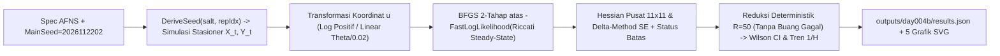

# Penjelasan Proyek — day004b: AFNS — Bias Sampel Terbatas, Rentang Kalender (*Long-Span*), dan Frekuensi Observasi (*Infill*) (Go)

## 1. Identitas dan Ringkasan Proyek
- **ID Progress**: `day004b` (Hari 4, Sesi b — Sesi Tantangan Berat Go)
- **Tanggal**: 2026-11-22 (WITA) · **Topik No**: `null` (*off-roadmap*) · **Jenis**: `quant` · **Bahasa**: Go 1.22+ (`go1.27.4 darwin/arm64`)
- **Proyek**: [projects/go/day004b_afns_inference/](../../projects/go/day004b_afns_inference/README.md) · **Metadata**: [meta.json](../../projects/go/day004b_afns_inference/meta.json)
- **Output JSON**: [outputs/day004b/results.json](../../outputs/day004b/results.json)
- **Ringkasan**: Studi inferensi kuantitatif mandiri berbasis Go murni untuk menguji hipotesis yang muncul dari `day004a`: mengapa estimasi *Maximum Likelihood* (MLE) filter Kalman pada model *Arbitrage-Free Nelson–Siegel* (AFNS) 11 parameter mengalami bias *mean-reversion* fisik $K^{\mathbb{P}}_{ii}$ ke atas ($+0{,}21\text{–}+0{,}27\text{ thn}^{-1}$) dan *undercoverage* interval Wald pada $\theta^{\mathbb{P}}_1$ ($68\%$ di `day004a`). Proyek membangun ulang filter Kalman (dipercepat *steady-state* Riccati dan diverifikasi ulang terhadap Gaussian gabungan eksak $T=5$), membandingkan replikasi *baseline* $1{,}000$ minggu terhadap `day004a`, lalu menjalankan eksperimen **long-span** ($H \in \{10, 20, 40, 80\}$ tahun mingguan dengan jalur prefiks-80y bersama, $R=50$) serta eksperimen **infill** pada rentang tetap $H=20$ tahun ($\Delta \in \{1/12, 1/52, 1/252\}$, $R=50$).

## 2. Masalah dan Tujuan
Pada estimasi ruang-keadaan model suku bunga afinitas seperti AFNS (Christensen, Diebold, Rudebusch 2011), tidak semua parameter memiliki sumber identifikasi statistik yang sama:
1. Parameter penampang $\mathbb{Q}$ ($\lambda$) dan struktur kovarians instan ($\sigma_1, \sigma_2, \sigma_3, \sigma_\varepsilon$) diinformasikan oleh variasi lintas-tenor pada setiap titik waktu maupun variasi kuadratik lokal.
2. Parameter dinamika historis di bawah ukuran fisik $\mathbb{P}$ ($K^{\mathbb{P}}_{11}, K^{\mathbb{P}}_{22}, K^{\mathbb{P}}_{33}$ dan rata-rata jangka panjang $\theta^{\mathbb{P}}$) bergantung pada *mean reversion* lintasan waktu faktor laten, terutama untuk komponen *level* yang sangat persisten ($K^{\mathbb{P}}_{11} = 0{,}05\text{ thn}^{-1}$, waktu paruh $\ln 2 / 0{,}05 \approx 13{,}86$ tahun).

Tujuan penelitian eksperimental ini adalah membedakan secara kuantitatif tanpa memaksakan hasil:
- **Pertanyaan 1 (*Long-span*)**: Apakah bias $K^{\mathbb{P}}_{ii}$ meluruh seiring $1/H$ saat rentang kalender diperluas dari $10$ ke $80$ tahun, bagaimana tren regresi terhadap $1/H$ beserta galat Monte Carlo-nya, dan sejauh mana produk $\text{bias} \times H$ mendekati heuristik skalar $4/H$?
- **Pertanyaan 2 (*Infill*)**: Pada rentang tetap $H=20$ tahun, apakah mempercepat pengambilan sampel dari bulanan ($\Delta=1/12$, $T=240$) ke mingguan ($\Delta=1/52$, $T=1040$) dan harian bisnis ($\Delta=1/252$, $T=5040$) menghilangkan bias $K^{\mathbb{P}}_{ii}$ atau memperbaiki identifiabilitas $\theta^{\mathbb{P}}$?
- **Pertanyaan 3 (Cakupan Hessian)**: Mengapa interval kepercayaan Wald berbasis matriks Hessian menghasilkan cakupan di bawah $95\%$ untuk parameter *drift* persisten, serta bagaimana perilaku rata-rata vs median *standard error* Hessian?
- **Batas ruang lingkup**: Spesifikasi mengikuti `day004a` ($K^{\mathbb{P}}$ diagonal, $\sigma_\varepsilon = 5\text{ bp}$ iid antar-observasi, kondisi awal dari distribusi stasioner $\mathbb{P}$). Model diuji murni pada skenario *well-specified* dengan data sintetik AFNS.

## 3. Apa yang Dikerjakan Proyek
Runner CLI [cmd/run/main.go](../../projects/go/day004b_afns_inference/cmd/run/main.go) mengeksekusi pipeline deterministik berurutan (`MainSeed = 2026112202`, `8` worker goroutine, total waktu `41,93 detik`) yang menghasilkan [outputs/day004b/results.json](../../outputs/day004b/results.json) (termasuk seluruh hasil per replikasi $350$ optimisasi MLE) serta 5 grafik vektor SVG di [outputs/figures/](../../outputs/figures/):
1. **Verifikasi Awal (`part1_exact_anchors_and_verification`)**: kecocokan Gaussian gabungan penuh $T=5$ (3 tenor) terhadap `FilterAndSmooth` & `FastLogLikelihood`, pemeriksaan gradien beda hingga pusat vs ekstrapolasi Richardson, serta pengujian invariansi bit *worker* (`1` vs `8` worker) pada fixture cepat.
2. **Studi Baseline (`baseline_1000w`, `T=1000`, `dt=1/52`, `H ≈ 19,2308y`, `R=50`)**: terpisah ketat dari `20y` (`T=1040`) dan dibandingkan terhadap statistik acuan `day004a` dalam satuan MCSE gabungan.
3. **Studi Long-Span (`longspan_{10,20,40,80}y_weekly`, `R=50`)**: membangkitkan 50 jalur mingguan sepanjang 80 tahun ($T=4160$) dan tebakan awal terganggu $[0{,}5, 1{,}8]\times$, lalu mengestimasi MLE pada potongan prefiks $520, 1040, 2080, 4160$ langkah; menganalisis bias vs $1/H$ dengan OLS/WLS beserta MCSE tepat berbasis replikasi prefiks-bersama.
4. **Studi Infill (`infill_20y_{monthly,weekly,daily}`, `H=20y`, `R=50`)**: membandingkan bulanan ($T=240$), mingguan ($T=1040$, memakai ulang hasil `longspan_20y_weekly`), dan harian bisnis ($T=5040$) di bawah model derau pengukuran iid baru pada setiap titik observasi.

## 4. Uraian Kode
- [internal/rng/rng.go](../../projects/go/day004b_afns_inference/internal/rng/rng.go) & [rng_test.go](../../projects/go/day004b_afns_inference/internal/rng/rng_test.go): generator `xoshiro256++`, inisialisasi `SplitMix64`, `DeriveSeed(MainSeed, salt, index)` dengan `MainSeed = 2026112202`, serta Box–Muller `NormFloat64`.
- [internal/parallel/parallel.go](../../projects/go/day004b_afns_inference/internal/parallel/parallel.go) & [parallel_test.go](../../projects/go/day004b_afns_inference/internal/parallel/parallel_test.go): `DefaultWorkers` dan `RunChunks` yang mengembalikan irisan hasil dalam indeks deterministik.
- [internal/afns/afns.go](../../projects/go/day004b_afns_inference/internal/afns/afns.go) & [afns_test.go](../../projects/go/day004b_afns_inference/internal/afns/afns_test.go): pemuat kurva `G1`/`G2` (stabil Taylor $|u| < 10^{-4}$), koreksi konveksitas CDR 2011 + kuadratur Gauss–Legendre 16-titik (`YieldAdjustmentComponents`), matriks transisi tertutup `TransitionMatrixClosed`, kovarians transisi `TransitionCovClosed`, kovarians Lyapunov `StationaryCov`, dan simulator stasioner `SimulateStationaryPath`.
- [internal/optim/optim.go](../../projects/go/day004b_afns_inference/internal/optim/optim.go) & [optim_test.go](../../projects/go/day004b_afns_inference/internal/optim/optim_test.go): `CentralDiffGrad`, `RichardsonGrad`, `VerifyGradVsRichardson`, `CentralDiffHessian`, dan optimizer kuasi-Newton `MinimizeBFGS` dengan pencarian garis Armijo serta pelacakan kotak aktif per parameter (`HitBoundByParam`).
- [internal/kalman/kalman.go](../../projects/go/day004b_afns_inference/internal/kalman/kalman.go), [linalg.go](../../projects/go/day004b_afns_inference/internal/kalman/linalg.go), & [kalman_test.go](../../projects/go/day004b_afns_inference/internal/kalman/kalman_test.go): `FastLogLikelihood` dengan pembekuan *steady-state* Riccati saat $\max|P_{t|t-1} - P_{t-1|t-2}| \le 10^{-15}\max|P_{t|t-1}|$ setelah $t \ge 5$, `FilterAndSmooth` (Joseph penuh + *RTS smoother*), `VerifyJointGaussianAnchor`, transformasi parameter `PackUnconstrained` / `UnpackUnconstrained`, serta `EstimateMLE`.
- [internal/kalman/study.go](../../projects/go/day004b_afns_inference/internal/kalman/study.go) & [study_test.go](../../projects/go/day004b_afns_inference/internal/kalman/study_test.go): `RunIndependentConfigStudy`, `RunLongSpanSharedPrefixStudy`, `ReuseAsInfillConfig`, `CompareBaselineToDay004a`, `AnalyzeLongSpanTrend` (menghitung MCSE prefiks bersama antar-horizon), `AnalyzeInfillScaling`, serta penyusunan ringkasan tak-terfilter seluruh $R=50$ replikasi.
- [internal/stats/stats.go](../../projects/go/day004b_afns_inference/internal/stats/stats.go), [internal/jsonout/jsonout.go](../../projects/go/day004b_afns_inference/internal/jsonout/jsonout.go), [internal/svg/svg.go](../../projects/go/day004b_afns_inference/internal/svg/svg.go), dan [cmd/run/main.go](../../projects/go/day004b_afns_inference/cmd/run/main.go): fungsi `WilsonCI`, `FitLinearTrend` (OLS & WLS), penulis JSON 17-digit, generator grafik garis/titik/batang SVG, dan runner CLI (`-quick` aman menulis hanya ke temp dir).

## 5. Metode dan Alur Kerja
Alur lengkap untuk setiap studi mengikuti urutan berikut:

Detail formulasi kunci:
- **Persamaan Ruang-Keadaan**: transisi eksak $X_t - \theta^{\mathbb{P}} = e^{-K^{\mathbb{P}}\Delta}(X_{t-1}-\theta^{\mathbb{P}}) + \eta_t$, $\eta_t \sim \mathcal{N}(0, Q_\Delta)$ dan pengamatan $Y_t(\tau_j) = -A(\tau_j)/\tau_j + H(\tau_j) X_t + \varepsilon_{t,j}$, $\varepsilon_{t,j} \stackrel{\text{iid}}{\sim} \mathcal{N}(0, \sigma_\varepsilon^2)$.
- **Parameterisasi Optimizer**: vektor bebas $u = (\ln\lambda, \ln K^{\mathbb{P}}_{11..33}, \theta^{\mathbb{P}}_{1..3}/0{,}02, \ln(\sigma_{1..3}/0{,}01), \ln(\sigma_\varepsilon/0{,}0005))^\top$ menjaga kepositifan alami serta menskalakan turunan antar dimensi. Batas kotak pengaman asli: $\lambda \in [0{,}05, 5{,}0]$, $K^{\mathbb{P}}_{ii} \in [5\cdot 10^{-4}, 5{,}0]$, $\theta^{\mathbb{P}}_i \in [-0{,}5, 0{,}5]$, $\sigma_i \in [10^{-5}, 0{,}2]$, dan $\sigma_\varepsilon \in [10^{-6}, 0{,}05]$. Toleransi konvergensi mengevaluasi baik $\|g\|_\infty \le 10^{-4}$ maupun $\|g\|_\infty / \max(1, |f|) \le 10^{-6}$ agar sampel panjang ($T=4160, 5040$, di mana $|\ell| \sim 2{,}4\text{–}2{,}9\times 10^5$ dan lantai *roundoff* float64 $\sim 10^{-4}$) tidak gagal artifisial bila sudah optimal secara numerik.
- **Ketidakpastian Tren $1/H$ dengan Prefiks-Bersama**: karena keempat horizon menggunakan prefiks acak dari replikasi independen yang sama ($r=0,\dots,R-1$), kemiringan regresi $\hat{\beta} = \sum_h w_h (\hat{\psi}_h - \psi_{\text{true}}) = \frac{1}{R}\sum_r \hat{\beta}_r$ memiliki varians tepat yang dapat ditaksir dari $\operatorname{SE}_r(\hat{\beta}_r)$ lintas replikasi independen, memperhitungkan penuh korelasi positif antar-horizon tanpa mengasumsikan titik $1/H$ independen.

## 6. Output yang Ditargetkan
Sebelum simulasi penuh $R=50$ dijalankan, kriteria penerimaan metodologis berikut ditetapkan (dengan tegas memperlakukan besar bias, arah tren $1/H$, rasio *infill*, dan cakupan Wald sebagai **hasil riset empiris** yang tidak dipaksa lulus):
1. **C1 (`c1_exact_anchor_and_score_fd`)**: selisih absolut log-likelihood Kalman vs Gaussian gabungan penuh $T=5$ $< 10^{-9}$, selisih mean dan kovarians smoother RTS $< 10^{-9}$, selisih `FastLogLikelihood` tunak Riccati vs filter penuh $< 10^{-9}$, serta galat relatif L2 skor FD vs Richardson $< 10^{-5}$.
2. **C2 (`c2_baseline_reproducible_within_3_mcse`)**: studi *baseline* `1000w` menghasilkan estimasi bias yang seluruh $11$ parameternya berada dalam batas $|z| \le 3{,}0$ terhadap `day004a` menggunakan MCSE gabungan $\sqrt{\text{MCSE}_{4b}^2 + \text{MCSE}_{4a}^2}$.
3. **C3 (`c3_complete_unfiltered_summaries`)**: seluruh 8 konfigurasi melaporkan ringkasan lengkap dan berhingga (*finite*) atas keseluruhan $50/50$ replikasi tanpa membuang kasus gagal atau batas aktif, mencakup bias, SD, RMSE, bias MCSE, mean & median Hessian SE, cakupan Wald 95% + Wilson 95% CI, laju konvergensi, dan batas aktif total + per parameter.
4. **C4 (`c4_worker_determinism_and_runtime_lt_600s`)**: keluaran `1` vs `8` worker identik bit-demi-bit pada fixture uji dan runner penuh selesai $< 600$ detik (`10` menit).

## 7. Status Pencapaian Berbasis Bukti

| Kriteria / Tujuan | Status | Target Pra-Spesifikasi & Bukti Nyata Terukur (`outputs/day004b/results.json`, `41,93s`) |
|---|---|---|
| C1: Anchor eksak & skor FD | `tercapai` | Target diff $< 10^{-9}$ ($T=5$), grad $< 10^{-5}$. Bukti: `loglik_diff = 3,41e-13`, `fast_ll_diff = 3,55e-13`, `mean_diff = 2,83e-16`, `cov_diff = 6,39e-17`; max score err `2,71e-9` (init) & `4,34e-7` (true) |
| C2: Reproduksi baseline `day004a` | `tercapai` | Target seluruh $11$ parameter $\|z\| \le 3{,}0$ MCSE gabungan. Bukti: `11/11` dalam $3\text{ MCSE}$ (`max \|z\| = 2,8191` pada `kp33`), `10/11` dalam $2\text{ MCSE}$; semua bias $K^{\mathbb{P}}_{ii}$ konsisten positif |
| C3: Kelengkapan ringkasan $R=50$ | `tercapai` | Target $50/50$ replikasi utuh & berhingga. Bukti: ke-8 entri `experiments` memiliki `n_rep = 50`, `total_reps = 50` per parameter, kasus batas aktif (`Rep 7`, `Rep 31`, `Rep 13`, `Rep 45`) tetap dihitung |
| C4: Determinisme & waktu $< 10\text{ mnt}$ | `tercapai` | Target bit-identik `1` vs `8` worker & waktu $< 600\text{s}$. Bukti: `bit_identical_1_vs_n = true`; runner penuh selesai dalam `41,93s` (`8` worker) |
| Keseluruhan metodologis (`all_methodological_passed`) | `tercapai` | Keempat kriteria (`c1`, `c2`, `c3`, `c4`) lulus pada eksekusi penuh pasca-suntingan final kode Go |

### Ringkasan Hasil Riset Empiris (`HASIL PERINTAH` dari `outputs/day004b/results.json`)
- **Waktu eksekusi per bagian (`workers = 8`)**: `Part1 (anchor & determinisme) = 0,39s`, `Baseline 1000w = 3,76s`, `Long-span total = 23,39s` (`10y = 2,29s`, `20y = 3,49s`, `40y = 5,68s`, `80y = 11,93s`), `Infill monthly = 1,19s`, `Infill weekly = 0s (reused)`, `Infill daily = 13,18s`, `SVG = 0,001s`, total `41,93s`.
- **Long-span ($H = 10 \to 20 \to 40 \to 80$ tahun)**:
  - `kp11` bias turun hampir tepat setengah tiap penggandaan $H$: $+0{,}4657 \to +0{,}2241 \to +0{,}0983 \to +0{,}0451$ ($\text{bias}\times H = +4{,}66 \to +4{,}48 \to +3{,}93 \to +3{,}61$; kemiringan OLS $+4{,}839 \pm 0{,}945$, WLS $+4{,}701 \pm 0{,}719$).
  - `kp22` bias: $+0{,}4254 \to +0{,}1998 \to +0{,}1007 \to +0{,}0731$ ($\text{bias}\times H = +4{,}25 \to +4{,}00 \to +4{,}03 \to +5{,}85$; OLS $+4{,}120 \pm 0{,}839$, WLS $+3{,}864 \pm 0{,}784$).
  - `kp33` bias: $+0{,}3590 \to +0{,}2026 \to +0{,}0981 \to +0{,}0452$ ($\text{bias}\times H = +3{,}59 \to +4{,}05 \to +3{,}92 \to +3{,}62$; OLS $+3{,}562 \pm 0{,}878$, WLS $+3{,}778 \pm 0{,}791$).
- **Infill 20 tahun ($\Delta = 1/12 \to 1/52 \to 1/252$)**:
  - Rasio $\text{RMSE}_{\text{daily}} / \text{RMSE}_{\text{monthly}}$ hampir datar/stagnan pada parameter *drift*: `kp11 = 0,980` (`bias = +0,270 -> +0,224 -> +0,231`), `kp22 = 1,181` (`bias = +0,191 -> +0,200 -> +0,211`), `kp33 = 0,936` (`bias = +0,201 -> +0,203 -> +0,222`), dan `theta1 = 0,503` (mingguan $0{,}0181 \to$ harian $0{,}0148$).
  - Sebaliknya, parameter lintas-seksi & difusi menyusut tajam: `lambda = 0,012`, `sigma_eps = 0,003`, `sigma1 = 0,217`, `sigma2 = 0,100`, `sigma3 = 0,128` (teoretis $1/\sqrt{5040/240} = 0{,}2182$).
- **Cakupan Wald 95% & Rasio Hessian SE**: cakupan $\theta_1$ tetap rendah pada $H \le 40\text{y}$ (`34%` di 10y, `42%` di 20y, `48%` di 40y, `60%` di 20y harian) dan baru pulih menuju `72%` [Wilson CI: `58,3%–82,5%`] di $H=80\text{y}$; sementara `lambda, sigma1..3, sigma_eps` mencapai cakupan `86%–100%` pada semua studi terkecuali sedikit fluktuasi di *monthly* $T=240$.

## 8. Pemisahan Fakta, Hasil Perintah, dan Hipotesis (Termasuk Kasus Gagal Konvergen & Batas Aktif)
- **FAKTA (diamati di kode dan log replikasi)**:
  - Ke-8 studi mempertahankan seluruh $50$ replikasi (`bound_hit` terjadi masing-masing pada `1/50` replikasi di `baseline_1000w` [Rep 7: `lambda=0.05`], `10y` [Rep 31: `theta1=0.5, sigma2=0.2`], `40y` [Rep 13: `lambda=5.0, kp33=5.0, theta1=0.5`], `80y` [Rep 13: `lambda=5.0, kp11=0.0005, theta1=0.5, theta2=0.5, sigma3=0.2`], dan `20y monthly` [Rep 45: `lambda=0.05`]; sementara `20y weekly` dan `20y daily` mencatat `50/50` konvergen, `0/50` batas aktif, dan `50/50` $\ell_{\text{MLE}} \ge \ell_{\text{true}}$).
  - Pada `longspan_40y` dan `longspan_80y`, satu replikasi yang menyentuh batas (`Rep 13`, $2\%$) berujung pada $\hat{\lambda} = 5{,}0$ dan menaikkan `Mean Estimate` $\lambda$ dari $0{,}600$ menjadi $0{,}688$ (`EmpSD = 0,622`), sehingga juga membuat `Mean Hessian SE` membengkak (`42,3`–`52,9`) sementara `Median Hessian SE` tetap akurat (`0,00174` di `40y`, `0,00122` di `80y`).
  - Pada `baseline_1000w` `Rep 39` dan `80y` `Rep 19 & 37`, flag `converged = false` muncul bukan karena kegagalan ke puncak ($\ell_{\text{MLE}} = 242{,}258{,}8 > \ell_{\text{true}} = 242{,}251{,}2$ pada Rep 19 dengan `scaledGrad = 1,92e-9`), melainkan karena pencarian garis Armijo terhenti pada kebuntuan ULP *float64*.
- **HASIL PERINTAH (terukur)**: seluruh angka tabel di Bagian 7, konvergensi `94%–100%` di ke-8 konfigurasi, serta pengurangan bias $K^{\mathbb{P}}_{ii} \propto 1/H$ di *long-span* berbanding stagnasi penuh *infill*.
- **HIPOTESIS (penjelasan teoretis atas fenomena teramati)**:
  - **Mengapa 1 replikasi (`Rep 13`) macet di `40y`/`80y`?** *Hipotesis*: kombinasi pengali acak awal $[0{,}5, 1{,}8]\times$ untuk ke-11 parameter menempatkan titik awal BFGS awal pada lembah kurvatur sangat datar ($\lambda$ besar membuat fungsi beban Nelson–Siegel terkolaps ke tenor terpendek), sehingga pencarian garis BFGS tunggal tanpa *multi-start* gagal keluar setelah langkah awal menabrak kotak atas $\lambda = 5{,}0$. Dapat diuji langsung di studi lanjutan lewat strategi *2-stage cross-sectional warm-start* ($\lambda, \sigma_\varepsilon$ dulu sebelum MLE gabungan).
  - **Mengapa cakupan $\theta_1$ rendah pada $H \le 40\text{y}$?** *Hipotesis*: karena informasi Fisher asimtotik $\theta_1$ pada proses OU proporsional terhadap $\kappa_1^2 H / \sigma_1^2$, matriks Hessian yang dievaluasi pada $\hat{\kappa}_1$ yang terbias ke atas $4\text{–}5\times$ memprediksi $\text{SE}(\hat{\theta}_1)$ sekitar $4\text{–}5\times$ terlalu kecil (`MedRatio = 0,13–0,39`), sehingga interval Wald yang sempit gagal menangkap nilai benar $\theta_1 = 0{,}045$ meskipun estimasi rata-rata $\theta_1$ sendiri nyaris tak terbias.

## 9. Landasan Teori (Minimal 10 Poin Terhubung ke Kode)
1. **Model Ruang-Keadaan AFNS Bebas-Arbitrase**: kurva *zero yield* mengikuti $y_t(\tau) = -A(\tau)/\tau + H(\tau) X_t + \varepsilon_t$ dengan $H(\tau) = (1, g_1(\lambda\tau), g_2(\lambda\tau))$ di `YieldLoadings` dan penyesuaian konveksitas $-A(\tau)/\tau \le 0$ dari ODE Riccati (Christensen–Diebold–Rudebusch 2011) di `YieldAdjustmentComponents` ([internal/afns/afns.go](../../projects/go/day004b_afns_inference/internal/afns/afns.go)).
2. **Diskretisasi Eksak Proses Ornstein–Uhlenbeck ($\mathbb{P}$)**: proses $dX_t = K^{\mathbb{P}}(\theta^{\mathbb{P}} - X_t)\,dt + \Sigma\,dW_t^{\mathbb{P}}$ berdistribusi Gaussian eksak $X_{t+\Delta} \mid X_t \sim \mathcal{N}(\theta^{\mathbb{P}} + e^{-K^{\mathbb{P}}\Delta}(X_t - \theta^{\mathbb{P}}), Q_\Delta)$, diterapkan identik untuk semua $\Delta \in \{1/12, 1/52, 1/252\}$ lewat `TransitionMatrixClosed` dan `TransitionCovClosed` ([internal/afns/afns.go](../../projects/go/day004b_afns_inference/internal/afns/afns.go)).
3. **Kovarians Stasioner & Persamaan Lyapunov Diskret**: $X_0$ ditarik dari distribusi stasioner $\mathcal{N}(\theta^{\mathbb{P}}, Q_\infty)$ yang memenuhi $K^{\mathbb{P}} Q_\infty + Q_\infty (K^{\mathbb{P}})^\top = \Sigma\Sigma^\top$ (`StationaryCov`) serta identitas diskret $Q_\infty = \Phi(\Delta) Q_\infty \Phi(\Delta)^\top + Q_\Delta$, teruji $< 10^{-14}$ di `TestDiscreteLyapunovStationarity` ([internal/afns/afns_test.go](../../projects/go/day004b_afns_inference/internal/afns/afns_test.go)).
4. **Filter Kalman Bentuk Joseph & Dekomposisi Inovasi**: evaluasi log-likelihood $\ell(\psi) = -\frac{1}{2}\sum_{t=0}^{T-1}(M\ln 2\pi + \ln|F_t| + v_t^\top F_t^{-1} v_t)$ di `FastLogLikelihood` dan pembaruan kovarians stabil Joseph $P_{t|t} = (I - K_t H)P_{t|t-1}(I - K_t H)^\top + K_t R K_t^\top$ di `FilterAndSmooth` ([internal/kalman/kalman.go](../../projects/go/day004b_afns_inference/internal/kalman/kalman.go)).
5. **Konvergensi Geometris Persamaan Riccati Diskret (Steady-State Filtering)**: pada sistem linear tak-berubah-waktu (*LTI*) AFNS yang *observable*, kovarians prediksi $P_{t|t-1}$ berkonvergensi ke titik tetap aljabar Riccati $P_\infty$ dalam $\sim 20\text{–}80$ langkah; pembekuan $L_t, \ln|F_t|, K_t$ saat galat relatif $< 10^{-15}$ memangkas kompleksitas langkah harian $T=5040$ hingga $> 85\%$ dengan akurasi teruji $< 10^{-9}$ di `TestFastLogLikelihoodMatchesFullFilterWithRiccatiSteadyState`.
6. **Ekstrapolasi RTS Smoother vs Kondisional Gaussian Gabungan**: lintasan *posterior* $p(X_{0:T-1} \mid Y_{0:T-1})$ dapat dihitung secara terfaktor oleh sapuan mundur Rauch–Tung–Striebel (`XSmooth`, `PSmooth`) maupun satu inversi matriks blok $TM \times TM$ (`VerifyJointGaussianAnchor` pada $T=5$), menghasilkan kecocokan presisi mesin $\sim 10^{-16}$.
7. **Bias Sampel Terbatas Kendall–Marriott–Pope & Tang–Chen untuk Proses OU**: untuk proses OU skalar dengan mean tak diketahui, estimator MLE $\hat{\kappa}$ berbias ke atas sebesar $\approx +4/H$ pada horizon kalender $H$ (Kendall 1954; Marriott & Pope 1954; Tang & Chen 2009, *Journal of Econometrics*). Pada AFNS multivariat di `AnalyzeLongSpanTrend` ([internal/kalman/study.go](../../projects/go/day004b_afns_inference/internal/kalman/study.go)), heuristik $+4/H$ berlaku secara aproksimatif hanya sebagai patokan orde karena keberadaan tiga faktor, efek filtrasi derau $\sigma_\varepsilon = 5\text{ bp}$, serta pencampuran penampang antar-tenor.
8. **Asimtotik Long-Span vs Infill (Non-Identifiabilitas Drift dalam Infill)**: menurut teori inferensi difusi kontinyu (Merton 1980; Phillips & Yu 2009), informasi Fisher parameter difusi $\Sigma$ dan kurva lintas-seksi ($\lambda$) tumbuh seiring jumlah observasi lokal $N \to \infty$ (variasi kuadratik), sedangkan informasi parameter *drift* $(K^{\mathbb{P}}, \theta^{\mathbb{P}})$ dibatasi oleh rentang waktu total $\int_0^H (X_t - \theta^{\mathbb{P}})^2 dt \propto H$ yang invarian terhadap $\Delta \to 0$. Ini terverifikasi langsung pada `AnalyzeInfillScaling`: RMSE $K^{\mathbb{P}}$ stagnan saat $T$ naik $21\times$ ($240 \to 5040$).
9. **Perbedaan Model Derau Pengukuran Infill (sigma_eps iid Baru)**: di bawah `SimulateStationaryPath`, penambahan frekuensi dari mingguan ke harian menambahkan satu vektor derau observasi independen $\varepsilon_{t,\cdot} \sim \mathcal{N}(0, \sigma_\varepsilon^2 I_{10})$ pada setiap $\Delta t$, yang mempersempit presisi $\hat{\sigma}_\varepsilon$ dan $\hat{\lambda}$ melampaui laju $N^{-1/2}$ ($\text{rasio } \sigma_\varepsilon = 0{,}003$) sambil tetap membatasi konsistensi $\hat{K}^{\mathbb{P}}$ pada $H = 20\text{y}$.
10. **Ketergantungan Skala Informasi Observed Hessian ($1/\hat{\kappa}_1^2$)**: ekspresi informasi Fisher lokal untuk mean jangka panjang $\mathcal{I}(\theta_1) \approx \kappa_1^2 H / \sigma_1^2$ (dalam limit bebas-derau) membuat *plug-in* invers Hessian di `EstimateMLE` meremehkan ketidakpastian $\theta_1$ ketika $\hat{\kappa}_1 > \kappa_1^{\text{true}}$, menyebabkan cakupan Wald jatuh jauh di bawah $95\%$ meskipun interval dibangun sah di sekitar $\hat{\theta}_1$.
11. **Selang Skor Wilson untuk Proporsi Cakupan Binomial**: alih-alih interval Wald binomial $\hat{p} \pm z\sqrt{\hat{p}(1-\hat{p})/R}$ yang runtuh menjadi lebar nol saat $\hat{p}=1$ (terjadi pada $\sigma_2, \sigma_\varepsilon, \lambda$ di harian), `WilsonCI` di [internal/stats/stats.go](../../projects/go/day004b_afns_inference/internal/stats/stats.go) menjamin selang valid terkurung ketat di $[0, 1]$ untuk $R=50$.
12. **Propagasi Galat Monte Carlo dengan Prefiks-Bersama**: pada `AnalyzeLongSpanTrend`, koefisien kemiringan OLS/WLS adalah fungsional linier dari estimator antar-horizon per replikasi $r$; mengambil $\operatorname{SE}_r(\hat{\beta}_r)$ secara otomatis memperhitungkan korelasi silang antar horizon $10\text{y}\text{–}80\text{y}$ yang berbagi jalur acak 80y sama.

## 10. Kesimpulan dan Batasan
Eksperimen `day004b` memberikan bukti kuantitatif tegas atas pertanyaan yang diwariskan dari `day004a`:
- **Terbukti secara empiris**: bias positif pada $K^{\mathbb{P}}_{ii}$ merupakan efek *long-span* murni yang meluruh secara sistematis menurut $\propto 1/H$ (turun $\sim 8\text{–}10\times$ saat $H$ tumbuh $10\text{y} \to 80\text{y}$), sementara memadatkan frekuensi observasi hingga harian ($T=5{,}040$) pada rentang tetap $20\text{y}$ **tidak mengurangi** bias maupun RMSE $K^{\mathbb{P}}_{ii}$ ($\text{rasio } 0{,}94\text{–}1{,}18$).
- **Batasan & kelanjutan**: studi memakai $R=50$ replikasi per konfigurasi dan inisialisasi BFGS acak satu kali per replikasi (menyebabkan 1 replikasi batas aktif di beberapa horizon). Pekerjaan lanjutan yang sangat relevan adalah menguji estimator koreksi bias (*tang-chen jackknife* atau *indirect inference*), *profile likelihood* / *bootstrap* parametrik untuk cakupan $\theta^{\mathbb{P}}_1$, serta inisialisasi multi-tahap untuk mengeliminasi jebakan batas lokal.

## 11. Referensi dan Jejak Bukti
- **Referensi Literatur**:
  - Christensen, J. H. E., Diebold, F. X., & Rudebusch, G. D. (2011). *The affine arbitrage-free class of Nelson–Siegel term structure models*. Journal of Econometrics, 164(1), 4–20.
  - Kendall, M. G. (1954). *Note on bias in the estimation of autocorrelation*. Biometrika, 41(3/4), 403–404.
  - Marriott, F. H. C., & Pope, J. A. (1954). *Bias in the estimation of autocorrelations*. Biometrika, 41(3/4), 390–402.
  - Tang, C. Y., & Chen, S. X. (2009). *Parameter estimation and bias correction for diffusion processes*. Journal of Econometrics, 149(1), 65–81.
  - Wilson, E. B. (1927). *Probable inference, the law of succession, and statistical inference*. JASA, 22(158), 209–212.
- **Artefak Kode & Data Lokal**:
  - Modul Go: [projects/go/day004b_afns_inference/](../../projects/go/day004b_afns_inference/README.md)
  - Data Lengkap (termasuk seluruh 350 replikasi & ringkasan): [outputs/day004b/results.json](../../outputs/day004b/results.json)
  - Grafik SVG: [kp-bias-vs-inv-h.svg](../../outputs/figures/day004b_kp-bias-vs-inv-h.svg), [infill-vs-longspan-rmse.svg](../../outputs/figures/day004b_infill-vs-longspan-rmse.svg), [wald-coverage-intervals.svg](../../outputs/figures/day004b_wald-coverage-intervals.svg), [hessian-se-to-emp-sd-ratio.svg](../../outputs/figures/day004b_hessian-se-to-emp-sd-ratio.svg), [convergence-and-bound-hits.svg](../../outputs/figures/day004b_convergence-and-bound-hits.svg)
- **Jejak Bukti Eksekusi Terakhir**: `gofmt -l .` kosong, `go vet ./...` bersih, seluruh 9 paket (`cmd/run, afns, jsonout, kalman, optim, parallel, rng, stats, svg`) lulus `go test -race -count=1 ./...`, dan runner penuh `go run ./cmd/run` selesai `41,93s` pada `workers = 8` dengan `c1..c4 = true` (`all_methodological_passed = true`).
