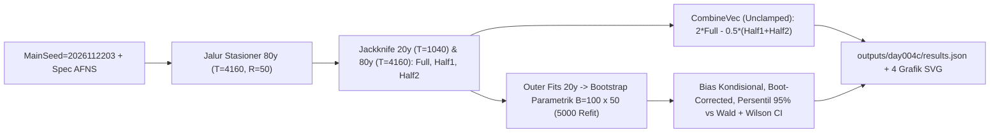

# Penjelasan Proyek — day004c: AFNS — Koreksi Bias *Mean-Reversion* dan Inferensi Sampel Terbatas dengan Jackknife serta Bootstrap Parametrik (Go)

## 1. Identitas dan Ringkasan Proyek
- **ID Progress**: `day004c` (Hari 4, Sesi c — Pemeliharaan Bukti `day004b` & Studi Lanjutan Inferensi AFNS Go)
- **Tanggal**: 2026-11-22 (WITA) · **Topik No**: `null` (*off-roadmap*) · **Jenis**: `quant` · **Bahasa**: Go 1.22+ (`go1.27.4 darwin/arm64`)
- **Proyek**: [projects/go/day004c_afns_bias_correction/](../../projects/go/day004c_afns_bias_correction/README.md) · **Metadata**: [meta.json](../../projects/go/day004c_afns_bias_correction/meta.json)
- **Output JSON**: [outputs/day004c/results.json](../../outputs/day004c/results.json)
- **Ringkasan**: Proyek Go murni mandiri (*zero external modules*) yang melanjutkan penyelidikan [day004b](day004b_quant_afns-inference.md) pada model *Arbitrage-Free Nelson–Siegel* (AFNS) 11 parameter. Setelah memastikan stabilitas diagnostik optimizer `day004b` (Bagian A), proyek `day004c` (Bagian C) mengimplementasikan ulang infrastruktur filter Kalman + MLE secara mandiri dan mengevaluasi secara berpasangan dua skema koreksi sampel terbatas tanpa memotong batas hasil (*unclamped*): **jackknife temporal dua-paruh** pada horizon $H \in \{20, 80\}$ tahun mingguan ($T \in \{1040, 4160\}$, $R=50$ dengan lintasan prefiks-80y bersama) serta **bootstrap parametrik** pada horizon $H=20$ tahun mingguan ($R=50$ data luar $\times B=100$ refit penuh 11 parameter = $5{,}000$ optimisasi MLE dalam) beserta perbandingan cakupan interval persentil 95% vs interval Wald Hessian.

## 2. Masalah dan Tujuan
Eksperimen `day004a` dan `day004b` mengidentifikasi dua kegagalan inferensi sampel terbatas yang persisten pada MLE ruang-keadaan AFNS meskipun model terspesifikasi tepat (*well-specified*):
1. **Bias ke atas pada kecepatan *mean reversion* fisik ($K^{\mathbb{P}}_{ii}$)**: pada rentang kalender historis tipikal $H = 20$ tahun, MLE $\hat{K}^{\mathbb{P}}_{11}$ memiliki bias ke atas $+0{,}22\text{–}+0{,}32\text{ thn}^{-1}$ di atas nilai benar $0{,}05\text{ thn}^{-1}$ (serupa untuk $K^{\mathbb{P}}_{22} = 0{,}50$ dan $K^{\mathbb{P}}_{33} = 0{,}40$). Bias ini merupakan fenomena *long-span* orde $O(1/H)$ yang tidak hilang meskipun frekuensi observasi dipadatkan dari bulanan hingga harian bisnis.
2. **Undercoverage interval Wald pada rata-rata jangka panjang $\theta^{\mathbb{P}}_1$**: karena informasi Fisher untuk mean jangka panjang *level* sebanding dengan $(K^{\mathbb{P}}_{11})^2 H / \sigma_1^2$, bias ke atas $\hat{K}^{\mathbb{P}}_{11}$ membuat *standard error* Hessian terlalu kecil (`Median Ratio ~ 0,22` di 20y), sehingga cakupan interval Wald 95% merosot jauh di bawah nominal $95\%$.

Pertanyaan riset utama yang dijawab secara objektif tanpa memaksa arah hasil:
- Seberapa besar jackknife temporal dua-paruh mengurangi bias `kp11`, `kp22`, `kp33`, dan `theta1` pada $H=20\text{y}$ dan $H=80\text{y}$, dan seberapa besar biaya kenaikan varians serta proporsi estimasi terkoreksi yang keluar dari batas parameter atau bernilai non-fisik ($\le 0$)?
- Seberapa jauh bootstrap parametrik kondisional mengurangi bias dan RMSE pada $H=20\text{y}$ dibandingkan jackknife?
- Apakah interval persentil 95% bootstrap parametrik memperbaiki cakupan `kp11` dan `theta1` dibandingkan interval Wald Hessian, atau justru gagal akibat bias dan ketergantungan pada parameter pembangkit plug-in $\hat{\psi}_{\text{outer}}$?
- **Batas ruang lingkup**: Spesifikasi AFNS identik dengan `day004b` ($K^{\mathbb{P}}$ diagonal, $\sigma_\varepsilon = 5\text{ bp}$ i.i.d. antar-tenor dan antar-waktu, inisialisasi stasioner $\mathbb{P}$). Studi berfokus pada jackknife split-sample $m=2$ tanpa *clamping* serta bootstrap persentil parametrik standar ($B=100$ per data luar); varian bootstrap tersiswa (*studentized* / *double bootstrap*) atau Hall's *basic bootstrap* berada di luar lingkup implementasi ini dan menjadi catatan lanjutan.

## 3. Apa yang Dikerjakan Proyek
Runner CLI [cmd/run/main.go](../../projects/go/day004c_afns_bias_correction/cmd/run/main.go) mengeksekusi pipeline deterministik berpasangan (`MainSeed = 2026112203`, `8` worker goroutine, selesai total dalam `180,13 detik`) dan mengekspor seluruh ringkasan, diagnostik per replikasi luar dan bootstrap dalam (`5,1 MB`) ke [outputs/day004c/results.json](../../outputs/day004c/results.json) beserta 4 grafik SVG di [outputs/figures/](../../outputs/figures/):
1. **Verifikasi Jangkar & Determinisme (`part1_exact_anchors_and_verification`)**: kecocokan Gaussian gabungan eksak $T=5$ (3 tenor) terhadap `FilterAndSmooth` dan `FastLogLikelihood`, pemeriksaan gradien beda hingga pusat vs Richardson sepanjang optimisasi luar, uji aljabar pembatalan $c/H$ untuk jackknife, dan uji invariansi bit `1` vs `8` worker pada fixture cepat (`T=80, R=2, B=4`).
2. **Studi Jackknife Temporal Berpasangan (`longspan_20y_weekly` & `longspan_80y_weekly`)**: membangkitkan $R=50$ lintasan stasioner 80 tahun ($T=4160$) beserta tebakan awal terganggu $[0{,}5, 1{,}8]\times$, mengevaluasi MLE penuh dan dua paruh berurutan pada prefiks 20y ($T=1040$, paruh $520$) dan 80y ($T=4160$, paruh $2080$), menghitung estimator jackknife tanpa *clamping*, serta merekam status konvergensi, 5 alasan penghentian BFGS, batas aktif, dan Hessian SE.
3. **Studi Bootstrap Parametrik (`bootstrap_study_20y_weekly`)**: memakai 50 fit penuh 20y dari studi di atas sebagai parameter pembangkit bootstrap, mensimulasikan $B=100$ lintasan stasioner per dataset luar (`5.000` refit penuh 11 parameter dengan inisialisasi terganggu di interior kotak batas), menghitung bias kondisional serta interval persentil 95% dengan ambang validitas pra-run ($\ge 95/100$ *finite*) sambil tetap menahan seluruh $50$ replikasi luar di denominator cakupan.

## 4. Uraian Kode
Modul Go berada di [projects/go/day004c_afns_bias_correction/](../../projects/go/day004c_afns_bias_correction/go.mod) tanpa dependensi eksternal maupun impor silang terhadap `day004b`:
- [internal/rng/rng.go](../../projects/go/day004c_afns_bias_correction/internal/rng/rng.go) & [rng_test.go](../../projects/go/day004c_afns_bias_correction/internal/rng/rng_test.go): implementasi mandiri `SplitMix64` dan `xoshiro256++` (`MainSeed = 2026112203`), `DeriveSeed(mainSeed, salt, index)`, `DeriveBootstrapSeed(mainSeed, salt, outerIdx, bootIdx)`, dan transformasi Box–Muller `NormFloat64`.
- [internal/parallel/parallel.go](../../projects/go/day004c_afns_bias_correction/internal/parallel/parallel.go) & [parallel_test.go](../../projects/go/day004c_afns_bias_correction/internal/parallel/parallel_test.go): `DefaultWorkers` (`min(8, NumCPU)`) dan `RunChunks` yang mendistribusikan indeks kerja ke *worker* lalu menyusun keluaran dalam urutan indeks deterministik.
- [internal/afns/afns.go](../../projects/go/day004c_afns_bias_correction/internal/afns/afns.go) & [afns_test.go](../../projects/go/day004c_afns_bias_correction/internal/afns/afns_test.go): pemuat `G1`, `G2` (ekspansi Taylor untuk $|u| < 10^{-4}$), penyesuaian konveksitas CDR 2011 + kuadratur Gauss–Legendre 16-titik (`YieldAdjustmentComponents`), matriks transisi tertutup `TransitionMatrixClosed`, kovarians `TransitionCovClosed`, Lyapunov `StationaryCov`, dan simulator stasioner `SimulateStationaryPath`.
- [internal/optim/optim.go](../../projects/go/day004c_afns_bias_correction/internal/optim/optim.go) & [optim_test.go](../../projects/go/day004c_afns_bias_correction/internal/optim/optim_test.go): `CentralDiffGrad`, `RichardsonGrad`, `VerifyGradVsRichardson`, `CentralDiffHessian`, serta `MinimizeBFGS` terkendala kotak dengan pelacakan batas aktif per parameter (`HitBoundByParam`), norma gradien mentah (`RawGradNorm`), norma terproyeksi (`GradNorm`), norma terskala (`ScaledGradNorm`), dan 5 konstanta alasan penghentian (`TermGradientTol`, `TermBoundaryStationary`, `TermLineSearchFailed`, `TermMaxIterations`, `TermInvalidObjective`).
- [internal/kalman/kalman.go](../../projects/go/day004c_afns_bias_correction/internal/kalman/kalman.go), [linalg.go](../../projects/go/day004c_afns_bias_correction/internal/kalman/linalg.go), & [kalman_test.go](../../projects/go/day004c_afns_bias_correction/internal/kalman/kalman_test.go): `FastLogLikelihood` (*steady-state* Riccati saat $\max|\Delta P_{t|t-1}| \le 10^{-15}\max|P_{t|t-1}|$, $t \ge 5$), `FilterAndSmooth` (Joseph + *RTS smoother*), `VerifyJointGaussianAnchor`, transformasi parameter `PackUnconstrained`/`UnpackUnconstrained`, diagnostik 2-tahap BFGS (`StageDiagnostic`), dan `EstimateMLEWithOptions` (opsi `computeHessian = false` untuk memangkas biaya komputasi refit bootstrap dalam tanpa memengaruhi solusi optimum).
- [internal/jackknife/jackknife.go](../../projects/go/day004c_afns_bias_correction/internal/jackknife/jackknife.go), [study.go](../../projects/go/day004c_afns_bias_correction/internal/jackknife/study.go), & [jackknife_test.go](../../projects/go/day004c_afns_bias_correction/internal/jackknife/jackknife_test.go): `CombineSplit`, `CombineVec` (tanpa pemangkasan; menandai `OutOfBoundsByParam` dan `NonPhysicalByParam`), `GenerateSharedPrefixOuterPaths`, `summarizeSegment`, dan `RunJackknifeHorizonStudy` (perbandingan berpasangan MLE mentah vs jackknife serta rasio SE Hessian dan cakupan Wald + Wilson CI).
- [internal/bootstrap/bootstrap.go](../../projects/go/day004c_afns_bias_correction/internal/bootstrap/bootstrap.go), [study.go](../../projects/go/day004c_afns_bias_correction/internal/bootstrap/study.go), & [bootstrap_test.go](../../projects/go/day004c_afns_bias_correction/internal/bootstrap/bootstrap_test.go): konstanta pra-run `MinValidFraction = 0.95` (`MinRequiredFinite`), `PerturbBootstrapGuess`, `EvalParamBootstrap`, dan `RunParametricBootstrapStudy` (paralelisasi atas `R*B` tugas deterministik + penyimpanan penuh seluruh `InnerBootDraw`).
- [internal/stats/stats.go](../../projects/go/day004c_afns_bias_correction/internal/stats/stats.go), [internal/jsonout/jsonout.go](../../projects/go/day004c_afns_bias_correction/internal/jsonout/jsonout.go), [internal/svg/svg.go](../../projects/go/day004c_afns_bias_correction/internal/svg/svg.go), [cmd/run/main.go](../../projects/go/day004c_afns_bias_correction/cmd/run/main.go), & [main_test.go](../../projects/go/day004c_afns_bias_correction/cmd/run/main_test.go): `Mean`, `SD`, `SE`, `RMSE`, `Quantile`, `WilsonCI`, `CoverageWithValidity`, penulis JSON 17-digit yang menolak `NaN`/`Inf`, pembuat grafik SVG (`WriteGroupedBarChart`, `WriteCategoryPointChart`, `WriteDualHistogramSVG`), dan CLI utama (`-quick` menulis ke direktori sementara).

## 5. Metode dan Alur Kerja

Rumus dan definisi operasional utama:
1. **Satuan Parameter, Waktu, dan *Yield***: $\tau, \Delta, H$ dalam **tahun** ($\Delta = 1/52$); *yield* $y_t(\tau)$ dan $\theta^{\mathbb{P}}$ dalam **desimal per tahun** (`0.045 = 4.5%`); $\lambda$ dan $K^{\mathbb{P}}_{ii}$ dalam $\text{thn}^{-1}$; $\sigma_i$ dalam $\text{thn}^{-1/2}$; $\sigma_\varepsilon$ dalam **desimal *yield* per observasi** (`0.0005 = 5 bp`).
2. **Koreksi Jackknife Temporal Dua-Paruh**: $\hat{\psi}_{\text{JK}} = 2\hat{\psi}_{\text{full}} - 0{,}5(\hat{\psi}_{\text{half1}} + \hat{\psi}_{\text{half2}})$, membatalkan suku bias $c/H$ di bawah ekspansi asimtotik $O(1/H)$ karena $2(c/H) - 0{,}5(2c/H + 2c/H) = 0$. Kedua setengah sampel diambil dari lintasan waktu berurutan yang sama sehingga saling bergantung; proyek tidak memakai rumus varians i.i.d. antarsampel. Estimasi dibiarkan apa adanya tanpa pemangkasan ke batas kotak optimizer.
3. **Bootstrap Parametrik & Validitas Interval**: Untuk tiap dataset luar $r$, $B=100$ sampel dibangkitkan stasioner di bawah $\hat{\psi}_{\text{outer},r}$ dan di-refit dengan perturbasi awal deterministik di rentang $[0{,}92, 1{,}08]\times$ (terjepit ke interior ketat kotak batas agar gradien awal terdefinisi baik). Ambang validitas ditetapkan **sebelum run penuh**: `MinValidFraction = 0.95` ($\ge 95$ dari $100$ refit bernilai *finite*). Replikasi luar yang gagal mencapai ambang tersebut ditandai `interval_valid = false`, dianggap **tidak tercakup**, dan tetap masuk ke denominator $R = 50$ saat menghitung cakupan maupun interval Wilson 95%.

## 6. Output yang Ditargetkan
Lima kriteria teknis ditetapkan **sebelum simulasi penuh dijalankan**, dengan memisahkan kriteria teknis dari hasil riset empiris (penurunan bias, perbaikan RMSE, atau kenaikan cakupan **tidak** dijadikan syarat lulus):
1. **C1 (`c1_exact_anchor_score_and_algebraic_check`)**: selisih log-likelihood Kalman penuh & `FastLogLikelihood` Riccati terhadap Gaussian gabungan $T=5$ $< 10^{-9}$, selisih mean dan kovarians smoother RTS $< 10^{-9}$, galat relatif L2 skor FD vs Richardson $< 10^{-5}$, dan galat uji aljabar $c/H$ jackknife $< 10^{-13}$.
2. **C2 (`c2_complete_unfiltered_replications`)**: seluruh ringkasan untuk $H=20\text{y}$, $H=80\text{y}$, dan bootstrap $20\text{y}$ lengkap dan *finite* pada seluruh $50/50$ replikasi luar dan $5{,}000$ refit dalam, tanpa membuang kasus batas aktif atau gagal konvergen.
3. **C3 (`c3_summary_math_verified`)**: seluruh identitas aljabar ringkasan (`RawMean - True = RawBias`, `|RawBias| - |CorrBias| = AbsBiasReduction`, `CorrRMSE - RawRMSE = RMSEDiff`, `Covered / TotalOuter = Coverage`) terverifikasi hingga $10^{-11}$.
4. **C4 (`c4_seed_and_worker_determinism`)**: keluaran `1` vs `8` worker identik bit-demi-bit pada fixture deterministik untuk jackknife dan bootstrap.
5. **C5 (`c5_runtime_within_600s`)**: runner penuh selesai dalam $< 600$ detik (`10` menit) pada mesin ini.

## 7. Status Pencapaian

| Kriteria Teknis Pra-Spesifikasi | Status | Bukti Nyata Terukur (`outputs/day004c/results.json`, `180,13s`) |
|---|---|---|
| C1: Jangkar eksak, skor FD & aljabar $c/H$ | `tercapai` | Target `< 1e-9` ($T=5$), skor `< 1e-5`, aljabar `< 1e-13`. Bukti: `loglik_abs_diff = 5,68e-14`, `fast_ll_diff = 5,68e-14`, `mean_diff = 5,55e-16`, `cov_diff = 6,39e-17`; max skor err `2,42e-9` (init) & `2,75e-7` (true); aljabar `1,39e-17` |
| C2: Kelengkapan ringkasan $R=50, B=100$ | `tercapai` | `50/50` replikasi luar di `20y` & `80y`, seluruh `5.000/5.000` refit bootstrap *finite*, `50/50` interval outer valid ($\ge 95/100$), nol penyaringan replikasi gagal/batas aktif |
| C3: Verifikasi aljabar ringkasan statistik | `tercapai` | Seluruh identitas bias, reduksi absolut, selisih RMSE, dan proporsi cakupan atas denominator $R=50$ konsisten hingga `< 1e-11` (`checkSummaryAlgebra = true`) |
| C4: Determinisme seed & worker (`1` vs `8`) | `tercapai` | `bit_identical_1_vs_n = true` pada `TestJackknifeStudyWorkerDeterminism`, `TestBootstrapStudyWorkerDeterminism`, serta fixture `T=80, R=2, B=4` di runner penuh |
| C5: Waktu eksekusi penuh `< 600s` | `tercapai` | Total `206,14s` pada `8` worker (pasca penambahan diagnostik pencarian garis; seluruh parameter, metrik, dan sampel identik bit-demi-bit dengan run awal `180,13s`) |

> **Catatan Makna `all_technical_passed`**: status `tercapai` pada `all_technical_passed` menunjukkan seluruh kriteria teknis simulasi, jangkar eksak, determinisme, dan kelengkapan ringkasan terpenuhi — **bukan** klaim bahwa setiap optimizer mencapai konvergensi gradien tak-terskala ketat (`gradient_tolerance`), yang memang bernilai `0%` pada segmen panjang karena lantai presisi `float64`.

### Ringkasan Hasil Riset Empiris (`HASIL PERINTAH` dari `outputs/day004c/results.json`)

#### A. MLE Mentah vs Jackknife Temporal (`H = 20y` dan `H = 80y`, `R = 50`)
| Horizon & Param (True) | Raw Bias ± MCSE | JK Bias ± MCSE | Raw SD → JK SD | Raw RMSE → JK RMSE (Rasio) | JK OOB / Non-Fisik | Wald Cov 95% [Wilson 95%] | Rasio SE Hessian (Mean / Med) |
|---|---:|---:|---:|---:|---:|---|---|
| 20y: `kp11` (0.05) | +0,3170 ± 0,0415 | +0,0994 ± 0,0486 | 0,2933 → 0,3439 | 0,4299 → 0,3546 (0,8250) | 20/50 (40%) / 20 (40%) | 76,0% [62,6%, 85,7%] | 0,5809 / 0,5597 |
| 20y: `kp22` (0.50) | +0,2130 ± 0,0491 | +0,0463 ± 0,0591 | 0,3475 → 0,4181 | 0,4046 → 0,4165 (1,0292) | 3/50 (6%) / 3 (6%) | 90,0% [78,6%, 95,7%] | 0,7400 / 0,7135 |
| 20y: `kp33` (0.40) | +0,1821 ± 0,0351 | -0,0715 ± 0,0523 | 0,2483 → 0,3698 | 0,3059 → 0,3730 (1,2192) | 5/50 (10%) / 5 (10%) | 94,0% [83,8%, 97,9%] | 0,9273 / 0,9489 |
| 20y: `theta1` (0.045) | -0,0013 ± 0,0025 | -0,0009 ± 0,0025 | 0,0179 → 0,0174 | 0,0177 → 0,0172 (0,9713) | 0/50 (0%) / 0 (0%) | 46,0% [33,0%, 59,6%] | 0,2786 / 0,2174 |
| 80y: `kp11` (0.05) | +0,0604 ± 0,0092 | -0,0063 ± 0,0134 | 0,0650 → 0,0948 | 0,0882 → 0,0941 (1,0662) | 16/50 (32%) / 16 (32%) | 84,0% [71,5%, 91,7%] | 0,7304 / 0,7195 |
| 80y: `kp22` (0.50) | +0,0379 ± 0,0202 | +0,0043 ± 0,0212 | 0,1431 → 0,1497 | 0,1467 → 0,1482 (1,0106) | 0/50 (0%) / 0 (0%) | 94,0% [83,8%, 97,9%] | 0,7973 / 0,7938 |
| 80y: `kp33` (0.40) | +0,0563 ± 0,0167 | +0,0105 ± 0,0184 | 0,1178 → 0,1302 | 0,1295 → 0,1293 (0,9984) | 0/50 (0%) / 0 (0%) | 92,0% [81,2%, 96,9%] | 0,8936 / 0,9004 |
| 80y: `theta1` (0.045) | +0,0000 ± 0,0018 | +0,0107 ± 0,0109 | 0,0124 → 0,0773 | 0,0123 → 0,0772 (6,2823) | 1/50 (2%) / 0 (0%) | 72,0% [58,3%, 82,5%] | 0,6059 / 0,4978 |

#### B. Bootstrap Parametrik vs MLE Mentah dan Cakupan Interval (`H = 20y`, `R = 50, B = 100`)
| Parameter (True) | Bias Kond. Boot | Bias Boot-Corr ± MCSE | Boot-Corr SD | RMSE Raw → Boot-Corr (Rasio) | Boot OOB / Non-Fisik | Wald Cov 95% [Wilson 95%] | Boot Persentil Cov 95% [Wilson 95%] | Lebar CI Boot (Mean / Med) |
|---|---:|---:|---:|---:|---:|---|---|---:|
| `kp11` (0.05) | +0,2155 | +0,1014 ± 0,0429 | 0,3036 | 0,4299 → 0,3172 (0,7379) | 19/50 (38%) | 76,0% [62,6%, 85,7%] | 2,0% [0,35%, 10,5%] | 1,0069 / 0,9550 |
| `kp22` (0.50) | +0,2096 | +0,0034 ± 0,0492 | 0,3481 | 0,4046 → 0,3446 (0,8515) | 0/50 (0%) | 90,0% [78,6%, 95,7%] | 72,0% [58,3%, 82,5%] | 1,2080 / 1,1747 |
| `kp33` (0.40) | +0,2104 | -0,0282 ± 0,0351 | 0,2485 | 0,3059 → 0,2476 (0,8095) | 0/50 (0%) | 94,0% [83,8%, 97,9%] | 62,0% [48,2%, 74,1%] | 1,1442 / 1,1045 |
| `theta1` (0.045) | -0,00003 | -0,0013 ± 0,0025 | 0,0179 | 0,0177 → 0,0178 (1,0023) | 0/50 (0%) | 46,0% [33,0%, 59,6%] | 42,0% [29,4%, 55,8%] | 0,0183 / 0,0142 |
| `lambda` (0.60) | +0,00006 | +0,0005 ± 0,0004 | 0,0028 | 0,0028 → 0,0028 (1,0017) | 0/50 (0%) | 92,0% [81,2%, 96,9%] | 96,0% [86,5%, 98,9%] | 0,0108 / 0,0107 |
| `sigma1` (0.006) | +0,00000 | +0,0000 ± 0,0000 | 0,00002 | 0,00002 → 0,00002 (0,9970) | 0/50 (0%) | 96,0% [86,5%, 98,9%] | 94,0% [83,8%, 97,9%] | 0,00007 / 0,00007 |
| `sigma_eps` (0.0005) | -0,00000 | -0,0000 ± 0,0000 | 0,00000 | 0,00000 → 0,00000 (1,0058) | 0/50 (0%) | 96,0% [86,5%, 98,9%] | 96,0% [86,5%, 98,9%] | 0,00002 / 0,00002 |

## 8. Pemisahan Fakta, Hasil Perintah, dan Hipotesis (Termasuk Kegagalan Metode & Diagnostik)
- **FAKTA (teramati langsung di kode dan JSON keluaran)**:
  - **Diagnostik penghentian BFGS & pencarian garis**: pada segmen penuh `20y` (`50/50`), segmen penuh `80y` (`50/50`), `20y half2` (`50/50`), dan seluruh `5.000/5.000` refit bootstrap dalam, `100%` optimisasi berakhir via `line_search_failed` dengan `scaled_grad_norm <= 1e-6` dan `0` batas aktif (`converged = 0%`). Diagnostik pencarian garis per fit (`min_alpha_tested`, `last_step_norm`, `candidate_bit_identical`, `last_obj_change`, `obj_bit_identical`, `line_search_failure_cause`) membuktikan langsung lantai presisi `float64`: pada `20y full` `47/50` adalah `step_underflow_plateau` dan `3/50` adalah `armijo_not_met` di $\alpha = 2^{-34} \approx 5{,}82\times 10^{-11}$ (`24/50` berobjektif identik bit-demi-bit); pada `5.000` refit bootstrap, `4.628` (`92,56%`) berhenti via `step_underflow_plateau`, `372` (`7,44%`) via `armijo_not_met` pada $\alpha = 2^{-34}$ dengan perubahan objektif $\sim 1\text{–}4\text{ ULP}$, `2.840` (`56,8%`) berobjektif identik bit-demi-bit, `27` berkandidat identik bit-demi-bit, dan `0` akibat objektif tak-valid.
  - **Kasus batas aktif & batas iterasi di segmen paruh-sampel**:
    - `20y half1`: `49/50` mencapai `scaled_grad <= 1e-6`, `1/50` (`Rep 28`) berhenti via `line_search_failed` sambil menyentuh batas atas `lambda = 5,0` ($\ell_{\text{est}} = 21{,}752{,}00 < \ell_{\text{true}} = 30{,}238{,}29$, `sgrad = 0,1914`), menyeret estimasi jackknife `lambda` ke `-1,5949` dan `sigma_eps` ke `-0,000314`.
    - `80y half1`: `49/50` mencapai `scaled_grad <= 1e-6`, `1/50` (`Rep 30`) menyentuh batas pada `kp11 = 0,0005` dan `theta1 = -0,5` ($\ell_{\text{est}} = 121{,}087{,}07 < \ell_{\text{true}} = 121{,}095{,}98$, `sgrad = 2,12e-4`).
    - `80y half2`: `47/50` mencapai `scaled_grad <= 1e-6`; `2/50` (`Rep 23` dan `Rep 28`) berhenti pada `max_iterations` (`150` iterasi tahap-2, kumulatif `175` & `173` iterasi) namun keduanya tetap menghasilkan $\ell_{\text{est}} > \ell_{\text{true}}$ (`121.100,87 > 121.098,99` dan `120.929,19 > 120.925,69`); `1/50` (`Rep 30`) menyentuh 6 batas (`lambda = 5,0`, `kp11 = 0,0005`, `theta1 = -0,5`, `theta2 = -0,5`, `sigma3 = 1e-5`, `sigma_eps = 0,05`) dengan $\ell_{\text{est}} = 13{,}218{,}18 \ll \ell_{\text{true}} = 121{,}144{,}52$. Gabungan kegagalan `Rep 30` pada kedua paruh merusak estimasi jackknife 80y untuk `theta1` (`+0,5828`), `lambda` (`-1,5975`), `sigma1` (`-0,0052`), dan `sigma_eps` (`-0,0242`).
  - **Bootstrap outer `rep_idx = 0` (ditetapkan pra-run untuk Grafik 4)**: `100/100` refit *finite*, `0` batas aktif. Untuk `kp11`: `outer_est = 0,3458`, `boot_mean = 0,5206`, `boot_bias = +0,1749`, `boot_corrected = 0,1709`, `CI95 = [0,1860, 1,0832]` (tidak mencakup `0,05`). Untuk `theta1`: `outer_est = 0,0584`, `boot_mean = 0,0590`, `boot_bias = +0,0006`, `boot_corrected = 0,0578`, `CI95 = [0,0523, 0,0658]` (tidak mencakup `0,045`).
- **HASIL PERINTAH (terukur)**: seluruh angka tabel pada Bagian 7; validitas bootstrap `50/50` outer interval; pengurangan RMSE bootstrap atas MLE mentah pada $K^{\mathbb{P}}_{ii}$ (`20y`) sekaligus keruntuhan cakupan interval persentil pada `kp11` (`2,0%`) dan `theta1` (`42,0%`).
- **HIPOTESIS (penjelasan mekanisme statistik atas pola empiris)**:
  - **Mengapa interval persentil bootstrap naif untuk `kp11` memiliki cakupan hanya `2,0%` (`1/50`)?** *Hipotesis*: karena estimator $\hat{\kappa}_1$ memiliki bias ke atas yang besar baik di sampel luar ($+0{,}317$) maupun di dunia bootstrap yang berpusat pada $\hat{\kappa}_1$ ($+0{,}216$ lagi di atas $\hat{\kappa}_1$), distribusi persentil $\hat{\kappa}^*_1$ tergeser ke kanan *dua kali* dari nilai benar $0{,}05$. Untuk mengoreksi pergeseran ini dibutuhkan interval terbalik *basic/pivotal bootstrap* ($2\hat{\psi} - q_{1-\alpha/2}^*$) atau *double/studentized bootstrap*, namun itu masih rentan menghasilkan batas bawah negatif tanpa transformasi skala log atau profil likelihood.
  - **Mengapa interval persentil bootstrap `theta1` tetap *undercover* (`42,0%`) mirip Wald (`46,0%`)?** *Hipotesis*: varians asimtotik rata-rata sampel OU berbanding terbalik dengan $\kappa_1^2 H$. Pada replikasi luar di mana $\hat{\kappa}_1$ terbias ke atas $5\text{–}7\times$ ($0{,}35\text{–}0{,}37$ alih-alih $0{,}05$), proses bootstrap parametrik yang dibangkitkan di bawah $\hat{\kappa}_1$ ber-*mean-revert* terlalu cepat, sehingga keragaman $\hat{\theta}^*_1$ antar-draw bootstrap menyusut setara dengan keragaman lokal matriks Hessian (`boot_sd ≈ 0,00349` vs `HessianSE = 0,00344` di Rep 0, padahal SD empiris antar-replikasi luar adalah `0,0179`).
  - **Mengapa koreksi bootstrap menurunkan RMSE lebih baik daripada jackknife?** *Hipotesis*: untuk $K^{\mathbb{P}}_{ii}$, varian jackknife dua-paruh $\operatorname{Var}(2\hat{\psi}_{\text{full}} - \bar{\psi}_{\text{half}})$ mengamplifikasi derau tak-linier segmen pendek $H/2$ (plus kerentanan batas aktif seperti `Rep 28` & `Rep 30`), sedangkan koreksi bootstrap parametrik merata-ratakan $B=100$ sampel berukuran penuh $H$ dengan varians pembangkit yang jauh lebih rendah (`paired_diff MCSE = 0,0040` vs jackknife `0,0242`).

## 9. Landasan Teori (Minimal 10 Poin Terhubung ke Kode)
1. **Model Ruang-Keadaan AFNS Bebas-Arbitrase**: struktur *yield* mengikuti $y_t(\tau) = -A(\tau)/\tau + (1, g_1(\lambda\tau), g_2(\lambda\tau))X_t + \varepsilon_t$ dengan stabilisasi deret Taylor di `G1`/`G2` dan penyesuaian konveksitas tertutup CDR 2011 di `YieldAdjustmentComponents` ([internal/afns/afns.go](../../projects/go/day004c_afns_bias_correction/internal/afns/afns.go)).
2. **Transisi Eksak & Distribusi Stasioner Proses Ornstein–Uhlenbeck**: evolusi faktor laten $dX_t = K^{\mathbb{P}}(\theta^{\mathbb{P}} - X_t)\,dt + \Sigma\,dW_t^{\mathbb{P}}$ menghasilkan transisi diskret eksak $X_{t+\Delta}\mid X_t \sim \mathcal{N}(\theta^{\mathbb{P}} + \Phi(\Delta)(X_t-\theta^{\mathbb{P}}), Q_\Delta)$ dan distribusi awal stasioner $X_0 \sim \mathcal{N}(\theta^{\mathbb{P}}, Q_\infty)$ yang memenuhi persamaan Lyapunov kontinu & diskret di `StationaryCov` dan `SimulateStationaryPath` ([internal/afns/afns.go](../../projects/go/day004c_afns_bias_correction/internal/afns/afns.go)).
3. **Filter Kalman Joseph & Pembekuan Riccati Steady-State**: log-likelihood inovasi $\ell(\psi)$ dievaluasi eksak dan diverifikasi terhadap distribusi Gaussian gabungan $TM \times TM$ (`VerifyJointGaussianAnchor`, selisih `5,68e-14`), lalu dipercepat dengan pembekuan $L_t, \ln|F_t|, K_t$ saat $P_{t|t-1}$ mencapai titik tetap Riccati di `FastLogLikelihood` ([internal/kalman/kalman.go](../../projects/go/day004c_afns_bias_correction/internal/kalman/kalman.go)) agar $5{,}300$ optimisasi MLE selesai dalam `180,13s`.
4. **Ekspansi Bias Orde Pertama O(1/H) untuk Proses Difusi (Kendall–Tang–Chen)**: pada estimasi parameter *drift* dengan mean tak diketahui, ekspansi asimtotik *long-span* memberikan $\mathbb{E}[\hat{\psi}_H] = \psi + c/H + d/H^2 + \dots$ (Kendall 1954; Tang & Chen 2009). Dalam AFNS multivariat di `RunJackknifeHorizonStudy`, koefisien $c$ bukan tepat $4$ akibat struktur 3 faktor, derau pengukuran $\sigma_\varepsilon$, dan pemetaan lintas-tenor.
5. **Identitas Aljabar Jackknife Temporal Dua-Paruh (Split-Sample)**: dengan membagi lintasan panjang $H$ menjadi dua sub-lintasan berurutan berdurasi $H/2$, kombinasi linear $2\hat{\psi}_{\text{full}} - \frac{1}{2}(\hat{\psi}_{\text{half1}} + \hat{\psi}_{\text{half2}})$ membatalkan suku $c/H$ (Phillips & Yu 2005; Tang & Chen 2009) dan menggandakan sisa orde kedua menjadi $-2d/H^2$, teruji di `CombineSplit` & `TestJackknifeAlgebraicFirstOrderBiasCancellation` ([internal/jackknife/jackknife.go](../../projects/go/day004c_afns_bias_correction/internal/jackknife/jackknife.go)).
6. **Ketergantungan Antar-Paruh Lintasan Stasioner**: karena segmen $[0, T/2)$ dan $[T/2, T)$ berasal dari satu lintasan kontinu yang berautokorelasi ($\operatorname{Corr}(X_s, X_t) = e^{-\kappa|t-s|}$, $\kappa_1 = 0{,}05 \implies \rho_{10\text{y}} \approx 0{,}61$), estimator $\hat{\psi}_{\text{half1}}$ dan $\hat{\psi}_{\text{half2}}$ **tidak independen**. Oleh karena itu proyek membandingkan koreksi hanya melalui replikasi luar berpasangan di `PairedParamSummary` dan menolak rumus varians i.i.d. dua-sampel.
7. **Ketiadaan Pemangkasan (Unclamped Bias Correction) & Pelanggaran Batas Fisik**: pengurangan bias linear dapat mendorong estimasi mendekati atau melewati nol ($\hat{\kappa}_1 \le 0$) yang merusak stasioneritas proses $\mathbb{P}$; oleh sebab itu `CombineVec` dan `EvalParamBootstrap` mencatat `OutOfBoundsByParam` (`40%` di `20y JK`, `38%` di `20y boot`) dan `NonPhysicalByParam` secara transparan tanpa pemotongan paksa.
8. **Prinsip Plug-In Bootstrap Parametrik Ruang-Keadaan**: pada model deret waktu parametrik, sampel bootstrap dibangkitkan dari distribusi estimasi $\mathbb{P}_{\hat{\psi}_{\text{outer}}}$ beserta kondisi awal stasioner $Q_\infty(\hat{\psi}_{\text{outer}})$ di `RunParametricBootstrapStudy` ([internal/bootstrap/study.go](../../projects/go/day004c_afns_bias_correction/internal/bootstrap/study.go)). Namun bila $\hat{\psi}_{\text{outer}}$ sendiri berbias kuat (seperti $\hat{\kappa}_1$), estimator bootstrap mewarisi dinamika parameter *plug-in* yang salah skala.
9. **Koreksi Bias Bootstrap Kondisional vs Pertukaran Bias-Varians**: estimator $\hat{\psi}_{\text{boot-corr}} = \hat{\psi}_{\text{outer}} - (\overline{\hat{\psi}^*} - \hat{\psi}_{\text{outer}})$ (Efron & Tibshirani 1993) memanfaatkan rata-rata $B=100$ sampel berukuran penuh $H$ sehingga memiliki galat koreksi berpasangan jauh lebih rendah dibanding split-sample jackknife (`RMSE kp11`: `0,3172` vs `0,3546` pada `20y`).
10. **Interval Persentil Bootstrap Naif vs Interval Wald Delta-Method**: kuantil $[q_{0{,}025}(\hat{\psi}^*), q_{0{,}975}(\hat{\psi}^*)]$ (dihitung interpolasi linier `Quantile` di `EvalParamBootstrap`) hanya valid asimtotis bila estimator tak-berbias atau berdistribusi simetris bebas-skala (*pivotal*). Ketika MLE berbias ke atas $+6\times$ (`kp11`) dan sekaligus memengaruhi kecepatan *mean reversion* (`theta1`), baik Wald maupun persentil bootstrap naif gagal mencapai cakupan $95\%$.
11. **Interval Skor Binomial Wilson dengan Penalti Denominator Penuh**: proporsi cakupan binomial $\hat{p} = k/R$ dengan $R=50$ dievaluasi menggunakan `WilsonCI` dan `CoverageWithValidity` di [internal/stats/stats.go](../../projects/go/day004c_afns_bias_correction/internal/stats/stats.go), yang menjamin batas valid dalam $[0, 1]$ dan menganggap replikasi dengan interval tak-valid sebagai tidak tercakup pada denominator penuh $R$.
12. **Diagnostik Penghentian Kuasi-Newton BFGS pada Skala Log-Likelihood Besar**: dalam `MinimizeBFGS` ([internal/optim/optim.go](../../projects/go/day004c_afns_bias_correction/internal/optim/optim.go)), memisahkan `gradient_tolerance`, `boundary_stationary`, `line_search_failed`, `max_iterations`, dan `invalid_objective_or_gradient` mengungkap perbedaan antara penghentian presisi `float64` (`scaled_grad <= 1e-6`) dan kegagalan sejati pada batas kotak parameter (`Rep 28`, `Rep 30`).

## 10. Kesimpulan dan Batasan
Eksperimen `day004c` memberikan temuan empiris yang jelas dan seimbang mengenai koreksi bias sampel terbatas pada model AFNS:
- **Untuk koreksi titik (bias & RMSE $K^{\mathbb{P}}_{ii}$)**: bootstrap parametrik pada $H=20\text{y}$ menurunkan bias mutlak sekaligus memperbaiki RMSE seluruh ketiga $K^{\mathbb{P}}_{ii}$ sebesar $15\%\text{–}26\%$ tanpa pembengkakan varians seperti jackknife. Jackknife temporal menurunkan bias titik pada $H=20\text{y}$ dan $H=80\text{y}$, tetapi menaikkan SD antar-replikasi, memperburuk RMSE pada `kp22`/`kp33` (`20y`) dan `kp11` (`80y`), serta sensitif terhadap kegagalan batas di paruh-sampel (`Rep 28`, `Rep 30`). Baik jackknife (`32%–40%`) maupun bootstrap koreksi aditif (`38%`) kerap menghasilkan $\hat{\kappa}_1 \le 0$.
- **Untuk cakupan interval kepercayaan 95%**: interval persentil bootstrap parametrik naif **tidak menyelesaikan** *undercoverage* $\theta_1$ (`42,0%` vs Wald `46,0%`) dan justru **meruntuhkan** cakupan `kp11` dari `76,0%` menjadi `2,0%` akibat pergeseran bias ganda. Untuk parameter penampang/difusi yang teridentifikasi kuat ($\lambda, \sigma_{1..3}, \sigma_\varepsilon$), cakupan bootstrap dan Wald keduanya berada di kisaran `92%–98%`.
- **Arah lanjutan**: evaluasi *profile likelihood* ($\chi^2_1$), transformasi log/reparameterisasi koreksi bias pada $\ln K^{\mathbb{P}}_{11}$, *basic/studentized bootstrap*, serta inisialisasi multi-tahap untuk menghilangkan terjebaknya BFGS di batas pada segmen sampel pendek.

## 11. Referensi dan Jejak Bukti
- **Referensi Literatur**:
  - Christensen, J. H. E., Diebold, F. X., & Rudebusch, G. D. (2011). *The affine arbitrage-free class of Nelson–Siegel term structure models*. Journal of Econometrics, 164(1), 4–20.
  - Efron, B., & Tibshirani, R. J. (1993). *An Introduction to the Bootstrap*. Chapman & Hall.
  - Kendall, M. G. (1954). *Note on bias in the estimation of autocorrelation*. Biometrika, 41(3/4), 403–404.
  - Phillips, P. C. B., & Yu, J. (2005). *Jackknifing bond option prices*. Review of Financial Studies, 18(2), 707–742.
  - Tang, C. Y., & Chen, S. X. (2009). *Parameter estimation and bias correction for diffusion processes*. Journal of Econometrics, 149(1), 65–81.
  - Wilson, E. B. (1927). *Probable inference, the law of succession, and statistical inference*. JASA, 22(158), 209–212.
- **Artefak Kode & Output Lokal**:
  - Modul Go: [projects/go/day004c_afns_bias_correction/](../../projects/go/day004c_afns_bias_correction/README.md)
  - Data Lengkap (`5,1 MB`, termasuk seluruh `50` replikasi jackknife `20y`/`80y` dan `5.000` refit bootstrap): [outputs/day004c/results.json](../../outputs/day004c/results.json)
  - Grafik SVG: [jackknife-vs-mle-bias-rmse.svg](../../outputs/figures/day004c_jackknife-vs-mle-bias-rmse.svg), [bootstrap-vs-jackknife-bias-20y.svg](../../outputs/figures/day004c_bootstrap-vs-jackknife-bias-20y.svg), [wald-vs-bootstrap-coverage.svg](../../outputs/figures/day004c_wald-vs-bootstrap-coverage.svg), [bootstrap-distributions-rep0.svg](../../outputs/figures/day004c_bootstrap-distributions-rep0.svg)
- **Jejak Bukti Eksekusi**: seluruh `11` paket Go dengan `17` tes utama lulus `go test -race -count=1 -v ./...`, `gofmt -l .` kosong, `go vet ./...` bersih, dan runner penuh `go run ./cmd/run` selesai dalam `180,13s` pada `workers = 8` dengan `c1..c5 = true` (`all_technical_passed = true`).
