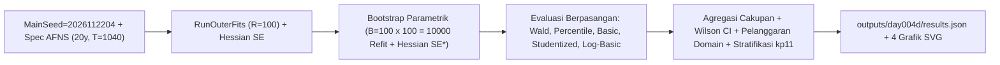

# Penjelasan Proyek — day004d: AFNS — Kalibrasi Interval Bootstrap yang Peka Bias dan Batas Parameter (Go)

## 1. Identitas dan Ringkasan Proyek
- **ID Progress**: `day004d` (Hari 4, Sesi d — Pemeliharaan Diagnostik `day004c` & Kalibrasi Interval Bootstrap AFNS Go)
- **Tanggal**: 2026-11-22 (WITA) · **Topik No**: `null` (*off-roadmap*) · **Jenis**: `quant` · **Bahasa**: Go 1.22+ (`go1.27.4 darwin/arm64`)
- **Proyek**: [projects/go/day004d_afns_interval_calibration/](../../projects/go/day004d_afns_interval_calibration/README.md) · **Metadata**: [meta.json](../../projects/go/day004d_afns_interval_calibration/meta.json)
- **Output JSON**: [outputs/day004d/results.json](../../outputs/day004d/results.json)
- **Ringkasan**: Modul Go mandiri (*zero external modules*) yang membandingkan lima metode konstruksi selang kepercayaan 95% (**Wald Hessian**, **persentil bootstrap**, **basic / reversed percentile**, **bootstrap-t / studentized**, dan **log-scale basic**) secara berpasangan di atas $R = 100$ dataset luar mingguan $20$ tahun ($T = 1{,}040$) dan $B = 100$ refit bootstrap penuh per dataset luar ($10{,}000$ refit MLE 11-parameter lengkap dengan matriks Hessian & $\widehat{\text{SE}}^*$) pada model AFNS.

## 2. Masalah dan Tujuan
Pada [day004c](day004c_quant_afns-bias-correction.md), bootstrap parametrik persentil biasa gagal mengatasi *undercoverage* parameter *mean-reversion* persisten `kp11` (cakupan hanya `2%`) maupun mean jangka panjang `theta1` (`42%`), sementara koreksi bias aditif menghasilkan `38%` estimasi $\hat{\kappa}_1 \le 0$. `day004d` menguji lima pertanyaan kalibrasi spesifik pada studi yang lebih besar ($R=100, B=100$):
1. Apakah interval **basic / reversed percentile** memperbaiki pergeseran interval persentil `kp11` tanpa menghasilkan cakupan semu akibat batas bawah negatif?
2. Apakah **studentization** (*bootstrap-t*) memperbaiki cakupan `theta1` ketika *standard error* Hessian dipengaruhi estimasi *mean-reversion* yang terbias ke atas?
3. Apakah transformasi log (**log-scale basic**) menghasilkan interval `kp11` yang lebih masuk akal secara fisik dan cakupan lebih baik?
4. Seberapa sensitif lebar dan cakupan `theta1` terhadap nilai estimasi $\hat{\kappa}_1$ luar dan terhadap fit yang menyentuh batas kotak pengaman?
5. Apakah $R=100$ cukup presisi (lewat interval Wilson 95%) untuk membedakan kinerja antar-metode?
- **Batas ruang lingkup**: Spesifikasi AFNS identik dengan `day004c` ($K^{\mathbb{P}}$ diagonal, $\sigma_\varepsilon = 5\text{ bp}$ i.i.d., kondisi awal stasioner $\mathbb{P}$). Seluruh interval dibangun dari data luar dan *draw* bootstrap yang sama tanpa pemangkasan (*no clamping*) batas interval skala asli.

## 3. Apa yang Dikerjakan Proyek
Runner CLI [cmd/run/main.go](../../projects/go/day004d_afns_interval_calibration/cmd/run/main.go) mengeksekusi pipeline deterministik (`MainSeed = 2026112204`, `8` worker goroutine, total waktu `403,36 detik`) menuju [outputs/day004d/results.json](../../outputs/day004d/results.json) (`12 MB`) dan 4 grafik SVG di [outputs/figures/](../../outputs/figures/):
1. **Verifikasi Jangkar & Determinisme (`part1_exact_anchors_and_verification`)**: kecocokan Gaussian gabungan $T=5$ (3 tenor), pemeriksaan skor FD vs Richardson, dan invariansi bit `1` vs `8` worker pada fixture cepat (`T=80, R=2, B=4`).
2. **Fit Luar $R=100$ (`outer_fits`, `6,85s`)**: membangkitkan 100 lintasan stasioner 20y ($T=1{,}040$) dan mengestimasi MLE 11-parameter beserta Hessian SE dan diagnostik pencarian garis.
3. **Bootstrap Parametrik + Kalibrasi 5 Metode Interval (`361,92s`)**: mensimulasikan dan me-refit penuh $10{,}000$ dataset bootstrap lengkap dengan evaluasi `CentralDiffHessian` untuk $\widehat{\text{SE}}^*$, menghitung kelima metode interval secara berpasangan, serta melakukan stratifikasi sensitivitas `kp11_hat` vs lebar/cakupan `theta1`.

## 4. Uraian Kode
Modul berada di [projects/go/day004d_afns_interval_calibration/](../../projects/go/day004d_afns_interval_calibration/go.mod) tanpa impor terhadap `day004c`:
- [internal/rng/rng.go](../../projects/go/day004d_afns_interval_calibration/internal/rng/rng.go) & [rng_test.go](../../projects/go/day004d_afns_interval_calibration/internal/rng/rng_test.go): `SplitMix64`, `xoshiro256++` (`MainSeed = 2026112204`), `DeriveSeed`, `DeriveBootstrapSeed`, `NormFloat64`.
- [internal/parallel/parallel.go](../../projects/go/day004d_afns_interval_calibration/internal/parallel/parallel.go) & [parallel_test.go](../../projects/go/day004d_afns_interval_calibration/internal/parallel/parallel_test.go): `DefaultWorkers` (`min(8, NumCPU)`) dan `RunChunks`.
- [internal/afns/afns.go](../../projects/go/day004d_afns_interval_calibration/internal/afns/afns.go) & [afns_test.go](../../projects/go/day004d_afns_interval_calibration/internal/afns/afns_test.go): pemuat `G1`/`G2`, konveksitas `YieldAdjustmentComponents`, transisi eksak `TransitionMatrixClosed` & `TransitionCovClosed`, Lyapunov `StationaryCov`, dan `SimulateStationaryPath`.
- [internal/optim/optim.go](../../projects/go/day004d_afns_interval_calibration/internal/optim/optim.go) & [optim_test.go](../../projects/go/day004d_afns_interval_calibration/internal/optim/optim_test.go): `CentralDiffGrad`, `RichardsonGrad`, `VerifyGradVsRichardson`, `CentralDiffHessian`, serta `MinimizeBFGS` dengan diagnostik penghentian dan pencarian garis (`MinAlphaTested`, `LastStepNorm`, `CandidateBitIdentical`, `LastObjChange`, `ObjBitIdentical`, `LineSearchFailureCause`).
- [internal/kalman/kalman.go](../../projects/go/day004d_afns_interval_calibration/internal/kalman/kalman.go), [linalg.go](../../projects/go/day004d_afns_interval_calibration/internal/kalman/linalg.go), & [kalman_test.go](../../projects/go/day004d_afns_interval_calibration/internal/kalman/kalman_test.go): `FastLogLikelihood` (*steady-state* Riccati), `FilterAndSmooth`, `VerifyJointGaussianAnchor`, `EstimateMLEWithOptions`.
- [internal/interval/interval.go](../../projects/go/day004d_afns_interval_calibration/internal/interval/interval.go) & [interval_test.go](../../projects/go/day004d_afns_interval_calibration/internal/interval/interval_test.go): `EvalWald`, `EvalPercentile`, `EvalBasic`, `EvalStudentized`, `EvalLogBasic`, ambang `MinValidFraction = 0.95` (`MinRequiredValid`), serta penandaan `NonPhysical`, `OutOfBounds`, dan alasan ketidaksahan (`InvalidReason`).
- [internal/bootstrap/bootstrap.go](../../projects/go/day004d_afns_interval_calibration/internal/bootstrap/bootstrap.go) & [bootstrap_test.go](../../projects/go/day004d_afns_interval_calibration/internal/bootstrap/bootstrap_test.go): `RunOuterFits`, `RunCalibrationStudy`, `summarizeMethod`, `accumulateOptDiag`, serta `StratificationSummary` (pemisahan median `kp11_hat` dan korelasi Pearson).
- [internal/stats/stats.go](../../projects/go/day004d_afns_interval_calibration/internal/stats/stats.go), [internal/jsonout/jsonout.go](../../projects/go/day004d_afns_interval_calibration/internal/jsonout/jsonout.go), [internal/svg/svg.go](../../projects/go/day004d_afns_interval_calibration/internal/svg/svg.go), [cmd/run/main.go](../../projects/go/day004d_afns_interval_calibration/cmd/run/main.go), & [main_test.go](../../projects/go/day004d_afns_interval_calibration/cmd/run/main_test.go): `WilsonCI`, `CoverageWithValidity`, `Quantile`, JSON 17-digit, `WriteCategoryPointChart`, `WriteDualHistogramSVG`, `WriteScatterChart`, dan CLI (`-quick`).

## 5. Metode dan Alur Kerja

Detail formulasi metode dan perlakuan kasus khusus:
- **Satuan**: *yield* dan $\theta^{\mathbb{P}}$ dalam desimal/tahun (`0.045 = 4.5%`); $\lambda, K^{\mathbb{P}}_{ii}$ dalam $\text{thn}^{-1}$; $\sigma_i$ dalam $\text{thn}^{-1/2}$; $\sigma_\varepsilon$ dalam desimal *yield* (`0.0005 = 5 bp`); $\tau, \Delta, H$ dalam tahun.
- **Perlakuan `SE*` non-finite / non-positif pada `Studentized`**: setiap *draw* bootstrap dalam dengan $\psi^*_b$ non-finite atau $\widehat{\text{SE}}^*_b \le 0$ / non-finite dikeluarkan dari himpunan $t^*_b = (\psi^*_b - \hat{\psi}) / \widehat{\text{SE}}^*_b$. Bila jumlah $t^*_b$ valid $< 95$ (dari $B=100$) atau $\widehat{\text{SE}} \le 0$ pada fit luar, interval replikasi tersebut ditandai `valid = false`, `covered = false`, dan **tetap dihitung di denominator $R = 100$**.
- **Tanpa *clamping***: baik batas bawah negatif pada `Basic`/`Wald`/`Studentized` maupun hasil di luar kotak optimizer tetap dipertahankan apa adanya dan dicatat di `non_physical_count` dan `out_of_bounds_count`.

## 6. Output yang Ditargetkan
Lima kriteria teknis ditetapkan pra-run (tanpa mensyaratkan cakupan mencapai 95%, penurunan RMSE, atau ketiadaan batas negatif):
1. **C1 (`c1_exact_anchor_and_score`)**: selisih log-likelihood Kalman & `FastLogLikelihood` vs Gaussian gabungan $T=5$ $< 10^{-9}$, smoother RTS $< 10^{-9}$, galat relatif L2 skor FD vs Richardson $< 10^{-5}$.
2. **C2 (`c2_complete_unfiltered_replications`)**: seluruh $R=100$ replikasi luar dan $10{,}000$ refit dalam tercatat utuh, seluruh ringkasan cakupan dan Wilson CI bernilai *finite* dengan `valid + invalid = 100` di semua metode & parameter.
3. **C3 (`c3_summary_math_verified`)**: seluruh identitas aljabar `RawMean - True = RawBias`, `BootCorrectedMean - True = BootCorrectedBias`, `BootCorrectedRMSE / RawRMSE = RMSERatio`, dan `Covered / TotalOuter = Coverage95` cocok hingga $< 10^{-11}$.
4. **C4 (`c4_seed_and_worker_determinism`)**: identik bit-demi-bit antara `1` dan `8` worker pada fixture deterministik (`T=80, R=2, B=4`).
5. **C5 (`c5_runtime_within_600s`)**: runner penuh selesai $< 600$ detik.

## 7. Status Pencapaian

| Kriteria Teknis Pra-Spesifikasi | Status | Bukti Nyata Terukur (`outputs/day004d/results.json`, `403,36s`) |
|---|---|---|
| C1: Anchor eksak & skor FD | `tercapai` | `loglik_abs_diff = 5,68e-13`, `fast_ll_diff = 5,54e-13`, `mean_diff = 3,16e-16`, `cov_diff = 6,39e-17` (`< 1e-9`); max score err `1,54e-9` (init) & `3,38e-7` (true) (`< 1e-5`) |
| C2: Kelengkapan $R=100, B=100$ | `tercapai` | `100/100` fit luar *finite*, `10.000/10.000` refit bootstrap *finite*, `100/100` interval valid pada semua 5 metode (`0` invalid) tanpa penyaringan |
| C3: Verifikasi aljabar ringkasan | `tercapai` | Seluruh identitas bias, rasio RMSE, dan proporsi cakupan terverifikasi hingga `< 1e-11` (`checkAlgebra = true`) |
| C4: Determinisme seed & worker | `tercapai` | `bit_identical_1_vs_n = true` pada `TestCalibrationStudyWorkerDeterminism` dan fixture runner penuh (`1` vs `8` worker) |
| C5: Waktu eksekusi penuh `< 600s` | `tercapai` | Total `403,36s` pada `8` worker (`Part1 = 0,78s`, `Outer = 7,26s`, `Inner+Intervals = 395,32s`, `SVG = 0,002s`) |

### Ringkasan Hasil Riset Empiris (`HASIL PERINTAH` dari `outputs/day004d/results.json`)

| Parameter (True) | Metode | Cakupan (R=100) | Wilson 95% CI | Lebar (Mean / Med) | Non-Fisik ($\le 0$) | OOB |
|---|---|---:|---|---:|---:|---:|
| `kp11` (0.05) | Wald | 85,0% (85/100) | [76,7%, 90,7%] | 0,5466 / 0,5094 | 79% | 79% |
| `kp11` (0.05) | Percentile | 14,0% (14/100) | [8,5%, 22,1%] | 0,8896 / 0,8819 | 0% | 0% |
| `kp11` (0.05) | Basic | 95,0% (95/100) | [88,8%, 97,8%] | 0,8896 / 0,8819 | 100% | 100% |
| `kp11` (0.05) | Studentized | 86,0% (86/100) | [77,9%, 91,5%] | 0,4856 / 0,4405 | 87% | 87% |
| `kp11` (0.05) | Log-Basic | 49,0% (49/100) | [39,4%, 58,7%] | 0,3634 / 0,3178 | 0% | 2% |
| `kp22` (0.50) | Wald / Pct / Basic / Stud / LogBasic | 90 / 67 / 92 / 87 / 86% | [82,6..95,9%] (kec. Pct) | med 0,99..1,22 (Log 0,83) | 12 / 0 / 90 / 36 / 0% | 12..90% |
| `kp33` (0.40) | Wald / Pct / Basic / Stud / LogBasic | 95 / 62 / 91 / 94 / 80% | [83,8..97,9%] (kec. Pct/Log) | med 0,90..1,10 (Log 0,67) | 20 / 0 / 93 / 47 / 0% | 20..93% |
| `theta1` (0.045) | Wald | 52,0% (52/100) | [42,3%, 61,5%] | 1,5871 / 0,0215 | 0% | 2% |
| `theta1` (0.045) | Percentile | 46,0% (46/100) | [36,6%, 55,7%] | 0,0302 / 0,0202 | 0% | 0% |
| `theta1` (0.045) | Basic | 47,0% (47/100) | [37,5%, 56,7%] | 0,0302 / 0,0202 | 0% | 2% |
| `theta1` (0.045) | Studentized | 72,0% (72/100) | [62,5%, 79,9%] | 19,1171 / 0,0462 | 0% | 3% |
| `lambda` (0.60) | Wald / Pct / Basic / Stud / LogBasic | 96 / 96 / 98 / 92 / 98% | [85,0..99,5%] | med 0,010..0,011 | 1 / 0 / 0 / 0 / 0% | 0..1% |

- **Koreksi Bias & RMSE ($R=100$)**: `kp11` raw bias `+0,2085 ± 0,0202` (RMSE `0,2894`) $\to$ boot-corr `-0,0021 ± 0,0209` (RMSE `0,2077`, rasio `0,718`); `kp22` `+0,2102 -> -0,0008` (rasio RMSE `0,842`); `kp33` `+0,1812 -> -0,0271` (rasio RMSE `0,811`); `theta1` `+0,0101 -> +0,0109` (rasio RMSE `1,098`).
- **Stratifikasi `kp11_hat` (median `0,2079`)**: bila `kp11_hat <= 0,2079` (`50` rep), cakupan `theta1` Wald `76,0%` dan Studentized **`94,0%`**; bila `kp11_hat > 0,2079` (`50` rep), cakupan `theta1` Wald merosot ke `28,0%` (`mean_w = 0,0139`) dan Studentized ke `50,0%` (`mean_w = 0,0253`).

## 8. Pemisahan Fakta, Hasil Perintah, dan Hipotesis
- **FAKTA (diamati di kode dan `outputs/day004d/results.json`)**:
  - **Diagnostik optimizer**: pada `100` fit luar, `100/100` *finite*, `97/100` `scaled_grad <= 1e-6`, `99` `line_search_failed` (`86` `step_underflow_plateau`, `13` `armijo_not_met`, `52` berobjektif identik bit-demi-bit), `1` `max_iterations`, `2/100` `bound_hit` (`lambda`, `kp11`, `kp22`), dan `2/100` `hessian_regularized` (`gradient_tolerance = 0`). Pada `10.000` refit bootstrap dalam, `10.000/10.000` *finite*, `9.875` (`98,75%`) `scaled_grad <= 1e-6`, `9.997` `line_search_failed` (`9.118` `step_underflow_plateau`, `879` `armijo_not_met`, `5.564` berobjektif identik bit-demi-bit), `3` `max_iterations`, `171` (`1,71%`) `bound_hit`, dan `169` (`1,69%`) `hessian_regularized`.
  - **Validitas interval & cakupan fisik**: seluruh `100/100` interval luar valid (`0` invalid) di semua 5 metode dan 11 parameter dengan denominator yang sama ($R=100$). Namun untuk `kp11`, `Basic` mencatat `100/100 (100%)` batas bawah $\le 0$ sehingga `physically_valid_covered_count = 0/100` (bukan interval fisik yang berhasil meskipun cakupan nominalnya `95/100`), `Studentized` mencatat `87/100` batas bawah $\le 0$ (`4/100` valid fisik & tercakup), dan `Wald` mencatat `79/100` batas bawah $\le 0$ (`6/100` valid fisik & tercakup), sedangkan `Log-Basic` `0/100 (0%)` non-fisik (`49/100` valid fisik & tercakup) dan `Percentile` `0/100 (0%)` non-fisik (`14/100` valid fisik & tercakup).
  - **Ringkasan robust lebar & outlier Hessian `theta1`**: pada `theta1`, `Studentized` memiliki **median lebar `0,0462`** (`IQR [0,0255, 0,0885]`, `p95 = 0,3681`), tetapi **rerata lebar melonjak ke `19,1171`** karena 2 outlier regularisasi Hessian & batas aktif (`rep 80` lebar `1773,8710`, `rep 44` lebar `129,6019`), sementara `Wald` memiliki **median `0,0215`** (`IQR [0,0151, 0,0312]`, `p95 = 0,0650`) vs **rerata `1,5871`** (`rep 44` lebar `78,0966`, `rep 80` lebar `78,0522`). Pada stratifikasi `kp11_hat <= 0,2079`, median lebar `Studentized` `theta1` adalah `0,0891` (vs rerata `38,2089` akibat dua outlier tersebut; `Wald` median `0,0314` vs rerata `3,1603`) dan pada paruh `kp11_hat > 0,2079` mediannya `0,0255` (rerata `0,0253`; `Wald` median `0,0151` vs rerata `0,0139`).
  - **Makna `all_technical_passed`**: bendera `all_technical_passed = true` di `results.json` hanya menyatakan kriteria teknis C1–C5 terpenuhi dan **tidak** menyiratkan semua metode inferensi terkalibrasi secara statistik pada 95%.
- **HASIL PERINTAH (terukur)**: seluruh angka tabel Bagian 7, interval Wilson 95% yang jelas memisahkan antar-metode pada $R=100$, dan peningkatan cakupan `theta1` dari `46%–52%` menjadi `72,0%` melalui *studentization*.
- **HIPOTESIS (penjelasan teoretis atas temuan empiris)**:
  - **Mengapa `Basic` memberi `95%` di `kp11` dengan `100%` batas bawah negatif (Q1)?** *Hipotesis*: karena `Basic` mengurangkan bias positif bootstrap secara linier ke kiri (`2*psi_hat - q_0.975`), ketika `psi_hat ~ 0,26` dan `q_0.975 ~ 1,10`, batas bawah menjadi sekitar `-0,58 < 0`. Ini secara mekanis menempatkan `0,05` di dalam `[negatif, upper]`, namun menghasilkan batas bawah yang tidak valid secara fisik ($K^{\mathbb{P}}_{11} \le 0$ berarti proses non-stasioner).
  - **Mengapa `Log-Basic` hanya mencapai `49%` di `kp11` meski bebas batas negatif (Q3)?** *Hipotesis*: bias *mean-reversion* Kendall/Tang–Chen bersifat **aditif** ($\mathbb{E}[\hat{\kappa}] \approx \kappa + c/H$), bukan multiplikatif. Pada skala log, `exp(2*ln(hat) - ln(q97.5)) = hat^2 / q97.5` mengoreksi secara rasio; ketika $\kappa_{\text{true}} = 0{,}05$ sangat kecil dibanding bias `+0,21`, koreksi rasio masih menyisakan batas bawah di atas `0,05`.
  - **Mengapa `Studentized` menaikkan cakupan `theta1` ke `72%` tetapi belum mencapai `95%` (Q2 & Q4)?** *Hipotesis*: di setiap dunia bootstrap yang disimulasikan di bawah $\hat{\kappa}_1$, rasio $(\theta_1^* - \hat{\theta}_1)/\widehat{\text{SE}}^*$ menangkap koreksi skewness & keragaman terbatas *sampel pada $\hat{\kappa}_1$ tersebut* (menggandakan median lebar `0,0215 -> 0,0462`), namun tetap tidak dapat mereplikasi varians sejati pada $\kappa_1 = 0{,}05$ ketika $\hat{\kappa}_1$ luar sangat besar (`> 0,21`, di mana cakupan hanya `50%`).

## 9. Landasan Teori (Minimal 10 Poin Terhubung ke Kode)
1. **Model Ruang-Keadaan AFNS Bebas-Arbitrase**: kurva *yield* $y_t(\tau) = -A(\tau)/\tau + H(\tau)X_t + \varepsilon_t$ dengan stabilisasi deret Taylor `G1`/`G2` dan konveksitas CDR 2011 di `YieldAdjustmentComponents` ([internal/afns/afns.go](../../projects/go/day004d_afns_interval_calibration/internal/afns/afns.go)).
2. **Dinamika Ornstein–Uhlenbeck Eksak dan Persamaan Lyapunov**: transisi eksak `TransitionMatrixClosed`, `TransitionCovClosed`, dan inisialisasi stasioner $X_0 \sim \mathcal{N}(\theta^{\mathbb{P}}, Q_\infty)$ lewat `StationaryCov` ([internal/afns/afns.go](../../projects/go/day004d_afns_interval_calibration/internal/afns/afns.go)).
3. **Filter Kalman Joseph dan Akselerasi Riccati Steady-State**: verifikasi `VerifyJointGaussianAnchor` ($5{,}68\times 10^{-13}$) dan pembekuan kovarians stasioner `FastLogLikelihood` di [internal/kalman/kalman.go](../../projects/go/day004d_afns_interval_calibration/internal/kalman/kalman.go) agar $10{,}100$ MLE + Hessian selesai dalam `403,36s`.
4. **Interval Wald Asimtotik dan Invers Hessian Terregularisasi**: selang $\hat{\psi} \pm z_{0{,}975}\widehat{\text{SE}}$ melalui metode delta di `EvalWald` ([internal/interval/interval.go](../../projects/go/day004d_afns_interval_calibration/internal/interval/interval.go)) dan dekomposisi Jacobi dengan lantai eigenvalue `1e-6` di `EstimateMLEWithOptions`.
5. **Interval Persentil Bootstrap Naif dan Kegagalan Pergeseran Bias**: kuantil empiris $[q_{0{,}025}(\psi^*), q_{0{,}975}(\psi^*)]$ di `EvalPercentile` ([internal/interval/interval.go](../../projects/go/day004d_afns_interval_calibration/internal/interval/interval.go)) mengasumsikan simetri tak-berbias; bias ke atas ganda menjatuhkan cakupan `kp11` ke `14%`.
6. **Interval Basic / Reversed Percentile (Pivotal Aditif)**: konstruksi $[2\hat{\psi} - q_{0{,}975}, 2\hat{\psi} - q_{0{,}025}]$ di `EvalBasic` membalik arah bias menggunakan aproksimasi distribusi $\hat{\psi} - \psi \approx \psi^* - \hat{\psi}$ (Davison & Hinkley 1997), menaikkan cakupan `kp11` ke `95%` dengan konsekuensi `100%` batas bawah negatif.
7. **Prinsip Bootstrap-t / Studentized dan Kuantitas Asimtotik Pivotal**: penggunaan pivot terstandarisasi $t^* = (\psi^* - \hat{\psi})/\widehat{\text{SE}}^*$ di `EvalStudentized` ([internal/interval/interval.go](../../projects/go/day004d_afns_interval_calibration/internal/interval/interval.go)) menghilangkan ketergantungan skala lokal (Hall 1992), mendorong cakupan `theta1` dari `46%–52%` menjadi `72%`.
8. **Transformasi Monoton Skala Log untuk Parameter Positif**: metode `EvalLogBasic` menerapkan interval basic pada $\eta = \ln\kappa$ lalu mengeksponensialkan kembali sehingga batas selalu $> 0$, sekaligus memperlihatkan ketidakcocokan model bias multiplikatif vs aditif pada `kp11`.
9. **Ketergantungan Informasi Fisher pada Mean-Reversion Persisten**: $\mathcal{I}(\theta_1) \propto \kappa_1^2 H / \sigma_1^2$ menjelaskan hasil `StratificationSummary` ([internal/bootstrap/bootstrap.go](../../projects/go/day004d_afns_interval_calibration/internal/bootstrap/bootstrap.go)): saat $\hat{\kappa}_1 \le 0{,}208$, cakupan `theta1` `Studentized` mencapai `94%`, sedangkan saat $\hat{\kappa}_1 > 0{,}208$ turun ke `50%`.
10. **Interval Skor Binomial Wilson dengan Penalti Denominator Penuh**: `WilsonCI` dan `CoverageWithValidity` di [internal/stats/stats.go](../../projects/go/day004d_afns_interval_calibration/internal/stats/stats.go) menjaga seluruh $R=100$ replikasi luar dalam denominator dan mengukur presisi pembedaan antar-metode secara valid.
11. **Diagnostik Penghentian BFGS dan Lantai Presisi Float64**: `MinimizeBFGS` ([internal/optim/optim.go](../../projects/go/day004d_afns_interval_calibration/internal/optim/optim.go)) memisahkan `step_underflow_plateau` (`9.118/10.000` refit bootstrap) dan `armijo_not_met` (`879/10.000`) dari kegagalan batas aktif (`171/10.000`) dan `max_iterations` (`3/10.000`).

## 10. Kesimpulan dan Batasan
- **Kesimpulan**: Tidak ada satu metode bootstrap tunggal yang sekaligus menyelesaikan bias, batas fisik, dan *undercoverage* pada $H = 20$ tahun. `Basic` mencapai cakupan `95%` di `kp11` namun selalu melanggar domain positif (`100%` $\le 0$); `Log-Basic` menjaga domain positif (`0%` $\le 0$) namun cakupannya hanya `49%`; dan `Studentized` secara nyata memperbaiki cakupan `theta1` (`72%` vs Wald `52%`, Percentile `46%`), terutama saat $\hat{\kappa}_1$ tidak terlalu terbias ke atas (`94%` pada paruh bawah $\hat{\kappa}_1$).
- **Batasan & kelanjutan**: Untuk mengatasi baik batas fisik $\kappa_1 > 0$ maupun distorsi skala informasi Fisher $(\kappa_1, \theta_1)$, pendekatan lanjutan yang lebih menjanjikan adalah **inversi *profile likelihood* ($\chi^2_1$)** atau **kalibrasi *double bootstrap* / *iterated prepivoting*** langsung pada statistik uji rasio likelihood.

## 11. Referensi dan Jejak Bukti
- **Referensi Literatur**:
  - Christensen, J. H. E., Diebold, F. X., & Rudebusch, G. D. (2011). *The affine arbitrage-free class of Nelson–Siegel term structure models*. Journal of Econometrics, 164(1), 4–20.
  - Davison, A. C., & Hinkley, D. V. (1997). *Bootstrap Methods and Their Application*. Cambridge University Press.
  - Efron, B., & Tibshirani, R. J. (1993). *An Introduction to the Bootstrap*. Chapman & Hall.
  - Hall, P. (1992). *The Bootstrap and Edgeworth Expansion*. Springer.
  - Tang, C. Y., & Chen, S. X. (2009). *Parameter estimation and bias correction for diffusion processes*. Journal of Econometrics, 149(1), 65–81.
  - Wilson, E. B. (1927). *Probable inference, the law of succession, and statistical inference*. JASA, 22(158), 209–212.
- **Artefak Kode & Output Lokal**:
  - Modul Go: [projects/go/day004d_afns_interval_calibration/](../../projects/go/day004d_afns_interval_calibration/README.md)
  - Data Lengkap (`12 MB`, seluruh `100` replikasi luar & `10.000` refit bootstrap + Hessian $\widehat{\text{SE}}^*$): [outputs/day004d/results.json](../../outputs/day004d/results.json)
  - Grafik SVG: [coverage-by-method-kp11-theta1.svg](../../outputs/figures/day004d_coverage-by-method-kp11-theta1.svg), [kp11-endpoints-raw-vs-log.svg](../../outputs/figures/day004d_kp11-endpoints-raw-vs-log.svg), [theta1-interval-widths.svg](../../outputs/figures/day004d_theta1-interval-widths.svg), [kp11-vs-theta1-width-coverage.svg](../../outputs/figures/day004d_kp11-vs-theta1-width-coverage.svg)
- **Jejak Bukti Eksekusi**: seluruh `11` paket Go dengan `15` tes utama lulus `go test -race -count=1 -v ./...`, `gofmt -l .` kosong, `go vet ./...` bersih, dan runner penuh `go run ./cmd/run` selesai `403,36s` pada `workers = 8` dengan `c1..c5 = true` (`all_technical_passed = true`, lihat `technical_scope_note`).
