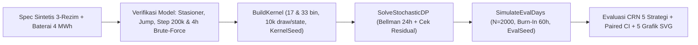

# Penjelasan Proyek — day004e: Harga Listrik Negatif dan Arbitrase Baterai (DP Stokastik, Go)

## 1. Identitas dan Ringkasan Proyek
- **ID Progress**: `day004e` (Hari 4, Sesi e — Kasus Baru Go: Pasar Listrik Sintetis & Arbitrase Baterai)
- **Tanggal**: 2026-11-22 (WITA) · **Topik No**: `null` (*off-roadmap*) · **Jenis**: `quant` · **Bahasa**: Go 1.22+ (`go1.27.4 darwin/arm64`)
- **Proyek**: [projects/go/day004e_power_storage/](../../projects/go/day004e_power_storage/README.md) · **Metadata**: [meta.json](../../projects/go/day004e_power_storage/meta.json)
- **Output JSON**: [outputs/day004e/results.json](../../outputs/day004e/results.json)
- **Ringkasan**: Modul Go 1.22+ mandiri (*standard library* saja, tanpa mengimpor paket `day004d`) yang mensimulasikan pasar listrik sintetis 3-rezim (`normal`, `scarcity`, `oversupply`) dengan harga negatif tak-terpotong dan lonjakan *compound Poisson*, lalu membandingkan kebijakan *dispatch* baterai $4\text{ MWh}$ melalui **Stochastic Dynamic Programming** (grid harga `17` dan `33` bin, `10.000` *draw*/state) terhadap kebijakan **Threshold** tetap, batas atas **Perfect-Foresight DP**, dan benchmark **Tanpa Baterai** di atas `N = 2.000` hari evaluasi *Common Random Numbers* (CRN) setelah *burn-in* `60` hari.

## 2. Masalah dan Tujuan
Proyek ini keluar sejenak dari rangkaian suku bunga AFNS untuk mempelajari kendali stokastik pada komoditas tak-tersimpan dengan ekor ekstrem dua sisi:
1. Bagaimana rantai Markov 3-rezim, pola musiman diurnal, dan lonjakan *compound Poisson* bertanda berlawanan memunculkan harga negatif (`oversupply`) sekaligus lonjakan kelangkaan (`scarcity`) tanpa pembatasan harga buatan?
2. Seberapa besar nilai tambah kebijakan **Stochastic DP** *nonanticipative* (yang mengoptimalkan nilai harapan masa depan bersyarat pada jam, rezim, bin harga, dan SoC) dibanding aturan ambang tetap (*threshold policy*) pada metrik profit rata-rata, ekor bawah (`VaR 5%`, `ES 5%`), dan *turnover* baterai (`EFC`)?
3. Seberapa sensitif solusi Stochastic DP terhadap perhalusan grid harga (`17` bin vs `33` bin) dan seberapa besar *regret* informasi terhadap batas atas bersyarat **Perfect-Foresight DP**?
- **Batas ruang lingkup**: Seluruh eksperimen menggunakan **model sintetis berparameter tetap**, bukan kalibrasi pasar tenaga listrik nyata. Strategi beroperasi sebagai *price-taker* per jam dengan aksi diskret tanpa perdagangan *forward/futures* dan mengasumsikan rezim saat ini teramati.

## 3. Apa yang Dikerjakan Proyek
Runner CLI [cmd/run/main.go](../../projects/go/day004e_power_storage/cmd/run/main.go) menjalankan seluruh eksperimen dalam `0,70 detik` pada `8` worker goroutine menuju [outputs/day004e/results.json](../../outputs/day004e/results.json) (`386 KB`) dan `5` grafik SVG di [outputs/figures/](../../outputs/figures/):
1. **Verifikasi Model & Determinisme**: menguji matriks transisi & distribusi stasioner eksak, momen *compound Poisson* (`200k` draw), momen transisi satu langkah (`200k` draw), kecocokan Bellman 4-jam vs enumerasi *brute force* (`625` lintasan), serta invariansi bit-identik `1` vs `8` worker.
2. **Konstruksi Kernel & Bellman DP**: membangun kernel transisi independen pada grid `17` bin (`1.224` state $\times 10.000$ draw = `12,24 juta` draw) dan `33` bin (`2.376` state $\times 10.000$ draw = `23,76 juta` draw) memakai `KernelSeed = 2026112215`, lalu menyelesaikan rekursi Bellman 24 jam dengan pemeriksaan residual penuh.
3. **Evaluasi Ekonomi CRN (`N = 2.000` hari)**: membangkitkan `2.000` hari evaluasi independen (`EvalSeed = 2026112225`, masing-masing didahului *burn-in* `60` hari = `1.440` jam), mengevaluasi kelima strategi secara serentak pada lintasan sama, menghitung interval ketidakpastian berpasangan, dan memilih hari contoh via aturan pra-run.

## 4. Uraian Kode
Seluruh modul berada di [projects/go/day004e_power_storage/](../../projects/go/day004e_power_storage/go.mod) tanpa dependensi eksternal:
- [internal/rng/rng.go](../../projects/go/day004e_power_storage/internal/rng/rng.go) & [rng_test.go](../../projects/go/day004e_power_storage/internal/rng/rng_test.go): `SplitMix64`, `xoshiro256++`, `DeriveSeed`, `DeriveStateSeed`, pemisahan `MainSeed`/`KernelSeed`/`EvalSeed`/`VerifySeed`, Box–Muller `NormFloat64`, `ExpFloat64`, serta `Poisson` Knuth/Atkinson.
- [internal/parallel/parallel.go](../../projects/go/day004e_power_storage/internal/parallel/parallel.go) & [parallel_test.go](../../projects/go/day004e_power_storage/internal/parallel/parallel_test.go): `DefaultWorkers` (`min(8, NumCPU)`) dan `RunChunks` berurutan deterministik.
- [internal/regime/regime.go](../../projects/go/day004e_power_storage/internal/regime/regime.go) & [regime_test.go](../../projects/go/day004e_power_storage/internal/regime/regime_test.go): `DefaultTransitionMatrix`, `ValidateTransitionMatrix`, eliminasi Gauss `StationaryDistribution`, `StationaryResidual`, serta sampler `SampleNext`/`SampleStationary`.
- [internal/jumps/jumps.go](../../projects/go/day004e_power_storage/internal/jumps/jumps.go) & [jumps_test.go](../../projects/go/day004e_power_storage/internal/jumps/jumps_test.go): `DefaultSpecs`, `TheoreticalMoments`, dan `SampleJump` *compound Poisson* per rezim.
- [internal/prices/prices.go](../../projects/go/day004e_power_storage/internal/prices/prices.go) & [prices_test.go](../../projects/go/day004e_power_storage/internal/prices/prices_test.go): `SeasonalMean` (`h mod 24`), `Step` tak-terpotong, `OneStepConditionalMoments`, `SimulateEvalDay` (*burn-in* `60` hari + `24` jam evaluasi), dan `SimulateEvalDays`.
- [internal/battery/battery.go](../../projects/go/day004e_power_storage/internal/battery/battery.go) & [battery_test.go](../../projects/go/day004e_power_storage/internal/battery/battery_test.go): `DefaultSpec`, `Actions` (5 aksi dengan `DeltaSoCIdx` kelipatan eksak `0,1 MWh`), `IsFeasible`, `HourlyCashflow`, `TerminalValue`, dan `EquivalentFullCycles`.
- [internal/dp/grid.go](../../projects/go/day004e_power_storage/internal/dp/grid.go), [kernel.go](../../projects/go/day004e_power_storage/internal/dp/kernel.go), [bellman.go](../../projects/go/day004e_power_storage/internal/dp/bellman.go), [eval.go](../../projects/go/day004e_power_storage/internal/dp/eval.go), & [dp_test.go](../../projects/go/day004e_power_storage/internal/dp/dp_test.go): `NewCoarseGrid17`, `NewFineGrid33`, `BuildKernel`, `SolveStochasticDP`, `SolveDeterministicDP`, `EvalStochasticDP`, `EvalThresholdPolicy`, `EvalPerfectForesightDP`, `EvalNoBattery`, dan `ComputeRegretVsPF`.
- [internal/stats/stats.go](../../projects/go/day004e_power_storage/internal/stats/stats.go), [internal/jsonout/jsonout.go](../../projects/go/day004e_power_storage/internal/jsonout/jsonout.go), [internal/svg/svg.go](../../projects/go/day004e_power_storage/internal/svg/svg.go), [cmd/run/main.go](../../projects/go/day004e_power_storage/cmd/run/main.go), & [main_test.go](../../projects/go/day004e_power_storage/cmd/run/main_test.go): `VaRAndES`, `PairedDiffCI`, JSON 17-digit, pembuat 5 grafik SVG, dan CLI `-quick`.

## 5. Metode dan Alur Kerja

Formulasi kunci yang dipakai:
- **Transisi harga**: $P_{t+1} = m(r_{t+1}, h+1) + \phi_{r_{t+1}}(P_t - m(r_{t+1}, h)) + \sigma_{r_{t+1}}Z + J$ dengan $m(r,h)=\mu_r + 15\cos(2\pi((h\bmod 24)-19)/24)$.
- **Persamaan Bellman**: pada jam terminal $h=24$, $V_{24}(r, b, s) = 45 \cdot \eta_d \cdot \text{SoC}(s)$. Untuk $h = 23, \dots, 0$:
  $$V_h(r,b,s) = \max_{a \in \mathcal{A}(s)} \left\{\text{Cashflow}(P^{\text{rep}}_b, a) + \sum_{r', b'} \hat{\mathbb{P}}(r', b' \mid h, r, b) V_{h+1}\bigl(r', b', s + \Delta s(a)\bigr)\right\}.$$
- **Definisi profit bersih harian**: $\Pi = \sum_{h=0}^{23} \text{Cashflow}(P_h, a_h) + V_{24}(s_{24}) - V_{24}(s_0)$. Karena $V_{24}(s_0) = 45\cdot 0{,}90 \cdot 2{,}0 = 81\text{ EUR}$ dikurangkan pada semua strategi berbaterai, strategi *idle* penuh maupun `no_battery` tepat bernilai `0 EUR`, sementara selisih antar-strategi serta *regret* identik dengan definisi nilai kotor.
- **VaR & ES 5%**: $\text{VaR}_{0{,}05}$ adalah kuantil empiris ke-5 (interpolasi linier), dan $\text{ES}_{0{,}05}$ adalah rata-rata $k = \lceil 0{,}05 N\rceil = 100$ hari terburuk.

## 6. Output yang Ditargetkan
Delapan kriteria teknis ditetapkan sebelum run penuh tanpa menyetel parameter/seed/ambang pasca-hasil:
1. **C1 (`c1_stationary_distribution_valid`)**: baris matriks transisi berjumlah 1 dan $\max_j |(\pi P)_j - \pi_j| < 10^{-13}$.
2. **C2 (`c2_jump_and_onestep_moments_verified`)**: mean & varians MC (`200k` draw) *compound Poisson* per rezim dan transisi satu langkah di 3 titik uji seluruhnya dalam `4 MCSE` rumus teoretis.
3. **C3 (`c3_zero_soc_and_power_violations`)**: `0` pelanggaran SoC (`[0, 4] MWh`) dan batas daya (`2 MW` charge, `1,8 MW` discharge) di semua strategi.
4. **C4 (`c4_bellman_matches_bruteforce_and_residual`)**: DP deterministik cocok dengan enumerasi lengkap `4` jam (`625` lintasan) $< 10^{-11}$ serta `max_bellman_residual < 10^{-11}` pada grid 17 & 33 bin.
5. **C5 (`c5_perfect_foresight_upper_bound`)**: *perfect-foresight DP* tidak pernah kalah dari strategi *feasible* manapun pada seluruh `2.000` hari (`tol = 1e-9`).
6. **C6 (`c6_seed_and_worker_determinism`)**: keluaran `1` vs `8` worker identik bit-demi-bit pada kernel dan lintasan evaluasi.
7. **C7 (`c7_negative_prices_and_spikes_realized`)**: harga negatif, *scarcity*, *oversupply*, dan *jump* benar-benar muncul dalam `2.000` hari evaluasi penuh.
8. **C8 (`c8_outputs_finite_and_within_budget`)**: seluruh ringkasan bernilai *finite*, JSON & 5 grafik SVG terbentuk, dan runtime penuh `< 600s`.

## 7. Status Pencapaian

| Kriteria Teknis Pra-Spesifikasi | Status | Bukti Nyata Terukur (`outputs/day004e/results.json`, `0,70s`) |
|---|---|---|
| C1: Distribusi stasioner Markov | `tercapai` | $\pi = [0{,}933817,\; 0{,}040798,\; 0{,}025385]$, `stationary_residual_max_abs = 1,04e-17` |
| C2: Momen jump & transisi 1 langkah | `tercapai` | Seluruh 3 rezim jump (`200k` draw) dan 3 kasus 1-langkah (`200k` draw) `within_4_mcse = true` |
| C3: Nol pelanggaran SoC & daya | `tercapai` | `soc_violation_count = 0`, `power_violation_count = 0` di seluruh 5 strategi (`240.000` jam-strategi) |
| C4: Bellman vs brute force & residual | `tercapai` | `4h` DP vs *brute force* (`626,20 EUR` gross): `abs_diff = 1,14e-13`; `max_bellman_residual = 0` pada `17` & `33` bin |
| C5: Batas atas perfect foresight | `tercapai` | `pf_domination_violations = 0`, `max_pf_domination_shortfall_eur = 0` di seluruh `2.000` hari |
| C6: Determinisme seed & worker | `tercapai` | `bit_identical = true` (`1` vs `8` worker pada `TestPerfectForesightDominanceAndWorkerDeterminism` & runner) |
| C7: Realisasi harga negatif & jump | `tercapai` | `5.608` jam `< 0` (`11,68%`), `204` jump non-nol (`151` scarcity, `53` oversupply, `8` jam $N>1$), `max = 1041,92` |
| C8: Output finite & waktu `< 600s` | `tercapai` | Seluruh metrik *finite*, `results.json` (`386 KB`) + 5 SVG valid selesai dalam `0,704s` pada `8` worker |

### Ringkasan Hasil Riset (`HASIL PERINTAH` dari `outputs/day004e/results.json`)
- **Perbandingan strategi (`N = 2.000` hari CRN)**:
  - `stochastic_dp_33bin`: mean **`236,09 ± 4,73 EUR/hari`**, median `192,98`, SD `211,46`, VaR 5% `27,59`, ES 5% `+4,87`, EFC `0,932` (`7,45 MWh/hari`), regret `252,30 ± 4,56`, profit jam negatif `29,29/hari`, profit jam scarcity/jump `69,18/hari`.
  - `stochastic_dp_17bin`: mean **`231,90 ± 4,75 EUR/hari`**, median `189,54`, SD `212,48`, VaR 5% `22,55`, ES 5% `-1,85`, EFC `1,020` (`8,16 MWh/hari`), regret `256,49 ± 4,60`, profit jam negatif `28,05/hari`, profit jam scarcity/jump `69,18/hari`.
  - `threshold_policy`: mean **`116,01 ± 4,41 EUR/hari`**, median `77,55`, SD `197,33`, VaR 5% `0,00`, ES 5% `0,00`, EFC `0,175` (`1,50 MWh/hari`), regret `372,38 ± 4,40`, profit jam negatif `22,00/hari`, profit jam scarcity/jump `64,10/hari`.
  - `perfect_foresight_dp`: mean **`488,39 ± 7,16 EUR/hari`**, median `394,22`, SD `320,34`, VaR 5% `219,18`, ES 5% `181,26`, EFC `2,505` (`20,08 MWh/hari`), profit jam negatif `82,46/hari`, profit jam scarcity/jump `140,78/hari`.
  - `no_battery`: `0,00` pada seluruh metrik profit & aktivitas, regret `488,39 ± 7,16 EUR/hari`.
- **Selisih berpasangan (`CI 95%` dengan `z = 1,96`)**: `DP-33 - Threshold = +120,08 ± 3,47` (`CI [113,29, 126,88]`, unggul di `87,85%` hari), `DP-17 - Threshold = +115,89 ± 3,49` (`CI [109,06, 122,73]`, unggul di `85,45%` hari), dan `DP-33 - DP-17 = +4,19 ± 1,26` (`CI [1,72, 6,66]`, unggul di `37,90%` hari).

## 8. Pemisahan Fakta, Hasil Perintah, dan Hipotesis
- **FAKTA (diamati di kode dan `outputs/day004e/results.json`)**:
  - Kedua kernel DP menampung ekor ekstrem secara eksplisit tanpa pemangkasan: `17-bin` mencatat massa *tail bin* bawah (`< -500`) `0,829%` (mean `-517,88`) dan atas (`>= 2000`) `2,720%` (mean `2058,27`); `33-bin` mencatat massa *tail bin* bawah `0,431%` (mean `-518,05`) dan atas `1,400%` (mean `2058,18`).
  - Pada hari contoh `#12` (`day004e_example-day-dispatch-soc.svg`), profit realisasi adalah `DP-33 = 434,0 EUR`, `Threshold = 828,8 EUR`, dan `Perfect Foresight = 1334,3 EUR`.
  - Seluruh `11` paket Go dengan `15` tes utama lulus `go test -race -count=1 -v ./...`.
- **HASIL PERINTAH (terukur)**:
  - `DP-33` menggandakan rata-rata profit harian terhadap `Threshold` (`236,09` vs `116,01 EUR/hari`, selisih `+120,08 ± 3,47`), memangkas *regret* terhadap *perfect foresight* sebesar `32,2%` (`372,38 -> 252,30 EUR/hari`), dan memperhalus grid dari `17` ke `33` bin menaikkan profit `+4,19 ± 1,26 EUR/hari` sekaligus menurunkan EFC dari `1,020` menjadi `0,932`.
- **HIPOTESIS (penjelasan mekanisme ekonomi & numerik)**:
  - **Mengapa `DP-33` mengungguli `Threshold` secara jauh lebih besar di hari normal maupun ekstrem?** *Hipotesis*: `Threshold` hanya bertindak saat $P \le 0$ atau $P \ge 200$, sehingga baterai menganggur `96,75%` jam (`46.441/48.000` jam *idle*), melewatkan arbitrase diurnal `cos(...)` di kisaran `30–70 EUR/MWh`, dan sering memasuki jam *scarcity* dengan SoC setengah penuh `2 MWh`. Sebaliknya, DP aktif memanfaatkan siklus harian sekaligus menahan SoC lebih tinggi saat rezim `scarcity` aktif (terlihat di grafik `day004e_dp-value-vs-soc-regime.svg`).
  - **Mengapa `DP-33` unggul sekaligus lebih hemat EFC daripada `DP-17`?** *Hipotesis*: bin kasar `17` bin (misalnya lebar `20` atau `80 EUR/MWh` di sekitar `40–120`) mencampur harga di bawah dan di atas titik impas biaya efisiensi-degradasi (`~9–14 EUR/MWh` spread bersih), sehingga memicu aksi *charge/discharge* marginal yang memperburuk `ES 5%` (`-1,85` EUR di `17-bin` vs `+4,87` EUR di `33-bin`).
  - **Mengapa `Threshold` bisa menang pada hari contoh tunggal `#12` (`828,8` vs `434,0 EUR`)?** *Hipotesis*: sifat *nonanticipative* DP membuatnya menjual sebagian energi ketika harga sempat naik moderat sebelum lonjakan `308 EUR/MWh` muncul, sementara `Threshold` secara kebetulan tetap menyimpan hingga `>= 200 EUR/MWh`. Ini menegaskan keunggulan DP hanya berlaku dalam ekspektasi/distribusi antar-hari, bukan dominasi di setiap realisasi tunggal.

## 9. Landasan Teori (Minimal 10 Poin Terhubung ke Kode)
1. **Rantai Markov Waktu Diskret dan Distribusi Stasioner**: transisi 3-rezim dengan matriks stokastik $P$ dan penyelesaian linear eksak $\pi P = \pi, \sum_i \pi_i = 1$ di `StationaryDistribution` ([internal/regime/regime.go](../../projects/go/day004e_power_storage/internal/regime/regime.go)).
2. **Model Mean-Reverting Musiman Pergantian Rezim (Regime-Switching AR(1))**: komponen musiman diurnal `SeasonalMean` ($h \bmod 24$) dan dinamika mean-reverting per rezim di `Step` ([internal/prices/prices.go](../../projects/go/day004e_power_storage/internal/prices/prices.go)).
3. **Proses Compound Poisson dengan Tanda Eksponensial**: cacah kedatangan $N \sim \text{Poisson}(\lambda_r)$ dan ukuran lonjakan eksponensial dengan identitas momen $\mathbb{E}[J] = \pm\lambda\mu_J$ serta $\operatorname{Var}(J) = 2\lambda\mu_J^2$ di `SampleJump` dan `TheoreticalMoments` ([internal/jumps/jumps.go](../../projects/go/day004e_power_storage/internal/jumps/jumps.go)).
4. **Hukum Ekspektasi Total dan Varians Total**: penurunan rumus momen kondisional satu langkah di atas campuran 3 rezim tujuan di `OneStepConditionalMoments` ([internal/prices/prices.go](../../projects/go/day004e_power_storage/internal/prices/prices.go)) untuk pengujian bebas-penyetelan berbasis `MCSE`.
5. **Efisiensi Putaran Penuh (Round-Trip Efficiency) dan Biaya Degradasi Baterai**: pemisahan daya grid vs perubahan energi tersimpan ($\Delta \text{SoC}_c = \eta_c c\Delta t$, $\Delta \text{SoC}_d = -d\Delta t/\eta_d$) serta biaya degradasi sisi-grid `2 EUR/MWh` di `HourlyCashflow` ([internal/battery/battery.go](../../projects/go/day004e_power_storage/internal/battery/battery.go)).
6. **Prinsip Optimalitas Bellman untuk Masalah Kendali Stokastik Horizon Berhingga**: induksi mundur 24 jam $V_h(r,b,s) = \max_a \{R + \mathbb{E}[V_{h+1}]\}$ dan verifikasi residual nol di `SolveStochasticDP` ([internal/dp/bellman.go](../../projects/go/day004e_power_storage/internal/dp/bellman.go)).
7. **Diskretisasi Ruang Keadaan Kontinu dan Penanganan Tail Bin**: pemetaan harga tak-terpotong ke `17` dan `33` bin dengan *tail bin* terbuka `(-inf, -500)` dan `[2000, +inf)` di `PriceGrid.BinIndex` ([internal/dp/grid.go](../../projects/go/day004e_power_storage/internal/dp/grid.go)).
8. **Kebijakan Nonanticipative vs Batas Atas Perfect Foresight**: pembatasan keputusan pada filtrasi $\mathcal{F}_h$ di `EvalStochasticDP` vs optimisasi deterministik lintasan realisasi penuh di `SolveDeterministicDP` dan `ComputeRegretVsPF` ([internal/dp/eval.go](../../projects/go/day004e_power_storage/internal/dp/eval.go)).
9. **Pengurangan Varians Common Random Numbers (CRN) dan Selisih Berpasangan**: evaluasi seluruh 5 strategi di atas 2.000 hari yang sama dan interval kepercayaan berpasangan di `PairedDiffCI` ([internal/stats/stats.go](../../projects/go/day004e_power_storage/internal/stats/stats.go)).
10. **Ukuran Risiko Ekor Bawah (Value-at-Risk & Expected Shortfall)**: pengukuran risiko profit harian terburuk 5% (`VaR5Profit`, `ES5Profit`) di `VaRAndES` ([internal/stats/stats.go](../../projects/go/day004e_power_storage/internal/stats/stats.go)) untuk mendeteksi biaya ketidakpastian di grid kasar vs halus.

## 10. Kesimpulan dan Batasan
- **Kesimpulan**: Pada model sintetis harga listrik 3-rezim dengan `11,68%` jam negatif dan lonjakan *compound Poisson*, *stochastic DP* nonanticipative (`33-bin`) menghasilkan rata-rata profit bersih `236,09 ± 4,73 EUR/hari` — lebih dari dua kali lipat aturan *threshold* (`116,01 ± 4,41 EUR/hari`, selisih berpasangan `+120,08 ± 3,47 EUR/hari`) dan memangkas *regret* terhadap *perfect foresight* dari `372,38` ke `252,30 EUR/hari`. Perhalusan grid dari `17` ke `33` bin memberi peningkatan kecil tetapi signifikan secara statistik (`+4,19 ± 1,26 EUR/hari`) sekaligus menurunkan siklus baterai (`EFC 1,020 -> 0,932`) dan memperbaiki `ES 5%`.
- **Batasan & kelanjutan**: Model bersifat sintetis dan mengasumsikan observabilitas penuh rezim Markov; perpanjangan alami berikutnya adalah **POMDP / filter Hidden Markov** ketika rezim tidak diamati langsung serta optimasi gabungan pasar *day-ahead* dan *intraday*.

## 11. Referensi dan Jejak Bukti
- **Referensi Literatur**:
  - Bellman, R. (1957). *Dynamic Programming*. Princeton University Press.
  - Bertsekas, D. P. (2017). *Dynamic Programming and Optimal Control* (Vol. I). Athena Scientific.
  - Carmona, R., & Ludkovski, M. (2010). *Valuation of energy storage: An optimal switching approach*. Quantitative Finance, 10(4), 359–374.
  - Weron, R. (2014). *Electricity price forecasting: A review of the state-of-the-art with a look into the future*. International Journal of Forecasting, 30(4), 1030–1081.
- **Artefak Kode & Output Lokal**:
  - Modul Go: [projects/go/day004e_power_storage/](../../projects/go/day004e_power_storage/README.md)
  - Data Lengkap (`386 KB`): [outputs/day004e/results.json](../../outputs/day004e/results.json)
  - 5 Grafik SVG: [sample-price-regimes-jumps.svg](../../outputs/figures/day004e_sample-price-regimes-jumps.svg), [example-day-dispatch-soc.svg](../../outputs/figures/day004e_example-day-dispatch-soc.svg), [daily-profit-distribution.svg](../../outputs/figures/day004e_daily-profit-distribution.svg), [dp-value-vs-soc-regime.svg](../../outputs/figures/day004e_dp-value-vs-soc-regime.svg), [grid-resolution-sensitivity.svg](../../outputs/figures/day004e_grid-resolution-sensitivity.svg)
- **Jejak Bukti Eksekusi**: seluruh `11` paket Go dengan `15` tes utama lulus `go test -race -count=1 -v ./...`, `gofmt -l .` kosong, `go vet ./...` bersih, dan runner penuh `go run ./cmd/run` selesai `0,70s` pada `workers = 8` dengan `c1..c8 = true` (`all_technical_passed = true`).
