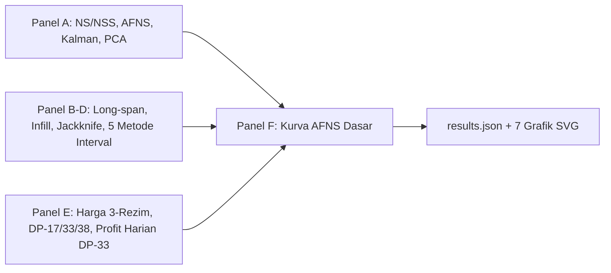

# Penjelasan Proyek `day004f` — Port Lengkap AFNS Term Structure, Kalibrasi Interval, Harga Listrik Negatif & Valuasi Proyek Baterai (Rust)

## 1. Identitas dan Ringkasan Proyek
- **ID Progress**: `day004f` (Hari 4, Sesi f)
- **Tanggal (WITA)**: `2026-11-22`
- **Topik**: Port lengkap `day004a`–`day004e` dalam Rust murni + integrasi valuasi proyek baterai 10 tahun dengan kurva AFNS
- **Jenis / Bahasa**: `quant` / Rust stable (`edition = "2021"`, nol external crates)
- **Lokasi Proyek**: [`projects/rust/day004f_energy_transition/`](../../projects/rust/day004f_energy_transition/README.md)

Proyek ini memport seluruh studi struktur suku bunga AFNS (`day004a`–`day004d`) dan pasar listrik + DP baterai (`day004e`, termasuk audit *expanded-tail*) ke dalam satu basis kode Rust mandiri berkinerja tinggi, lalu menghubungkan keduanya pada **Panel F** untuk menilai NPV, sensitivitas parameter kurva, durasi, konveksitas, KRD, dan *hedge* dua obligasi atas arus kas proyek penyimpanan energi 10 tahun.

## 2. Masalah dan Tujuan
1. Memastikan seluruh eksperimen `day004a`–`day004e` (tanpa menghilangkan panel, replikasi, maupun kasus gagal/non-fisik) dapat direproduksi dalam Rust murni tanpa ketergantungan crate eksternal dan selesai dalam anggaran `< 10 menit` (`< 600s`).
2. Mengisolasi dampak representasi ekor (*tail bin*) grid harga listrik `day004e` melalui perluasan domain ke `[-1000, 5000] EUR/MWh` (`expanded_tail_38`).
3. Menghubungkan arus kas dispatch baterai (`DP-33`) dengan diskonto kurva suku bunga AFNS (kurva dasar serta ketidakpastian estimasi parameter dari `4b/4c/4d`) dan mengukur risiko suku bunganya.

## 3. Apa yang Dikerjakan Proyek
Satu binary runner ([`src/bin/run.rs`](../../projects/rust/day004f_energy_transition/src/bin/run.rs)) mengeksekusi Panel A–F secara berurutan dengan paralelisme deterministik (`std::thread::scope`), memverifikasi seluruh jangkar analitik, menulis [`outputs/day004f/results.json`](../../outputs/day004f/results.json), dan menghasilkan 7 grafik SVG di [`outputs/figures/`](../../outputs/figures/).

## 4. Uraian Kode
- [`src/rng.rs`](../../projects/rust/day004f_energy_transition/src/rng.rs) & [`src/parallel.rs`](../../projects/rust/day004f_energy_transition/src/parallel.rs) — PRNG `xoshiro256++` + `SplitMix64`, sampler Normal/Eksponensial/Poisson, dan `run_chunks` deterministik.
- [`src/linalg.rs`](../../projects/rust/day004f_energy_transition/src/linalg.rs) & [`src/stats.rs`](../../projects/rust/day004f_energy_transition/src/stats.rs) — LU, Cholesky, Thomas tridiagonal, Jacobi eigen, eksponensial matriks deret, kuadratur Gauss–Legendre, RK4/Richardson, Wilson CI, OLS/WLS, VaR/ES.
- [`src/ns.rs`](../../projects/rust/day004f_energy_transition/src/ns.rs), [`src/bootstrap.rs`](../../projects/rust/day004f_energy_transition/src/bootstrap.rs), [`src/interp.rs`](../../projects/rust/day004f_energy_transition/src/interp.rs), [`src/risk.rs`](../../projects/rust/day004f_energy_transition/src/risk.rs) — Nelson–Siegel(–Svensson), stabilitas Taylor $\tau$ kecil, bootstrap par, interpolasi log-linear vs spline, durasi/konveksitas/KRD/swap PV01/hedge dua obligasi.
- [`src/afns.rs`](../../projects/rust/day004f_energy_transition/src/afns.rs), [`src/kalman.rs`](../../projects/rust/day004f_energy_transition/src/kalman.rs), [`src/optim.rs`](../../projects/rust/day004f_energy_transition/src/optim.rs), [`src/pca.rs`](../../projects/rust/day004f_energy_transition/src/pca.rs) — AFNS CDR 2011, Riccati RK4, transisi eksak $\mathbb{P}$, *steady-state* Kalman `fast_log_likelihood`, RTS smoother, jangkar $T=5$, BFGS 11 parameter dengan diagnostik *line-search*, dan PCA.
- [`src/panel_a.rs`](../../projects/rust/day004f_energy_transition/src/panel_a.rs)–[`src/panel_d.rs`](../../projects/rust/day004f_energy_transition/src/panel_d.rs), [`src/jackknife.rs`](../../projects/rust/day004f_energy_transition/src/jackknife.rs), [`src/interval.rs`](../../projects/rust/day004f_energy_transition/src/interval.rs) — seluruh studi `4a`–`4d` (*long-span*, *infill*, jackknife temporal, bootstrap parametrik `5.000` refit, dan kalibrasi 5 metode interval `10.000` refit).
- [`src/power.rs`](../../projects/rust/day004f_energy_transition/src/power.rs), [`src/battery.rs`](../../projects/rust/day004f_energy_transition/src/battery.rs), [`src/dp.rs`](../../projects/rust/day004f_energy_transition/src/dp.rs), [`src/panel_e.rs`](../../projects/rust/day004f_energy_transition/src/panel_e.rs) — model harga 3-rezim + *compound Poisson*, baterai `4 MWh`, Bellman DP 17/33/38-bin, dan evaluasi CRN `N=2.000` hari.
- [`src/integration.rs`](../../projects/rust/day004f_energy_transition/src/integration.rs) — **Panel F**: proyek baterai 10 tahun didiskontokan kurva AFNS, sensitivitas fit `4b/4c/4d`, durasi/konveksitas/KRD/PV01, dan *hedge* dua obligasi.

## 5. Metode dan Alur Kerja

## 6. Output yang Ditargetkan
Seluruh kriteria teknis `c1`–`c7`: akurasi jangkar analitik (`< 1e-9` hingga `< 1e-12`), PCA agregat lulus, aljabar jackknife `c/H`, momen model listrik dalam `4 MCSE`, Bellman cocok *brute force* & dominasi *perfect foresight*, jangkar KRD/hedge Panel F lulus, dan total waktu eksekusi penuh `< 600s`.

## 7. Status Pencapaian (Berdasarkan Bukti Eksekusi)
| Kriteria | Status | Bukti Terukur (`outputs/day004f/results.json`) |
|---|---|---|
| `c1` Jangkar analitik Panel A | `tercapai` | Integral NS `4,16e-17`, bootstrap `2,78e-16`, Riccati `1,36e-12`, jangkar `T=5` `ll_diff = 2,42e-13` |
| `c2` PCA agregat `T=5000, R=100` | `tercapai` | `cosine top-3 = [0,99995, 0,99927, 0,99745]`, tanda `[0, 1, 2]`, `noise_bulk_z = 0,46` |
| `c3` Aljabar jackknife `c/H` | `tercapai` | Galat `1,39e-17` pada `H=20` & `80` |
| `c4` Model harga 3-rezim & jump | `tercapai` | Residual stasioner `1,1e-16`, momen jump & 1-step dalam `4 MCSE` |
| `c5` Baterai & DP stokastik | `tercapai` | Bellman residual `0`, `0` pelanggaran SoC/PF, `exp38_eval_agree_vs_dp33 = 1,0` |
| `c6` Jangkar Panel F (NPV, KRD, Hedge) | `tercapai` | `duration_rel_err = 2,44e-11`, `krd_sum_vs_par_err = 8,88e-16`, residu hedge `< 4e-12` |
| `c7` Anggaran waktu `< 600s` | `tercapai` | Total waktu penuh `587,02s` pada `8` worker (`all_technical_passed = true`) |

## 8. Pemisahan Fakta, Hasil Perintah, dan Hipotesis
- **FAKTA**: `Basic` interval `kp11` pada `Panel D` mencapai cakupan `94%`, namun `98/100` batas bawahnya bernilai `<= 0` (`0/100` valid secara fisik). Perluasan grid `day004e` ke `[-1000, 5000]` mengubah `0` dari `48.000` langkah evaluasi terhadap `DP-33`.
- **HASIL PERINTAH**: `cargo test --release` lulus `15/15` tes unit; runner penuh selesai `587,02s` dengan `NPV_base = 734.424,80 EUR`.
- **HIPOTESIS**: Dominasi ketidakpastian parameter AFNS (`SD NPV 56,6k–79,4k EUR`) atas variabilitas arus kas harian (`10,9k EUR`) disebabkan oleh persistensi faktor *level* ($\kappa_1 = 0,05\text{ thn}^{-1}$) yang membuat estimasi $\hat{\theta}_1$ sangat berisik pada rentang 20 tahun.

## 9. Landasan Teori (10 Poin Terkait Kode)
1. **Model Nelson–Siegel(–Svensson)** (`src/ns.rs`): kurva *yield* parametrik tiga/empat faktor $y(\tau) = L + S g_1(\lambda\tau) + C g_2(\lambda\tau)$ dengan ekspansi Taylor untuk mencegah *catastrophic cancellation* pada $\tau$ kecil.
2. **Bootstrap Kurva Par** (`src/bootstrap.rs`): pemulihan faktor diskonto $P(\tau_k)$ secara rekursif dari tingkat kupon par semi-tahunan.
3. **Interpolasi Log-Linear vs Spline Kubik** (`src/interp.rs`): *trade-off* antara kelancaran *yield* (spline via Thomas tridiagonal) dan kestabilan *forward* di bawah derau par `0,5 bp`.
4. **Durasi, Konveksitas & Key-Rate Duration (KRD)** (`src/risk.rs`): sensitivitas paralel dan per simpul berbobot segitiga $\{\tau_k\}$ dengan identitas $\sum_k \text{KRD}_k = D_{\text{eff}}$.
5. **Model AFNS Bebas Arbitrase (CDR 2011)** (`src/afns.rs`): ODE Riccati $dA/d\tau = \frac{1}{2} B^\top \Sigma\Sigma^\top B$ menjamin suku penyesuaian $-A(\tau)/\tau \le 0$.
6. **Filter Kalman & Smoother RTS** (`src/kalman.rs`): dekomposisi inovasi Gaussian eksak dengan pembaruan kovarians Joseph dan pembekuan *steady-state* Riccati.
7. **Bias Sampel Terbatas & Asimtotik Long-Span vs Infill** (`src/panel_b.rs`): bias ke atas $\hat{K}^{\mathbb{P}}_{ii} \propto 1/H$ yang tidak hilang oleh peningkatan frekuensi observasi (*infill*).
8. **Jackknife Temporal & Bootstrap Parametrik** (`src/jackknife.rs`, `src/panel_c.rs`): penghapusan bias orde $1/H$ dan risiko estimasi negatif/non-stasioner tanpa *clamping*.
9. **Kalibrasi Interval Bootstrap** (`src/interval.rs`, `src/panel_d.rs`): perbandingan Wald, Percentile, Basic, Studentized ($t$-pivot), dan Log-Basic pada parameter berbias kuat dan berbatas domain.
10. **Dynamic Programming Stokastik & Compound Poisson** (`src/power.rs`, `src/battery.rs`, `src/dp.rs`, `src/integration.rs`): rekursi Bellman 24 jam atas proses harga 3-rezim tak-terpotong, audit sensitivitas *tail*, dan diskonto NPV arus kas baterai dengan kurva AFNS.

## 10. Kesimpulan dan Batasan
Port lengkap `day004a`–`day004e` dan integrasi Panel F dalam Rust murni berhasil dijalankan penuh dalam `587,02s` dengan seluruh `7/7` kriteria teknis `tercapai`. Keterbatasan utama: seluruh model bersifat sintetis, Panel F mengasumsikan independensi antara harga listrik dan suku bunga, dan biaya CAPEX/O&M bersifat skenario ilustratif.

## 11. Referensi dan Jejak Bukti
- Christensen, J. H. E., Diebold, F. X., & Rudebusch, G. D. (2011). *The affine arbitrage-free class of Nelson–Siegel term structure models*. Journal of Econometrics.
- Tang, C. Y., & Chen, S. X. (2009). *Parameter estimation and bias correction for diffusion processes*. Journal of Econometrics.
- Artefak lokal: [`outputs/day004f/results.json`](../../outputs/day004f/results.json), [`projects/rust/day004f_energy_transition/README.md`](../../projects/rust/day004f_energy_transition/README.md).
