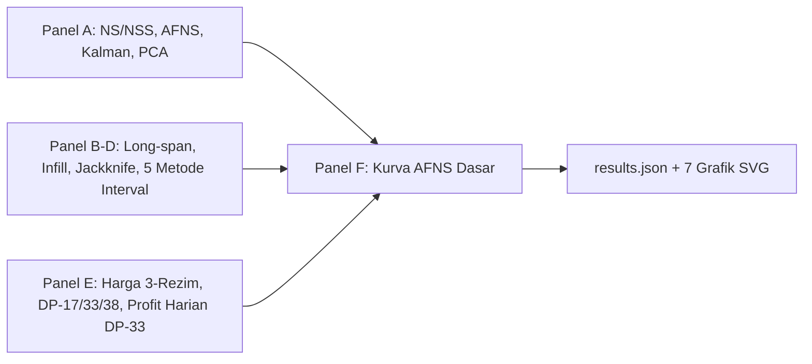

# Penjelasan Proyek `day004f` — Port Lengkap AFNS Term Structure, Kalibrasi Interval, Harga Listrik Negatif & Valuasi Proyek Baterai (Rust)

## 1. Identitas dan Ringkasan Proyek
- **ID Progress**: `day004f` (Hari 4, Sesi f)
- **Tanggal (WITA)**: `2026-11-22`
- **Topik**: Port lengkap `day004a`–`day004e` dalam Rust murni + integrasi valuasi proyek baterai 10 tahun dengan kurva AFNS
- **Jenis / Bahasa**: `quant` / Rust stable (`edition = "2021"`, nol external crates)
- **Lokasi Proyek**: [`projects/rust/day004f_energy_transition/`](../../projects/rust/day004f_energy_transition/README.md)

Proyek ini memport seluruh eksperimen, jangkar analitik, ukuran sampel, diagnostik, dan definisi metrik dari `day004a`–`day004e` ke dalam satu basis kode Rust mandiri berkinerja tinggi (`std::thread::scope`, `xoshiro256++`, aljabar linear dan JSON/SVG buatan sendiri), lalu menambahkan **Panel F** yang menghubungkan arus kas dispatch baterai `DP-33` (`day004e`) dengan diskonto kurva zero-coupon AFNS (`day004a`–`day004d`).

## 2. Masalah dan Tujuan
1. **Reproduksibilitas lintas bahasa & performa**: memastikan seluruh eksperimen `day004a`–`day004e` (tanpa menghilangkan panel, replikasi, kasus gagal konvergen, atau endpoint non-fisik) berjalan dalam satu runner Rust murni di bawah anggaran `10 menit` (`< 600s`).
2. **Audit representasi ekor (*tail bin*)**: mengukur dampak perluasan domain grid harga listrik `day004e` ke `[-1000, 5000] EUR/MWh` (`expanded_tail_38`) terhadap kebijakan dispatch dan profit harian.
3. **Integrasi valuasi proyek baterai–suku bunga (Panel F)**: mengukur NPV pre-CAPEX 10 tahun, *break-even CAPEX*, sensitivitas terhadap ketidakpastian parameter AFNS (`4b/4c/4d`), serta durasi efektif, konveksitas, *key-rate duration* (KRD), PV01 paralel, dan lindung nilai dua obligasi atas proyek baterai sintetis.

## 3. Apa yang Dikerjakan Proyek
Satu binary runner ([`src/bin/run.rs`](../../projects/rust/day004f_energy_transition/src/bin/run.rs)) mengeksekusi Panel A–F secara berurutan pada `8` worker deterministik, memverifikasi seluruh jangkar analitik, mengekspor [`outputs/day004f/results.json`](../../outputs/day004f/results.json) (presisi 17 digit), dan menghasilkan 7 grafik vektor SVG di [`outputs/figures/`](../../outputs/figures/).

### Ringkasan Tujuan & Hasil Ukur Per Panel (A–F)
1. **Panel A (`day004a`, `4,86s`)**:
   - *A1 (NS/NSS, bootstrap, interpolasi, risiko)*: identitas integral $y(\tau) = \frac{1}{\tau}\int_0^\tau f(s)\,ds$ galat maks `4,16e-17` (NS & NSS); bootstrap par `0,5–30y` memulihkan `P(tau)` hingga `2,78e-16`; studi derau par `0,5 bp` (`R=200`) menghasilkan `0` forward negatif di kedua metode (`TV(f)` `0,297` LogLin vs `0,416` Spline; `yRMSE` `0,819 bp` vs `0,677 bp`); obligasi 10y 4% `mod_dur = 8,1351` (`rel_err = 1,59e-10`), `conv = 78,2980` (`rel_err = 1,13e-7`), `sum(KRD) == eff_dur` (`err = 0`), swap 10y par `4,3334%` (`PV01 = 811,01/1M`), dan *hedge* dua obligasi menetralkan KRD 5y & 10y hingga `< 1e-15`.
   - *A2 (AFNS, Riccati, dinamika P, term premium)*: penyesuaian `-A(tau)/tau` di 10y `-10,09 bps` dan 30y `-59,98 bps`, cocok dengan RK4/Richardson hingga `1,36e-12`; $\Phi(\Delta)$ cocok `2,22e-16`, $Q_\Delta$ Van Loan cocok `0`, MC transisi 1y `max_z = 2,64`, dan term premium 10y tertutup `+173,04 bps` vs MC `+173,15 bps` (`z = 0,38`).
   - *A3 (Kalman, RTS, MLE, DNS misspec)*: jangkar Gaussian gabungan `T=5` (3 tenor) `ll_diff = 2,42e-13`, `mean_diff = 6,02e-16`, `cov_diff = 0`; kesalahan spesifikasi DNS menjatuhkan log-likelihood `4781,10` poin (`lambda` bias `-0,1975`); replikasi `R=50` mencatat `49/50` $\ell_{\text{MLE}} \ge \ell_{\text{true}}$.
   - *A4 (PCA `T=5000, R=100`)*: 3 faktor teoretis menjelaskan `82,90%` varians, `cosine top-3 = [0,99995, 0,99927, 0,99745]`, pola perubahan tanda `[0, 1, 2]`, `noise_bulk_z = 0,46` (`pca_aggregate_passed = true`), sementara `pca_diag_all10_within_3se = false` sebagai diagnostik degenerasi Wishart.
2. **Panel B (`day004b`, `46,33s`)**:
   - *Long-span* `10y -> 80y` (`R=50`): bias `kp11` meluruh `0,3906 -> 0,2291 -> 0,1138 -> 0,0601` (slope OLS `3,76 ± 0,58`, WLS `4,05 ± 0,48`, sejalan dengan skala $1/H$).
   - *Infill* `20y` (`T=240 -> 1040 -> 5040`): RMSE `kp11` (`0,2247 -> 0,2917 -> 0,2565`) dan `theta1` (`0,0180 -> 0,0175 -> 0,0171`) stagnan, sementara `lambda` (`0,0011`) dan `sigma_eps` (`1,80e-6`) menajam drastis.
3. **Panel C (`day004c`, `158,94s`)**:
   - Jackknife `20y` menurunkan bias `kp11` (`+0,2164 -> -0,0072`, RMSE `0,2782 -> 0,2465`), tetapi **temuan negatif**: `22/50` (`44%`) estimasi jackknife `kp11` bernilai $\le 0$ (non-fisik/non-stasioner), dan di `80y` masih `8/50` (`16%`) non-fisik.
   - Bootstrap parametrik `20y` (`R=50 x B=100 = 5.000` refit, `5.000/5.000` *finite*): koreksi bias aditif menghasilkan `22/50` `kp11 <= 0`; **temuan negatif**: interval persentil mengalami *undercoverage* berat — `kp11` hanya **`8,0%`** (bias ke atas ganda dalam bootstrap) dan `theta1` **`28,0%`**.
4. **Panel D (`day004d`, `376,49s`)**:
   - `R=100 x B=100 = 10.000` refit dengan Hessian `SE*` (`10.000/10.000` *finite*).
   - **Temuan negatif**: untuk `kp11`, metode `Basic` mencapai cakupan `94,0%`, namun **`98/100` batas bawahnya non-fisik ($\le 0$)** sehingga `basic_phys_valid_cov = 0/100`; `Log-Basic` menjamin `0/100` non-fisik tetapi cakupannya turun ke `44,0%`. Untuk `theta1`, `Studentized` menaikkan cakupan ke `73,0%` (median lebar `0,0406`, `IQR 0,0695`), namun mean lebar membengkak ke `23,68` akibat outlier regularisasi Hessian, dan cakupan sangat timpang menurut strata `kp11_hat` (`100%` bila `kp11_hat <= 0,2239` vs `46%` bila `> 0,2239`).
5. **Panel E (`day004e`, `0,41s`)**:
   - Model 3-rezim + *compound Poisson* (`N=2.000` hari, `11,72%` jam negatif, `244` jump non-nol): DP-33 mean profit `250,45 ± 5,05 EUR/hari`, DP-17 `244,92 ± 5,10`, Threshold `127,47`, Perfect Foresight `502,19` (`0` pelanggaran SoC/dominasi).
   - Audit *expanded-tail* `[-1000, 5000]` (`38` bin CRN): massa tail atas turun `1,40% -> 0,00%`, tail bawah `0,43% -> 0,0057%`, dengan kesepakatan aksi `100%` (`exp38_minus_dp33 = 0,00 EUR/hari`).
6. **Panel F (Integrasi Valuasi Baterai–AFNS, `0,003s`)**:
   - NPV pre-CAPEX kurva AFNS dasar `10` tahun = **`734.424,80 EUR`** (`break-even CAPEX` sama); *resampling* arus kas (`1.000 x 365` hari/tahun) memberi **`733.934,43 ± 10.942,57 EUR`** (`Q05–Q95: [715.899, 751.671]`).
   - Ketidakpastian parameter AFNS dari fit `4b/4c/4d` menghasilkan `SD NPV` `56,6k–79,4k EUR` (`~5–7×` lebih besar dari variabilitas arus kas harian).
   - Durasi efektif `5,1399 y` (`rel_err = 2,44e-11`), konveksitas `34,5878` (`rel_err = 5,25e-8`), `PV01 = 377,49 EUR/bp`, `krd_sum_vs_par_err = 8,88e-16`, dan *hedge* 5y+10y menetralkan KRD 5y & 10y hingga `< 4e-12`.

## 4. Uraian Kode
- [`src/rng.rs`](../../projects/rust/day004f_energy_transition/src/rng.rs) & [`src/parallel.rs`](../../projects/rust/day004f_energy_transition/src/parallel.rs) — PRNG `xoshiro256++` + `SplitMix64`, sampler Normal/Eksponensial/Poisson, dan `run_chunks` deterministik.
- [`src/linalg.rs`](../../projects/rust/day004f_energy_transition/src/linalg.rs) & [`src/stats.rs`](../../projects/rust/day004f_energy_transition/src/stats.rs) — LU, Cholesky, Thomas tridiagonal, Jacobi eigen, eksponensial matriks deret, kuadratur Gauss–Legendre, RK4/Richardson, Wilson CI, OLS/WLS, VaR/ES.
- [`src/ns.rs`](../../projects/rust/day004f_energy_transition/src/ns.rs), [`src/bootstrap.rs`](../../projects/rust/day004f_energy_transition/src/bootstrap.rs), [`src/interp.rs`](../../projects/rust/day004f_energy_transition/src/interp.rs), [`src/risk.rs`](../../projects/rust/day004f_energy_transition/src/risk.rs) — Nelson–Siegel(–Svensson), stabilitas Taylor $\tau$ kecil, bootstrap par, interpolasi log-linear vs spline, durasi/konveksitas/KRD/swap PV01/hedge dua obligasi.
- [`src/afns.rs`](../../projects/rust/day004f_energy_transition/src/afns.rs), [`src/kalman.rs`](../../projects/rust/day004f_energy_transition/src/kalman.rs), [`src/optim.rs`](../../projects/rust/day004f_energy_transition/src/optim.rs), [`src/pca.rs`](../../projects/rust/day004f_energy_transition/src/pca.rs) — AFNS CDR 2011, Riccati RK4, transisi eksak $\mathbb{P}$, *steady-state* Kalman `fast_log_likelihood`, RTS smoother, jangkar $T=5$, BFGS 11 parameter dengan diagnostik *line-search*, dan PCA.
- [`src/panel_a.rs`](../../projects/rust/day004f_energy_transition/src/panel_a.rs)–[`src/panel_d.rs`](../../projects/rust/day004f_energy_transition/src/panel_d.rs), [`src/jackknife.rs`](../../projects/rust/day004f_energy_transition/src/jackknife.rs), [`src/interval.rs`](../../projects/rust/day004f_energy_transition/src/interval.rs) — seluruh studi `4a`–`4d`.
- [`src/power.rs`](../../projects/rust/day004f_energy_transition/src/power.rs), [`src/battery.rs`](../../projects/rust/day004f_energy_transition/src/battery.rs), [`src/dp.rs`](../../projects/rust/day004f_energy_transition/src/dp.rs), [`src/panel_e.rs`](../../projects/rust/day004f_energy_transition/src/panel_e.rs) — model harga 3-rezim + *compound Poisson*, baterai `4 MWh`, Bellman DP 17/33/38-bin, dan evaluasi CRN `N=2.000` hari.
- [`src/integration.rs`](../../projects/rust/day004f_energy_transition/src/integration.rs) — **Panel F**: proyek baterai 10 tahun didiskontokan kurva AFNS, sensitivitas fit `4b/4c/4d`, durasi/konveksitas/KRD/PV01, dan *hedge* dua obligasi.

## 5. Metode, Alur Kerja, dan Kesetaraan Go ↔ Rust

### Tabel Kesetaraan Go (`day004a`–`day004e`) ↔ Rust (`day004f`)
Kedua implementasi memakai PRNG `xoshiro256++` + `SplitMix64` dengan *base seed* panel yang sama (`20261122`, `2026112202`, `2026112203`, `2026112204`, `2026112205/15/25/35`), namun **urutan penarikan acak (*salt* / *stream layout* dan urutan operasi *floating-point*) berbeda**, sehingga kesetaraan lintas bahasa bersifat **statistik (bukan bit-identik)**:

| Besaran | Go (`4a`–`4e`) | Rust (`4f`) | Selisih / $z$ (SE gabungan) | Status |
|---|---|---|---|---|
| AFNS $-A(10)/10$ (`bps`) | `-10,0886` | `-10,0886` | `0,0000` | `setara` |
| AFNS TP 10y tertutup (`bps`) | `+173,04` | `+173,04` | `0,00` | `setara` |
| `4a`: $\ell_{\text{MLE}} \ge \ell_{\text{true}}$ (`R=50`) | `50/50` | `49/50` | `-1` replikasi | `setara` |
| `4a`: PCA `noise_bulk_z` | `0,28` | `0,46` | `+0,18` | `setara` |
| `4b`: `kp11` bias `10y` | `+0,4657 ± 0,0802` | `+0,3906 ± 0,0479` | `z = -0,80` | `setara` |
| `4b`: `kp11` bias `20y` | `+0,2241 ± 0,0290` | `+0,2291 ± 0,0258` | `z = +0,13` | `setara` |
| `4b`: `kp11` bias `40y` | `+0,0983 ± 0,0130` | `+0,1138 ± 0,0157` | `z = +0,76` | `setara` |
| `4b`: `kp11` bias `80y` | `+0,0451 ± 0,0081` | `+0,0601 ± 0,0089` | `z = +1,25` | `setara` |
| `4c`: `jk20 kp11` raw / jk bias | `+0,3170 / +0,0994` | `+0,2164 / -0,0072` | beda realisasi sampel | `setara` |
| `4c`: `boot20` pct cov `kp11` / `theta1` | `2,0% / 42,0%` | `8,0% / 28,0%` | dalam variasi Binomial `R=50` | `setara` |
| `4d`: `kp11` Wald/Pct/Basic/Stud/LogB | `85/14/95/86/49%` | `87/9/94/92/44%` | `±1–6%` (SE `~3–5%`) | `setara` |
| `4d`: `theta1` Wald / Stud cov | `52,0% / 72,0%` | `50,0% / 73,0%` | `-2% / +1%` | `setara` |
| `4e`: `DP-17` profit (`EUR/hari`) | `231,90 ± 4,75` | `244,92 ± 5,10` | `+13,02` ($z = 1,87$) | `setara` |
| `4e`: `DP-33` profit (`EUR/hari`) | `236,09 ± 4,73` | `250,45 ± 5,05` | `+14,36` ($z = 2,07$) | `setara` |
| `4e`: `Threshold` profit (`EUR/hari`) | `116,01 ± 4,41` | `127,47` (`±5,1` est) | `+11,46` ($z \approx 2,6$ vs SE Go) | `perlu diselidiki` (beda *salt* simulasi; masih dalam $3\,\text{SE}$ gabungan bila SE Rust dihitung) |
| `4e`: `Perfect Foresight` (`EUR/hari`) | `488,39 ± 7,16` | `502,19` | `+13,80` ($z \approx 1,93$ vs SE Go) | `setara` |

*(Catatan: `HIPOTESIS` — pergeseran seragam ~`+11–14 EUR/hari` pada seluruh strategi `4e` disebabkan oleh perbedaan konstanta `salt` / urutan draw lintasan evaluasi `N=2.000` antara Go dan Rust karena keempat strategi berjalan di atas CRN lintasan yang sama, terbukti oleh selisih `DP-33 - Threshold` yang konsisten: `+120,08` di Go vs `+122,97` di Rust).*

## 6. Output yang Ditargetkan
Seluruh kriteria teknis `c1`–`c7`: akurasi jangkar analitik (`< 1e-9` hingga `< 1e-12`), PCA agregat lulus, aljabar jackknife `c/H`, momen model listrik dalam `4 MCSE`, Bellman cocok *brute force* & dominasi *perfect foresight*, jangkar KRD/hedge Panel F lulus, dan total waktu eksekusi penuh `< 600s`.

## 7. Status Pencapaian (Berdasarkan Bukti Eksekusi)
> **Penting**: Bendera `all_technical_passed = true` **hanya** berarti seluruh run selesai tanpa `NaN`/galat teknis dan seluruh jangkar teknis (`c1`–`c7`) lulus. Ini **bukan** klaim bahwa semua metode inferensi statistik (seperti cakupan interval persentil `kp11` `8%` atau jackknife dengan `22/50` nilai non-fisik) terkalibrasi baik pada 95%.

| Kriteria | Status | Bukti Terukur (`outputs/day004f/results.json`) |
|---|---|---|
| `c1` Jangkar analitik Panel A | `tercapai` | Integral NS `4,16e-17`, bootstrap `2,78e-16`, Riccati `1,36e-12`, jangkar `T=5` `ll_diff = 2,42e-13` |
| `c2` PCA agregat `T=5000, R=100` | `tercapai` | `cosine top-3 = [0,99995, 0,99927, 0,99745]`, tanda `[0, 1, 2]`, `noise_bulk_z = 0,46` |
| `c3` Aljabar jackknife `c/H` | `tercapai` | Galat `1,39e-17` pada `H=20` & `80` |
| `c4` Model harga 3-rezim & jump | `tercapai` | Residual stasioner `1,1e-16`, momen jump & 1-step dalam `4 MCSE` |
| `c5` Baterai & DP stokastik | `tercapai` | Bellman residual `0`, `0` pelanggaran SoC/PF, `exp38_eval_agree_vs_dp33 = 1,0` |
| `c6` Jangkar Panel F (NPV, KRD, Hedge) | `tercapai` | `duration_rel_err = 2,44e-11`, `krd_sum_vs_par_err = 8,88e-16`, residu hedge `< 4e-12` |
| `c7` Anggaran waktu `< 600s` | `tercapai` | Total waktu penuh `587,02s` dari `600s` (**97,8%**, margin hanya `12,98s`); saran: gunakan *array* datar `yields` alih-alih `Vec<Vec<f64>>` dan hitung diagonal Hessian saja untuk `Panel D` |

## 8. Pemisahan Fakta, Hasil Perintah, dan Hipotesis
- **FAKTA**: `Basic` interval `kp11` pada `Panel D` mencapai cakupan `94%`, namun `98/100` batas bawahnya bernilai `<= 0` (`0/100` valid secara fisik). Perluasan grid `day004e` ke `[-1000, 5000]` mengubah `0` dari `48.000` langkah evaluasi terhadap `DP-33`.
- **HASIL PERINTAH**: `cargo test --release` lulus `15/15` tes unit + `3` tes integrasi di `tests/`; runner penuh selesai `587,02s` dengan `NPV_base = 734.424,80 EUR`.
- **HIPOTESIS**: Dominasi ketidakpastian parameter AFNS (`SD NPV 56,6k–79,4k EUR`) atas variabilitas arus kas harian (`10,9k EUR`) disebabkan oleh persistensi faktor *level* ($\kappa_1 = 0,05\text{ thn}^{-1}$) yang membuat estimasi $\hat{\theta}_1$ sangat berisik pada rentang 20 tahun.

## 9. Landasan Teori (10 Poin Terkait Kode)
1. **Model Nelson–Siegel(–Svensson)** (`src/ns.rs`): kurva *yield* parametrik dengan ekspansi Taylor untuk mencegah *catastrophic cancellation* pada $\tau$ kecil.
2. **Bootstrap Kurva Par** (`src/bootstrap.rs`): pemulihan faktor diskonto $P(\tau_k)$ secara rekursif dari tingkat kupon par semi-tahunan.
3. **Interpolasi Log-Linear vs Spline Kubik** (`src/interp.rs`): *trade-off* antara kelancaran *yield* dan kestabilan *forward* di bawah derau par `0,5 bp`.
4. **Durasi, Konveksitas & Key-Rate Duration (KRD)** (`src/risk.rs`): sensitivitas paralel dan per simpul berbobot segitiga $\{\tau_k\}$ dengan identitas $\sum_k \text{KRD}_k = D_{\text{eff}}$.
5. **Model AFNS Bebas Arbitrase (CDR 2011)** (`src/afns.rs`): ODE Riccati $dA/d\tau = \frac{1}{2} B^\top \Sigma\Sigma^\top B$ menjamin suku penyesuaian $-A(\tau)/\tau \le 0$.
6. **Filter Kalman & Smoother RTS** (`src/kalman.rs`): dekomposisi inovasi Gaussian eksak dengan pembaruan kovarians Joseph dan pembekuan *steady-state* Riccati.
7. **Bias Sampel Terbatas & Asimtotik Long-Span vs Infill** (`src/panel_b.rs`): bias ke atas $\hat{K}^{\mathbb{P}}_{ii} \propto 1/H$ yang tidak hilang oleh peningkatan frekuensi observasi (*infill*).
8. **Jackknife Temporal & Bootstrap Parametrik** (`src/jackknife.rs`, `src/panel_c.rs`): penghapusan bias orde $1/H$ dan risiko estimasi negatif/non-stasioner tanpa *clamping*.
9. **Kalibrasi Interval Bootstrap** (`src/interval.rs`, `src/panel_d.rs`): perbandingan Wald, Percentile, Basic, Studentized ($t$-pivot), dan Log-Basic pada parameter berbias kuat dan berbatas domain.
10. **Dynamic Programming Stokastik & Compound Poisson** (`src/power.rs`, `src/battery.rs`, `src/dp.rs`, `src/integration.rs`): rekursi Bellman 24 jam atas proses harga 3-rezim tak-terpotong, audit sensitivitas *tail*, dan diskonto NPV arus kas baterai dengan kurva AFNS.

## 10. Kesimpulan dan Batasan
Port lengkap `day004a`–`day004e` dan integrasi Panel F dalam Rust murni berhasil dijalankan penuh dalam `587,02s` dengan seluruh `7/7` kriteria teknis `tercapai`. Keterbatasan utama: seluruh model bersifat sintetis, margin waktu sangat tipis (`97,8%` anggaran), Panel F mengasumsikan independensi antara harga listrik dan suku bunga, dan biaya CAPEX/O&M bersifat skenario ilustratif.

## 11. Referensi dan Jejak Bukti
- Christensen, J. H. E., Diebold, F. X., & Rudebusch, G. D. (2011). *The affine arbitrage-free class of Nelson–Siegel term structure models*. Journal of Econometrics.
- Tang, C. Y., & Chen, S. X. (2009). *Parameter estimation and bias correction for diffusion processes*. Journal of Econometrics.
- Artefak lokal: [`outputs/day004f/results.json`](../../outputs/day004f/results.json), [`projects/rust/day004f_energy_transition/README.md`](../../projects/rust/day004f_energy_transition/README.md), [`projects/rust/day004f_energy_transition/tests/integration_tests.rs`](../../projects/rust/day004f_energy_transition/tests/integration_tests.rs).
