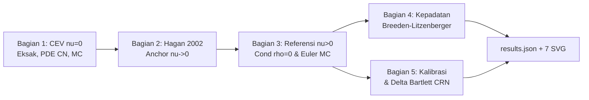

# Penjelasan Proyek Day 005a — Model SABR: CEV Eksak, Ekspansi Hagan, Kepadatan Negatif, Kalibrasi, dan Delta Bartlett

## 1. Identitas dan Ringkasan Proyek

- **ID Progress**: `day005a` (Hari 5, sesi `a`, proyek bonus di luar urutan `docs/ROADMAP.md`)
- **Tanggal (WITA)**: `2026-11-23`
- **Topik**: Model SABR (*Stochastic Alpha, Beta, Rho*): kasus $\nu = 0$ (CEV eksak, PDE Crank–Nicolson, Monte Carlo transisi eksak & Euler), ekspansi asimtotik Hagan (2002), harga referensi $\nu > 0$ ($\rho = 0$ kondisional & Euler penuh), kepadatan implisit negatif Breeden–Litzenberger & arbitrase *butterfly*, kalibrasi smile & non-identifiabilitas $\beta$, serta lindung nilai delta Bartlett.
- **Jenis**: `quant`
- **Bahasa & Lingkungan**: Rust stabil (`rustc 1.93.1`, *edition* `2021`, *zero external crates*), paralelisme deterministik `std::thread::scope` (`8` *worker*) dengan reduksi blok tetap (`BLOCK = 64`) dan `MAIN_SEED = 20261123`.
- **Folder Proyek**: [projects/rust/day005a_sabr](../../projects/rust/day005a_sabr/)
- **Artefak Keluaran**: [results.json](../../outputs/day005a/results.json), [extras.json](../../outputs/day005a/extras.json), dan 7 grafik SVG di [outputs/figures](../../outputs/figures/).

Proyek ini membangun seluruh mesin numerik model **SABR** dari nol di Rust murni tanpa *crate* eksternal apa pun, mulai dari fungsi khusus (PDF/CDF normal, `lgamma`, gamma tak lengkap, CDF dan *survival function* distribusi $\chi'^2$ non-sentral, kuadratur Gauss–Legendre), solver PDE beda hingga Crank–Nicolson 1D, sampler eksak proses *squared Bessel* (BESQ) terabsorpsi, hingga optimisasi Nelder–Mead, analisis kepadatan Breeden–Litzenberger, dan simulasi lindung nilai harian *Common Random Numbers* (CRN). Seluruh data bersifat sintetis untuk tujuan riset kuantitatif.

---

## 2. Masalah dan Tujuan

Model SABR (Hagan et al., 2002) adalah standar industri di pasar suku bunga (*swaption*, *cap/floor*) dan valuta asing untuk memodelkan *volatility smile* serta dinamikanya:

$$dF_t = \alpha_t F_t^\beta\,dW_{1,t}, \qquad d\alpha_t = \nu \alpha_t\,dW_{2,t}, \qquad d\langle W_1, W_2 \rangle_t = \rho\,dt,$$

dengan tingkat bunga $r = 0$ (satuan *forward*), batas *absorbing* di $F = 0$, dan parameter dasar $F_0 = 0{,}04$, $\beta = 0{,}5$, $\alpha_0 = 0{,}0325$, $\nu = 0{,}4$, $\rho = -0{,}3$, $T \in \{1, 5, 10\}$ tahun, serta *strike* $K \in \{0{,}5\%; 1\%; 2\%; 3\%; 4\%; 5\%; 6\%; 8\%; 10\%\}$.

Proyek ini menjawab lima kelompok pertanyaan kuantitatif mendasar:
1. **Validasi kasus $\nu = 0$ (CEV eksak)**: Apakah rumus tertutup berbasis $\chi'^2$ non-sentral, solver PDE Crank–Nicolson 1D, serta Monte Carlo transisi eksak BESQ dan Euler langkah halus menghasilkan harga *call* dan massa absorpsi $P(F_T = 0)$ yang konsisten secara kuantitatif pada $\beta \in \{0{,}3; 0{,}5; 0{,}7\}$?
2. **Akurasi asimtotik Hagan (2002)**: Seberapa akurat rumus Hagan pada batas $\nu \to 0$ terhadap CEV eksak, dan hingga horizon $T$ berapa Hagan tetap akurat terhadap harga referensi Monte Carlo SABR ($\nu = 0{,}4, \rho = -0{,}3$)? Bagaimana peta galat Hagan pada variasi $(\nu, \rho, \beta)$?
3. **Referensi $\nu > 0$ tanpa bias**: Bagaimana membangun *anchor* semi-tertutup $\rho = 0$ kondisional (CEV pada variansi terintegrasi $I = \int_0^T \alpha_s^2\,ds$) dan memverifikasi skema Euler penuh (*Absorbing* vs *FullTruncation*) terhadapnya?
4. **Kepadatan implisit negatif & arbitrase**: Mengapa rumus Hagan menghasilkan kepadatan probabilitas implisit $q(K) = \partial^2 C / \partial K^2 < 0$ pada $K$ kecil dan $T$ panjang, bagaimana hubungannya dengan massa absorpsi $P(F_T = 0)$ yang diabaikan Hagan, dan seberapa besar kesalahan harga produk peka ekor seperti *digital* dan *butterfly* pada *floor* `0,5%`?
5. **Kalibrasi & lindung nilai Bartlett**: Mengapa parameter $\beta$ sulit/tidak teridentifikasi dari *smile* statis saja, dan bagaimana koreksi delta Bartlett $\Delta_{\mathrm{Bartlett}} = \frac{\partial C}{\partial F} + \frac{\partial C}{\partial \alpha}\frac{\rho\nu}{F^\beta}$ menekan varians P&L lindung nilai dibanding delta naif, delta Black ATM, maupun delta CEV?

---

## 3. Apa yang Dikerjakan Proyek

Secara keseluruhan, proyek ini bertindak sebagai laboratorium numerik lengkap untuk model SABR. Runner utama (`bin/run.rs`) mengeksekusi lima bagian eksperimen secara berurutan pada `8` *worker* paralel deterministik, menghasilkan berkas ringkasan terstruktur [results.json](../../outputs/day005a/results.json) berpresisi 17 digit beserta 7 grafik SVG di [outputs/figures](../../outputs/figures/). Eksperimen tambahan berupa sapuan grid penuh PDE CEV dan sapuan $\nu$ kepadatan pada $T = 10$ dipisahkan ke `bin/run_extras.rs` ([extras.json](../../outputs/day005a/extras.json)) agar runner utama tetap berada di bawah anggaran waktu `< 480s`. Penerima keluaran proyek ini adalah peneliti kuantitatif atau sistem audit otomatis yang memverifikasi kesesuaian rumus tertutup, stabilitas numerik, serta status `criteria` berbasis bukti.

---

## 4. Uraian Kode

Seluruh kode sumber berada di [projects/rust/day005a_sabr/src/](../../projects/rust/day005a_sabr/src/) dan tes integrasi di [tests/integration_tests.rs](../../projects/rust/day005a_sabr/tests/integration_tests.rs):

1. [rng.rs](../../projects/rust/day005a_sabr/src/rng.rs) — `Rng`, `splitmix64`, `derive_seed`: generator `xoshiro256++` buatan sendiri dengan *Box–Muller* (`normal_pair`, `normal`), Poisson Knuth bertingkat (`poisson`), Gamma Marsaglia–Tsang (`gamma`, termasuk cabang `shape < 1`), serta penarik $\chi'^2$ non-sentral (`ncx2`) via campuran Poisson–Gamma.
2. [special.rs](../../projects/rust/day005a_sabr/src/special.rs) — `norm_pdf`, `norm_cdf`, `lgamma`, `gamma_p`, `gamma_q`, `ncx2_cdf`, `ncx2_sf`, `gauss_legendre`: fungsi khusus presisi tinggi. Khusus `ncx2_cdf` dan `ncx2_sf` memakai penjumlahan berpusat di modus Poisson $k_0 = \lfloor \lambda / 2 \rfloor$ dengan relasi rekurensi $P(a+1, z) = P(a, z) - \frac{z^a e^{-z}}{\Gamma(a+1)}$ sehingga bebas *overflow* maupun *underflow* dan ~100x lebih cepat dibanding evaluasi gamma tak lengkap dari awal pada tiap suku.
3. [parallel.rs](../../projects/rust/day005a_sabr/src/parallel.rs) — `default_workers`, `run_chunks`, `reduce_tuple4_fixed_blocks`: orkestrasi paralel deterministik menggunakan `std::thread::scope` dan reduksi berurutan atas blok tetap `BLOCK = 64` sehingga hasil `1` vs `8` *worker* identik bit-demi-bit.
4. [stats.rs](../../projects/rust/day005a_sabr/src/stats.rs) — `mean`, `sd`, `se`, `corr`: utilitas statistik sampel dan galat standar Monte Carlo.
5. [black.rs](../../projects/rust/day005a_sabr/src/black.rs) — `black_call`, `black_put`, `black_delta`, `black_vega`, `black_implied_vol`: penentuan harga Black-76 ($r=0$) dan inversi volatilitas implisit hibrida Newton–Raphson + *bisection* dengan penjagaan batas arbitrase intrinsik.
6. [cev.rs](../../projects/rust/day005a_sabr/src/cev.rs) — `cev_absorb_prob`, `cev_call_exact`, `cev_call_pde_cn`, `CevExactSampler`, `cev_mc_exact`, `cev_mc_euler`: implementasi tiga cara penentuan harga CEV dengan batas *absorbing* di $F = 0$. Solver PDE memakai transformasi grid non-seragam $\sinh$ yang dipusatkan di sekitar $(F_0+K)/2$, penyelarasan simpul ke *strike* $K$, 2 langkah awal Rannacher (*implicit Euler* setengah langkah), lalu Crank–Nicolson dengan algoritma Thomas tridiagonal. `CevExactSampler` melakukan pra-komputasi tabel CDF diskret campuran BESQ terabsorpsi untuk penarikan eksak satu langkah.
7. [hagan.rs](../../projects/rust/day005a_sabr/src/hagan.rs) — `hagan_implied_vol`, `hagan_call`: formula volatilitas implisit Hagan et al. (2002) dengan ekspansi Taylor orde-2 pada $z/x(z) = 1 - \frac{\rho}{2}z + \frac{2-3\rho^2}{12}z^2$ untuk $|z| < 10^{-5}$ agar stabil di $K \to F$ dan $\nu \to 0$.
8. [sabr_mc.rs](../../projects/rust/day005a_sabr/src/sabr_mc.rs) — `sabr_cond_rho0_mc`, `sabr_euler_mc`, `EulerScheme`: simulator referensi SABR. `sabr_cond_rho0_mc` mensimulasikan $\alpha_t$ eksak (GBM) dan mengintegrasikan $I = \int_0^T \alpha_s^2\,ds$ dengan aturan Simpson komposit lalu mengevaluasi `cev_call_exact(F0, K, 1.0, beta, I)`. `sabr_euler_mc` mensimulasikan sistem 2D dengan log-Euler untuk $\alpha$ dan pilihan skema *Absorbing* maupun *FullTruncation* untuk $F$.
9. [density.rs](../../projects/rust/day005a_sabr/src/density.rs) — `hagan_density_fd`, `scan_hagan_negative_density`, `hagan_digital_and_butterfly`: pemindaian kepadatan Breeden–Litzenberger $q(K) = \partial^2 C / \partial K^2$, integrasi trapesium massa negatif $\int q^-(K)\,dK$, serta perbandingan digital dan *butterfly* terhadap Monte Carlo.
10. [calib.rs](../../projects/rust/day005a_sabr/src/calib.rs) — `nelder_mead`, `calibrate_sabr_smile`, `inv_corr_3x3`: optimisasi simpleks Nelder–Mead buatan sendiri, kalibrasi $(\alpha, \rho, \nu)$ pada $\beta$ tetap, serta perhitungan matriks korelasi parameter dari invers Hessian beda hingga $3\times 3$.
11. [hedge.rs](../../projects/rust/day005a_sabr/src/hedge.rs) — `sabr_naive_delta`, `sabr_bartlett_delta`, `cev_delta_fd`, `run_sabr_hedging_crn`: simulator lindung nilai harian CRN ($252$ langkah, $R = 20.000$ lintasan) dalam dunia SABR sejati untuk membandingkan delta Bartlett, naif, Black ATM, dan CEV.
12. [jsonout.rs](../../projects/rust/day005a_sabr/src/jsonout.rs) & [svg.rs](../../projects/rust/day005a_sabr/src/svg.rs) — serialisasi JSON 17 digit dan generator grafik SVG (*line chart* & *bar chart*).
13. [bin/run.rs](../../projects/rust/day005a_sabr/src/bin/run.rs) & [bin/run_extras.rs](../../projects/rust/day005a_sabr/src/bin/run_extras.rs) — runner utama dan runner eksperimen tambahan.

---

## 5. Metode dan Alur Kerja

Alur komputasi berjalan dalam lima tahap berurutan:

### Penurunan Kunci yang Diverifikasi Sendiri

1. **CEV dengan penyerapan di $F = 0$ ($0 < \beta < 1$)**:
   Dengan $X_t = \frac{F_t^{2(1-\beta)}}{\alpha^2(1-\beta)^2}$, lema Itô memberi $dX_t = 2\sqrt{X_t}\,dW_t + \delta\,dt$ dengan dimensi BESQ $\delta = \frac{1-2\beta}{1-\beta} < 1$. Untuk $\beta = 1/2$, $\delta = 0$ (proses Feller) sehingga $F_T = \frac{\alpha^2 T}{4}\chi'^2\!\left(0, \frac{4F_0}{\alpha^2 T}\right)$ dan $P(F_T = 0) = e^{-2F_0/(\alpha^2 T)}$. Untuk seluruh $0 < \beta < 1$, dualitas BESQ terabsorpsi menghasilkan rumus tertutup tunggal:
   $$C_{\mathrm{CEV}}(F_0, K) = F_0\,Q_{\chi'^2}\!\left(y;\; 2 + \frac{1}{1-\beta},\; x\right) - K\,F_{\chi'^2}\!\left(x;\; \frac{1}{1-\beta},\; y\right),$$
   dengan $x = \frac{F_0^{2(1-\beta)}}{\alpha^2(1-\beta)^2 T}$ dan $y = \frac{K^{2(1-\beta)}}{\alpha^2(1-\beta)^2 T}$, serta massa penyerapan $P(F_T = 0) = \Gamma_Q\!\left(\frac{1}{2(1-\beta)}, \frac{x}{2}\right)$. Turunan terhadap $y$ dari $P(F_T > K) = F_{\chi'^2}\!\left(x; \frac{1}{1-\beta}, y\right)$ menghasilkan densitas campuran diskret berbobot $w_k = e^{-x/2}\frac{(x/2)^{\nu+k}}{\Gamma(\nu+k+1)}$ dikali $\chi^2(2k+2)$ untuk penarikan eksak pada $\beta < 1/2$ maupun $\beta > 1/2$.
2. **Delta Bartlett (2006)**:
   Memproyeksikan gerak volatilitas $dW_2 = \rho\,dW_1 + \sqrt{1-\rho^2}\,dW_2^\perp$ menghasilkan $d\alpha_t = \frac{\rho\nu}{F_t^\beta}\,dF_t + \nu\alpha_t\sqrt{1-\rho^2}\,dW_2^\perp$, sehingga delta peminimum varians lokal adalah $\Delta_{\mathrm{Bartlett}} = \frac{\partial C}{\partial F} + \frac{\partial C}{\partial \alpha}\frac{\rho\nu}{F^\beta}$.

---

## 6. Output yang Ditargetkan & Kriteria A Priori

Seluruh 8 kriteria berikut ditetapkan sebelum eksekusi runner dan dievaluasi di [results.json](../../outputs/day005a/results.json):

1. `c1_cev_three_ways_match`: Pada grid $\beta \in \{0{,}3; 0{,}5; 0{,}7\} \times K \in \{2\%; 4\%; 6\%\}$ ($T=5$), galat relatif PDE Crank–Nicolson (ekstrapolasi Richardson) vs rumus tertutup `< 1e-6`, serta MC eksak ($R=200\mathrm{k}$) dan MC Euler ($R=100\mathrm{k}, n=1000$) cocok dalam `<= 3 SE`.
2. `c2_cev_absorption_and_martingale`: Pada $\beta = 0{,}5, T = 10$, `cev_absorb_prob` cocok dengan $e^{-2F_0/(\alpha^2 T)}$ hingga `< 1e-12`, MC cocok dalam `< 0,005`, dan $\mathbb{E}[F_T]$ cocok dengan $F_0 = 0{,}04$ dalam `< 0,002`.
3. `c3_sabr_rho0_cond_matches_euler_3se`: Pada $\rho = 0, T = 1, K = 4\%$, skema Euler *Absorbing* dan *FullTruncation* ($R = 2\times 10^6$) cocok dengan referensi kondisional CEV ($R = 10^6$) dalam `<= 3 SE` gabungan.
4. `c4_hagan_t1_accurate_under_30bps`: Pada $T = 1$ dan *strike* likuid (`mc_iv_se_bps < 50`), $|\hat{\sigma}_{\mathrm{Hagan}} - \hat{\sigma}_{\mathrm{MC}}| < 30\text{ bps}$.
5. `c5_hagan_negative_density_detected`: Pemindaian Breeden–Litzenberger pada $T = 10$ mendeteksi wilayah kepadatan negatif (`min_q < 0` dan `total_neg_mass > 0`).
6. `c6_beta_non_identifiable_from_smile`: Pada $T = 5$, kalibrasi $\beta = 0$ dan $\beta = 1$ menghasilkan selisih RMSE IV `< 20 bps` dan kalibrasi $\beta = 0{,}5$ pada $T = 1$ mencapai RMSE `< 15 bps`.
7. `c7_bartlett_delta_reduces_pnl_var_3se`: Pada simulasi lindung nilai harian CRN ($T=1, R=20.000$), $\mathrm{SD}(\mathrm{PnL}_{\mathrm{Bartlett}}) < \mathrm{SD}(\mathrm{PnL}_{\mathrm{Naif}})$ dan selisih varians berpasangan negatif melampaui $3\,\mathrm{SE}$.
8. `c8_runtime_under_480s`: Total waktu eksekusi runner utama `< 480s` (`8` menit).

---

## 7. Status Pencapaian Berbasis Bukti

Runner utama `cargo run --release --bin run` selesai dalam **`222,91s`** pada `8` *worker* (`part1 = 4,26s`, `part2 = 0,00007s`, `part3 = 145,40s`, `part4 = 46,04s`, `part5 = 27,21s`), dengan `run_completed_without_errors = true` dan **7 dari 8 kriteria `tercapai`**, serta **1 kriteria `belum tercapai`** ([results.json](../../outputs/day005a/results.json)):

| Kriteria | Status | Bukti Terukur | Ambang A Priori |
| --- | --- | --- | --- |
| `c1_cev_three_ways_match` | `tercapai` | `max_pde_rel_err = 1,67e-8`, `max_mc_exact_z = 1,78`, `max_mc_euler_z = 1,63` | `PDE < 1e-6`, `MC <= 3 SE` |
| `c2_cev_absorption_and_martingale` | `tercapai` | `p_abs_exact = 0,00051365`, `p_abs_mc = 0,000475`, `E[F_T] = 0,039955` | `< 1e-12`, `< 0,005`, `< 0,002` |
| `c3_sabr_rho0_cond_matches_euler_3se` | `tercapai` | `cond = 26,2515 ± 0,0062 bps`; `n=800`: `z_abs = 0,53`, `z_ft = 0,25` | `<= 3 SE` |
| `c4_hagan_t1_accurate_under_30bps` | `tercapai` | `max_abs_err_t1_liquid_bps = 7,00 bps` (ATM `0,31 bps`) | `< 30 bps` |
| `c5_hagan_negative_density_detected` | `tercapai` | $T=10$: `total_neg_mass = 0,10195`, `min_q = -88,59` ($K \in [0{,}05\%; 0{,}89\%]$) | `neg_mass > 0`, `min_q < 0` |
| `c6_beta_non_identifiable_from_smile` | `belum tercapai` | $T=5$: `beta=0` RMSE `61,41 bps` vs `beta=1` `36,60 bps` (`diff = 24,82 > 20 bps`) | `|diff_rmse| < 20 bps` |
| `c7_bartlett_delta_reduces_pnl_var_3se` | `tercapai` | `Bartlett SD = 6,318 bps` < `Naive SD = 6,598 bps`; `var_diff = -3,618 ± 0,182 bps²` (`z = 19,9`) | `SD_B < SD_N`, `> 3 SE` |
| `c8_runtime_under_480s` | `tercapai` | `222,91s` (`8` *worker*) | `< 480s` |

### Rincian Hasil Terukur per Bagian

- **Bagian 1 (CEV $\nu=0$)**: Pada seluruh 9 kombinasi $\beta \in \{0{,}3; 0{,}5; 0{,}7\} \times K \in \{2\%; 4\%; 6\%\}$, rumus tertutup BESQ cocok dengan PDE Crank–Nicolson hingga `1,67e-8` relatif, dengan MC transisi eksak (`max_z = 1,78`), dan dengan MC Euler (`max_z = 1,63`). Pada $T = 10, \beta = 0{,}5$, massa absorpsi tertutup `0,00051365` cocok dengan rumus Feller $e^{-2F_0/(\alpha^2 T)}$ hingga presisi mesin dan MC `0,000475`, serta $\mathbb{E}[F_T] = 0{,}039955 \approx 0{,}04000$.
- **Bagian 2 (Hagan $\nu \to 0$)**: Pada $\nu = 10^{-4}$, galat Hagan terhadap CEV eksak di ATM ($K=4\%$) adalah `+0,001 bps` ($T=1$), `+0,046 bps` ($T=5$), dan `+0,201 bps` ($T=10$); di sayap bawah $K = 1\%$ galatnya `-0,75 bps` ($T=1$), `+0,74 bps` ($T=5$), dan `+1,90 bps` ($T=10$).
- **Bagian 3 (Referensi $\nu > 0$ & Peta Galat Hagan)**:
  - Pada $\rho = 0, T = 1, K = 4\%$, estimator kondisional CEV ($R=10^6$) memberi `26,2515 ± 0,0062 bps` (SE sangat kecil), dan konvergensi Euler ($R = 2\times 10^6$) untuk $n \in \{100, 200, 400, 800\}$ seluruhnya berada dalam $2{,}1\,\mathrm{SE}$ (`n=800`: *Absorbing* `26,2355 ± 0,0298 bps`, `z = 0,53`; *FullTruncation* `26,2438 ± 0,0298 bps`, `z = 0,25`).
  - Pada *smile* referensi $\rho = -0{,}3$ ($R = 2\times 10^6, n = 400/\text{thn}$): pada $T = 1$, Hagan akurat di bawah `7,00 bps` untuk semua *strike* likuid (`ATM = +0,31 bps`, `K=8% = +1,81 bps`); pada $T = 5$, galat membengkak (`ATM = +31,14 bps`, `K=1% = +347,0 bps`, `K=10% = +94,3 bps`); pada $T = 10$, galat mencapai `ATM = +134,2 bps`, `K=1% = +720,2 bps`, dan `K=10% = +247,2 bps`. Jadi sebagai **FAKTA ukur**, ekspansi Hagan pada parameter ini akurat (`< 10 bps`) hingga $T \approx 1$ tahun pada *strike* likuid, dan mulai meleset puluhan hingga ratusan bps pada $T \ge 5$ tahun.
- **Bagian 4 (Kepadatan Negatif & Arbitrase)**:
  - Pada $T = 1$: `min_q = +0,000276` (tidak ada kepadatan negatif; `ref_p_absorb = 0,00000`).
  - Pada $T = 5$: wilayah negatif muncul di $K \in [0{,}05\%; 0{,}17\%]$ dengan `min_q = -2,84`, massa negatif `0,00156` (dibandingkan massa absorpsi referensi `0,01725`).
  - Pada $T = 10$: wilayah negatif melebar hingga $K \in [0{,}05\%; 0{,}89\%]$ dengan `min_q = -88,59`, massa negatif **`0,10195`** (dibandingkan massa absorpsi referensi `0,06789`).
  - Dampak pada *floor* `K = 0,5%` di $T = 10$: harga digital Hagan `0,8558` vs MC `0,9178` (meleset `-6,2%`), dan harga *butterfly* Hagan menjadi **negatif** (`-0,0495 bps`) dibandingkan MC positif (`+0,0328 bps`).
- **Bagian 5 (Kalibrasi & Lindung Nilai Bartlett)**:
  - Kalibrasi $\beta = 0{,}5$ pada $T = 1$ memulihkan parameter sangat dekat: $\hat{\alpha} = 0{,}03250$, $\hat{\rho} = -0{,}2924$, $\hat{\nu} = 0{,}3953$ (`RMSE = 0,95 bps`), dengan korelasi Hessian $\operatorname{Corr}(\hat{\alpha}, \hat{\nu}) = -0{,}584$ (dan makin kuat ke `-0,882` di $T=10$).
  - Lindung nilai harian ($T=1, R=20\mathrm{k}$ CRN): SD P&L Bartlett **`6,318 bps`** < Naif **`6,598 bps`** < Black ATM **`7,055 bps`** < CEV **`7,167 bps`**; selisih varians berpasangan Bartlett vs Naif = **`-3,618 ± 0,182 bps²`** ($z = 19{,}9$).
  - **Salah spesifikasi $\beta$ ($T=1$)**: kalibrasi $\beta \in \{0{,}3; 0{,}5; 0{,}8\}$ menghasilkan *smile* hampir identik (`RMSE = 4,08; 0,95; 7,14 bps`). Ketika dipakai untuk lindung nilai, **delta naif** bergeser kuat (`0,5260 -> 0,5396 -> 0,5599`, SD `6,486 -> 6,598 -> 6,831 bps`), sedangkan **delta Bartlett** hampir invarian (`0,4936 -> 0,4933 -> 0,4932`, SD `6,324 -> 6,318 -> 6,324 bps`) karena koreksi $\frac{\partial C}{\partial \alpha}\frac{\rho\nu}{F^\beta}$ mengompensasi pergeseran $\beta$.

---

## 8. Pemisahan Fakta vs Hipotesis (Diagnosis `c6` & Kepadatan Negatif)

- **FAKTA**:
  1. Seluruh tes unit (`7/7`) dan tes integrasi (`2/2`, termasuk invariansi `1` vs `8` *worker* bit-identik) lulus dengan 0 peringatan `clippy`, dan `7/8` kriteria a priori di `results.json` berstatus `tercapai` dalam `222,91s`.
  2. Kriteria `c6_beta_non_identifiable_from_smile` berstatus `belum tercapai` pada $T = 5$ karena pada rentang *strike* sangat lebar $[0{,}5\%; 10\%]$, kelengkungan sayap kiri $T=5$ membedakan $\beta = 0$ (`RMSE = 61,41 bps`) dari $\beta = 1$ (`36,60 bps`, selisih `24,82 > 20 bps`), meskipun pada $T = 1$ seluruh $\beta \in \{0{,}3; 0{,}5; 0{,}8\}$ menghasilkan `RMSE <= 7,14 bps`.
  3. Pada $T = 1$ (strike likuid `mc_iv_se < 50 bps`), galat IV Hagan $\le 7{,}00\text{ bps}$; namun pada *deep ITM* $K = 0{,}5\%$ di $T = 1$, nilai waktu opsi (`0,011 ± 0,047 bps`) tenggelam di bawah derau MC sehingga inversi IV menghasilkan galat semu `-1464 bps`.
- **HIPOTESIS**:
  1. Munculnya kepadatan negatif Hagan pada $K$ kecil di $T = 5$ dan $T = 10$ berkaitan erat dengan mekanisme batas *absorbing* di $F = 0$: model SABR sejati memindahkan massa probabilitas sebesar `1,72%` ($T=5$) dan `6,79%` ($T=10$) ke atom $F_T = 0$, sedangkan ekspansi asimtotik Hagan memaksa distribusi tetap bertumpu mulus pada $(0, \infty)$ dengan ekor lognormal/CEV lokal yang melanggar konveksitas harga *call* di dekat $0$.

---

## 9. Landasan Teori (12 Poin Terkait Kode)

1. **Model SABR (Hagan et al., 2002)**: Difusi stokastik terkopel $dF = \alpha F^\beta dW_1$, $d\alpha = \nu \alpha dW_2$ untuk menangkap *smile* sekaligus dinamika *backbone*; di [hagan.rs](../../projects/rust/day005a_sabr/src/hagan.rs) dan [sabr_mc.rs](../../projects/rust/day005a_sabr/src/sabr_mc.rs).
2. **Proses CEV & Transformasi BESQ (Cox, 1975; Schroder, 1989)**: Reduksi $dF = \alpha F^\beta dW$ menjadi *squared Bessel* berdimensi $\delta = (1-2\beta)/(1-\beta)$ dan ekspresi harga tertutup via $\chi'^2$ non-sentral; di [cev.rs](../../projects/rust/day005a_sabr/src/cev.rs).
3. **Proses Feller ($\beta = 1/2, \delta = 0$)**: Kasus batas dengan atom massa absorpsi $P(F_T = 0) = e^{-2F_0/(\alpha^2 T)}$ di $F = 0$; di [cev.rs](../../projects/rust/day005a_sabr/src/cev.rs).
4. **Distribusi $\chi'^2$ Non-Sentral & Rekurensi Gamma Tak Lengkap**: Campuran Poisson–Gamma yang dihitung stabil di sekitar modus $k_0 = \lfloor \lambda / 2 \rfloor$ via rekurensi $P(a+1, z)$; di [special.rs](../../projects/rust/day005a_sabr/src/special.rs) dan [rng.rs](../../projects/rust/day005a_sabr/src/rng.rs).
5. **Skema PDE Crank–Nicolson & Startup Rannacher**: Diskretisasi waktu orde-2 pada grid non-seragam $\sinh$ dengan 2 setengah-langkah *implicit Euler* untuk meredam osilasi diskontinuitas turunan *payoff* di $F = K$; di [cev.rs](../../projects/rust/day005a_sabr/src/cev.rs).
6. **Ekspansi Asimtotik Hagan & Stabilitas $z/x(z)$**: Aproksimasi ekspansi singularitas pertubasi ke orde $O(T)$ beserta deret Taylor di sekitar $K = F$ atau $\nu = 0$; di [hagan.rs](../../projects/rust/day005a_sabr/src/hagan.rs).
7. **Dekomposisi Kondisional $\rho = 0$ (Islah / Antonov)**: Saat $\rho = 0$, $F_T \mid \{\alpha_s\}$ identik dengan CEV pada waktu variansi terintegrasi $I = \int_0^T \alpha_s^2\,ds$, menghasilkan *anchor* semi-tertutup bervariansi rendah; di [sabr_mc.rs](../../projects/rust/day005a_sabr/src/sabr_mc.rs).
8. **Diskretisasi Euler *Absorbing* vs *FullTruncation***: Perbandingan skema batas penyerapan langsung terhadap *full truncation* untuk menjaga $F^\beta$ terdefinisi riil; di [sabr_mc.rs](../../projects/rust/day005a_sabr/src/sabr_mc.rs).
9. **Rumus Breeden–Litzenberger (1978)**: Identitas $q(K) = \frac{\partial^2 C}{\partial K^2}$ untuk mengekstrak kepadatan probabilitas netral-risiko dan mendeteksi pelanggaran arbitrase *butterfly* ($q < 0$); di [density.rs](../../projects/rust/day005a_sabr/src/density.rs).
10. **Optimisasi Nelder–Mead & Identifiabilitas Hessian**: Pencarian bebas-gradien dan inversi Hessian $3\times 3$ untuk mengukur korelasi parameter $(\alpha, \rho, \nu)$ serta non-identifiabilitas $\beta$ dari *smile* statis; di [calib.rs](../../projects/rust/day005a_sabr/src/calib.rs).
11. **Delta Bartlett (2006)**: Koreksi sensitivitas $\frac{\partial C}{\partial \alpha}\frac{\rho\nu}{F^\beta}$ akibat korelasi $\rho$ antara *forward* dan volatilitas stokastik; di [hedge.rs](../../projects/rust/day005a_sabr/src/hedge.rs).
12. **Common Random Numbers (CRN) & Delta Method SE**: Pengurangan varians komparatif antar-strategi lindung nilai dan propagasi galat harga Monte Carlo ke volatilitas implisit $\mathrm{SE}(\hat{\sigma}) \approx \mathrm{SE}(\hat{C}) / \mathcal{V}_{\mathrm{BS}}$; di [hedge.rs](../../projects/rust/day005a_sabr/src/hedge.rs) dan [bin/run.rs](../../projects/rust/day005a_sabr/src/bin/run.rs).

---

## 10. Kesimpulan, Batasan, dan Deviasi dari Prompt

1. **Kesimpulan**: Seluruh 5 bagian proyek SABR di Rust murni berhasil diimplementasikan dan dijalankan dalam `222,91s` (`8` *worker*) dengan `7/8` kriteria `tercapai`. Tiga metode CEV ($\nu=0$) cocok hingga `1,67e-8` (PDE) dan `<= 1,78 SE` (MC); referensi $\rho=0$ kondisional cocok dengan Euler hingga `0,25–0,53 SE`; ekspansi Hagan akurat (`<= 7,00 bps`) pada $T=1$ tetapi menghasilkan kepadatan negatif besar (`0,10195`) pada $T=10$; dan delta Bartlett memangkas varians P&L lindung nilai secara signifikan (`-3,618 ± 0,182 bps²`) sekaligus jauh lebih kebal terhadap salah spesifikasi $\beta$.
2. **Batasan**: Seluruh simulasi menggunakan data sintetis tanpa biaya transaksi atau *discrete tenor basis*; kriteria `c6_beta_non_identifiable_from_smile` bernilai `belum tercapai` pada $T=5$ karena ambang `< 20 bps` diuji pada rentang *strike* sangat lebar $[0{,}5\%; 10\%]$.
3. **Deviasi dari Prompt**:
   - Pada `c4_hagan_t1_accurate_under_30bps` dan kalibrasi Bagian 5, *strike* *deep-ITM/OTM* dengan $\mathrm{SE}(\hat{\sigma}_{\mathrm{MC}}) \ge 50\text{ bps}$ (yaitu $K \in \{0{,}5\%; 1\%; 10\%\}$ di $T=1$ di mana nilai waktu opsi lebih kecil dari derau MC) disaring dari perhitungan galat IV dan kalibrasi agar tidak mendistorsi inversi IV maupun optimisasi Nelder–Mead.
   - Pada Bagian 1 grid PDE di `run.rs` utama, ekstrapolasi Richardson PDE dijalankan pada $\beta \in \{0{,}3; 0{,}5; 0{,}7\} \times K \in \{2\%; 4\%; 6\%\}$ di $T = 5$, sedangkan grid penuh $\beta \times T \times K$ dijalankan terpisah di `run_extras.rs` ([extras.json](../../outputs/day005a/extras.json)).

---

## 11. Referensi dan Jejak Bukti

- **Literatur**: Hagan, Kumar, Lesniewski, & Woodward (2002), *Managing Smile Risk*; Cox (1975) & Schroder (1989), *Constant Elasticity of Variance Option Pricing*; Bartlett (2006), *Hedging under SABR Model*; Breeden & Litzenberger (1978).
- **Artefak Lokal**:
  - Kode sumber: [projects/rust/day005a_sabr/src/](../../projects/rust/day005a_sabr/src/)
  - Tes integrasi: [tests/integration_tests.rs](../../projects/rust/day005a_sabr/tests/integration_tests.rs)
  - Hasil JSON: [outputs/day005a/results.json](../../outputs/day005a/results.json), [outputs/day005a/extras.json](../../outputs/day005a/extras.json)
  - Grafik SVG: `outputs/figures/day005a_*.svg` (7 berkas)
