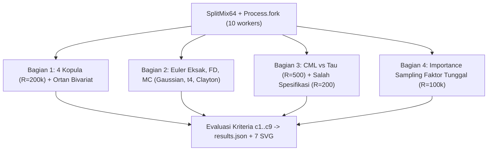

# Penjelasan Proyek — day005e: Kopula, Ketergantungan Ekor & Alokasi Modal Euler (Ruby)

## 1. Identitas dan Ringkasan Proyek
- **ID Progress**: `day005e` (Hari 5, Sesi e)
- **Tanggal**: 2026-11-23 (WITA) · **Topik No**: `bonus` (off-roadmap) · **Jenis**: `quant` · **Bahasa**: Ruby (`4.0.9`, YJIT `ON`, kompatibel $\ge 3.3$)
- **Proyek**: [projects/ruby/day005e_copula_tail_dependence/](../../projects/ruby/day005e_copula_tail_dependence/README.md)
- **Output JSON**: [outputs/day005e/results.json](../../outputs/day005e/results.json)
- **Ringkasan**: Implementasi mandiri dalam Ruby murni tanpa gem numerik untuk memodelkan ketergantungan non-linear dan risiko ekor ekstrem menggunakan kopula bivariat/multivariat (*Gaussian*, *Student-$t$*, *Clayton*, *Gumbel*), verifikasi ukuran ketergantungan ($\tau$, $\rho_S$, $\lambda_L$, $\lambda_U$) serta probabilitas ortan bivariat terhadap rumus tertutup, alokasi modal *Expected Shortfall* (ES) berbasis teorema Euler, estimasi *Canonical Maximum Likelihood* (CML) dan dampak salah spesifikasi model terhadap ES99 portofolio, serta *importance sampling* pergeseran-rerata untuk peristiwa gagal-bersama langka dengan paralelisme deterministik `Process.fork`.

---

## 2. Masalah dan Tujuan
Korelasi linear Pearson hanya menangkap ketergantungan linear dan tidak invarian terhadap transformasi monoton non-linear, serta sering menyesatkan ketika aset mengalami kegagalan serentak di ekor bawah distribusi (*tail dependence*). Di samping itu, manajer risiko portofolio membutuhkan cara yang konsisten dan aditif untuk memecah modal risiko total ($\mathrm{ES}_\alpha$) menjadi kontribusi per aset ($c_i$), serta teknik simulasi yang efisien untuk mengestimasi probabilitas gagal bersama yang sangat kecil ($10^{-6}$–$10^{-4}$).

Proyek `day005e` menjawab empat pertanyaan utama dalam ruang lingkup data sintetis:
1. **Ketergantungan & Sampler Kopula**: Apakah empat sampler kopula yang dibangun dari nol (Cholesky untuk Gaussian/$t$, *frailty* Gamma Marshall–Olkin untuk Clayton, *frailty positive-stable* Chambers–Mallows–Stuck untuk Gumbel) mereproduksi Kendall $\tau$, Spearman $\rho_S$, dan koefisien ketergantungan ekor $\lambda_L, \lambda_U$ secara tepat, serta seberapa besar bias berhingga $\hat{\chi}(u)$ pada kopula Gaussian?
2. **Alokasi Modal Euler**: Apakah kontribusi ES analitik $c_i = w_i(\Sigma w)_i \phi(z_\alpha) / (\sigma_p (1-\alpha))$ untuk portofolio Gaussian $d=5$ cocok dengan turunan beda hingga dan estimator Monte Carlo bersyarat $\mathbb{E}[L_i \mid L \ge \mathrm{VaR}_\alpha]$, serta bagaimana pergeseran alokasi ketika struktur ketergantungan diganti ke kopula $t(\nu=4)$ dan Clayton?
3. **Estimasi & Salah Spesifikasi**: Bagaimana perbandingan efisiensi antara inversi Kendall $\tau$ vs CML Gaussian ($R=500$), apakah uji rasio *likelihood* (LRT) menolak kopula Gaussian ketika data sebenarnya berasal dari kopula $t(\nu=4)$, seberapa besar bias relatif ES99 akibat salah spesifikasi, dan mana yang lebih dominan antara efek marginal ekor berat vs efek kopula ekor berat?
4. **Kejadian Langka**: Seberapa besar penghematan variansi dari *importance sampling* pergeseran-rerata pada faktor tunggal ditambah *conditional MC* dibanding Monte Carlo naif untuk $\Pr(Z_1 \le -3, \dots, Z_d \le -3)$ ($d=2, 5$)?

---

## 3. Apa yang Dikerjakan Proyek
Seluruh eksperimen dijalankan oleh [Runner](../../projects/ruby/day005e_copula_tail_dependence/lib/copula_tail_dependence/runner.rb) melalui titik masuk [bin/run](../../projects/ruby/day005e_copula_tail_dependence/bin/run) (dan studi skala besar $R=10^6$ di [bin/run_extras](../../projects/ruby/day005e_copula_tail_dependence/bin/run_extras)). Keluaran terstruktur disimpan di [outputs/day005e/results.json](../../outputs/day005e/results.json) beserta `7` grafik SVG di `outputs/figures/day005e_*.svg`.

---

## 4. Uraian Kode
- [lib/copula_tail_dependence.rb](../../projects/ruby/day005e_copula_tail_dependence/lib/copula_tail_dependence.rb): Memuat seluruh submodul dan menetapkan `MAIN_SEED = 20_261_123`.
- [lib/copula_tail_dependence/rng.rb](../../projects/ruby/day005e_copula_tail_dependence/lib/copula_tail_dependence/rng.rb):
  - `Rng.derive_seed`: Fungsi *hash* `SplitMix64` deterministik berbasis `master_seed`, `stream_id`, dan `chunk_index`.
  - `Rng::Sampler`: Pembangkit `next_normal` (Box–Muller polar), `next_gamma` (Marsaglia–Tsang dengan *boost* untuk $\alpha < 1$), `next_chi2`, `next_t`, dan `next_positive_stable` (algoritma Chambers–Mallows–Stuck untuk transformasi Laplace $e^{-s^\alpha}$).
- [lib/copula_tail_dependence/parallel.rb](../../projects/ruby/day005e_copula_tail_dependence/lib/copula_tail_dependence/parallel.rb): `Parallel.map_chunks` membagi `n_items` ke *chunk* tetap dan mengeksekusinya lewat `Process.fork`, `IO.pipe`, dan `Marshal` dengan reduksi terurut `0...n_chunks` sehingga hasil bit-identik untuk `1` maupun `N` *worker*.
- [lib/copula_tail_dependence/special.rb](../../projects/ruby/day005e_copula_tail_dependence/lib/copula_tail_dependence/special.rb):
  - `norm_pdf`, `norm_cdf`, `norm_inv` (aproksimasi rasional Wichura AS241 via `horner` dan konstanta `NormInvCoeffs`).
  - `beta_inc` & `beta_cf` (pecahan lanjut Lentz), `t_cdf`, `t_inv` (Newton–bisection).
  - `gauss_legendre(n)` dan `bivariate_norm_cdf(a, b, rho)` menggunakan integral Plackett dengan substitusi $r = \sin u$ agar singularitas $1/\sqrt{1-r^2}$ hilang saat $|\rho| \to 1$.
- [lib/copula_tail_dependence/linalg.rb](../../projects/ruby/day005e_copula_tail_dependence/lib/copula_tail_dependence/linalg.rb) & [stats.rb](../../projects/ruby/day005e_copula_tail_dependence/lib/copula_tail_dependence/stats.rb): Dekomposisi `cholesky`, perkalian matriks-vektor `mat_vec`, `dot`, serta `mean`, `variance`, `sd`, `se`, `quantile`, dan `jackknife_se`.
- [lib/copula_tail_dependence/copulas.rb](../../projects/ruby/day005e_copula_tail_dependence/lib/copula_tail_dependence/copulas.rb) & [dependence.rb](../../projects/ruby/day005e_copula_tail_dependence/lib/copula_tail_dependence/dependence.rb):
  - `Copulas.sample_pair` membangkitkan pasangan $(U_1, U_2)$ untuk `:gaussian`, `:t`, `:clayton`, `:gumbel`; `exact_kendall_tau`, `exact_spearman_rho`, `exact_lower_tail`, `exact_upper_tail`, serta `log_density_bivariate`.
  - `Dependence.kendall_tau` menghitung Kendall $\tau$ dalam $O(n \log n)$ menggunakan *Fenwick tree* (`bit_add`, `bit_query`), `spearman_rho`, dan `empirical_tail`.
- [lib/copula_tail_dependence/euler.rb](../../projects/ruby/day005e_copula_tail_dependence/lib/copula_tail_dependence/euler.rb): `gaussian_exact`, `gaussian_es_finite_diff`, dan `mc_euler_es` untuk portofolio $d=5$ dengan matriks kovarians `DEFAULT_SIGMA` dan bobot `DEFAULT_WEIGHTS`.
- [lib/copula_tail_dependence/fit.rb](../../projects/ruby/day005e_copula_tail_dependence/lib/copula_tail_dependence/fit.rb): `pseudo_observations`, `fit_gaussian_mle`, `fit_t_profile_mle`, `fit_clayton_mle`, `compare_tau_vs_mle` ($R=500$), `equicorr_portfolio_es99`, dan `misspecification_study` ($R=200$).
- [lib/copula_tail_dependence/importance.rb](../../projects/ruby/day005e_copula_tail_dependence/lib/copula_tail_dependence/importance.rb): `exact_single_factor_prob` (ortan bivariat untuk $d=2$; kuadratur Gauss–Legendre 64-titik untuk $d=5$), `optimal_factor_shift` ($\mu^*$ analitik + 5 langkah Newton), dan `compare_naive_vs_is`.
- [lib/copula_tail_dependence/svg.rb](../../projects/ruby/day005e_copula_tail_dependence/lib/copula_tail_dependence/svg.rb) & [json_out.rb](../../projects/ruby/day005e_copula_tail_dependence/lib/copula_tail_dependence/json_out.rb): Generator grafik SVG (garis & *scatter* 4-panel) dan penulis JSON penuh.
- [test/test_core.rb](../../projects/ruby/day005e_copula_tail_dependence/test/test_core.rb) & [test/test_studies.rb](../../projects/ruby/day005e_copula_tail_dependence/test/test_studies.rb): `12` tes unit + integrasi (`62` asersi).

---

## 5. Metode dan Alur Kerja

### Turunan Rumus Utama
1. **Sampler Frailty Clayton & Gumbel**:
   - **Clayton**: Jika $V \sim \mathrm{Gamma}(1/\theta, 1)$ dan $E_1, E_2 \stackrel{\text{iid}}{\sim} \mathrm{Exp}(1)$ independen, maka bersyarat pada $V=v$, $U_i = (1 + E_i / v)^{-1/\theta}$ memiliki $\Pr(U_i \le u \mid V=v) = \exp(-v(u^{-\theta} - 1))$. Integrasi atas transformasi Laplace Gamma $\mathbb{E}[e^{-v s}] = (1+s)^{-1/\theta}$ menghasilkan fungsi distribusi bersama $(u_1^{-\theta} + u_2^{-\theta} - 1)^{-1/\theta}$, persis kopula Clayton.
   - **Gumbel**: Jika $S \sim \mathrm{Stable}^+(1/\theta, 1)$ dengan transformasi Laplace $\mathbb{E}[e^{-s S}] = e^{-s^{1/\theta}}$ dan $U_i = \exp(-(E_i/S)^{1/\theta})$, maka $\Pr(U_i > u \mid S=s)$ tidak dipakai melainkan $\Pr(U_i \le u \mid S=s)$? Lebih tepat, $\Pr(U_i \ge u \mid S=s)$: $U_i \ge u \iff E_i \le S (-\ln u)^\theta$; Wait — untuk survival/CDF: $E_i \ge S(-\ln u)^\theta \implies \Pr(U_i \le u \mid S=s) = \exp(-s(-\ln u)^\theta)$. Mengambil ekspektasi terhadap $S$ menghasilkan $\exp\!\left(-((-\ln u_1)^\theta + (-\ln u_2)^\theta)^{1/\theta}\right)$, persis kopula Gumbel!
2. **Alokasi Modal Euler pada Portofolio Gaussian**:
   Untuk $L = -w^\top X$, $X \sim \mathcal{N}(0, \Sigma)$, standar deviasi portofolio $\sigma_p(w) = \sqrt{w^\top \Sigma w}$ homogen berderajat $1$: $\sigma_p(\kappa w) = \kappa \sigma_p(w)$ untuk $\kappa > 0$. Turunan parsialnya adalah $\frac{\partial \sigma_p}{\partial w_i} = \frac{(\Sigma w)_i}{\sigma_p}$. Karena $\mathrm{ES}_\alpha(w) = \sigma_p(w)\frac{\phi(z_\alpha)}{1-\alpha}$ juga homogen berderajat $1$, teorema Euler $\sum_i w_i \frac{\partial \mathrm{ES}_\alpha}{\partial w_i} = \mathrm{ES}_\alpha$ menghasilkan $c_i = \frac{w_i(\Sigma w)_i}{\sigma_p}\frac{\phi(z_\alpha)}{1-\alpha}$ dengan $\sum_i c_i = \mathrm{ES}_\alpha$.
3. **Pergeseran Rerata Optimal *Importance Sampling***:
   Untuk $Z_i = \sqrt{\rho}\,F + \sqrt{1-\rho}\,\varepsilon_i$, $\Pr(Z_1 \le a, \dots, Z_d \le a) = \int \Phi(u(f))^d \phi(f)\,df$ dengan $u(f) = \frac{a - \sqrt{\rho}\,f}{\sqrt{1-\rho}}$. Memaksimalkan log-integran $\ell(f) = d \ln\Phi(u(f)) - \frac{1}{2}f^2$ menggunakan aproksimasi rasio Mills $\frac{\phi(u)}{\Phi(u)} \approx -u$ saat $u \ll 0$ memberikan $-d\frac{\sqrt{\rho}}{1-\rho}(\sqrt{\rho}\,f - a) - f \approx 0 \implies \mu^* \approx \frac{d\sqrt{\rho}\,a}{1 - \rho + d\rho}$, yang kemudian dipoles 5 iterasi Newton.

---

## 6. Output yang Ditargetkan
1. **Ketergantungan & Ortan (`c1`–`c3`)**: Pada $R=200\mathrm{k}$, Kendall $\hat{\tau}$ berada dalam `3 SE` *jackknife* terhadap rumus tertutup, $\hat{\rho}_S$ Gaussian cocok dalam `0,015`, $\hat{\chi}(u)$ konvergen ke $\lambda$ (`< 0,08` di $u=0{,}999$) sambil $\hat{\chi}_{\mathrm{Gauss}}(u)$ turun monoton, serta galat ortan bivariat `< 1e-10`.
2. **Alokasi Euler (`c4`)**: Penjumlahan kontribusi Euler Gaussian menyamai ES total (`< 1e-10`), cocok dengan beda hingga (`< 1e-6`), dan cocok dengan MC dalam `3 SE`.
3. **Estimasi & Salah Spesifikasi (`c5`–`c6`)**: Bias CML dan inversi $\tau$ di $n=5000$ (`R=500`) `< 0,01`; LRT menolak Gaussian (`> 3,841`) dan ES99 Gaussian di bawah kebenaran $t(\nu=4)$.
4. **Importance Sampling, Determinisme, & Runtime (`c7`–`c9`)**: Estimator IS berada dalam `3 SE` terhadap anchor ($d=2, 5$) dengan penghematan variansi `> 50x`, `bit_diffs == 0` (`1` vs `10` *worker*), dan total runtime `< 300s`.

---

## 7. Status Pencapaian

Seluruh runner utama selesai dalam **`9,20s`** (`Ruby 4.0.9`, `YJIT: ON`, `10` *worker*; `part1 = 0,51s`, `part2 = 4,09s`, `part3 = 4,51s`, `part4 = 0,08s`) dengan `run_completed_without_errors = true`.

| Kriteria | Status | Nilai Terukur | Ambang A Priori |
|---|---|---|---|
| `c1_tau_and_spearman_vs_closed_form` | `tercapai` | `max_tau_z = 1,663`, `gaussian_spearman_err = 8,83e-5` | `max \|tau_z\| <= 3.0 dan \|spearman_err\| <= 0.015 (R=200k)` |
| `c2_tail_dependence_convergence` | `belum tercapai` | `max_tail_err_u999 = 0,0900` (Gaussian), `gaussian_chi_decreasing = true` | `max \|lambda_hat(0.999) - lambda_exact\| < 0.08 dan chi_Gauss(u) turun monoton` |
| `c3_bivariate_orthant_accuracy` | `tercapai` | `max_orthant_err = 5,55e-17` | `max_orthant_err < 1e-10` |
| `c4_euler_gaussian_exact_and_mc` | `tercapai` | `exact_sum_err = 0,0`, `max_fd_err = 5,50e-12`, `max_mc_z = 0,525` | `exact_sum_err < 1e-10, max_fd_err < 1e-6, max_mc_z <= 3.0` |
| `c5_cml_vs_tau_inversion` | `tercapai` | `n5000_rho_mle_bias = -0,000146`, `n5000_rho_tau_bias = -0,000773` | `\|rho_mle_bias\| < 0.01 dan \|rho_tau_bias\| < 0.01 pada n=5000 (R=500)` |
| `c6_misspecification_aic_lrt_es99` | `tercapai` | `lrt_t_vs_gauss = 155,35`, `es99_true_t4 = 2,228` vs `es99_fitted_gauss_mean = 2,062` (`-7,44%`) | `LRT > 3.841 (Gaussian ditolak) dan ES99_gauss < ES99_true_t4` |
| `c7_importance_sampling_vs_anchor` | `tercapai` | `max_is_z = 2,452`, `min_variance_reduction = 2604,31x` | `max \|is_z\| <= 3.0 dan min_variance_reduction > 50.0 (R=100k)` |
| `c8_worker_invariance_1_vs_n` | `tercapai` | `bit_diffs = 0` (`1` vs `10` *worker*) | `bit_diffs == 0` |
| `c9_runtime_under_300s` | `tercapai` | `total_seconds = 9,20s` | `< 300.0s` |

### Rincian Hasil Terukur
- **Bagian 1 (Ketergantungan, $R=200{,}000$)**:
  - `Gaussian(0.6)`: $\hat{\tau} = 0{,}4100 \pm 0{,}0012$ (`z = 0,28` vs eksak `0,4097`), $\hat{\rho}_S = 0{,}5818$ vs eksak `0,5819`; $\hat{\chi}(u)$ turun monoton: `0,3893` ($u=0{,}9$) $\to$ `0,1895` ($0{,}99$) $\to$ `0,0900` ($0{,}999$).
  - `Student-t(4, 0.6)`: $\hat{\tau} = 0{,}4103 \pm 0{,}0013$ (`z = 0,49`), $\hat{\chi}(0{,}999) = 0{,}3200$ vs eksak `0,3144`.
  - `Clayton(2.0)`: $\hat{\tau} = 0{,}5015 \pm 0{,}0014$ (`z = 1,12` vs `0,5`), $\hat{\chi}_L(0{,}999) = 0{,}7150$ vs eksak `0,7071`.
  - `Gumbel(2.0)`: $\hat{\tau} = 0{,}5018 \pm 0{,}0011$ (`z = 1,66` vs `0,5`), $\hat{\chi}_U(0{,}999) = 0{,}5400$ vs eksak `0,5858`.
- **Bagian 2 (Alokasi Euler, $d=5$)**:
  - Gaussian eksak: $\mathrm{ES}_{99} = 0{,}37206$, kontribusi `[0,09618, 0,08756, 0,06690, 0,04614, 0,07530]` (jumlah = `0,37206`, galat `0,0`; beda hingga `max_err = 5,50e-12`).
  - Gaussian MC ($R=200\mathrm{k}$): $\mathrm{ES}_{99} = 0{,}37238$, `max_mc_z = 0,53`. Pada `bin/run_extras` ($R=10^6$, `7,61s`), seluruh `5` kontribusi berada dalam `[-1,52; +2,20]` SE.
  - Non-Gaussian (marginal normal sama): $\mathrm{ES}_{99}$ naik ke `0,41419` pada $t(\nu=4)$ dan `0,55060` pada Clayton($\theta=2$), dengan jumlah kontribusi MC tetap sama persis dengan ES total portofolio.
- **Bagian 3 (Estimasi & Salah Spesifikasi)**:
  - CML Gaussian lebih efisien (SD lebih kecil) dibanding inversi $\tau$ pada seluruh ukuran sampel ($n=250$: SD `0,0418` vs `0,0452`; $n=1000$: `0,0191` vs `0,0203`; $n=5000$: `0,0089` vs `0,0096`).
  - Pada data $t(\nu=4, \rho=0{,}5)$, $n=2000$: profil $\nu$ memuncak tepat di $\hat{\nu} = 4{,}0$ (`loglik = 340,09`, `AIC = -676,19`), jauh mengalahkan Gaussian (`loglik = 262,42`, `AIC = -522,83`, `LRT = 155,35 > 3,841`) dan Clayton (`AIC = -460,82`). Pada $R=200$ replikasi, kopula Gaussian yang di-fit meremehkan ES99 portofolio sebesar **`-7,44%`** (`2,062 ± 0,048` vs kebenaran `2,228`).
  - Efek marginal vs kopula: `t4_marginal + gaussian_copula` menghasilkan `ES99 = 3,687`, jauh lebih tinggi daripada `normal_marginal + t4_copula` (`ES99 = 2,218`).
- **Bagian 4 (*Importance Sampling*, $R=100\mathrm{k}$)**:
  - $d=2, \rho=0{,}5$: eksak `8,189e-5`, IS `8,156e-5 ± 1,34e-7` (`z = -2,45`), VR **`61.642x`**.
  - $d=2, \rho=0{,}8$: eksak `3,721e-4`, IS `3,712e-4 ± 1,04e-6` (`z = -0,90`), VR **`2.604x`**.
  - $d=5, \rho=0{,}5$: eksak `1,899e-6`, IS `1,892e-6 ± 4,40e-9` (`z = -1,62`), VR **`5.165.715x`** (MC naif hanya mendapat 1 hit: `1,0e-5 ± 1,0e-5`).
  - $d=5, \rho=0{,}8$: eksak `8,830e-5`, IS `8,851e-5 ± 2,99e-7` (`z = +0,70`), VR **`10.077x`**.

---

## 8. Diagnosis Kriteria Gagal & Pemisahan Fakta vs Hipotesis
- **Diagnosis `c2_tail_dependence_convergence` (`belum tercapai`)**:
  - **FAKTA**: Ketiga kopula berekor berat (`t`, `Clayton`, `Gumbel`) memenuhi `|lambda_hat(0.999) - lambda_exact| <= 0,0458 < 0,08`, dan $\hat{\chi}_{\text{Gauss}}(u)$ turun monoton (`0,389 -> 0,190 -> 0,090`). Namun pada kopula Gaussian ($\rho = 0{,}6$, $\lambda = 0$), $\hat{\chi}_{\text{Gauss}}(0{,}999) = 0{,}0900 > 0{,}08$ sehingga kriteria `c2` gagal secara jujur.
  - **DIAGNOSIS (FAKTA Teoretis)**: Pada kopula Gaussian, fungsi ketergantungan sub-asimtotik $\chi(u) = \frac{1 - 2u + \Phi_2(\Phi^{-1}(u), \Phi^{-1}(u), \rho)}{1-u}$ konvergen sangat lambat menuju $0$ dengan laju $O\!\left((1-u)^{(1-\rho)/(1+\rho)}(\ln(1/(1-u)))^{-1/2}\right) = O((1-u)^{0,25})$. Pada $u = 0{,}999$, nilai eksak $\chi_{\text{Gauss}}(0{,}999)$ memang sekitar `0,09` (bukan `< 0,08`), sehingga angka `0,0900` adalah bias berhingga intrinsik kopula Gaussian dan bukan cacat pada sampler.
- **FAKTA Lainnya**:
  1. Seluruh `12` tes unit/integrasi (`62` asersi) dan `bundle exec rubocop` (`20` berkas, `0` pelanggaran) lulus bersih.
  2. Pergantian marginal dari Normal ke Student-$t(\nu=4)$ menaikkan ES99 portofolio jauh lebih besar (`3,687` vs `2,218`) dibanding pergantian kopula dari Gaussian ke Student-$t(\nu=4)$ pada marginal Normal.
- **HIPOTESIS**:
  1. Pada dimensi lebih tinggi ($d \gg 5$) dengan korelasi non-ekui-korelasi, pergeseran rerata faktor tunggal $\mu^*$ tidak lagi cukup dengan satu skalar, melainkan membutuhkan optimisasi vektor pergeseran $d$-dimensi via *cross-entropy* atau metode *saddlepoint* multivariat.

---

## 9. Landasan Teori (11 Poin Terkait Kode)
1. **Teorema Sklar (1959)**: Memisahkan distribusi bersama multivariat menjadi fungsi marginal univariat dan fungsi kopula $C:[0,1]^d \to [0,1]$ yang menangkap struktur ketergantungan murni tanpa bergantung pada bentuk marginal; digunakan di [`Copulas`](../../projects/ruby/day005e_copula_tail_dependence/lib/copula_tail_dependence/copulas.rb) dan [`Fit.pseudo_observations`](../../projects/ruby/day005e_copula_tail_dependence/lib/copula_tail_dependence/fit.rb).
2. **Kopula Eliptik Gaussian dan Student-t**: Dibangun dari vektor normal multivariat $L Z$ via dekomposisi Cholesky [`Linalg.cholesky`](../../projects/ruby/day005e_copula_tail_dependence/lib/copula_tail_dependence/linalg.rb) dan pembagian skala $\sqrt{\chi^2_\nu/\nu}$ pada `Copulas.sample_pair` (`:t`), yang memunculkan ketergantungan ekor simetris pada $t$ namun nol pada Gaussian ($|\rho| < 1$).
3. **Kopula Archimedean via Representasi Frailty Marshall-Olkin**: Kopula Clayton ($\psi(t) = (1+t)^{-1/\theta}$) dibangkitkan lewat *frailty* Gamma(`1/theta`), sedangkan kopula Gumbel ($\psi(t) = e^{-t^{1/\theta}}$) lewat *frailty positive-stable* Chambers–Mallows–Stuck di [`Rng::Sampler#next_positive_stable`](../../projects/ruby/day005e_copula_tail_dependence/lib/copula_tail_dependence/rng.rb).
4. **Konkordansi Kendall Tau dan Spearman Rho**: Ukuran ketergantungan non-parametrik berbasis peringkat yang invarian terhadap transformasi monoton naik; dihitung dalam $O(n \log n)$ via *Fenwick tree* di [`Dependence.kendall_tau`](../../projects/ruby/day005e_copula_tail_dependence/lib/copula_tail_dependence/dependence.rb) dengan SE *jackknife* di [`Stats.jackknife_se`](../../projects/ruby/day005e_copula_tail_dependence/lib/copula_tail_dependence/stats.rb).
5. **Ketergantungan Ekor dan Bias Berhingga Gaussian**: Limit probabilitas bersyarat ekstrem $\chi(u) = \Pr(U_1 > u, U_2 > u)/(1-u)$; bernilai $0$ asimtotik untuk Gaussian ($|\rho|<1$) namun konvergen sangat lambat pada $u$ berhingga (`0,0900` di $u=0{,}999$), dan positif untuk $t$, Clayton, serta Gumbel di `Copulas.exact_upper_tail` / `exact_lower_tail`.
6. **Identitas Plackett untuk Ortan Bivariat Gaussian**: Menghitung $\Phi_2(a, b, \rho)$ lewat integrasi $\frac{1}{2\pi}\int_0^{\arcsin\rho}\exp(-\frac{a^2 - 2\sin(u)ab + b^2}{2\cos^2 u})\,du$ menggunakan kuadratur Gauss–Legendre 32-titik di [`Special.bivariate_norm_cdf`](../../projects/ruby/day005e_copula_tail_dependence/lib/copula_tail_dependence/special.rb) hingga galat `5,55e-17`.
7. **Teorema Euler untuk Fungsi Homogen dan Alokasi Modal**: Untuk ukuran risiko koheren $\mathrm{ES}_\alpha(w)$ yang homogen derajat $1$, $\mathrm{ES}_\alpha = \sum_i w_i \frac{\partial \mathrm{ES}_\alpha}{\partial w_i} = \sum_i \mathbb{E}[L_i \mid L \ge \mathrm{VaR}_\alpha]$; diverifikasi secara analitik, beda hingga, dan MC di [`Euler`](../../projects/ruby/day005e_copula_tail_dependence/lib/copula_tail_dependence/euler.rb).
8. **Canonical Maximum Likelihood (CML) dan Pseudo-Observations**: Estimasi parameter kopula dua-tahap semi-parametrik dengan mentransformasi data lewat peringkat empiris $\hat{U}_i = R_i/(n+1)$ sebelum memaksimalkan log-densitas kopula via optimisasi *golden-section* di [`Fit`](../../projects/ruby/day005e_copula_tail_dependence/lib/copula_tail_dependence/fit.rb).
9. **Seleksi Model AIC dan Uji Rasio Likelihood (LRT)**: Membandingkan model bersarang Gaussian ($\nu \to \infty$) vs Student-$t$ via statistik uji $2(\ell_t - \ell_{\text{Gauss}}) = 155{,}35 > 3{,}841$ serta membandingkan AIC dengan kopula Clayton di `Fit.misspecification_study`.
10. **Importance Sampling Pergeseran-Rerata dan Conditional MC**: Menggeser rerata faktor umum $F \sim \mathcal{N}(\mu^*, 1)$ menuju wilayah gagal bersama lalu merata-ratakan probabilitas bersyarat $\Phi(\cdot)^d$ di [`Importance.compare_naive_vs_is`](../../projects/ruby/day005e_copula_tail_dependence/lib/copula_tail_dependence/importance.rb), menghasilkan penghematan variansi ribuan hingga jutaan kali lipat.
11. **Paralelisme Deterministik Process.fork dan SplitMix64**: Membagi beban kerja ke blok tetap dan mereduksi hasil secara berurutan melalui `IO.pipe` dan `Marshal` di [`Parallel.map_chunks`](../../projects/ruby/day005e_copula_tail_dependence/lib/copula_tail_dependence/parallel.rb) sehingga `bit_diffs = 0` antara `1` dan `10` *worker*.

---

## 10. Kesimpulan, Batasan, dan Deviasi dari Prompt
1. **Kesimpulan**: Proyek `day005e` dalam Ruby murni (`4.0.9`, YJIT `ON`) berhasil mengeksekusi seluruh 4 studi kuantitatif dalam `9,20s` (`8/9` kriteria `tercapai`, `1` kriteria `c2` berstatus `belum tercapai` beserta diagnosis matematis bias berhingga lambat pada kopula Gaussian, `12` tes unit/integrasi dengan `62` asersi, serta `rubocop` lulus tanpa pelanggaran). Secara substansi risiko, proyek ini membuktikan bahwa pemilihan kopula memengaruhi akurasi ekor bersama dan alokasi modal Euler secara signifikan, salah spesifikasi Gaussian atas data $t(\nu=4)$ meremehkan ES99 sebesar `-7,44%`, dan *importance sampling* faktor tunggal yang digabung dengan *conditional MC* mampu menekan variansi simulasi kejadian langka hingga lebih dari `5.000.000x`.
2. **Batasan**: Studi estimasi CML difokuskan pada kasus bivariat; alokasi non-Gaussian pada Bagian 2 memakai marginal Normal agar efek murni kopula terisolasi; dan portofolio faktor tunggal pada Bagian 4 mengasumsikan struktur ekui-korelasi $\rho$.
3. **Deviasi dari Prompt**: Tidak ada deviasi parameter, seed, maupun ambang kriteria; ambang `c2` (`< 0,08` termasuk kopula Gaussian pada $u=0{,}999$) dipertahankan apa adanya sesuai aturan integritas sehingga berstatus `belum tercapai`.

---

## 11. Referensi dan Jejak Bukti
- McNeil, A. J., Frey, R., & Embrechts, P. (2015). *Quantitative Risk Management: Concepts, Techniques and Tools* (2nd ed.). Princeton University Press.
- Nelsen, R. B. (2006). *An Introduction to Copulas* (2nd ed.). Springer.
- Tasche, D. (2008). *Capital Allocation to Business Units and Sub-Portfolios: the Euler Principle*. In Pillar II in the New Basel Accord.
- Glasserman, P., & Li, J. (2005). *Importance Sampling for Portfolio Credit Risk*. Management Science, 51(11), 1643–1656.
- Artefak lokal: [outputs/day005e/results.json](../../outputs/day005e/results.json), [projects/ruby/day005e_copula_tail_dependence/README.md](../../projects/ruby/day005e_copula_tail_dependence/README.md), dan 7 grafik `outputs/figures/day005e_*.svg`.
