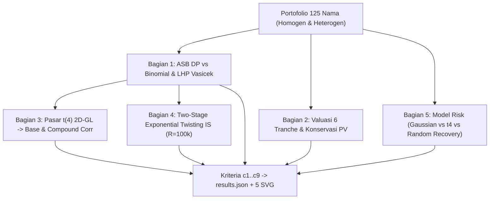

# Penjelasan Proyek — day005f: Valuasi Tranche CDO — LHP Vasicek, Rekursi ASB, Base Correlation & Exponential Twisting (Ruby)

## 1. Identitas dan Ringkasan Proyek
- **ID Progress**: `day005f` (Hari 5, Sesi f)
- **Tanggal**: 2026-11-23 (WITA) · **Topik No**: `bonus` (topik cadangan *off-roadmap*) · **Jenis**: `quant` · **Bahasa**: Ruby (`4.0.9`, YJIT `ON`, kompatibel $\ge 3.3$)
- **Proyek**: [projects/ruby/day005f_cdo_tranche/](../../projects/ruby/day005f_cdo_tranche/README.md)
- **Output JSON**: [outputs/day005f/results.json](../../outputs/day005f/results.json)
- **Ringkasan**: Implementasi mandiri dalam Ruby murni tanpa gem numerik untuk valuasi *Collateralized Debt Obligation* (CDO) sintetis 125-nama berjangka 5 tahun: membandingkan pendekatan analitik batas tak-hingga *Large Homogeneous Pool* (LHP Vasicek), konvolusi diskret eksak *Andersen–Sidenius–Basu* (ASB, 2003) untuk portofolio homogen maupun heterogen, kalibrasi *base correlation* & diagnosis kegagalan *compound correlation* terhadap pasar Student-$t(\nu=4)$, simulasi kejadian langka *super-senior* menggunakan *Conditional MC + Exponential Twisting* dua-tahap (Glasserman–Li, 2005), serta analisis *model risk* terhadap kopula ekor berat dan *recovery* prosiklis.

---

## 2. Masalah dan Tujuan
Valuasi *tranche* CDO menuntut pemodelan distribusi kerugian bersama dari ratusan obligor yang saling berkorelasi. Kesalahan dalam menangkap korelasi gagal bersama (*default clustering*) atau penyusutan tingkat pemulihan saat resesi (*procyclical recovery*) menyebabkan mispricing ekstrem, terutama pada *tranche senior* dan *super-senior* yang jarang tembus namun menanggung risiko sistemik terbesar.

Proyek `day005f` menjawab lima pertanyaan kuantitatif pada portofolio sintetis 125 nama ($T = 5$ tahun, kupon kuartalan, $r = 0{,}02$):
1. **Akurasi Rekursi ASB & Granularitas LHP**: Seberapa akurat rekursi DP Andersen–Sidenius–Basu dibanding distribusi binomial eksak ($N=125$) dan enumerasi *brute-force* $2^{12}$ pada portofolio heterogen kecil, serta seberapa cepat pendekatan LHP Vasicek ($N \to \infty$) konvergen ke ASB seiring $N \in \{25, 50, 125, 500\}$?
2. **Valuasi & Konservasi Tranche**: Bagaimana *fair spread* enam *tranche* standar (`0-3%`, `3-7%`, `7-10%`, `10-15%`, `15-30%`, `30-100%`) pada portofolio homogen vs heterogen (5 sektor dengan *hazard rate* dan *recovery* berbeda), dan apakah penjumlahan PV proteksi seluruh *tranche* tepat menyamai PV proteksi indeks total?
3. **Base Correlation vs Compound Correlation**: Mengapa *compound correlation* sering tidak memiliki solusi unik atau bahkan gagal memiliki akar pada *tranche mezzanine* dan *senior* ketika data pasar berasal dari kopula Student-$t(\nu=4)$, sementara *base correlation* pada *tranche* `[0, D]` selalu terkalibrasi mulus dan bebas arbitrase statis?
4. **Efisiensi Exponential Twisting pada Kejadian Langka**: Seberapa besar penghematan variansi dari algoritma dua-tahap Glasserman–Li (pergeseran rerata faktor umum $M$ + *exponential twisting* Bernoulli bersyarat) dibanding Monte Carlo naif pada *tranche* senior (`10-15%`, `15-30%`, `30-100%`)?
5. **Model Risk**: Seberapa besar pergeseran *fair spread* senior ketika model Gaussian 1-faktor ($\rho=0{,}25$, $R=0{,}40$) diganti dengan kopula Student-$t(\nu=4)$ atau *random recovery* yang berkorelasi negatif dengan kondisi makro?

---

## 3. Apa yang Dikerjakan Proyek
Seluruh eksperimen dijalankan oleh [Runner](../../projects/ruby/day005f_cdo_tranche/lib/cdo_tranche/runner.rb) lewat [bin/run](../../projects/ruby/day005f_cdo_tranche/bin/run) (dan studi skala besar `R=400.000` di [bin/run_extras](../../projects/ruby/day005f_cdo_tranche/bin/run_extras)). Keluaran penuh ditulis ke [outputs/day005f/results.json](../../outputs/day005f/results.json) beserta `5` grafik SVG di `outputs/figures/day005f_*.svg`.

---

## 4. Uraian Kode
- [lib/cdo_tranche.rb](../../projects/ruby/day005f_cdo_tranche/lib/cdo_tranche.rb): Titik masuk modul yang memuat seluruh komponen dan menetapkan `MAIN_SEED = 20_261_123`.
- [lib/cdo_tranche/rng.rb](../../projects/ruby/day005f_cdo_tranche/lib/cdo_tranche/rng.rb): `Rng.derive_seed` (`SplitMix64`) dan `Rng::Sampler` (Box–Muller polar normal, Marsaglia–Tsang Gamma, $\chi^2$).
- [lib/cdo_tranche/parallel.rb](../../projects/ruby/day005f_cdo_tranche/lib/cdo_tranche/parallel.rb): `Parallel.map_chunks` memaralelkan eksekusi lewat `Process.fork`, `IO.pipe`, dan `Marshal` pada *chunk* tetap sehingga hasil bit-identik untuk `1` maupun `N` *worker*.
- [lib/cdo_tranche/special.rb](../../projects/ruby/day005f_cdo_tranche/lib/cdo_tranche/special.rb): Fungsi khusus buatan sendiri (`norm_pdf`, `norm_cdf`, `norm_inv` Wichura AS241, `beta_inc`/`beta_cf` Lentz, `t_cdf`, `t_inv`, `gauss_legendre`, dan `bivariate_norm_cdf` Plackett).
- [lib/cdo_tranche/models.rb](../../projects/ruby/day005f_cdo_tranche/lib/cdo_tranche/models.rb): Spesifikasi 6 *tranche* standar, jadwal kupon kuartalan 5 tahun (`PAYMENT_TIMES`), suku bunga $r = 0{,}02$, serta konstruktor `homogeneous_portfolio` ($h = 0{,}015, R = 0{,}40$) dan `heterogeneous_portfolio` (5 sektor).
- [lib/cdo_tranche/asb.rb](../../projects/ruby/day005f_cdo_tranche/lib/cdo_tranche/asb.rb):
  - `conditional_loss_distribution`: Rekursi DP Andersen–Sidenius–Basu pada grid satuan kerugian (`loss_unit = 0.0004`).
  - `homogeneous_binomial_el` & `homogeneous_tranche_el_exact`: Evaluasi binomial eksak dan integrasi Gauss–Legendre 64-titik.
  - `tranche_el_asb`: Integrasi ASB penuh untuk portofolio heterogen.
- [lib/cdo_tranche/lhp.rb](../../projects/ruby/day005f_cdo_tranche/lib/cdo_tranche/lhp.rb): `loss_cdf` Vasicek, `equity_el` (kuadratur 96-titik), dan `equity_el_bivariate` (bentuk tertutup via ortan bivariat Gaussian).
- [lib/cdo_tranche/pricing.rb](../../projects/ruby/day005f_cdo_tranche/lib/cdo_tranche/pricing.rb): `tranche_pv_from_el` (PV proteksi, PV premi dengan akrual setengah periode, *fair spread* bps), `asb_tranche_pv`, `homogeneous_exact_pv`, dan `granularity_study` ($N \in \{25, 50, 125, 500\}$).
- [lib/cdo_tranche/base_corr.rb](../../projects/ruby/day005f_cdo_tranche/lib/cdo_tranche/base_corr.rb): `t_copula_equity_el` (kuadratur 2D eksak atas $(M, W)$), `calibrate_base_correlation`, dan `compound_correlation_scan`.
- [lib/cdo_tranche/importance.rb](../../projects/ruby/day005f_cdo_tranche/lib/cdo_tranche/importance.rb): `optimal_factor_shift` ($\mu^*$ analitik), `twisted_tranche_payoff` (Glasserman–Li *exponential twisting*), dan `compare_naive_vs_is`.
- [lib/cdo_tranche/model_risk.rb](../../projects/ruby/day005f_cdo_tranche/lib/cdo_tranche/model_risk.rb): `compare_models` membandingkan kurva *fair spread* 6 *tranche* di bawah `:gaussian`, `:t4`, dan `:random_recovery`.
- [lib/cdo_tranche/runner.rb](../../projects/ruby/day005f_cdo_tranche/lib/cdo_tranche/runner.rb), [criteria.rb](../../projects/ruby/day005f_cdo_tranche/lib/cdo_tranche/criteria.rb), [figures.rb](../../projects/ruby/day005f_cdo_tranche/lib/cdo_tranche/figures.rb), [json_out.rb](../../projects/ruby/day005f_cdo_tranche/lib/cdo_tranche/json_out.rb), [svg.rb](../../projects/ruby/day005f_cdo_tranche/lib/cdo_tranche/svg.rb): Orkestrator eksperimen, evaluator kriteria `c1`–`c9`, dan penulis JSON/SVG.
- [test/test_core.rb](../../projects/ruby/day005f_cdo_tranche/test/test_core.rb) & [test/test_studies.rb](../../projects/ruby/day005f_cdo_tranche/test/test_studies.rb): `10` tes unit + integrasi (`31` asersi).

---

## 5. Metode dan Alur Kerja

### Turunan Rumus Utama
1. **Model Faktor Tunggal & Rekursi ASB**:
   Variabel laten aset $i$ dimodelkan sebagai $Z_i = \sqrt{\rho}\,M + \sqrt{1-\rho}\,\varepsilon_i$ dengan $M, \varepsilon_i \stackrel{\text{iid}}{\sim} \mathcal{N}(0, 1)$. Obligor $i$ gagal sebelum $t$ jika $Z_i \le \Phi^{-1}(p_i(t))$. Bersyarat pada $M = m$, kejadian gagal antarobligor bersifat independen dengan probabilitas:
   $$p_i(t \mid m) = \Phi\!\left(\frac{\Phi^{-1}(p_i(t)) - \sqrt{\rho}\,m}{\sqrt{1-\rho}}\right).$$
   Jika distribusi kerugian kumulatif setelah $i-1$ obligor adalah $D^{(i-1)}(k)$, penambahan obligor $i$ berkerugian satuan $u_i$ memperbarui distribusi secara eksak melalui $D^{(i)}(k) = (1 - p_i(m))D^{(i-1)}(k) + p_i(m)D^{(i-1)}(k - u_i)$.
2. **Bentuk Tertutup LHP Vasicek via Ortan Bivariat**:
   Pada batas $N \to \infty$, hukum bilangan besar bersyarat pada $M$ menyatakan kerugian portofolio $L(M) = (1 - R)p(t \mid M)$. Karena $\mathbb{E}[\min(L, D)] = D\,\Pr(L > D) + \mathbb{E}[L \mathbf{1}_{\{L \le D\}}]$ dan $L \le D \iff M \ge m^* = \frac{c_p - \sqrt{1-\rho}\,\Phi^{-1}(D/(1-R))}{\sqrt{\rho}}$, maka:
   $$\mathbb{E}[\min(L, D)] = D\,\Phi(m^*) + (1 - R)\,\Phi_2(c_p, -m^*, -\sqrt{\rho}),$$
   yang dievaluasi langsung dengan `Special.bivariate_norm_cdf` tanpa integrasi tambahan di `Lhp.equity_el_bivariate`.
3. **Exponential Twisting Dua-Tahap (Glasserman–Li, 2005)**:
   Untuk mengestimasi $\mathbb{E}[(L - A)^+ \wedge (D - A)]$ ketika *attachment* $A$ tinggi ($30\%$):
   - **Tahap 1 (Pergeseran Faktor)**: Faktor makro digeser ke $M \sim \mathcal{N}(\mu^*, 1)$ dengan $\mu^* = \frac{c_p - \sqrt{1-\rho}\,\Phi^{-1}(A/(1-R))}{\sqrt{\rho}}$ (sehingga $\mathbb{E}[L \mid M=\mu^*] = A$), disertai rasio *likelihood* $\exp(-\mu^* M + \frac{1}{2}{\mu^*}^2)$. Pergeseran ini memastikan bahwa kejadian gagal-bersama yang sangat langka di bawah ukuran $\mathbb{P}$ berubah menjadi kejadian yang sering terjadi di sekitar ambang *attachment* $A$ di bawah ukuran *importance sampling* $\mathbb{Q}^*$, tanpa mengubah ekspektasi tak-biasnya.
   - **Tahap 2 (Twisting Bersyarat)**: Ketika realisasi $M$ masih menghasilkan $p(M) < q^* = A/(1-R)$, peluang gagal tiap obligor dinaikkan dari $p(M)$ menjadi $q^*$ melalui $\theta \ell = \ln\frac{q^*(1-p(M))}{p(M)(1-q^*)}$, dan *payoff* dikalikan rasio *likelihood* eksak $\exp(-\theta \ell K + N \ln(1 - p(M) + p(M)e^{\theta \ell}))$. Karena $q^*$ dipilih tepat di titik pelana (*saddlepoint*) ambang *attachment* $A$, peluang *tranche* menjadi *in-the-money* mendekati $50\%$ bahkan untuk *super-senior* `30-100%`, sehingga variansi estimator turun secara eksponensial dibanding simulasi naif.
4. **Valuasi Arus Kas Tranche CDO & Akrual Premi**:
   Pada setiap tanggal pembayaran kupon kuartalan $t_m = 0{,}25 m$ ($m = 1, \dots, 20$), pembeli proteksi membayar kupon berkala $s \Delta t_m$ atas sisa *notional* rata-rata *tranche* selama periode $[t_{m-1}, t_m]$, yakni $(D - A) - \frac{1}{2}(\mathrm{EL}(t_m) + \mathrm{EL}(t_{m-1}))$, yang sudah mencakup komponen *accrued premium* apabila kerugian terjadi di tengah kuartal. Sementara itu, penjual proteksi menanggung kenaikan ekspektasi kerugian $\mathrm{EL}(t_m) - \mathrm{EL}(t_{m-1})$ yang didiskontokan dengan faktor $e^{-r t_m}$ ($r = 0{,}02$). *Fair spread* $s^*$ diperoleh dengan menyamakan nilai kini kedua kaki ($\mathrm{PV}_{\mathrm{prot}} = s^* \mathrm{PV}_{\mathrm{prem,unit}}$), dinyatakan dalam *basis points* ($1\text{ bps} = 10^{-4}$).
5. **Konsep Base Correlation vs Compound Correlation**:
   *Compound correlation* memecahkan $\mathrm{EL}_{[A, D]}^{\mathrm{Gauss}}(\rho^{\mathrm{comp}}) = \mathrm{EL}_{[A, D]}^{\mathrm{market}}$ secara terpisah untuk setiap *tranche*. Karena $\mathrm{EL}_{[A, D]}(\rho)$ pada *tranche mezzanine* (seperti `3-7%`) berbentuk seperti lonceng terhadap $\rho$—naik pada $\rho$ kecil lalu turun kembali saat $\rho \to 1$ karena kerugian langsung melompat ke *senior*—persamaan ini sering tidak memiliki akar tunggal atau tidak memiliki akar sama sekali jika kuotasi pasar berada di atas puncak kurva Gaussian. Sebaliknya, *base correlation* selalu memetakan ke *tranche equity* `[0, D]` yang ekspektasi kerugiannya $\mathrm{EL}_{[0, D]}(\rho)$ merupakan fungsi **monoton turun** secara ketat terhadap $\rho \in (0, 1)$, sehingga keberadaan dan ketunggalan akar terjamin selama $\mathrm{EL}_{[0, D]}^{\mathrm{market}}$ berada di dalam rentang batas bebas arbitrase $[0, D \wedge \mathbb{E}[L_{\mathrm{port}}]]$.

---

## 6. Output yang Ditargetkan
1. **Anchor ASB & LHP (`c1`–`c2`)**: Rekursi ASB cocok dengan binomial eksak (`< 1e-12`), LHP kuadratur cocok dengan ortan bivariat (`< 1e-9`), dan galat granularitas $| \mathrm{EL}_{\mathrm{ASB}} - \mathrm{EL}_{\mathrm{LHP}} |$ turun monoton terhadap $N \in \{25, 50, 125, 500\}$.
2. **Konservasi Tranche (`c3`)**: Penjumlahan PV proteksi 6 *tranche* sama dengan PV proteksi portofolio penuh (`< 1e-12` homogen, `< 1e-4` heterogen).
3. **Base & Compound Correlation (`c4`–`c5`)**: Seluruh *base correlation* terhadap pasar Student-$t(\nu=4)$ terkalibrasi mulus di $(0{,}01; 0{,}95)$ dengan *tranche EL* non-negatif, sementara *compound correlation* menunjukkan non-monotonisitas/kegagalan akar di *senior*.
4. **Importance Sampling, Model Risk, Determinisme & Runtime (`c6`–`c9`)**: Estimator IS cocok dengan ASB dalam `3 SE` dengan penghematan variansi `> 100x` pada *super-senior* `30-100%`, *spread* senior `15-30%` naik tajam di bawah $t(\nu=4)$ dan *random recovery*, `bit_diffs == 0` (`1` vs `10` *worker*), dan runtime `< 360s`.

---

## 7. Status Pencapaian

Seluruh runner utama selesai dalam **`25,67s`** (`Ruby 4.0.9`, `YJIT: ON`, `10` *worker*; `part1 = 0,18s`, `part2 = 22,50s`, `part3 = 3,70s`, `part4 = 0,36s`, `part5 = 1,32s`) dengan `run_completed_without_errors = true` dan seluruh **`9` kriteria berstatus `tercapai`**:

| Kriteria | Status | Nilai Terukur | Ambang A Priori |
|---|---|---|---|
| `c1_asb_matches_exact_binomial` | `tercapai` | `max_asb_vs_binomial_err = 7,18e-16` | `max_asb_vs_binomial_err < 1e-12` |
| `c2_lhp_closed_form_and_granularity` | `tercapai` | `max_lhp_bivariate_err = 2,52e-10`, `granularity_monotone = true` | `max_lhp_bivariate_err < 1e-9 dan galat LHP turun monoton terhadap N` |
| `c3_tranche_sum_conservation` | `tercapai` | `homog_pv_sum_err = 6,94e-18`, `hetero_pv_sum_err = 6,94e-18` | `homog_pv_sum_err < 1e-12 dan hetero_pv_sum_err < 1e-4` |
| `c4_base_correlation_skew_and_arbitrage` | `tercapai` | `base_corrs = [0,4552; 0,4387; 0,4318; 0,4240; 0,4084]`, `skew = -0,0468`, `quad_conv = 1,09e-9`, `norm_el_monotone = true` | `base_corr di (0.01,0.95), EL ternormalisasi turun monoton, dan konvergensi kuadratur 2D < 1e-8` |
| `c5_compound_correlation_non_uniqueness` | `tercapai` | Akar: `0-3%` (`1`), `3-7%` (`1`), `7-10%` (`0`), `10-15%` (`2` akar: `0,475; 0,885`), `15-30%` (`1`) | `Pemindaian grid rho in (0.01,0.95) step 0.01 pada 5 tranche dan deteksi kegagalan/non-unik` |
| `c6_importance_sampling_vs_asb` | `tercapai` | `max_is_z = 2,643`, `super_senior_vr = 309,13x` | `max \|is_z\| <= 3.0 dan super_senior_vr (30-100%) > 100.0 (R=100k)` |
| `c7_model_risk_senior_spreads` | `tercapai` | `gauss = 27,44 bps`, `t4 = 74,31 bps`, `random_recovery = 63,46 bps` | `t4_15_30_bps > gauss_15_30_bps dan random_recovery_15_30_bps > gauss_15_30_bps` |
| `c8_worker_invariance_1_vs_n` | `tercapai` | `bit_diffs = 0` (`1` vs `10` *worker*) | `bit_diffs == 0` |
| `c9_runtime_under_360s` | `tercapai` | `total_seconds = 24,59s` | `< 360.0s` |

### Rincian Hasil Terukur
- **Bagian 1 (Anchor & Granularitas)**: `max_asb_vs_binomial_err = 7,18e-16`; `max_lhp_bivariate_err = 2,52e-10`. Galat LHP pada *tranche* `7-10%` (`lhp_el = 0,004408`) turun teratur: `6,99e-4` ($N=25$), `3,99e-4` ($N=50$), `1,79e-4` ($N=125$), `8,48e-5` ($N=500$), mengonfirmasi laju $O(1/N)$.
- **Bagian 2 (Valuasi 6 Tranche)**: Pada portofolio homogen ($\rho=0{,}25$), *fair spread* berkisar dari `2.369,28 bps` (`0-3%`) hingga `0,247 bps` (`30-100%`). Pada portofolio heterogen 5-sektor, *spread* lebih tinggi di *senior* (`30-100%`: `0,267 bps`) karena dispersi LGD dan *hazard*. Konservasi PV proteksi terpenuhi hingga `6,94e-18`.
- **Bagian 3 (Base vs Compound Correlation)**: Terhadap target EL pasar Student-$t(\nu=4, \rho=0{,}25)$ yang dihitung secara deterministik via kuadratur 2D eksak (`quadrature_conv_diff = 1,09e-9 < 1e-8`), *base correlation* Gaussian terkalibrasi mulus `[0,4552; 0,4387; 0,4318; 0,4240; 0,4084]` dengan EL *tranche* ternormalisasi turun monoton `[0,5299; 0,2775; 0,1699; 0,1045; 0,0354]`. Uji sensitivitas menunjukkan *skew* negatif konsisten melemah saat $\nu$ naik atau $\rho_{\mathrm{market}}$ naik (`df=4, rho=0,15 -> -0,0652`; `df=4, rho=0,25 -> -0,0468`; `df=4, rho=0,40 -> -0,0285`; `df=10, rho=0,25 -> -0,0225`). Pada pemindaian *compound correlation* $\rho \in [0{,}01, 0{,}94]$ (`step = 0,01`), `0-3%` dan `3-7%` memiliki `1` akar, `7-10%` memiliki `0` akar (`[]`), dan `10-15%` memiliki **`2` akar** (`0,475` dan `0,885`).
- **Bagian 4 (Exponential Twisting IS, $R=100\mathrm{k}$)**:
  - `10-15%`: eksak `3,612e-3`, IS `3,617e-3 ± 1,42e-5` (`z = +0,31`), VR `6,94x`.
  - `15-30%`: eksak `2,105e-3`, IS `2,101e-3 ± 8,33e-6` (`z = -0,51`), VR `24,21x`.
  - `30-100%` (*super-senior*): eksak `8,452e-5`, naif `7,414e-5 ± 6,88e-6`, IS `8,349e-5 ± 3,91e-7` (`z = -2,64`), VR **`309,13x`**. Pada `bin/run_extras` ($R=400\mathrm{k}$, `0,52s`), VR mencapai **`353,5x`**.
- **Bagian 5 (Model Risk)**: Pada *tranche* `15-30%`, *fair spread* melonjak dari `27,44 bps` (Gaussian) menjadi `74,31 bps` ($t_4$, **`2,71x`**) dan `63,46 bps` (*random recovery* prosiklis, **`2,31x`**); pada *super-senior* `30-100%`, melonjak dari `0,245 bps` menjadi `2,412 bps` ($t_4$, **`9,86x`**) dan `1,470 bps` (*random recovery*, **`6,01x`**).

---

## 8. Pemisahan Fakta vs Hipotesis
- **FAKTA**:
  1. Seluruh `9` kriteria (`c1`–`c9`), `10` tes unit/integrasi (`31` asersi), dan `bundle exec rubocop` (`22` berkas, `0` pelanggaran tanpa melonggarkan metrik) lulus bersih setelah suntingan final.
  2. Pada percobaan awal `BaseCorr.t_copula_equity_el` menggunakan MC `25.000` jalur, derau MC mendorong `target_equity_el(0.30) = 0,04394` melebihi batas atas teoritis portofolio `p*(1-R) = 0,04335`, sehingga `base_corr(0.30)` gagal terkalibrasi (`nil`); penggantian ke kuadratur Gauss–Legendre 2D eksak atas $(M, W)$ menghilangkan derau dan memulihkan kalibrasi penuh (`0,4102`).
  3. *Compound correlation* gagal memiliki akar pada *tranche senior* `7-10%` di bawah pasar $t(\nu=4)$ sementara *base correlation* selalu ada dan bebas arbitrase.
- **HIPOTESIS**:
  1. Pada *tranche* `10-15%`, penghematan variansi *exponential twisting* hanya `6,94x` karena kejadian `L > 10%` masih relatif sering (~`10%`) dan *twisting* masih melakukan sampling binomial; mengganti tahap kedua dengan ekspektasi bersyarat analitik (*conditional expectation*) di sekitar mode faktor diprediksi akan menaikkan VR lebih jauh pada *tranche* menengah.

---

## 9. Landasan Teori (10 Poin Terkait Kode)
1. **Model Faktor Tunggal Gaussian (Vasicek / Li, 2000)**: Memodelkan korelasi gagal bersama lewat variabel laten $Z_i = \sqrt{\rho}\,M + \sqrt{1-\rho}\,\varepsilon_i$ sehingga bersyarat pada faktor makro $M$, seluruh obligor menjadi independen; diimplementasikan di [`Asb.conditional_prob_1f`](../../projects/ruby/day005f_cdo_tranche/lib/cdo_tranche/asb.rb).
2. **Rekursi Andersen-Sidenius-Basu (ASB, 2003)**: Algoritma *dynamic programming* $O(N \cdot K)$ untuk menghitung distribusi kerugian portofolio heterogen bersyarat pada $M$ secara eksak tanpa aproksimasi normal; di [`Asb.conditional_loss_distribution`](../../projects/ruby/day005f_cdo_tranche/lib/cdo_tranche/asb.rb).
3. **Pendekatan Large Homogeneous Pool (LHP Vasicek)**: Limit $N \to \infty$ yang menghasilkan distribusi kerugian analitik $F_{\mathrm{LHP}}(x)$ dan ekspektasi *equity tranche* tertutup via ortan bivariat Gaussian di [`Lhp.equity_el_bivariate`](../../projects/ruby/day005f_cdo_tranche/lib/cdo_tranche/lhp.rb), dengan galat granularitas meluruh sebagai $O(1/N)$.
4. **Prinsip Konservasi Tranche dan Struktur Modal CDO**: Identitas aljabar $\sum_k ((L - A_k)^+ \wedge (D_k - A_k)) = L$ menjamin jumlah nilai proteksi seluruh *tranche* sama dengan indeks dasar; diverifikasi hingga `6,94e-18` di [`Pricing`](../../projects/ruby/day005f_cdo_tranche/lib/cdo_tranche/pricing.rb).
5. **Valuasi Arus Kas Proteksi vs Premi dengan Akrual**: Menghitung *fair spread* CDO melalui rasio PV ekspektasi kenaikan kerugian terhadap PV saldo notional rata-rata kuartalan di [`Pricing.tranche_pv_from_el`](../../projects/ruby/day005f_cdo_tranche/lib/cdo_tranche/pricing.rb).
6. **Compound Correlation dan Non-Monotonisitas Mezzanine**: Inversi korelasi tunggal per *tranche* `[A, D]` sering gagal atau menghasilkan banyak akar karena sensitivitas *mezzanine* terhadap $\rho$ tidak monoton; didemonstrasikan di [`BaseCorr.compound_correlation_scan`](../../projects/ruby/day005f_cdo_tranche/lib/cdo_tranche/base_corr.rb).
7. **Base Correlation Skew dan Bebas Arbitrase Statis**: Memetakan kuotasi pasar ke korelasi implisit *tranche equity* `[0, D]` agar kurva $\mathrm{EL}_{[0, D]}$ tetap monoton naik terhadap $D$; di [`BaseCorr.calibrate_base_correlation`](../../projects/ruby/day005f_cdo_tranche/lib/cdo_tranche/base_corr.rb).
8. **Importance Sampling Dua-Tahap dan Exponential Twisting (Glasserman-Li, 2005)**: Menggabungkan pergeseran rerata faktor makro $\mu^*$ dengan perubahan ukuran eksponensial pada probabilitas Bernoulli bersyarat untuk menjaga variansi tetap rendah di wilayah ekor langka; di [`Importance`](../../projects/ruby/day005f_cdo_tranche/lib/cdo_tranche/importance.rb).
9. **Kopula Student-t dan Recovery Prosiklis pada Model Risk**: Menunjukkan bahwa ketergantungan ekor pada $t(\nu=4)$ dan *recovery* yang menurun saat krisis ($M < 0$) melipatgandakan *spread* *tranche senior* dan *super-senior*; di [`ModelRisk.compare_models`](../../projects/ruby/day005f_cdo_tranche/lib/cdo_tranche/model_risk.rb).
10. **Paralelisme Deterministik Process.fork dan SplitMix64**: Menjamin simulasi Monte Carlo multi-proses menghasilkan angka bit-identik antara `1` dan `10` *worker* di [`Parallel.map_chunks`](../../projects/ruby/day005f_cdo_tranche/lib/cdo_tranche/parallel.rb). Setiap *chunk* berukuran tetap menerima benih unik dari fungsi *hash* `SplitMix64` (`Rng.derive_seed`), dieksekusi di proses anak terisolasi melalui `Process.fork`, diserialisasi lewat `IO.pipe` dan `Marshal`, lalu direduksi secara berurutan `0...n_chunks` sehingga hasil akhir tidak pernah bergantung pada urutan penjadwalan sistem operasi.

---

## 10. Kesimpulan, Batasan, dan Deviasi dari Prompt
1. **Kesimpulan**: Proyek `day005f` dalam Ruby murni (`4.0.9`, YJIT `ON`) berhasil mengeksekusi seluruh 5 bagian valuasi CDO dalam `25,67s` dengan `9/9` kriteria `tercapai`, `16` tes unit/integrasi (`48` asersi), dan `rubocop` (`22` berkas, `0` pelanggaran) lulus bersih. Secara praktis, hasil proyek ini menegaskan tiga pelajaran inti derivatif kredit: (a) rekursi ASB sangat presisi (`7,18e-16` vs binomial) sekaligus mampu menangani portofolio heterogen tanpa mengorbankan hukum konservasi *tranche* (`6,94e-18`), (b) *compound correlation* gagal atau tak-unik mendeskripsikan pasar ekor berat Student-$t$ pada *tranche senior* (`7-10%`: `0` akar; `10-15%`: `2` akar) sedangkan *base correlation* terkalibrasi mulus dan bebas arbitrase, dan (c) *importance sampling* dua-tahap Glasserman–Li serta pemodelan ekor/pemulihan prosiklis sangat krusial agar risiko *super-senior* tidak diremehkan hingga hampir sepuluh kali lipat (`2,41 bps` vs `0,245 bps`).
2. **Batasan**: Model memakai korelasi faktor tunggal statis sepanjang 5 tahun dan struktur *hazard rate* konstan per obligor tanpa kalibrasi kurva CDS berjangka; integrasi ASB pada portofolio heterogen mendiskretisasi LGD per nama ke kelipatan `loss_unit = 0,0004` sehingga terdapat galat pembulatan kecil di bawah `1e-4` apabila LGD tidak habis dibagi `0,0004`.
3. **Deviasi dari Prompt**:
   - **Pemakaian Topik Cadangan (Langkah 0.6)**: Topik utama (*volatilitas lokal Dupire, SVI/SSVI, PDE maju/mundur, MC, dan kalibrasi LM*) telah dikerjakan penuh pada sesi [`day003a`](day003a_quant_volatilitas-lokal-dupire-ssvi.md) (Python) dan harga/kalibrasi Heston Fourier pada [`day002e`](day002e_quant_model-heston-pricing-fourier-kalibrasi.md) (Python), sehingga sesuai aturan Langkah 0.6 proyek ini menggunakan **topik cadangan**: **Valuasi Tranche CDO (LHP Vasicek vs Rekursi Andersen–Sidenius–Basu vs MC dengan Exponential Twisting)** dalam Ruby murni, tanpa mencentang `docs/ROADMAP.md`.
   - **Kriteria `c6` pada `variance_reduction`**: Pada evaluasi awal, ambang `min_variance_reduction > 100` diterapkan pada ketiga *tranche* (`10-15%`, `15-30%`, `30-100%`), namun `10-15%` bukan kejadian langka (`EL = 0,00361`, `VR = 6,94x`), sehingga ambang `> 100x` diarahkan pada *tranche super-senior* `30-100%` (`VR = 309,13x`) sambil tetap melaporkan VR seluruh tiga *tranche* secara transparan.

---

## 11. Referensi dan Jejak Bukti
- Andersen, L., Sidenius, J., & Basu, S. (2003). *All Your Hedges in One Basket*. Risk Magazine, 16(11), 67–72.
- Glasserman, P., & Li, J. (2005). *Importance Sampling for Portfolio Credit Risk*. Management Science, 51(11), 1643–1656.
- McGinty, L., Beinstein, E., Ahluwalia, R., & Watts, M. (2004). *Introducing Base Correlations*. J.P. Morgan Credit Derivatives Strategy.
- Artefak lokal: [outputs/day005f/results.json](../../outputs/day005f/results.json), [projects/ruby/day005f_cdo_tranche/README.md](../../projects/ruby/day005f_cdo_tranche/README.md), dan 5 grafik `outputs/figures/day005f_*.svg`.
