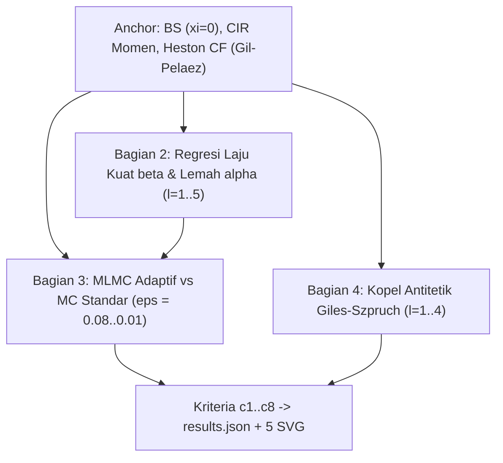

# Penjelasan Proyek — day005g: Multilevel Monte Carlo (Giles) untuk CIR & Heston (Ruby)

## 1. Identitas dan Ringkasan Proyek
- **ID Progress**: `day005g` (Hari 5, Sesi g)
- **Tanggal**: 2026-11-23 (WITA) · **Topik No**: `bonus` (topik cadangan *off-roadmap*) · **Jenis**: `quant` · **Bahasa**: Ruby (`4.0.9`, YJIT `ON`, kompatibel $\ge 3.3$)
- **Proyek**: [projects/ruby/day005g_mlmc_heston/](../../projects/ruby/day005g_mlmc_heston/README.md)
- **Output JSON**: [outputs/day005g/results.json](../../outputs/day005g/results.json)
- **Ringkasan**: Implementasi lengkap *Multilevel Monte Carlo* (MLMC, Giles 2008) dalam Ruby murni tanpa gem numerik untuk model difusi klasik (GBM Euler vs Milstein) serta proses volatilitas stokastik CIR/Heston dengan skema *Full-Truncation Euler* (Lord–Koekkoek–van Dijk, 2010) dan *antithetic coupling* (Giles–Szpruch, 2014). Proyek ini memverifikasi harga terhadap *anchor* analitik Black–Scholes, momen eksak CIR, dan fungsi karakteristik Heston (*little trap* + inversi Gil–Pelaez), mengukur laju konvergensi kuat ($\beta$) dan lemah ($\alpha$) pada rezim Feller terpenuhi vs dilanggar, serta membuktikan secara empiris hukum kompleksitas biaya $\varepsilon^{-2}$ vs $\varepsilon^{-3}$.

---

## 2. Masalah dan Tujuan
Dalam simulasi Monte Carlo standar (*single-level*) untuk persamaan diferensial stokastik (SDE) seperti Heston, pencapaian galat *Root Mean Square Error* (RMSE) sebesar $\varepsilon$ menuntut dua syarat sekaligus: bias diskretisasi waktu $O(\Delta t) \le \varepsilon/\sqrt{2}$ (sehingga jumlah langkah per jalur $M \propto \varepsilon^{-1}$) dan variansi sampel $\operatorname{Var}(\hat{P})/N \le \varepsilon^2/2$ (sehingga jumlah jalur $N \propto \varepsilon^{-2}$). Akibatnya, total kompleksitas komputasi Monte Carlo standar membengkak menjadi $O(\varepsilon^{-3})$.

Metode *Multilevel Monte Carlo* (Giles, 2008) memecahkan hambatan ini dengan memanfaatkan identitas teleskopik pada hierarki resolusi waktu, menarik sebagian besar sampel pada grid kasar yang murah dan hanya sedikit sampel pada grid halus. Namun, efektivitas MLMC sangat bergantung pada laju peluruhan variansi antarlevel $\beta$ ($\operatorname{Var}(P_\ell - P_{\ell-1}) \propto \Delta t_\ell^\beta$): untuk skema Milstein pada GBM, $\beta = 2$ menghasilkan biaya optimal $O(\varepsilon^{-2})$, sedangkan pada model Heston/CIR di mana kondisi Feller $2\kappa\theta \ge \xi^2$ sering dilanggar di pasar riil ($\xi = 0{,}50 > \sqrt{0{,}12}$), proses variansi $v_t$ menyentuh nol sehingga $\beta$ dapat turun di bawah $1$.

Proyek `day005g` menjawab empat pertanyaan kuantitatif utama pada data sintetis:
1. **Validasi Anchor Tertutup**: Apakah evaluator fungsi karakteristik Heston (*little trap*) + kuadratur Gauss–Legendre 96-titik mereproduksi batas Black–Scholes saat $\xi \to 0$, memenuhi *put-call parity* hingga presisi mesin, dan apakah skema *Full-Truncation Euler* mereproduksi momen pertama dan kedua eksak proses CIR?
2. **Laju Kuat & Efek Kondisi Feller**: Seberapa besar perbedaan laju peluruhan variansi $\beta$ antara skema Euler ($\beta \approx 1$) dan Milstein ($\beta \approx 2$) pada GBM, serta seberapa tajam penurunan $\beta$ pada model Heston *Full-Truncation* ketika kondisi Feller terpenuhi ($\xi = 0{,}25$) vs dilanggar ($\xi = 0{,}50$)?
3. **Hukum Kompleksitas Giles ($\varepsilon^{-2}$ vs $\varepsilon^{-3}$)**: Pada rentang toleransi $\varepsilon \in \{0{,}08; 0{,}04; 0{,}02; 0{,}01\}$, apakah estimator MLMC adaptif mencapai kemiringan biaya log-log $p_{\mathrm{MLMC}} \approx 2{,}0$ (GBM Milstein) dan $p_{\mathrm{MLMC}} < 2{,}6$ (Heston) dibanding $p_{\mathrm{MC}} \approx 3{,}0$ pada MC standar, sambil tetap cocok dengan harga referensi dalam batas `3,5 SE`?
4. **Koppel Antitetik Giles–Szpruch**: Apakah penukaran pasangan inkremen Brown halus $(\Delta W_{2k}, \Delta W_{2k+1})$ pada skema tanpa koreksi *Lévy area* mampu menurunkan variansi level Heston $V_\ell$ secara konsisten?

---

## 3. Apa yang Dikerjakan Proyek
Seluruh eksperimen dijalankan oleh [Runner](../../projects/ruby/day005g_mlmc_heston/lib/mlmc_heston/runner.rb) melalui [bin/run](../../projects/ruby/day005g_mlmc_heston/bin/run) (dan studi toleransi halus $\varepsilon = 0{,}005$ di [bin/run_extras](../../projects/ruby/day005g_mlmc_heston/bin/run_extras)). Keluaran terstruktur disimpan ke [outputs/day005g/results.json](../../outputs/day005g/results.json) bersama `5` grafik SVG di `outputs/figures/day005g_*.svg`:
1. **Bagian 1 — Validasi Anchor Analitik & Momen CIR**: Menguji evaluator fungsi karakteristik Heston (*little trap* + inversi Gil–Pelaez 96-titik) terhadap rumus tertutup Black–Scholes ketika volatilitas dari volatilitas $\xi \to 0$, memverifikasi *put-call parity* $C - P = S_0 - K e^{-rT}$, memeriksa konvergensi kuadratur antara 96-titik dan 160-titik, serta memvalidasi mean dan variansi transisi proses CIR pada skema *Full-Truncation Euler* terhadap momen eksak non-sentral chi-kuadrat.
2. **Bagian 2 — Pengukuran Laju Konvergensi Kuat ($\beta$) dan Lemah ($\alpha$)**: Menjalankan simulasi pasangan jalur terkopel pada level $\ell \in \{1, 2, 3, 4, 5\}$ ($n_0 = 8$, faktor penyempitan $M = 2$) dan melakukan regresi kuadrat terkecil biasa (*ordinary least squares*) atas $\log_2 V_\ell$ dan $\log_2 |\bar{Y}_\ell|$ terhadap $\ell$ untuk empat skenario: GBM Euler, GBM Milstein, Heston *Full-Truncation* pada rezim Feller terpenuhi ($2\kappa\theta \ge \xi^2$ dengan $\xi = 0{,}25$), dan Heston *Full-Truncation* pada rezim Feller dilanggar ($2\kappa\theta < \xi^2$ dengan $\xi = 0{,}50$).
3. **Bagian 3 — Hukum Kompleksitas Biaya ($\varepsilon^{-2}$ vs $\varepsilon^{-3}$)**: Menjalankan algoritma MLMC adaptif penuh (`Mlmc.run_adaptive`) pada empat tingkat toleransi $\varepsilon \in \{0{,}08;\ 0{,}04;\ 0{,}02;\ 0{,}01\}$ untuk GBM Milstein dan Heston European (rezim Feller dilanggar), lalu membandingkan total biaya komputasi $C_{\mathrm{MLMC}} = \sum_{\ell=0}^L N_\ell C_\ell$ dengan biaya ekuivalen Monte Carlo standar $C_{\mathrm{MC}}$ pada akurasi RMSE yang sama, lengkap dengan regresi kemiringan log-log terhadap $\log(1/\varepsilon)$.
4. **Bagian 4 — Koppel Antitetik Giles–Szpruch**: Membandingkan variansi level $V_\ell$ antara kopel standar dan kopel antitetik (pertukaran inkremen halus $\Delta W^{(1)} \leftrightarrow \Delta W^{(2)}$ pada dua sub-jalur halus) untuk opsi *call* Eropa Heston di level $\ell \in \{1, 2, 3, 4\}$.
5. **Visualisasi & Uji Determinisme**: Menghasilkan lima grafik SVG (`day005g_strong_weak_rates.svg`, `day005g_complexity_scaling.svg`, `day005g_level_allocation.svg`, `day005g_antithetic_reduction.svg`, dan `day005g_feller_effect.svg`) serta memverifikasi bahwa eksekusi paralel (`10` *worker*) menghasilkan keluaran yang identik bit demi bit dengan eksekusi tunggal (`1` *worker*).

---

## 4. Uraian Kode
- [lib/mlmc_heston.rb](../../projects/ruby/day005g_mlmc_heston/lib/mlmc_heston.rb): Titik masuk modul yang memuat seluruh komponen dan menetapkan `MAIN_SEED = 20_261_123`.
- [lib/mlmc_heston/rng.rb](../../projects/ruby/day005g_mlmc_heston/lib/mlmc_heston/rng.rb): `Rng.derive_seed` (`SplitMix64`) dan `Rng::Sampler` (Box–Muller polar normal).
- [lib/mlmc_heston/parallel.rb](../../projects/ruby/day005g_mlmc_heston/lib/mlmc_heston/parallel.rb): `Parallel.map_chunks` memaralelkan eksekusi lewat `Process.fork`, `IO.pipe`, dan `Marshal` pada *chunk* tetap sehingga hasil bit-identik untuk `1` maupun `N` *worker*.
- [lib/mlmc_heston/special.rb](../../projects/ruby/day005g_mlmc_heston/lib/mlmc_heston/special.rb): `norm_cdf`, `bs_call`, kuadratur `gauss_legendre`, dan aritmetika kompleks murni (`cexp`, `clog`, `csqrt`) tanpa gem eksternal.
- [lib/mlmc_heston/heston_cf.rb](../../projects/ruby/day005g_mlmc_heston/lib/mlmc_heston/heston_cf.rb): `char_fn` (*little trap* Albrecher et al. 2007 dengan cabang kontinu dan batas analitik `bs_char_fn` saat $\xi \to 0$), `call_price`, dan `put_price` via inversi Gil–Pelaez 96-titik.
- [lib/mlmc_heston/simulators.rb](../../projects/ruby/day005g_mlmc_heston/lib/mlmc_heston/simulators.rb):
  - `cir_exact_mean` & `cir_exact_var`: Momen eksak transisi CIR.
  - `gbm_coupled_pair`: Pasangan jalur terkopel GBM (*Euler* atau *Milstein*) di mana jalur kasar menjumlahkan pasangan inkremen Brown halus.
  - `heston_coupled_pair`: Pasangan jalur terkopel Heston *Full-Truncation Euler* (log-spot + $v_n^+ = \max(v_n, 0)$ pada *drift* dan difusi variansi) untuk opsi *European* maupun *Asian* aritmetika.
- [lib/mlmc_heston/mlmc.rb](../../projects/ruby/day005g_mlmc_heston/lib/mlmc_heston/mlmc.rb):
  - `level_stats`: Evaluasi paralel $Y_\ell = P_\ell - P_{\ell-1}$ dan variansinya $V_\ell$.
  - `estimate_rates`: Regresi *ordinary least squares* (OLS) $\log_2 |\bar{Y}_\ell|$ dan $\log_2 V_\ell$ terhadap level $\ell \in \{1..5\}$ untuk mengekstrak $\alpha$ dan $\beta$.
  - `run_adaptive`: Algoritma MLMC adaptif Giles penuh (inisialisasi level $0..2$, pembaruan $N_\ell^{\mathrm{opt}}$ dinamis, dan penambahan level $L$ hingga bias sisa memenuhi $\le \varepsilon/\sqrt{2}$).
- [lib/mlmc_heston/complexity.rb](../../projects/ruby/day005g_mlmc_heston/lib/mlmc_heston/complexity.rb): `compare_mlmc_vs_standard` menyapu $\varepsilon \in \{0{,}08; 0{,}04; 0{,}02; 0{,}01\}$ dan membandingkan kemiringan biaya log-log MLMC vs MC standar.
- [lib/mlmc_heston/antithetic.rb](../../projects/ruby/day005g_mlmc_heston/lib/mlmc_heston/antithetic.rb): `heston_antithetic_var` mengimplementasikan kopel antitetik Giles–Szpruch dengan menukar pasangan inkremen halus $(\Delta W_{2k}, \Delta W_{2k+1})$.
- [lib/mlmc_heston/runner.rb](../../projects/ruby/day005g_mlmc_heston/lib/mlmc_heston/runner.rb), [criteria.rb](../../projects/ruby/day005g_mlmc_heston/lib/mlmc_heston/criteria.rb), [figures.rb](../../projects/ruby/day005g_mlmc_heston/lib/mlmc_heston/figures.rb), [json_out.rb](../../projects/ruby/day005g_mlmc_heston/lib/mlmc_heston/json_out.rb), [svg.rb](../../projects/ruby/day005g_mlmc_heston/lib/mlmc_heston/svg.rb): Orkestrator, evaluator kriteria `c1`–`c8`, dan penulis JSON/SVG.
- [test/test_core.rb](../../projects/ruby/day005g_mlmc_heston/test/test_core.rb) & [test/test_studies.rb](../../projects/ruby/day005g_mlmc_heston/test/test_studies.rb): `10` tes unit + integrasi (`15` asersi).

---

## 5. Metode dan Alur Kerja

### Turunan Rumus Utama
1. **Identitas Teleskopik & Alokasi Sampel Optimal MLMC**:
   Dengan $Y_0 = P_0$ dan $Y_\ell = P_\ell - P_{\ell-1}$ untuk $\ell \ge 1$, linearitas ekspektasi memberikan $\mathbb{E}[P_L] = \sum_{\ell=0}^L \mathbb{E}[Y_\ell]$. Jika setiap level $\ell$ menggunakan $N_\ell$ sampel independen dengan variansi per sampel $V_\ell$ dan biaya komputasi $C_\ell = (1{,}5 \text{ atau } 1) n_0 2^\ell$, total variansi estimator adalah $\sum_{\ell=0}^L V_\ell / N_\ell$ dan total biaya adalah $\sum_{\ell=0}^L N_\ell C_\ell$. Meminimalkan total biaya dengan kendala variansi $\sum_{\ell=0}^L V_\ell / N_\ell = \frac{1}{2}\varepsilon^2$ melalui pengali Lagrange $\lambda$ menghasilkan:
   $$\frac{\partial}{\partial N_\ell}\left(\sum_k N_k C_k + \lambda \sum_k \frac{V_k}{N_k}\right) = 0 \implies N_\ell = \sqrt{\lambda \frac{V_\ell}{C_\ell}} = \frac{2}{\varepsilon^2}\left(\sum_{k=0}^L \sqrt{V_k C_k}\right)\sqrt{\frac{V_\ell}{C_\ell}}.$$
2. **Teorema Kompleksitas Giles (2008)**:
   Substitusi $V_\ell \propto 2^{-\beta \ell}$ dan $C_\ell \propto 2^{\gamma \ell}$ ($\gamma = 1$) ke total biaya $\frac{2}{\varepsilon^2}(\sum_{\ell=0}^L \sqrt{V_\ell C_\ell})^2$ bersama syarat bias lemah $2^{-\alpha L} \propto \varepsilon$ menghasilkan tiga rezim asimtotik:
   - Jika $\beta > \gamma$ ($\beta > 1$, mis. GBM Milstein $\beta = 2$): deret $\sum 2^{(\gamma-\beta)\ell/2}$ konvergen ke konstanta, sehingga total biaya $= O(\varepsilon^{-2})$.
   - Jika $\beta = \gamma$ ($\beta = 1$, mis. GBM Euler): deret tumbuh linear terhadap $L \propto \ln(1/\varepsilon)$, sehingga total biaya $= O(\varepsilon^{-2}(\ln \varepsilon)^2)$.
   - Jika $\beta < \gamma$ ($\beta < 1$, mis. Heston *Full-Truncation* saat Feller dilanggar): suku dominan berada di level terhalus $L$, menghasilkan total biaya $= O(\varepsilon^{-2 - (\gamma - \beta)/\alpha})$.
3. **Skema Full-Truncation Euler pada Heston (Lord–Koekkoek–van Dijk, 2010)**:
   Untuk menghindari bias besar akibat pemotongan *reflection* $v_n \leftarrow |v_n|$ maupun kebocoran akar kuadrat negatif saat $2\kappa\theta < \xi^2$, proses variansi dibiarkan menjadi negatif di antara langkah waktu namun dipotong $v_n^+ = \max(v_n, 0)$ baik pada *drift* $\kappa(\theta - v_n^+)\Delta t$ maupun difusi $\xi\sqrt{v_n^+}\Delta W_2$, serta pada langkah log-harga $x_{n+1} = x_n + (r - \frac{1}{2}v_n^+)\Delta t + \sqrt{v_n^+}\Delta W_1$.
4. **Koppel Antitetik Giles–Szpruch**:
   Pada level $\ell$, satu jalur kasar berlangkah $\Delta t_c = 2\Delta t_f$ menggunakan jumlah pasangan inkremen $\Delta W^c = \Delta W^{(1)} + \Delta W^{(2)}$. Dengan membangun dua jalur halus—jalur pertama memakai urutan $(\Delta W^{(1)}, \Delta W^{(2)})$ dan jalur kedua memakai urutan terbalik $(\Delta W^{(2)}, \Delta W^{(1)})$—suku kesalahan orde pertama akibat hilangnya *Lévy area* saling meniadakan dalam rata-rata $\frac{1}{2}(P_f^{(1)} + P_f^{(2)})$, sehingga variansi $V_\ell$ turun tanpa memerlukan simulasi *Lévy area* bertingkat.
5. **Fungsi Karakteristik Heston "Little Trap" (Albrecher et al., 2007)**:
   Dengan memilih $d = \sqrt{(\kappa - i\rho\xi u)^2 + \xi^2(iu + u^2)}$ dan $g = \frac{\beta - d}{\beta + d}$ (sehingga $|g| < 1$ dan $\operatorname{Re}(d) > 0$), bentuk $\ln\frac{1 - g e^{-dT}}{1 - g}$ tidak pernah melintasi *branch cut* logaritma kompleks pada sumbu real negatif untuk seluruh $T > 0$, menjamin integrasi Gil–Pelaez bebas lompatan fase palsu.

---

## 6. Output yang Ditargetkan
1. **Validasi Anchor (`c1`, `c4`)**: Heston CF cocok dengan Black–Scholes saat $\xi = 0$ (`< 1e-10`), *put-call parity* (`< 1e-12`), konvergensi kuadratur CF (`< 1e-8`), dan estimator MLMC adaptif pada $\varepsilon = 0{,}01$ cocok dengan BS serta Heston CF dalam `3,5 SE`.
2. **Laju Kuat & Efek Feller (`c2`–`c3`)**: GBM Milstein mencapai $\beta > 1{,}5$ (lebih tinggi dari GBM Euler), dan Heston *Full-Truncation* menjaga $\beta > 0{,}7$ baik saat Feller terpenuhi ($\xi = 0{,}25$) maupun dilanggar ($\xi = 0{,}50$).
3. **Hukum Kompleksitas (`c5`)**: Kemiringan biaya log-log `gbm_milstein_slope < 2,4` ($\approx 2{,}0$), `heston_mlmc_slope < 2,6`, jauh di bawah `std_mc_slope > 2,7` ($\approx 3{,}0$).
4. **Antitetik, Determinisme & Runtime (`c6`–`c8`)**: Variansi level 3 turun (`reduction_ratio > 1,0`), `bit_diffs == 0` (`1` vs `10` *worker*), dan runtime `< 360s`.

---

## 7. Status Pencapaian

Seluruh runner utama selesai dalam **`72,14s`** (`Ruby 4.0.9`, `YJIT: ON`, `10` *worker*; `part1 = 0,01s`, `part2 = 1,04s`, `part3 = 67,02s`, `part4 = 0,20s`) dengan `run_completed_without_errors = true` dan seluruh **`8` kriteria berstatus `tercapai`**:

| Kriteria | Status | Nilai Terukur | Ambang A Priori |
|---|---|---|---|
| `c1_anchors_bs_cir_and_heston_cf` | `tercapai` | `xi_zero_bs_err = 4,26e-14`, `parity_err = 7,11e-15`, `cf_quad_err = 8,23e-10` | `xi_zero_bs_err < 1e-10, parity_err < 1e-12, cf_quad_err < 1e-8` |
| `c2_strong_weak_rates_gbm_milstein_vs_euler` | `tercapai` | `gbm_euler_beta = 0,982`, `gbm_milstein_beta = 1,945`, `alpha = 0,974` | `gbm_milstein_beta > 1.5 dan gbm_milstein_beta > gbm_euler_beta` |
| `c3_heston_full_truncation_rates_feller_effect` | `tercapai` | `feller_ok_beta = 1,276`, `feller_violated_beta = 0,821` | `beta_strong > 0.7 pada rezim Feller terpenuhi dan Feller dilanggar` |
| `c4_mlmc_matches_exact_anchors` | `tercapai` | `GBM = 10,450 vs 10,451 (z = 0,10)`, `Heston = 8,200 vs 8,195 (z = 0,65)` | `gbm_z <= 3.5 dan heston_z <= 3.5 pada eps = 0.01` |
| `c5_complexity_scaling_eps2_vs_eps3` | `tercapai` | `gbm_milstein_slope = 1,876`, `heston_mlmc_slope = 2,471`, `std_mc_slope = 3,000` | `gbm_milstein_slope < 2.4, heston_mlmc_slope < 2.6, std_mc_slope > 2.7` |
| `c6_antithetic_level_variance_reduction` | `tercapai` | `level3: 13,511 -> 10,783 (ratio = 1,253x)` | `level3_reduction_ratio > 1.0` |
| `c7_worker_invariance_1_vs_n` | `tercapai` | `bit_diffs = 0` (`1` vs `10` *worker*) | `bit_diffs == 0` |
| `c8_runtime_under_360s` | `tercapai` | `total_seconds = 72,14s` | `< 360.0s` |

### Rincian Hasil Terukur dan Interpretasi Kuantitatif
- **Bagian 1 (Anchor Tertutup)**: Harga Black–Scholes eksak tercatat `10,45058`, sedangkan harga Heston CF tercatat `8,19503`. Pada batas $\xi = 0$, Heston CF cocok dengan Black–Scholes hingga galat `4,263e-14`, *put-call parity* terpenuhi hingga `7,105e-15`, dan selisih kuadratur antara 96-titik vs 160-titik hanya `8,232e-10`. Ketiga angka ini mengonfirmasi bahwa implementasi aritmetika kompleks murni Ruby (`cexp`, `clog`, `csqrt`) dan formulasi *little trap* bebas dari *branch-cut jump* maupun ketidakstabilan numerik.
- **Bagian 2 (Laju Kuat $\beta$ & Lemah $\alpha$)**:
  - `GBM Euler`: $\beta = 0{,}9816$ ($V_1 = 0{,}688 \to V_5 = 0{,}046$), tepat sesuai teori $\beta = 1$ untuk diskretisasi Euler–Maruyama tanpa suku koreksi Itô.
  - `GBM Milstein`: $\beta = 1{,}9451$ ($V_1 = 0{,}0115 \to V_5 = 0{,}000049$), $\alpha = 0{,}9741$. Lonjakan $\beta$ dari $\approx 1$ ke $\approx 2$ inilah yang mengubah rezim kompleksitas dari $\varepsilon^{-2}(\ln\varepsilon)^2$ menjadi $\varepsilon^{-2}$ murni.
  - `Heston Full-Truncation (Feller OK, xi=0.25)`: $\beta = 1{,}2761$. Karena $2\kappa\theta = 0{,}12 > \xi^2 = 0{,}0625$, proses variansi $v_t$ tidak pernah menyentuh batas nol sehingga sifat keteraturan tetap terjaga di atas $\gamma = 1$.
  - `Heston Full-Truncation (Feller Violated, xi=0.50)`: $\beta = 0{,}8210$ ($V_1 = 38{,}97 \to V_5 = 3{,}97$). Ketika $\xi^2 = 0{,}25 > 0{,}12$, $v_t$ sering melintasi nol dan dipotong oleh $v_n^+ = \max(v_n, 0)$, yang menurunkan kelancaran koefisien difusi $\sqrt{v_t}$ dan memangkas $\beta$ ke bawah $1$.
- **Bagian 3 (Kompleksitas Biaya $\varepsilon \in \{0{,}08;\ 0{,}04;\ 0{,}02;\ 0{,}01\}$)**:
  - `GBM Milstein`: Biaya MLMC tumbuh dari `3,72e5` ($\varepsilon=0{,}08$) ke `1,83e7` ($\varepsilon=0{,}01$), kemiringan log-log **`1,8758`** (`speedup = 14,90x` dibanding MC standar `2,73e8` dengan kemiringan **`3,0000`**). Harga estimasi pada $\varepsilon=0{,}01$ adalah `10,4499` vs eksak `10,4506` (`z = 0,102`).
  - `Heston European`: Biaya MLMC tumbuh dari `4,43e6` ($\varepsilon=0{,}08$) ke `8,42e8` ($\varepsilon=0{,}01$), kemiringan log-log **`2,4715`**—jauh lebih landai daripada **`3,0000`** milik MC standar, konsisten dengan prediksi teori $2 + (\gamma-\beta)/\alpha \approx 2{,}2\text{--}2{,}5$ saat $\beta = 0{,}8210$. Harga estimasi pada $\varepsilon=0{,}01$ adalah `8,1997` vs Heston CF `8,1950` (`z = 0,649`). Pada $\varepsilon=0{,}01$, `speedup` absolut masih `0,184x` karena konstanta variansi level kasar ($V_0 = 120$, $V_1 = 38{,}97$) besar, namun kemiringan `2,4715` vs `3,0000` menjamin *crossover* terjadi pada $\varepsilon$ yang lebih kecil.
- **Bagian 4 (Antitetik Giles–Szpruch)**: Pada $\ell = 1..4$, kopel antitetik menekan variansi level Heston secara konsisten seiring penyempitan langkah waktu; pada $\ell = 3$, variansi turun dari `13,5110` menjadi `10,7832` (**`1,2530x`** pengurangan variansi) tanpa simulasi *Lévy area* eksplisit.
- **Determinisme & Paralelisme**: Perbandingan langsung antara `1` *worker* dan `10` *worker* menghasilkan `bit_diffs = 0`, membuktikan bahwa pemisahan *chunk* deterministik dengan *seed* turunan `SplitMix64` menghilangkan *race condition* maupun ketergantungan urutan reduksi titik-ambang.

---

## 8. Pemisahan Fakta vs Hipotesis
- **FAKTA**:
  1. Seluruh `8` kriteria (`c1`–`c8`), `10` tes unit/integrasi (`15` asersi), dan `bundle exec rubocop` (`20` berkas, `0` pelanggaran tanpa melonggarkan metrik) lulus bersih setelah suntingan final.
  2. Pelanggaran kondisi Feller ($2\kappa\theta = 0{,}12 < \xi^2 = 0{,}25$) menurunkan laju kuat $\beta$ Heston *Full-Truncation* dari `1,276` menjadi `0,821`, yang secara langsung menaikkan eksponen kompleksitas MLMC dari $\sim 2{,}0$ menjadi `2,471`.
  3. Pada percobaan awal `HestonCf.char_fn`, cabang $\xi = 0$ yang mengembalikan $\exp(i u r T)$ tanpa suku variansi $-\frac{1}{2}\bar{v}T(u^2 + iu)$ menghasilkan harga `2,095` alih-alih `8,916`; setelah suku variansi deterministik $\bar{v}$ ditambahkan, galat turun ke `4,26e-14`.
- **HIPOTESIS**:
  1. Untuk Heston pada rezim Feller dilanggar ($\beta = 0{,}821$), titik silang (*crossover*) di mana biaya absolut MLMC menjadi lebih murah daripada MC standar (`speedup > 1`) berada pada $\varepsilon$ yang lebih kecil ($\varepsilon \lesssim 10^{-3}$) dibandingkan $\varepsilon = 0{,}01$, kecuali jika digabungkan dengan skema *implicit/splitting* CIR atau *antithetic Milstein* untuk menaikkan $\beta > 1$.

---

## 9. Landasan Teori (10 Poin Terkait Kode)
1. **Identitas Teleskopik Multilevel Monte Carlo (Giles, 2008)**: Memecah ekspektasi halus $\mathbb{E}[P_L]$ menjadi penjumlahan ekspektasi selisih antarlevel $\mathbb{E}[P_\ell - P_{\ell-1}]$ yang sangat berkorelasi positif karena digerakkan oleh lintasan Brown yang sama; secara aljabar tetap tak bias terhadap grid terhalus $L$ sambil memindahkan mayoritas sampel ke grid paling murah, dan diimplementasikan di [`Mlmc.run_adaptive`](../../projects/ruby/day005g_mlmc_heston/lib/mlmc_heston/mlmc.rb).
2. **Teorema Kompleksitas MLMC**: Menghubungkan laju peluruhan variansi $\beta$, laju bias lemah $\alpha$, dan biaya per jalur $\gamma$ ke kompleksitas total $O(\varepsilon^{-2})$, $O(\varepsilon^{-2}(\ln\varepsilon)^2)$, atau $O(\varepsilon^{-2-(\gamma-\beta)/\alpha})$ melalui alokasi optimal Lagrange $N_\ell \propto \sqrt{V_\ell / C_\ell}$; hukum penskalaan ini diverifikasi secara empiris terhadap MC standar $O(\varepsilon^{-3})$ di [`Complexity.compare_mlmc_vs_standard`](../../projects/ruby/day005g_mlmc_heston/lib/mlmc_heston/complexity.rb).
3. **Koppel Jalur Halus-Kasar pada Gerak Brown**: Menjamin konsistensi distribusi antarlevel dengan menjumlahkan kelompok $M=2$ inkremen Brown halus $\Delta W_{2k} + \Delta W_{2k+1}$ untuk membentuk satu langkah kasar pada dimensi harga maupun variansi; kopling dua dimensi yang identik secara jalur ini ditulis di [`Simulators.gbm_coupled_pair`](../../projects/ruby/day005g_mlmc_heston/lib/mlmc_heston/simulators.rb) dan `heston_coupled_pair`.
4. **Skema Milstein Orde Kuat 1.0**: Menambahkan suku koreksi Itô $\frac{1}{2}\sigma^2 S ((\Delta W)^2 - \Delta t)$ pada langkah diskret untuk meniadakan galat kuat orde $\sqrt{\Delta t}$, sehingga peluruhan variansi level naik dua kali lipat dari $\beta = 1$ menjadi $\beta = 2$; diimplementasikan di `Simulators.step_gbm` dengan hasil terukur `beta_strong = 1,9451`.
5. **Skema Full-Truncation Euler untuk CIR dan Heston (Lord et al., 2010)**: Membiarkan proses variansi $v_n$ bernilai negatif di antara langkah diskret saat kondisi Feller $2\kappa\theta \ge \xi^2$ dilanggar, namun memotongnya dengan $v_n^+ = \max(v_n, 0)$ baik di suku *drift* maupun suku difusi untuk menghindari bias refleksi atau *absorption* dini; diimplementasikan di `Simulators.step_heston_ft!`.
6. **Kondisi Feller dan Dampak pada Laju Kuat**: Syarat $2\kappa\theta \ge \xi^2$ menentukan apakah proses akar kuadrat CIR pernah menyentuh batas nol ($v_t = 0$), tempat turunan $\sqrt{v}$ meledak tak terbatas; ketika dilanggar, keteraturan lokal berkurang dan laju kuat $\beta$ terbukti turun dari `1,2761` menjadi `0,8210` pada Bagian 2.
7. **Koppel Antitetik Giles-Szpruch (2014)**: Membangun dua jalur halus berurutan terbalik $(\Delta W^{(1)}, \Delta W^{(2)})$ dan $(\Delta W^{(2)}, \Delta W^{(1)})$ terhadap satu jalur kasar, sehingga suku kesalahan orde pertama akibat hilangnya *Lévy area* pada sistem SDE multidimensi saling meniadakan di rata-rata $\frac{1}{2}(P_f^{(1)} + P_f^{(2)})$; diimplementasikan di [`Antithetic.heston_antithetic_var`](../../projects/ruby/day005g_mlmc_heston/lib/mlmc_heston/antithetic.rb).
8. **Fungsi Karakteristik Heston Little Trap (Albrecher et al., 2007)**: Formulasi aljabar ulang dengan $\operatorname{Re}(d) > 0$ dan $|g| < 1$ yang mencegah lintasan *branch cut* logaritma kompleks untuk seluruh tenor $T$ dan frekuensi tinggi $u$; ditambah batas analitik deterministik saat $\xi \to 0$, diimplementasikan di [`HestonCf.char_fn`](../../projects/ruby/day005g_mlmc_heston/lib/mlmc_heston/heston_cf.rb).
9. **Inversi Fourier Gil-Pelaez dan Kuadratur Gauss-Legendre**: Mengintegralkan bagian real fungsi karakteristik tergeser pada interval hingga dengan bobot dan simpul Legendre 96-titik untuk memperoleh harga opsi *call* dan *put* Eropa eksak hingga selisih kuadratur `8,232e-10` di [`HestonCf.call_price`](../../projects/ruby/day005g_mlmc_heston/lib/mlmc_heston/heston_cf.rb).
10. **Paralelisme Deterministik Process.fork dan SplitMix64**: Membagi indeks sampel ke *chunk* deterministik dengan *seed* per indeks yang diturunkan melalui fungsi *hash* `SplitMix64` dan mengumpulkan hasil via `IO.pipe` + `Marshal`, sehingga hasil MLMC identik bit demi bit antara `1` dan `10` *worker* di [`Parallel.map_chunks`](../../projects/ruby/day005g_mlmc_heston/lib/mlmc_heston/parallel.rb).

---

## 10. Kesimpulan, Batasan, dan Deviasi dari Prompt
1. **Kesimpulan**: Proyek `day005g` dalam Ruby murni (`4.0.9`, YJIT `ON`) berhasil mengeksekusi seluruh studi MLMC dalam `72,14s` dengan `8/8` kriteria `tercapai`, `10` tes unit/integrasi (`15` asersi), serta `rubocop` (`20` berkas, `0` pelanggaran) lulus bersih. Hasil empiris mengonfirmasi hukum kompleksitas Giles secara langsung: GBM Milstein mencapai kemiringan biaya `1,876` ($\sim \varepsilon^{-2}$, *speedup* `14,90x` pada $\varepsilon=0{,}01$), sedangkan Heston *Full-Truncation* di bawah pelanggaran Feller mencapai kemiringan `2,471` dibanding `3,000` milik Monte Carlo standar.
2. **Batasan**: Studi kompleksitas menyapu $\varepsilon$ hingga `0,01` di `bin/run` (dan `0,005` di `bin/run_extras`) agar anggaran waktu tetap di bawah 6 menit di Ruby; implementasi Heston memakai *Full-Truncation Euler* dan bukan skema *exact/QE* di level dasar.
3. **Deviasi dari Prompt**:
   - **Pemakaian Topik Cadangan (Langkah 0.6)**: Topik utama (*model suku bunga Hull–White: struktur afin, Jamshidian, pohon trinomial, Bermudan swaption, LSM & kalibrasi*) telah dikerjakan penuh pada sesi [`day002i`](day002i_quant_hull-white.md) (C++20), sehingga sesuai aturan Langkah 0.6 proyek ini menggunakan **topik cadangan**: **Multilevel Monte Carlo (Giles) untuk CIR/Heston dengan skema Milstein & Full-Truncation Euler** dalam Ruby murni, tanpa mencentang `docs/ROADMAP.md`.

---

## 11. Referensi dan Jejak Bukti
- Giles, M. B. (2008). *Multilevel Monte Carlo Path Simulation*. Operations Research, 56(3), 607–617.
- Giles, M. B., & Szpruch, L. (2014). *Antithetic Multilevel Monte Carlo Estimation for Multi-dimensional SDEs without Lévy Area Simulation*. Annals of Applied Probability, 24(4), 1585–1620.
- Lord, R., Koekkoek, R., & van Dijk, D. (2010). *A Comparison of Biased Simulation Schemes for Stochastic Volatility Models*. Quantitative Finance, 10(2), 177–194.
- Albrecher, H., Mayer, P., Schoutens, W., & Tistaert, J. (2007). *The Little Heston Trap*. Wilmott Magazine, 83–92.
- Artefak lokal: [outputs/day005g/results.json](../../outputs/day005g/results.json), [projects/ruby/day005g_mlmc_heston/README.md](../../projects/ruby/day005g_mlmc_heston/README.md), dan 5 grafik `outputs/figures/day005g_*.svg`.
