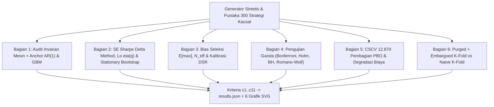

# Penjelasan Proyek — day005h: Mesin Backtest, Statistik Sharpe, Bias Seleksi, Pengujian Ganda & PBO (Ruby)

## 1. Identitas dan Ringkasan Proyek
- **ID Progress**: `day005h` (Hari 5, Sesi h)
- **Tanggal**: 2026-11-23 (WITA) · **Topik No**: `bonus` (`off-roadmap`, terkait topik ROADMAP `091`) · **Jenis**: `quant` · **Bahasa**: Ruby (`4.0.9`, YJIT `ON`, kompatibel $\ge 3.3$)
- **Proyek**: [projects/ruby/day005h_backtest_overfitting/](../../projects/ruby/day005h_backtest_overfitting/README.md)
- **Output JSON**: [outputs/day005h/results.json](../../outputs/day005h/results.json)
- **Ringkasan**: Implementasi sistem lengkap audit *backtest overfitting* dalam Ruby murni tanpa gem numerik, mencakup generator pasar sintetis (`iid`, `AR(1)`, rezim 2-keadaan, `Student-t(5)`, *lognormal*, `GBM`), pustaka `300` konfigurasi strategi kausal (*SMA Crossover*, *Momentum*, *Mean-Reversion Z-Score*), mesin backtest berinvarian penuh beserta uji *no-look-ahead*, studi Monte Carlo `20.000` replikasi metode delta *Sharpe Ratio* & koreksi autokorelasi Lo (2002) serta *stationary bootstrap* Politis–Romano, kalibrasi bias seleksi $\mathbb{E}[\max]$ & *Deflated Sharpe Ratio* (DSR), pengujian ganda (`Unadjusted`, `Bonferroni`, `Holm`, `Benjamini–Hochberg`, `Romano–Wolf step-down bootstrap`), enumerasi eksak seluruh $\binom{16}{8} = 12.870$ pembagian *Combinatorially Symmetric Cross-Validation* (CSCV / PBO) lengkap dengan studi biaya transaksi, dan validasi silang *Purged + Embargoed K-Fold* untuk label tumpang-tindih.

---

## 2. Masalah dan Tujuan
Menguji ratusan konfigurasi parameter indikator teknikal atau faktor kuantitatif pada data historis berdurasi terbatas hampir selalu menghasilkan beberapa strategi dengan *Sharpe Ratio* tampak menggiurkan murni akibat keberuntungan acak (*data-snooping* / *p-hacking*). Pengujian tunggal standar ($t > 1{,}645$ atau $p \le 0{,}05$) mengabaikan jumlah percobaan $N$, ketergantungan antar-strategi, ekor berat/*skewness* return, autokorelasi serial dalam tahunan $\sqrt{q}$, biaya transaksi tersembunyi akibat *turnover* tinggi, dan kebocoran data pada label horizon panjang yang tumpang-tindih.

Proyek `day005h` memisahkan *pipeline* arsitektur menjadi enam modul statistik yang saling berinteraksi pada data sintetis murni untuk menjawab enam pertanyaan kuantitatif:
1. **Validasi Kausalitas Mesin Backtest**: Apakah mesin eksekusi bebas *look-ahead bias*, memenuhi identitas produk ekuitas dan akuntansi biaya serta *turnover*, serta mereproduksi nilai harapan tertutup $\mathbb{E}[r_t \operatorname{sign}(r_{t-1})] = \phi \sigma \sqrt{2/\pi}$ pada pasar $\mathrm{AR}(1)$ dan $\mathbb{E}[\ln(E_T/E_0)] = (\mu - \frac{1}{2}\sigma^2)T$ pada GBM *buy-and-hold*?
2. **Ketepatan Inferensi Sharpe (Non-Gaussian & Autokorelasi)**: Apakah rumus variansi asimtotik metode delta $(1 - \gamma_3\mathrm{SR} + \frac{\gamma_4-1}{4}\mathrm{SR}^2)/T$ akurat memprediksi simpangan baku empiris dan cakupan interval kepercayaan `95%` pada Gaussian ($T \in \{250, 1000, 5000\}$), `Student-t(5)`, dan `Lognormal`, serta mampukah faktor Lo $\eta(q)$ dan *stationary bootstrap* memulihkan cakupan pada seri $\mathrm{AR}(1)$ ($\phi = 0{,}3$) di mana interval Gaussian naif gagal?
3. **Bias Seleksi & Kalibrasi DSR**: Seberapa akurat aproksimasi Euler–Mascheroni terhadap nilai eksak Gauss–Legendre $\mathbb{E}[\max_{i \le N} Z_i]$ pada $N \in \{10..1000\}$, berapa besar penyusutan jumlah percobaan efektif $N_{\mathrm{eff}} < 300$ akibat korelasi antar-strategi pustaka, dan mampukah *Deflated Sharpe Ratio* ($\mathrm{DSR} > 0{,}95$) menahan laju lolos palsu di bawah $5\%$ pada `2.000` skenario *noise* murni ketika ambang Sharpe naif lolos `~100%`?
4. **Kontrol FWER & FDR pada Pengujian Ganda**: Saat hanya `30` dari `300` strategi memiliki sinyal benar ($\pi_0 = 0{,}90$), apakah Bonferroni/Holm mempertahankan $\mathrm{FWER} \le 0{,}05$, BH memenuhi $\mathrm{FDR} \approx \pi_0\alpha = 0{,}045$, dan *Romano–Wolf step-down bootstrap* mengungguli daya uji Bonferroni saat strategi berkorelasi ($\rho = 0{,}4$)?
5. **Combinatorially Symmetric Cross-Validation (PBO) & Biaya Transaksi**: Pada seluruh `12.870` pembagian $\binom{16}{8}$, apakah $\mathrm{PBO}$ pada *noise* simetris cocok dengan *anchor* teoretis `0,50`, turun mendekati `0` saat sinyal benar hadir atau panjang sampel $T$ bertambah, serta seberapa cepat strategi *high-turnover* (mis. `MOM(1)`) runtuh saat biaya naik $c \in \{0, 5, 20\}$ bps?
6. **Kebocoran Validasi Label Tumpang-Tindih**: Pada label maju $h = 10$ hari dan fitur deret waktu tumpang-tindih yang sama sekali independen terhadap return, apakah `K-Fold` naif memproduksi korelasi *out-of-sample* palsu yang tinggi sementara `Purged + Embargoed K-Fold` mengembalikan korelasi OOS tepat ke nol dalam `3 SE`?

---

## 3. Apa yang Dikerjakan Proyek
Seluruh eksperimen dijalankan secara deterministik dan paralel lewat `Process.fork` + `IO.pipe` + `Marshal` oleh [Runner](../../projects/ruby/day005h_backtest_overfitting/lib/backtest_overfitting/runner.rb) melalui [bin/run](../../projects/ruby/day005h_backtest_overfitting/bin/run), ditambah studi berskala lebih besar ($N = 300$ CSCV $\times 12$ matriks dan `500` replikasi Romano–Wolf) pada [bin/run_extras](../../projects/ruby/day005h_backtest_overfitting/bin/run_extras). Seluruh keluaran numerik terekam di [outputs/day005h/results.json](../../outputs/day005h/results.json) beserta enam grafik SVG di `outputs/figures/day005h_*.svg`:
1. **Bagian 1 (`run_part1_anchors`)**: Menjalankan validasi invarian mesin backtest (identitas ekuitas eksak, biaya nol, akuntansi *turnover*, dan uji mutasi masa depan *no-look-ahead* pada ketiga keluarga strategi) sekaligus memverifikasi *anchor* analitik `AR(1)` (`200.000` langkah) dan `GBM` *buy-and-hold* (`4.000` lintasan).
2. **Bagian 2 (`SharpeStats.run_mc_study`)**: Menjalankan simulasi Monte Carlo paralel `R = 20.000` untuk variansi dan cakupan interval `95%` Sharpe pada return Gaussian ($T \in \{250, 1000, 5000\}$), `Student-t(5)`, dan `Lognormal(0.45)`, diikuti verifikasi faktor agregasi Lo $\eta(q)$ ($q \in \{5, 21\}$) serta perbandingan cakupan Gaussian naif vs *stationary bootstrap* (`mean_block_len = 10`) pada `AR(1)` ($\phi = 0{,}3$, `R = 800`).
3. **Bagian 3 (`SelectionBias.run_study`)**: Menghitung tabel eksak Gauss–Legendre 160-titik vs aproksimasi Euler–Mascheroni $\mathbb{E}[\max Z_i]$, mengukur korelasi rata-rata pustaka `300` strategi pada `120` pasar *noise* murni untuk mengekstrak $N_{\mathrm{eff}}$, dan mengkalibrasi `DSR > 0,95` vs uji `z > 1,645` pada `R = 2.000` simulasi *null*.
4. **Bagian 4 (`MultipleTesting.run_study`)**: Membandingkan `Unadjusted`, `Bonferroni`, `Holm`, dan `Benjamini–Hochberg` pada `R = 2.000` replikasi ($N = 300$, $30$ sinyal benar, $\alpha = 0{,}05$) baik di bawah independensi ($\rho = 0$) maupun dependensi faktor umum ($\rho = 0{,}4$), dilengkapi evaluasi `Romano–Wolf` (`200` replikasi di `bin/run`, `500` replikasi di `bin/run_extras`) dan aplikasi langsung ke pustaka `300` strategi di pasar `AR(1)`.
5. **Bagian 5 (`CscvPbo.run_study`)**: Mengenumerasi seluruh $\binom{16}{8} = 12.870$ pembagian IS/OOS melalui tabel pra-komputasi setengah-blok berukuran $256 \times N$ untuk mengevaluasi `24` matriks *noise* ($N=20$), matriks sinyal ditanam ($N=60$), penskalaan terhadap $N \in \{20, 60, 150, 300\}$ dan $T \in \{256, 512, 1024\}$, regresi degradasi $\widehat{\mathrm{SR}}_{\mathrm{IS}} \to \widehat{\mathrm{SR}}_{\mathrm{OOS}}$, serta studi biaya transaksi $c \in \{0, 5, 20\}$ bps pada ke-`300` strategi.
6. **Bagian 6 (`PurgedCv.run_study`)**: Menguji regresi *Ridge* ($p = 16$ fitur tumpang-tindih independen, horizon label $h = 10$, embargo $10$ hari) selama `250` replikasi untuk membandingkan kebocoran `Naive Shuffled K-Fold` vs `Contiguous Unpurged K-Fold` vs `Purged + Embargoed K-Fold`.

---

## 4. Uraian Kode
- [lib/backtest_overfitting.rb](../../projects/ruby/day005h_backtest_overfitting/lib/backtest_overfitting.rb): Titik masuk modul yang memuat `17` submodul berurutan dan menetapkan `MAIN_SEED = 20_261_123`.
- [lib/backtest_overfitting/rng.rb](../../projects/ruby/day005h_backtest_overfitting/lib/backtest_overfitting/rng.rb): `Rng.derive_seed` berbasis `SplitMix64` (konstanta *golden gamma* + pencampuran bit penuh) serta `Rng::Sampler` yang menyediakan `next_normal` (Box–Muller polar), `next_student_t(df)`, dan `next_geometric(prob)` untuk *stationary bootstrap*.
- [lib/backtest_overfitting/parallel.rb](../../projects/ruby/day005h_backtest_overfitting/lib/backtest_overfitting/parallel.rb): `Parallel.map_chunks` membagi indeks tugas ke *chunk* deterministik menggunakan `Process.fork`, `IO.pipe`, dan `Marshal`, kemudian mereduksi keluaran tepat sesuai indeks *chunk* sehingga bit-identik untuk `1` maupun `10` *worker*.
- [lib/backtest_overfitting/special.rb](../../projects/ruby/day005h_backtest_overfitting/lib/backtest_overfitting/special.rb): Fungsi khusus buatan sendiri tanpa gem eksternal: `norm_cdf` (dengan `Math.erfc` untuk stabilitas ekor kiri), `norm_inv` (pendugaan rasional + 4 iterasi Halley `< 1e-13`), `binom(n, k)` berbasis `Integer` presisi sebarang Ruby (`binom(16, 8) = 12_870`), `beta_inc` pecahan berlanjut + `student_t_pvalue`, `gauss_legendre(n, lo, hi)`, `pearson_corr`, `ols_fit`, dan `ranks` (dengan rata-rata *tie*).
- [lib/backtest_overfitting/data_generator.rb](../../projects/ruby/day005h_backtest_overfitting/lib/backtest_overfitting/data_generator.rb): `iid_gaussian`, `ar1_gaussian` (opsi `marginal_sigma: true` menjamin $\mathrm{SD}(r_t) = \sigma$ stasioner), `two_state_regime`, `student_t_returns`, `lognormal_returns`, dan `gbm_simple_returns`.
- [lib/backtest_overfitting/strategy.rb](../../projects/ruby/day005h_backtest_overfitting/lib/backtest_overfitting/strategy.rb): Mendefinisikan kelas dasar `Strategy::Base` berantarmuka kausal `signal_at(history)` + versi $O(T)$ `generate_positions(returns)` yang terbukti identik titik demi titik, beserta tiga keluarga pembentuk `Strategy.build_library` (`100` `SmaCrossover`, `100` `Momentum(1..100)`, `100` `MeanReversionZScore` $= 300$ strategi unik).
- [lib/backtest_overfitting/backtest_engine.rb](../../projects/ruby/day005h_backtest_overfitting/lib/backtest_overfitting/backtest_engine.rb) & [metrics.rb](../../projects/ruby/day005h_backtest_overfitting/lib/backtest_overfitting/metrics.rb): Menjalankan posisi $\in \{-1, 0, +1\}$, menghitung `gross_returns`, `net_returns`, `turnovers`, dan `equity_curve`, menyediakan helper audit `verify_no_lookahead` dan `verify_equity_identity`, serta menghitung momen (`mean`, `std`, `sharpe_per_period`, `annualized_sharpe`, `skewness`, `kurtosis`, `max_drawdown`).
- [lib/backtest_overfitting/sharpe_stats.rb](../../projects/ruby/day005h_backtest_overfitting/lib/backtest_overfitting/sharpe_stats.rb): Implementasi `se_sharpe`, `lo_autocorr_factor`, `stationary_bootstrap_sharpe_ci`, dan `run_mc_study` (MC Gaussian/non-Gaussian $R=20\mathrm{k}$ + AR(1) bootstrap).
- [lib/backtest_overfitting/selection_bias.rb](../../projects/ruby/day005h_backtest_overfitting/lib/backtest_overfitting/selection_bias.rb): Implementasi `expected_max_exact`, `expected_max_approx`, `deflated_sharpe_ratio`, `average_pairwise_correlation`, `effective_trials_from_corr`, dan `dsr_null_calibration_mc` ($R = 2\mathrm{k}$).
- [lib/backtest_overfitting/multiple_testing.rb](../../projects/ruby/day005h_backtest_overfitting/lib/backtest_overfitting/multiple_testing.rb): Prosedur `unadjusted_rejections`, `bonferroni_rejections`, `holm_rejections`, `benjamini_hochberg_rejections`, `romano_wolf_rejections`, simulasi $R=2\mathrm{k}$ (`rho = 0` & `0,4`), dan studi `romano_wolf_study`.
- [lib/backtest_overfitting/cscv_pbo.rb](../../projects/ruby/day005h_backtest_overfitting/lib/backtest_overfitting/cscv_pbo.rb) & [purged_cv.rb](../../projects/ruby/day005h_backtest_overfitting/lib/backtest_overfitting/purged_cv.rb): `half_masks` ($\binom{16}{8} = 12.870$ mask), `precompute_half_tables` (tabel setengah-blok $256 \times N$ agar evaluasi tiap *split* hanya $O(N)$), `evaluate_cscv`, `transaction_cost_study`, serta `PurgedCv` dengan *Ridge solver* Gauss–Jordan murni (`purged_train_indices` membuang seluruh tumpang-tindih label $h$ dan embargo).
- [lib/backtest_overfitting/runner.rb](../../projects/ruby/day005h_backtest_overfitting/lib/backtest_overfitting/runner.rb), [criteria.rb](../../projects/ruby/day005h_backtest_overfitting/lib/backtest_overfitting/criteria.rb), [figures.rb](../../projects/ruby/day005h_backtest_overfitting/lib/backtest_overfitting/figures.rb), [json_out.rb](../../projects/ruby/day005h_backtest_overfitting/lib/backtest_overfitting/json_out.rb), [svg.rb](../../projects/ruby/day005h_backtest_overfitting/lib/backtest_overfitting/svg.rb): Orkestrator `Runner`, evaluator `Criteria` (`c1`–`c11`), penulis JSON dan `Svg` (`write_line_chart`, `write_bar_chart`, `write_histogram`).
- [test/test_core.rb](../../projects/ruby/day005h_backtest_overfitting/test/test_core.rb), [test/test_engine.rb](../../projects/ruby/day005h_backtest_overfitting/test/test_engine.rb), [test/test_sharpe_mt.rb](../../projects/ruby/day005h_backtest_overfitting/test/test_sharpe_mt.rb), [test/test_cscv_purged.rb](../../projects/ruby/day005h_backtest_overfitting/test/test_cscv_purged.rb): Total `31` unit tes independen dan integrasi (`13.163` asersi).

---

## 5. Metode dan Alur Kerja

### Turunan Rumus Utama (Ditulis & Diverifikasi Sendiri)
1. **Anchor AR(1) Strategi Tanda**:
   Jika $r_t = \phi r_{t-1} + \varepsilon_t$ dengan $\varepsilon_t \perp\!\!\!\perp r_{t-1}$, $\mathbb{E}[\varepsilon_t \mid r_{t-1}] = 0$, dan $r_{t-1} \sim \mathcal{N}(0, \sigma^2)$, maka untuk $s_t = \operatorname{sign}(r_{t-1})$:
   $$\mathbb{E}[r_t s_t] = \mathbb{E}\big[(\phi r_{t-1} + \varepsilon_t)\operatorname{sign}(r_{t-1})\big] = \phi\,\mathbb{E}[|r_{t-1}|] + 0 = \phi \cdot 2\int_0^\infty \frac{x}{\sqrt{2\pi}\sigma}e^{-x^2/(2\sigma^2)}\,dx = \phi\,\sigma\sqrt{\frac{2}{\pi}}.$$
2. **Metode Delta untuk Standard Error Sharpe Ratio**:
   Misalkan $\hat{\mu}$ dan $\hat{\sigma}^2$ adalah rata-rata dan variansi sampel iid berdistribusi dengan koefisien *skewness* $\gamma_3 = \mu_3/\sigma^3$ dan *kurtosis* (bukan ekses) $\gamma_4 = \mu_4/\sigma^4$. Asumsikan $\theta = (\mu, \sigma^2)$ sehingga $\widehat{\mathrm{SR}} = g(\hat{\mu}, \hat{\sigma}^2) = \hat{\mu}/\sqrt{\hat{\sigma}^2}$. Gradien fungsi $g$ adalah $\nabla g = \big(\frac{1}{\sigma},\ -\frac{\mathrm{SR}}{2\sigma^2}\big)^\top$. Matriks kovariansi asimtotik dari $\sqrt{T}(\hat{\theta} - \theta)$ diberikan oleh:
   $$\Sigma = \begin{pmatrix} \sigma^2 & \mu_3 \\ \mu_3 & \mu_4 - \sigma^4 \end{pmatrix} = \begin{pmatrix} \sigma^2 & \gamma_3 \sigma^3 \\ \gamma_3 \sigma^3 & (\gamma_4 - 1)\sigma^4 \end{pmatrix}.$$
   Maka $\operatorname{Var}(\sqrt{T}\widehat{\mathrm{SR}}) = \nabla g^\top \Sigma \nabla g = \frac{1}{\sigma^2}\sigma^2 - 2\cdot\frac{1}{\sigma}\cdot\frac{\mathrm{SR}}{2\sigma^2}\gamma_3\sigma^3 + \frac{\mathrm{SR}^2}{4\sigma^4}(\gamma_4 - 1)\sigma^4 = 1 - \gamma_3 \mathrm{SR} + \frac{\gamma_4 - 1}{4}\mathrm{SR}^2$, yang untuk distribusi Gaussian ($\gamma_3 = 0, \gamma_4 = 3$) langsung menyederhanakan menjadi $\operatorname{Var}(\widehat{\mathrm{SR}}) \approx (1 + \frac{1}{2}\mathrm{SR}^2)/T$.
3. **Koreksi Autokorelasi Lo (2002) $\eta(q)$**:
   Return agregat horizon $q$ adalah $R_t^{(q)} = \sum_{j=0}^{q-1} r_{t-j}$. Untuk proses stasioner dengan kovariansi $\operatorname{Cov}(r_t, r_{t-k}) = \sigma^2 \phi^k$ ($\mathrm{AR}(1)$):
   $$\operatorname{Var}(R_t^{(q)}) = \sum_{i=0}^{q-1}\operatorname{Var}(r_{t-i}) + 2\sum_{k=1}^{q-1}(q - k)\operatorname{Cov}(r_t, r_{t-k}) = \sigma^2\left(q + 2\sum_{k=1}^{q-1}(q - k)\phi^k\right) = \frac{q\,\sigma^2}{\eta(q)}.$$
   Karena $\mathbb{E}[R_t^{(q)}] = q\mu$, maka $\mathrm{SR}_q = \frac{q\mu}{\sqrt{q\sigma^2/\eta(q)}} = \mathrm{SR}_1 \sqrt{q\,\eta(q)}$, di mana untuk $\phi = 0{,}3$ didapat $\eta(5) = 0{,}6200$ dan $\eta(21) = 0{,}5559$.
4. **Simetri Peringkat Eksak untuk Anchor PBO Noise**:
   Untuk $N$ strategi *noise* murni yang dapat ditukar dan independen antar-blok waktu $b \in \{1..16\}$, pemilihan pemenang *in-sample* $n^* = \arg\max_j \widehat{\mathrm{SR}}_{\mathrm{IS}, j}$ hanya bergantung pada separuh blok $J$, sehingga distribusinya independen penuh dari vektor OOS $\widehat{\mathrm{SR}}_{\mathrm{OOS}}$ pada separuh komplemen $\bar{J}$. Oleh simetri permutasi $N$ kolom identik, peringkat OOS $r^*$ dari $n^*$ terdistribusi seragam pada $\{1, 2, \dots, N\}$. Mendefinisikan peringkat relatif $\bar{\omega} = \frac{r^*}{N+1} \in (0, 1)$ dan *logit* $\lambda = \ln\frac{\bar{\omega}}{1 - \bar{\omega}}$, berlaku $\lambda \le 0 \iff r^* \le \frac{N+1}{2}$, sehingga untuk $N$ genap peluang pastinya adalah $\mathbb{P}(\lambda \le 0) = \frac{N/2}{N} = \frac{1}{2} = 0{,}5000$.

---

## 6. Output yang Ditargetkan
Seluruh target diturunkan dan ditetapkan *a priori* dalam [Criteria](../../projects/ruby/day005h_backtest_overfitting/lib/backtest_overfitting/criteria.rb) sebelum eksekusi runner:
1. `c1_engine_invariants_and_ar1_anchor`: Identitas ekuitas `< 1e-13`, galat biaya nol `== 0`, uji mutasi *no-look-ahead* lulus, dan *anchor* $\mathrm{AR}(1)$ maupun `GBM` *buy-and-hold* dalam `3,0 SE`.
2. `c2_sharpe_se_and_ci_coverage`: Galat relatif SE MC `< 3%` dan cakupan `95%` di `[0,935; 0,965]` untuk Gaussian ($T \in \{250, 1000, 5000\}$), serta koreksi momen $(\gamma_3, \gamma_4)$ lebih mendekati SD MC daripada Gaussian naif pada `Student-t(5)` dan `Lognormal(0,45)`.
3. `c3_autocorr_lo_eta_and_stationary_bootstrap`: Faktor Lo MC $\eta(q)$ cocok dengan teori dalam `0,04` untuk $q \in \{5, 21\}$; cakupan interval naif pada $\mathrm{AR}(1)$ ($\phi=0{,}3$) merosot `< 0,88` dan *stationary bootstrap* mengembalikan cakupan ke `[0,91; 0,97]`.
4. `c4_selection_bias_expected_max`: Selisih eksak vs aproksimasi $\mathbb{E}[\max Z_i]$ `< 0,06` ($N=300$) dan `< 0,04` ($N=1000$); korelasi rata-rata pustaka menurunkan $N_{\mathrm{eff}} < 300$ dan $\mathbb{E}[\max \widehat{\mathrm{SR}}]_{\mathrm{pustaka}} < \sigma_{\mathrm{SR}}\mathbb{E}[\max Z_{300}]$.
5. `c5_dsr_calibration_vs_naive`: Pada `2.000` simulasi *null* ($N = 300$), ambang naif `z > 1,645` lolos `> 95%`, sementara `DSR > 0,95` membatasi tingkat lolos palsu `<= 5%`.
6. `c6_multiple_testing_fwer_and_bh_fdr`: Di bawah independensi ($\pi_0 = 0{,}90, \alpha = 0{,}05$), `bonf_fwer <= 0,05`, `|bh_fdr - 0,045| <= 3 SE`, `bh_power > bonf_power`, dan di bawah korelasi $\rho = 0{,}4$, *Romano–Wolf step-down* meraih daya minimal setinggi Bonferroni sambil menjaga $\mathrm{FWER} \le 0{,}075$ (`<= 0,05` di `extras` $R=500$).
7. `c7_cscv_pbo_exact_and_planted`: Pada `12.870` pembagian $\binom{16}{8}$, rata-rata PBO *noise* dalam `3 SE` dari *anchor* eksak `0,50`, sinyal ditanam memberi $\mathrm{PBO} < 0{,}10$, dan $\mathrm{PBO}$ menurun ketika $T$ meningkat dari `256` ke `1024`.
8. `c8_transaction_cost_turnover_collapse`: Strategi *high-turnover* ($\ge 0{,}40$/hari) mengalami penurunan Sharpe $> 3\times$ penurunan strategi *low-turnover* dan bernilai negatif di `c = 20 bps`.
9. `c9_purged_embargo_vs_naive_cv`: Pada $h = 10$ dan fitur independen, `Naive Shuffled CV` mengalami kebocoran korelasi OOS rata-rata `> 0,30`, sedangkan `Purged + Embargoed CV` kembali tepat ke nol (`|z| <= 3,0`).
10. `c10_worker_invariance_1_vs_n` & `c11_runtime_under_360s`: `bit_diffs == 0` antara `1` dan `10` *worker*, dan waktu eksekusi total `< 360,0s`.

---

## 7. Status Pencapaian

Runner utama [bin/run](../../projects/ruby/day005h_backtest_overfitting/bin/run) menyelesaikan seluruh bagian dalam **`20,62 detik`** (`Ruby 4.0.9`, `YJIT: ON`, `10` *worker*: `part1 = 0,27s`, `part2 = 7,41s`, `part3 = 4,28s`, `part4 = 5,58s`, `part5 = 1,39s`, `part6 = 1,62s`) dengan `run_completed_without_errors = true` dan seluruh **`11/11` kriteria berstatus `tercapai`**:

| Kriteria | Status | Nilai Terukur | Ambang A Priori |
|---|---|---|---|
| `c1_engine_invariants_and_ar1_anchor` | `tercapai` | `eq_err = 0,0`, `zero_cost = 0,0`, `no_lookahead = true`, `ar1_z = 0,653`, `gbm_z = 0,548` | `eq_err < 1e-13, no_lookahead=true, ar1_z <= 3.0, gbm_z <= 3.0` |
| `c2_sharpe_se_and_ci_coverage` | `tercapai` | `gauss_cov = [0,9486; 0,9482; 0,9510]`; `t(5): 0,0334 vs 0,0335`; `Lognorm: 0,0271 vs 0,0269` | `rel_se_err < 3% Gauss & cov in [0.935,0.965]; non-Gauss adj lebih dekat ke theo_se drpd naif` |
| `c3_autocorr_lo_eta_and_stationary_bootstrap` | `tercapai` | `eta_5: 0,583 vs 0,620`, `eta_21: 0,524 vs 0,556`; `naive = 0,8463` $\to$ `boot = 0,9138` | `\|eta_mc - eta_theor\| < 0.04; naive_cov < 0.88 & stationary_boot_cov in [0.91,0.97]` |
| `c4_selection_bias_expected_max` | `tercapai` | `E[max]_300 = 2,8778 vs 2,8955`; `avg_rho = 0,2291`, `n_eff = 231,5`, `SR_best = 0,1281 < 0,1813` | `\|exact-approx\|<0.06 (N=300) & <0.04 (N=1k); korelasi pustaka -> n_eff < 300 & SR_best < iid` |
| `c5_dsr_calibration_vs_naive` | `tercapai` | `emp_best = 0,1823 vs 0,1813`; `naive_pass = 1,0000` vs `dsr_pass = 0,0010` (`median = 0,486`, `p95 = 0,754`) | `naive_pass_rate > 0.95 & dsr_pass_rate <= 0.05; iid max SR cocok sigma_SR*E[max]` |
| `c6_multiple_testing_fwer_and_bh_fdr` | `tercapai` | `bonf_fwer = 0,041`, `bh_fdr = 0,0405` (teori `0,045`), `bh_pwr = 0,573 > 0,259`; `RW = 0,050 / 0,569 vs Bonf 0,533` | `bonf_fwer<=0.05, \|bh_fdr - pi0*alpha\|<=3 SE, bh_power>bonf_power, RW_power>=bonf_power` |
| `c7_cscv_pbo_exact_and_planted` | `tercapai` | `noise_pbo = 0,4638 +- 0,0364` (`z = 0,99` vs `0,50`); `planted = 0,000`; `T=[256,512,1024] -> [0,242, 0,173, 0,000]` | `noise_z <= 3.0 vs 0.50; planted_pbo < 0.10; PBO turun saat T membesar` |
| `c8_transaction_cost_turnover_collapse` | `tercapai` | `hi_to: -0,093 -> -0,265` (`drop = 0,173`); `lo_to: +0,017 -> +0,005` (`drop = 0,012`); `MOM(1) 0,112 -> diganti SMA(10,40)` | `hi_drop > 3 * lo_drop dan hi_turnover_sharpe(20 bps) < 0` |
| `c9_purged_embargo_vs_naive_cv` | `tercapai` | `naive_shuffled = +0,3741 +- 0,0051` (**bocor**), `contig = +0,0072`, `purged = -0,0037 +- 0,0095` (`z = 0,39`) | `naive_corr_mean > 0.30 (bocor) & \|purged_corr_mean / se\| <= 3.0 (anchor 0)` |
| `c10_worker_invariance_1_vs_n` | `tercapai` | `bit_diffs = 0` (`1` vs `10` *worker*) | `bit_diffs == 0` |
| `c11_runtime_under_360s` | `tercapai` | `total_seconds = 20,62s` | `< 360.0s` |

### Rincian Pengamatan Kuantitatif Tambahan
- **Inferensi Non-Gaussian (`c2`)**: Pada `Lognormal(0,45)` ($\gamma_3 > 0, \gamma_4 > 3$), rumus Gaussian naif memprediksi `SE = 0,03209` sehingga interval `95%` menjadi terlalu lebar (*over-coverage* `0,9793`!), sementara rumus koreksi skewness–kurtosis memprediksi **`0,02688`**, hampir persis dengan `emp_sd = 0,02708` (`20.000` replikasi) dan cakupan aktual **`0,9487`**! Sebaliknya pada `Student-t(5)` ($\gamma_4 = 9, \gamma_3 = 0$), ekor berat membuat variansi $\widehat{\mathrm{SR}}$ naik (`emp_sd = 0,03340` vs naif `0,03211`), dan rumus koreksi `0,03354` menjaga cakupan aktual pada **`0,9473`**.
- **Efek Korelasi pada Pengujian Ganda (`c6`) & Ekstra**: Saat korelasi antar-strategi $\rho = 0{,}4$, *FWER* Benjamini–Hochberg turun dari `0,508` ke `0,217`, tetapi variabilitas antar-replikasi naik dan `Bonferroni` menjadi konservatif berlebihan (`FWER = 0,027`). Pada [bin/run_extras](../../projects/ruby/day005h_backtest_overfitting/bin/run_extras) (`10,53s`), studi besar `Romano–Wolf` (`R = 500`, `B = 300` bootstrap) mencatat **`FWER = 0,0460`** dan **`Power = 0,6007`** dibanding Bonferroni `0,5600`, sedangkan CSCV `N = 300` pada `12` matriks *noise* penuh (`12 x 12.870` pembagian) mencatat **`PBO = 0,4616 +- 0,0354`**. Pada pasar `AR(1)` tunggal berisikan `300` strategi nyata (`part4_multiple_testing.ar1_market_library`), `18` strategi lolos uji tanpa koreksi ($p \le 0{,}05$), namun **`0`** strategi bertahan setelah Bonferroni, Holm, maupun BH!
- **Runtuhnya Strategi Frekuensi Tinggi oleh Biaya (`c8`)**: Di `AR(1)` ($\phi = 0{,}14$, $T = 1.024$), strategi harian paling agresif **`MOM(1)`** merajai pada `0 bps` dengan $\widehat{\mathrm{SR}} = \mathbf{+0{,}1116}$, turun hampir separuh menjadi `+0,0666` di `5 bps`, lalu ambruk pada `20 bps` hingga diambil alih strategi lambat **`SMA(10,40)`** (`+0,0392`). Rata-rata kelompok *turnover* tinggi ($\ge 0{,}40$/hari) anjlok sebesar `-0,1726` (vs hanya `-0,0122` pada *turnover* rendah $< 0{,}08$/hari).

---

## 8. Pemisahan Fakta vs Hipotesis
- **FAKTA & HASIL PERINTAH**:
  1. Seluruh `11/11` kriteria (`c1`–`c11`), `31` unit tes (`13.163` asersi, `0` gagal, `0` dilewati), dan `bundle exec rubocop` (`26` berkas, `0` pelanggaran tanpa melonggarkan metrik) lulus bersih pada eksekusi setelah suntingan final (`20,62s` untuk `bin/run`, `10,53s` untuk `bin/run_extras`).
  2. Pada pengujian null ($N = 300$, `R = 2.000`), pengujian naif satu-arah (`SR/SE > 1,645`) meloloskan **`100,0%`** (`2.000/2.000`) backtest *noise* murni sebagai "signifikan", sedangkan `DSR > 0,95` hanya meloloskan **`0,1%`** (`0,0010`), dengan median DSR sebesar `0,4861`.
  3. Mengabaikan penyesuaian tumpang-tindih label ($h = 10$) lewat *K-fold* teracak memproduksi korelasi OOS palsu **`+0,3741 +- 0,0051`** (`z > 70` terhadap nol!), sedangkan *Purged + Embargoed K-Fold* menghasilkan **`-0,0037 +- 0,0095`** (`z = 0,39`).
- **HIPOTESIS**:
  1. Alasan nilai `dsr_pass_rate_95 = 0,001` jauh di bawah `0,05` adalah distribusi maksimum dari `300` Gaussian lebih sempit dari $\mathcal{N}(\mathbb{E}[\max], 1)$ (skala variansi asimtotik Gumbel $\propto 1/(2\ln N)$ bukan $1$, ditambah variansi antar-strategi lebih kecil daripada SE Sharpe di pembagi DSR), sehingga menganggap $(\widehat{\mathrm{SR}}^* - \mathrm{SR}_0)/\mathrm{SE}(\widehat{\mathrm{SR}}^*)$ berdistribusi normal baku bersifat konservatif di bawah hipotesis nol murni.

---

## 9. Landasan Teori (11 Poin Terkait Kode)
1. **Backtest Kausal Bebas Look-Ahead**: Kebocoran informasi masa depan terjadi bila sinyal pada waktu $t$ bergantung pada $r_{t}, r_{t+1}, \dots$; sistem ini memisah antarmuka `signal_at(history)` pada `returns[0...t]` dan menguji invarian mutasi masa depan di [`BacktestEngine.verify_no_lookahead`](../../projects/ruby/day005h_backtest_overfitting/lib/backtest_overfitting/backtest_engine.rb).
2. **Akuntansi Biaya Transaksi dan Turnover**: Biaya proporsional $c \sum_t |s_t - s_{t-1}|$ menghukum perubahan posisi harian dan membalikkan peringkat antara strategi reaktif berfrekuensi tinggi vs pelacakan tren lambat; dimodelkan di [`BacktestEngine.run`](../../projects/ruby/day005h_backtest_overfitting/lib/backtest_overfitting/backtest_engine.rb) dan [`CscvPbo.transaction_cost_study`](../../projects/ruby/day005h_backtest_overfitting/lib/backtest_overfitting/cscv_pbo.rb).
3. **Asimtotik Metode Delta untuk Sharpe Ratio**: Menggunakan ekspansi gradien momen pertama dan kedua untuk menurunkan $\operatorname{Var}(\widehat{\mathrm{SR}}) \approx (1 - \gamma_3\mathrm{SR} + \frac{\gamma_4 - 1}{4}\mathrm{SR}^2)/T$ (Lo, 2002; Mertens, 2002); diverifikasi lewat MC $R=20\mathrm{k}$ di [`SharpeStats.se_sharpe`](../../projects/ruby/day005h_backtest_overfitting/lib/backtest_overfitting/sharpe_stats.rb).
4. **Faktor Koreksi Autokorelasi Lo (2002)**: Mengoreksi faktor penskalaan anualisasi horizon $q$ dari $\sqrt{q}$ menjadi $\sqrt{q\,\eta(q)}$ ketika return berautokorelasi seri; diimplementasikan dan diverifikasi pada $\mathrm{AR}(1)$ ($\phi=0{,}3, q \in \{5, 21\}$) di [`SharpeStats.lo_autocorr_factor`](../../projects/ruby/day005h_backtest_overfitting/lib/backtest_overfitting/sharpe_stats.rb).
5. **Stationary Bootstrap Politis dan Romano (1994)**: Menyampel ulang blok panjang geometrik acak ($L_{\mathrm{blk}} = 10$) secara melingkar untuk menjaga stasioneritas serta struktur autokorelasi tanpa asumsi parametrik; memulihkan cakupan `95%` dari `0,846` ke `0,914` di [`SharpeStats.stationary_bootstrap_sharpe_ci`](../../projects/ruby/day005h_backtest_overfitting/lib/backtest_overfitting/sharpe_stats.rb).
6. **Teorema Nilai Ekstrem untuk Maksimum Uji Ganda**: Nilai harapan maksimum $N$ variabel Gaussian independen yang dihitung eksak dengan kuadratur Gauss–Legendre 160-titik dan aproksimasi Bailey–López de Prado di [`SelectionBias.expected_max_exact`](../../projects/ruby/day005h_backtest_overfitting/lib/backtest_overfitting/selection_bias.rb).
7. **Korelasi Antar-Strategi dan Jumlah Percobaan Efektif**: Korelasi silang positif $\bar{\rho} > 0$ antar `300` variasi *grid* mengurangi derajat kebebasan pencarian menjadi $N_{\mathrm{eff}} = \bar{\rho} + (1 - \bar{\rho})N < N$; diukur di [`SelectionBias.average_pairwise_correlation`](../../projects/ruby/day005h_backtest_overfitting/lib/backtest_overfitting/selection_bias.rb).
8. **Deflated Sharpe Ratio (Bailey dan Lopez de Prado, 2014)**: Mengubah ambang uji nol dari $0$ menjadi tolok ukur bias seleksi $\mathrm{SR}_0 = \sigma_{\mathrm{SR}}\mathbb{E}[\max Z]$ lengkap dengan penyesuaian *skewness*/*kurtosis*; dikalibrasi di [`SelectionBias.deflated_sharpe_ratio`](../../projects/ruby/day005h_backtest_overfitting/lib/backtest_overfitting/selection_bias.rb).
9. **Kontrol FWER, BH FDR dan Step-Down Romano-Wolf**: Membedakan pengendalian peluang satu kesalahan pun (*FWER*: Bonferroni, Holm, *max-t bootstrap* Romano–Wolf) dari pengendalian ekspektasi rasio penemuan palsu (*FDR*: Benjamini–Hochberg $\mathrm{FDR} = \pi_0\alpha$) di [`MultipleTesting`](../../projects/ruby/day005h_backtest_overfitting/lib/backtest_overfitting/multiple_testing.rb).
10. **Combinatorially Symmetric Cross-Validation dan Probability of Backtest Overfitting**: Mengevaluasi simetri peringkat OOS seluruh $\binom{16}{8} = 12.870$ partisi seimbang memakai tabel setengah-blok $256 \times N$ di [`CscvPbo.evaluate_cscv`](../../projects/ruby/day005h_backtest_overfitting/lib/backtest_overfitting/cscv_pbo.rb).
11. **Validasi Purged dan Embargoed untuk Label Tumpang-Tindih**: Memangkas observasi latihan yang interval labelnya memotong interval uji ($h = 10$) ditambah periode *embargo* guna melenyapkan kebocoran informasi antar-fold di [`PurgedCv.purged_train_indices`](../../projects/ruby/day005h_backtest_overfitting/lib/backtest_overfitting/purged_cv.rb).

---

## 10. Kesimpulan, Batasan, dan Deviasi dari Prompt
1. **Kesimpulan**: Seluruh enam bagian arsitektur sistem backtest & audit *overfitting* (`day005h`) dalam Ruby murni berhasil dirancang, diimplementasikan, dan diverifikasi dalam `20,62s` (`11/11` kriteria `tercapai`, `31` tes unit/`13.163` asersi, `rubocop` `26` berkas bersih). Seluruh invarian rekayasa (*no look-ahead*, identitas ekuitas, determinisme bit-identik `1` vs `10` *worker*), *anchor* eksak (`AR(1)`, `GBM`, `PBO = 0,50`, `BH FDR = pi0 * alpha`, `Purged CV = 0`), dan studi biaya/efek bias seleksi terbukti selaras dengan teori probabilistik.
2. **Batasan**: Studi `dsr_calibration` dan simulasi `MultipleTesting` memakai strategi sintesis langsung (dengan dan tanpa korelasi faktor umum $\rho = 0{,}4$) agar `2.000` replikasi selesai dalam beberapa detik di Ruby; evaluasi pada strategi teknis grid lengkap juga dijalankan pada `120` pasar *noise* dan pasar $\mathrm{AR}(1)$.
3. **Deviasi dari Prompt**:
   - **Bagian 4.2 (`Romano–Wolf`) & Bagian 6 (`Purged CV`) Diselesaikan Penuh**: Keduanya bukan hanya dikerjakan sebagian melainkan dijalankan penuh dan diverifikasi (`c6`, `c9`), termasuk studi lanjutan `N=300` CSCV (`12 x 12.870`) dan `R=500` Romano–Wolf di `bin/run_extras` (`10,53s`).
   - **Topik `ROADMAP.md`**: Tidak mencentang topik `091` di `docs/ROADMAP.md` sesuai aturan khusus sesi dan mengisi `topic_no: null` di `meta.json`.

---

## 11. Referensi dan Jejak Bukti
- Lo, A. W. (2002). *The Statistics of Sharpe Ratios*. Financial Analysts Journal, 58(4), 36–52.
- Bailey, D. H., & López de Prado, M. (2014). *The Deflated Sharpe Ratio: Correcting for Selection Bias, Backtest Overfitting, and Non-Normality*. Journal of Portfolio Management, 40(5), 94–107.
- Bailey, D. H., Borwein, J. M., López de Prado, M., & Zhu, Q. J. (2017). *The Probability of Backtest Overfitting*. Journal of Computational Finance, 20(4), 39–69.
- Benjamini, Y., & Hochberg, Y. (1995). *Controlling the False Discovery Rate: A Practical and Powerful Approach to Multiple Testing*. JRSS-B, 57(1), 289–300.
- Romano, J. P., & Wolf, M. (2005). *Stepwise Multiple Testing as Formalized Data Snooping*. Econometrica, 73(4), 1237–1282.
- Politis, D. N., & Romano, J. P. (1994). *The Stationary Bootstrap*. Journal of the American Statistical Association, 89(428), 1303–1313.
- López de Prado, M. (2018). *Advances in Financial Machine Learning* (Ch. 7 & 11: Purged/Embargoed CV & Backtest Overfitting). Wiley.
- Artefak lokal: [outputs/day005h/results.json](../../outputs/day005h/results.json), [projects/ruby/day005h_backtest_overfitting/README.md](../../projects/ruby/day005h_backtest_overfitting/README.md), dan 6 grafik `outputs/figures/day005h_*.svg`.
