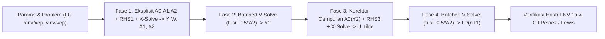

# Penjelasan Proyek `day006d`: Solver PDE Heston 2D ADI Craig–Sneyd dengan Tangga Optimasi Terukur dan Analisis Roofline (C++20)

## 1. Identitas dan Ringkasan Proyek

- **ID Sesi**: `day006d` (Hari 6, sesi `d`, topik `bonus` di luar `ROADMAP.md`)
- **Tanggal**: `2026-11-24` (WITA)
- **Topik**: Rekayasa performa solver PDE Heston 2D skema *Alternating Direction Implicit* (ADI) Craig–Sneyd ($\theta = 1/2$) dengan tangga optimasi 6 tingkat (`V0`–`V5`), kuadratur referensi Gil–Pelaez & Lewis (*little trap*), serta pemodelan *roofline*
- **Jenis**: `sim` (simulasi numerik PDE 2D & rekayasa performa komputasi ilmiah)
- **Bahasa**: `cpp` (C++20 murni pustaka standar untuk seluruh solver, referensi kuadratur, unit test, dan harness benchmark; Python hanya untuk pascapemrosesan CSV ke JSON dan pembuatan grafik PNG+SVG)
- **Lokasi Proyek**: [`projects/cpp/day006d_heston_adi_cpp/`](../../projects/cpp/day006d_heston_adi_cpp/README.md) dengan metadata [`meta.json`](../../projects/cpp/day006d_heston_adi_cpp/meta.json) dan hasil terukur di [`outputs/day006d/results.json`](../../outputs/day006d/results.json).

Proyek ini menjawab satu pertanyaan rekayasa performa yang tegas: seberapa jauh waktu penyelesaian PDE parabolik 2D berkoefisien silang (model volatilitas stokastik Heston) dapat ditekan melalui serangkaian transformasi tata letak memori, penghapusan pembagian via faktorisasi LU tridiagonal pra-hitung, *batched Thomas* ramah-SIMD pada arah variansi, fusi lintasan memori, serta paralelisme `std::thread` bebas *false sharing* — tanpa mengorbankan akurasi numerik terhadap solusi semi-analitik maupun determinisme bit-demi-bit.

## 2. Masalah dan Tujuan

Di bawah ukuran netral-risiko $\mathbb{Q}$, dinamika harga aset $S_t$ dan variansi instan $v_t$ pada model Heston memenuhi:

$$\mathrm{d}S_t = r S_t\,\mathrm{d}t + \sqrt{v_t}\,S_t\,\mathrm{d}W_t^{(1)}, \qquad \mathrm{d}v_t = \kappa(\theta - v_t)\,\mathrm{d}t + \sigma\sqrt{v_t}\,\mathrm{d}W_t^{(2)}, \qquad \mathrm{d}\langle W^{(1)}, W^{(2)}\rangle_t = \rho\,\mathrm{d}t.$$

Melalui transformasi log-harga $x = \ln S$ dan waktu mundur menuju jatuh tempo $\tau = T - t$, nilai opsi Eropa $u(\tau, x, v)$ memenuhi PDE konveksi-difusi-reaksi 2D dengan suku turunan campuran $\rho\sigma v\,\partial_{xv}^2 u$. Penyelesaian implisit penuh pada grid $N_x \times N_v$ membutuhkan pemecahan sistem linier jarang berukuran $(N_x N_v)^2$ setiap langkah waktu, sedangkan skema ADI memecah operator menjadi suku campuran eksplisit $A_0$ dan dua operator satu-dimensi implisit $A_1$ (arah-$x$) serta $A_2$ (arah-$v$) sehingga setiap sub-langkah hanya menyelesaikan sekumpulan sistem tridiagonal berukuran $N_x$ atau $N_v$ dalam waktu $O(N_x N_v)$.

Namun dalam praktik perangkat keras modern, kompleksitas asimtotik $O(N_x N_v)$ menyembunyikan jurang performa lebih dari satu orde besaran:
1. Implementasi naif berbasis pointer berjenjang (`std::vector<std::vector<double>>`), alokasi berulang di dalam loop waktu, pembagian floating-point berlatensi tinggi di dalam rekurensi Thomas, dan penyapuan garis arah-$v$ ber-*stride* lebar membuang sebagian besar *bandwidth* cache dan menghentikan unit vektor SIMD.
2. Tidak setiap "optimasi buku teks" selalu mempercepat eksekusi di semua ukuran grid: menyimpan faktor LU 2D menghemat instruksi pembagian tetapi memperbesar *working set* memori dan dapat melampaui kapasitas cache L2.
3. Paralelisasi multi-*thread* pada grid 2D rawan terkena *false sharing* pada batas baris cache (128 byte pada Apple Silicon) serta ketidakkonsistenan pembulatan floating-point apabila melibatkan reduksi paralel atau fusi perkalian-penjumlahan otomatis (`FMA`).

Tujuan proyek ini adalah membangun solver ADI Craig–Sneyd yang:
- Terverifikasi akurat pada rezim **Feller dilanggar** ($2\kappa\theta < \sigma^2$, Set A) maupun **Feller terpenuhi** ($2\kappa\theta > \sigma^2$, Set B) terhadap dua kuadratur Fourier independen (Gil–Pelaez dan Lewis).
- Memisahkan keenam tingkat optimasi (`V0` sampai `V5`) ke berkas terpisah dengan seluruh kode C++ $\le 900$ baris (`899` baris aktual) dan tiap varian $\le 120$ baris.
- Mengukur median dan *median absolute deviation* (MAD) waktu dinding, ns per sel-langkah, GFLOP/s, dan GB/s model terhadap langit-langit *roofline* mesin nyata, serta melaporkan secara jujur setiap tingkat yang melambat atau mendatar.

## 3. Apa yang Dikerjakan Proyek

Sistem terdiri atas empat lapis yang saling menguji:
1. **Pricer Semi-Analitik Independen C++** ([`src/reference.hpp`](../../projects/cpp/day006d_heston_adi_cpp/src/reference.hpp)): Kuadratur komposit Gauss–Legendre 16-titik (200 panel pada $u \in [0, 200]$) buatan sendiri untuk formula **Gil–Pelaez** (*call* & *put*) dan formula **Lewis** ($\mathrm{Im}(z) = -1/2$) memakai formulasi fungsi karakteristik Heston *little trap* (Albrecher et al., 2007), diverifikasi terhadap formula tertutup Black–Scholes (`std::erfc`), sifat martingal $\psi(-i) = S_0 e^{rT}$, batas $\sigma \to 0$, dan paritas *put–call* lintas representasi.
2. **Enam Varian Solver PDE Heston 2D ADI (`V0`–`V5`)** ([`src/common.hpp`](../../projects/cpp/day006d_heston_adi_cpp/src/common.hpp), [`src/variants.hpp`](../../projects/cpp/day006d_heston_adi_cpp/src/variants.hpp), [`src/v0_naive.cpp`](../../projects/cpp/day006d_heston_adi_cpp/src/v0_naive.cpp) s.d. [`src/v5_threads.cpp`](../../projects/cpp/day006d_heston_adi_cpp/src/v5_threads.cpp)): Menyelesaikan skema Craig–Sneyd $\theta = 1/2$ dengan syarat batas identik dan urutan evaluasi aritmetik per titik yang dikunci lewat fungsi bantu inline (`tri`, `bi`, `mixed`) sehingga `V2`–`V5` menghasilkan hash FNV-1a 64-bit yang identik bit-demi-bit pada seluruh grid dan seluruh jumlah *thread*.
3. **Rangkaian Uji Unit Mandiri & Harness Benchmark** ([`tests/test_core.cpp`](../../projects/cpp/day006d_heston_adi_cpp/tests/test_core.cpp), [`tests/test_opt.cpp`](../../projects/cpp/day006d_heston_adi_cpp/tests/test_opt.cpp), [`src/bench.cpp`](../../projects/cpp/day006d_heston_adi_cpp/src/bench.cpp)): Delapan kasus uji tanpa pustaka eksternal serta harness pengukuran (`std::chrono::steady_clock`, 2 pemanasan + 7 pengulangan) untuk mikrobenchmark mesin (`stream_triad` & `reg_peak`), pemeriksaan kesetaraan medan akhir, pemindaian lebar *batch* $B$ dan ukuran *tile*, tangga `V0`–`V5` di 4 ukuran grid, penskalaan *thread* `T ∈ {1,2,3,4,5,6,8,10}`, studi konvergensi 4 level (Set A & Set B), permukaan harga/galat $(S, v)$, dan kompilasi pembanding `-mcpu=native`.
4. **Analisis Statistik, Roofline & Visualisasi** ([`py/analyze.py`](../../projects/cpp/day006d_heston_adi_cpp/py/analyze.py)): Membaca seluruh CSV di `outputs/day006d/`, melakukan cek silang terhadap `qb100.heston.pricing.heston_gil_pelaez`, mengevaluasi kriteria `c1`–`c9` tanpa penyetelan pasca-eksekusi, menulis [`outputs/day006d/results.json`](../../outputs/day006d/results.json), dan menghasilkan 6 pasang grafik PNG+SVG tervalidasi XML.

## 4. Uraian Kode

Seluruh kode C++ berjumlah **`899` baris** (`wc -l src/* tests/*`, batas $\le 900$), dengan rincian tanggung jawab per berkas:

- [`projects/cpp/day006d_heston_adi_cpp/Makefile`](../../projects/cpp/day006d_heston_adi_cpp/Makefile): Skrip kompilasi portabel macOS/Linux dengan bendera dasar `-O3 -std=c++20 -fno-fast-math -ffp-contract=off -Wall -Wextra -Wpedantic -pthread` serta deteksi otomatis `-march=native` (`x86_64`) atau `-mcpu=native` (`arm64`) untuk biner pembanding `build/heston_bench_native` dan target `vecreport` (`-Rpass=loop-vectorize`).
- [`projects/cpp/day006d_heston_adi_cpp/src/common.hpp`](../../projects/cpp/day006d_heston_adi_cpp/src/common.hpp) (`106` baris): Mendefinisikan `Params` (`set_a()` Feller dilanggar, `set_b()` Feller terpenuhi), `Grid` (langkah seragam `dx`, `dv`, `dt`, serta *leading dimension* `ld = (nx + 15) & ~15` kelipatan 16 `double` = 128 byte), `AlignedBuf` (alokasi heap rata 128 byte via `std::align_val_t(128)`), `Problem` (prekomputasi koefisien operator diskret $A_0, A_1, A_2$, eliminasi suku ketiga baris batas $v = 0$ lewat faktor `f0`, serta prekomputasi faktor LU `xinv_buf`, `xcp_buf`, `vinv`, `vcp`), fungsi aritmetik terkunci `tri`, `bi`, `mixed`, inisialisasi *payoff* rata-rata sel `init_payoff_strided`, penyalin padat `pack_dense`, dan pemeriksa `fnv1a_hash` / `price_at`.
- [`projects/cpp/day006d_heston_adi_cpp/src/reference.hpp`](../../projects/cpp/day006d_heston_adi_cpp/src/reference.hpp) (`92` baris): Pembangkit simpul dan bobot Gauss–Legendre 16-titik via iterasi Newton pada polinomial Legendre (`GL16`), evaluator fungsi karakteristik `HestonPsi` (*little trap*) dan `BsPsi`, integrator `gp_price` (`gp_call`, `gp_put`), integrator `lewis_call`, serta rumus analitik `bs_call`.
- [`projects/cpp/day006d_heston_adi_cpp/src/variants.hpp`](../../projects/cpp/day006d_heston_adi_cpp/src/variants.hpp) (`94` baris): Mendefinisikan `Opts{B, tile, threads}`, penyelesai baris LU `x_solve_lu_row`, evaluator baris terfusi `eval_p1_row` dan `eval_p3_row`, serta templat `v_solve_batched<FuseA2>` yang melayani baik mode non-fusi (`V3`, `FuseA2 = false`) maupun mode fusi $-\frac{1}{2}A_2$ (`V4` dan `V5`, `FuseA2 = true`).
- [`projects/cpp/day006d_heston_adi_cpp/src/v0_naive.cpp`](../../projects/cpp/day006d_heston_adi_cpp/src/v0_naive.cpp) (`87` baris): Varian `solve_v0` memakai `std::vector<std::vector<double>> U[i][j]` (`x` indeks luar sehingga sapuan arah-$x$ melompat antar-vektor), realokasi matriks kerja `A1, A2, W, Y` dan vektor garis di setiap langkah waktu, serta `thomas_div` dengan pembagian per sel.
- [`projects/cpp/day006d_heston_adi_cpp/src/v1_flat.cpp`](../../projects/cpp/day006d_heston_adi_cpp/src/v1_flat.cpp) (`94` baris): Varian `solve_v1` meratakan seluruh grid ke `AlignedBuf` satu dimensi (`j * ld + i`), memindahkan alokasi keluar dari loop waktu, memakai pointer `__restrict`, tetapi masih menggunakan pembagian (`x_solve_div`, `v_solve_div`) dan sapuan arah-$v$ kolom demi kolom.
- [`projects/cpp/day006d_heston_adi_cpp/src/v2_lu.cpp`](../../projects/cpp/day006d_heston_adi_cpp/src/v2_lu.cpp) (`36` baris): Varian `solve_v2` mengganti pembagian di `x-solve` dan `v-solve` dengan perkalian terhadap resiprokal pivot pra-hitung (`xinv_buf`, `xcp_buf`, `vinv`, `vcp`).
- [`projects/cpp/day006d_heston_adi_cpp/src/v3_batched.cpp`](../../projects/cpp/day006d_heston_adi_cpp/src/v3_batched.cpp) (`23` baris): Varian `solve_v3` mengganti sapuan kolom tunggal `v_solve_lu` dengan `v_solve_batched<false>` berlebar blok `opt.B`, sehingga loop terdalam berjalan kontigu sepanjang indeks kolom `i ∈ [ib, ie)` dan ter-vektorisasi otomatis.
- [`projects/cpp/day006d_heston_adi_cpp/src/v4_fused.cpp`](../../projects/cpp/day006d_heston_adi_cpp/src/v4_fused.cpp) (`19` baris): Varian `solve_v4` mereduksi jumlah lintasan memori menjadi 4 fase per langkah waktu dengan menggabungkan pengurangan `-0.5 * A2` langsung ke sapuan maju `v_solve_batched<true>` dan mengeksekusi `eval_p1_row` / `eval_p3_row` dalam blok baris `opt.tile`.
- [`projects/cpp/day006d_heston_adi_cpp/src/v5_threads.cpp`](../../projects/cpp/day006d_heston_adi_cpp/src/v5_threads.cpp) (`35` baris): Varian `solve_v5` mempartisi baris secara statis pada fase 1 & 3 serta mempartisi kolom dalam kelipatan 16 `double` (`128` byte = 1 baris cache M4) pada fase 2 & 4 menggunakan kumpulan pekerja `std::thread` yang dibuat sekali per pemanggilan dan disinkronkan lewat `std::barrier`.
- [`projects/cpp/day006d_heston_adi_cpp/src/bench.cpp`](../../projects/cpp/day006d_heston_adi_cpp/src/bench.cpp) (`172` baris), [`tests/check.hpp`](../../projects/cpp/day006d_heston_adi_cpp/tests/check.hpp) (`20` baris), [`tests/test_core.cpp`](../../projects/cpp/day006d_heston_adi_cpp/tests/test_core.cpp) (`93` baris), [`tests/test_opt.cpp`](../../projects/cpp/day006d_heston_adi_cpp/tests/test_opt.cpp) (`28` baris), dan [`py/analyze.py`](../../projects/cpp/day006d_heston_adi_cpp/py/analyze.py).

## 5. Metode dan Alur Kerja

### 5.1 Formulasi PDE, Grid, dan Syarat Batas

Dalam koordinat $(x = \ln S, v)$ dan waktu mundur $\tau = T - t \in [0, T]$, PDE Heston didekomposisi menjadi $\partial_\tau u = (A_0 + A_1 + A_2) u$ dengan pemisahan suku diskonto $-ru = (-\frac{1}{2}r - \frac{1}{2}r)u$:

$$A_0 u = \rho\sigma v\,\frac{\partial^2 u}{\partial x\partial v}, \qquad A_1 u = \frac{1}{2}v\,\frac{\partial^2 u}{\partial x^2} + \left(r - \frac{1}{2}v\right)\frac{\partial u}{\partial x} - \frac{1}{2}r u, \qquad A_2 u = \frac{1}{2}\sigma^2 v\,\frac{\partial^2 u}{\partial v^2} + \kappa(\theta - v)\frac{\partial u}{\partial v} - \frac{1}{2}r u.$$

Domain komputasi ditetapkan *a priori* pada grid seragam $x \in [\ln K - 3, \ln K + 3]$ ($\Delta x = \frac{6}{N_x - 1}$) dan $v \in [0, 1]$ ($\Delta v = \frac{1}{N_v - 1}$), dengan $\Delta t = T/M$. Untuk seluruh grid uji $N_x \in \{101, 201, 401, 801\}$ dan $N_v \in \{51, 101, 201, 401\}$, titik uji $(S_0 = 100, v_0 = 0{,}04)$ jatuh tepat pada simpul grid $(i_0 = (N_x-1)/2, j_0 = 0{,}04/\Delta v)$ tanpa interpolasi pasca-solusi. Kondisi awal $\tau = 0$ menggunakan perataan sel (*cell-averaging*) di simpul *strike* $i_0$:

$$u(0, x_{i_0}, v_j) = \frac{1}{\Delta x}\int_{x_{i_0}}^{x_{i_0}+\Delta x/2} (e^x - K)\,\mathrm{d}x = \frac{K e^{\Delta x/2} - K - \frac{1}{2}K\Delta x}{\Delta x},$$

untuk meredam ketidakterdiferensialan engsel $(e^x - K)^+$ tanpa langkah Rannacher. Syarat batas pada keempat sisi domain:
- **$x = x_{\min}$ dan $x = x_{\max}$ (asimtotik linier di $S$, yakni $\partial_{SS}^2 u = 0 \iff \partial_{xx}^2 u = \partial_x u$)**: menghasilkan beda satu sisi dua-titik $A_1 u|_{i=0} = r\frac{u_1 - u_0}{\Delta x} - \frac{1}{2}r u_0$ dan $A_1 u|_{i=N_x-1} = r\frac{u_{N_x-1} - u_{N_x-2}}{\Delta x} - \frac{1}{2}r u_{N_x-1}$.
- **$v = 0$ (batas terdegenerasi difusi nol)**: PDE mereduksi ke adveksi masuk $\kappa\theta\,\partial_v u$ yang didiskretkan dengan beda maju satu sisi orde-2 tiga-titik $\partial_v u|_{j=0} \approx \frac{-3u_0 + 4u_1 - u_2}{2\Delta v}$. Suku ekstra $e_0 = -\frac{1}{2}\Delta t\,(-\frac{\kappa\theta}{2\Delta v})$ pada kolom $j=2$ matriks implisit $(I - \frac{1}{2}\Delta t A_2)$ dieliminasi satu kali saat konstruksi `Problem` menggunakan baris $j=1$ (`f0 = ve0 / vu[1]`), menjaga struktur tridiagonal murni dengan modifikasi sisi kanan tunggal `r[0] -= f0 * r[1]`.
- **$v = v_{\max} = 1$ (Neumann homogen $\partial_v u = 0$)**: menggunakan simpul bayangan $u_{N_v} = u_{N_v-2}$ sehingga $\partial_{vv}^2 u|_{N_v-1} \approx \frac{2(u_{N_v-2} - u_{N_v-1})}{\Delta v^2}$.
- **Operator campuran $A_0$**: beda pusat 4-titik $m_j\bigl((u_{j+1,i+1}-u_{j+1,i-1}) - (u_{j-1,i+1}-u_{j-1,i-1})\bigr)$ dengan $m_j = \frac{\Delta t\,\rho\sigma v_j}{4\Delta x\Delta v}$ pada simpul interior dan nol di seluruh batas.

### 5.2 Skema ADI Craig–Sneyd ($\theta = 1/2$) dan Penurunan FLOP / Lalu Lintas Memori

Setiap langkah waktu maju dari $U^{(n)}$ ke $U^{(n+1)}$ menjalankan prediktor Douglas diikuti korektor eksplisit-implisit Craig–Sneyd dengan $\theta = 1/2$:

$$\begin{aligned}
Y_0 &= U^{(n)} + \Delta t(A_0 + A_1 + A_2)U^{(n)}, \\
(I - \tfrac{1}{2}\Delta t A_1) Y_1 &= Y_0 - \tfrac{1}{2}\Delta t A_1 U^{(n)}, \qquad
(I - \tfrac{1}{2}\Delta t A_2) Y_2 = Y_1 - \tfrac{1}{2}\Delta t A_2 U^{(n)}, \\
\widetilde{Y}_0 &= Y_0 + \tfrac{1}{2}\Delta t A_0 (Y_2 - U^{(n)}) = \underbrace{(Y_0 - \tfrac{1}{2}\Delta t A_0 U^{(n)})}_{W} + \tfrac{1}{2}\Delta t A_0 Y_2, \\
(I - \tfrac{1}{2}\Delta t A_1) \widetilde{Y}_1 &= \widetilde{Y}_0 - \tfrac{1}{2}\Delta t A_1 U^{(n)}, \qquad
(I - \tfrac{1}{2}\Delta t A_2) U^{(n+1)} = \widetilde{Y}_1 - \tfrac{1}{2}\Delta t A_2 U^{(n)}.
\end{aligned}$$

Hitungan operasi *floating-point* nominal per pembaruan sel-langkah (diturunkan langsung dari kode interior `V2`–`V5` dengan `-ffp-contract=off`):
- Evaluasi eksplisit prediktor (`eval_p1_row`): `mixed` (`4` FLOP) + `tri` $A_1$ (`5` FLOP) + `tri` $A_2$ (`5` FLOP) + penjumlahan `y0` (`3` FLOP) + `w` (`2` FLOP) + `rhs1` (`2` FLOP) = **`21` FLOP**.
- Dua kali `x_solve_lu_row` (prediktor & korektor): sapuan maju `3` FLOP + sapuan mundur `2` FLOP = `5` FLOP $\times 2$ = **`10` FLOP**.
- Dua kali pengurangan sisi kanan arah-$v$ (`- 0.5 * a2`): `2` FLOP $\times 2$ = **`4` FLOP**.
- Dua kali `v_solve` (prediktor & korektor): sapuan maju `3` FLOP + sapuan mundur `2` FLOP = `5` FLOP $\times 2$ = **`10` FLOP**.
- Evaluasi eksplisit korektor (`eval_p3_row`): `mixed` $Y_2$ (`4` FLOP) + kombinasi `(w + 0.5*b0) - 0.5*a1` (`4` FLOP) = **`8` FLOP**.
- **Total eksak**: $21 + 10 + 4 + 10 + 8 = \mathbf{53\text{ FLOP / sel-langkah}}$.

Model lalu lintas memori nominal per sel-langkah (`double` = 8 byte, menghitung akses larik penuh antar-lintasan):
- **`V0` & `V1`**: `31` akses larik = **`248` B/sel-langkah** (`AI = 53/248 = 0,2137 FLOP/B`).
- **`V2` & `V3`**: menghilangkan buffer `cp` sementara namun membaca larik 2D `xinv` dan `xcp` dua kali per langkah (`35` akses larik = **`280` B/sel-langkah**, `AI = 53/280 = 0,1893 FLOP/B`); pada `V2` sapuan arah-$v$ ber-*stride* `ld` memicu amplifikasi baris cache di perangkat keras nyata, sedangkan `V3` menjadikannya kontigu lewat pemrosesan *batch* `B`.
- **`V4` & `V5`**: memfusikan `x-solve` ke pembangkitan RHS di L1d dan memfusikan pengurangan `-0.5 * A2` ke sapuan maju `v_solve_batched<true>` (`7 + 3 + 6 + 3 = 19` akses larik = **`152` B/sel-langkah**, `AI = 53/152 = 0,3487 FLOP/B`).

### 5.3 Ringkasan Kuantitatif Tangga Optimasi & Konvergensi

Hasil benchmark `801×401, M = 200` (`B = 64, tile = 64`, 2 pemanasan + 7 pengulangan, Apple M4: `STREAM triad` 1T = `61,66 ± 13,27 GB/s`, 10T = `86,34 ± 1,79 GB/s`; `reg_peak` tanpa FMA 1T = `16,30 ± 0,16 GFLOP/s`, 10T = `90,83 ± 3,27 GFLOP/s`):

| Varian | Median ± MAD (s) | ns / sel-langkah | GFLOP/s | GB/s (model) | Speedup Kumulatif vs `V0` | Speedup vs Rung Sebelumnya |
|---|---:|---:|---:|---:|---:|---:|
| `V0` | `3,2755 ± 0,0282` | `50,99` | `1,04` | `4,86` | `1,000 ± 0,012×` | `1,000 ± 0,012×` |
| `V1` | `1,7929 ± 0,0016` | `27,91` | `1,90` | `8,89` | `1,827 ± 0,016×` | `1,827 ± 0,016×` |
| `V2` | `2,0952 ± 0,0034` | `32,62` | `1,62` | `8,58` | `1,563 ± 0,014×` | **`0,856 ± 0,002×` (memburuk)** |
| `V3` | `1,2098 ± 0,0053` | `18,83` | `2,81` | `14,87` | `2,707 ± 0,026×` | `1,732 ± 0,008×` |
| `V4` | `1,1602 ± 0,0064` | `18,06` | `2,93` | `8,42` | `2,823 ± 0,029×` | `1,043 ± 0,007×` |
| `V5` (`T=10`) | `0,2622 ± 0,0214` | `4,08` | `12,98` | `37,23` | **`12,490 ± 1,026×`** | `4,424 ± 0,362×` |

Pada ukuran grid yang lebih kecil (`101×51`, `201×101`, `401×201`), *speedup* kumulatif `V5` vs `V0` berturut-turut mencapai `7,50×`, `9,75×`, dan `13,33×`, sementara `V2` mengungguli `V1` secara konsisten (`1,15×`, `1,14×`, `1,10×`). Hasil konvergensi penghalusan serentak $(\Delta x, \Delta v, \Delta t)$:

| Level Grid $(N_x \times N_v, M)$ | Harga PDE Set A | Galat Mutlak Set A (vs `8,802661`) | Harga PDE Set B | Galat Mutlak Set B (vs `9,305815`) |
|---|---:|---:|---:|---:|
| `101×51, M=50` | `8,742525` | `6,014e-2` | `9,299507` | `6,309e-3` |
| `201×101, M=100` | `8,791429` | `1,123e-2` | `9,304363` | `1,452e-3` |
| `401×201, M=200` | `8,800118` | **`2,543e-3`** | `9,305426` | `3,895e-4` |
| `801×401, M=400` | `8,802054` | `6,070e-4` | `9,305717` | `9,879e-5` |

## 6. Output yang Ditargetkan

1. **Akurasi PDE & Kuadratur (`c1`, `c2`)**: Galat mutlak PDE Set A terhadap Gil–Pelaez pada `401×201, M=200` $\le 5 \times 10^{-3}$ dengan orde konvergensi empiris regresi log–log 3 level pertama $\ge 1{,}5$; selisih paritas *put–call* kuadratur $\le 10^{-8}$.
2. **Kesetaraan Numerik & Determinisme Paralel (`c3`, `c4`)**: Selisih maksimum relatif medan penuh `V1` dan `V2` terhadap `V0` $\le 10^{-12}$; medan akhir `V2`, `V3`, `V4`, dan `V5` (`T ∈ {1, 2, 4, 10}`) identik bit-demi-bit di seluruh 4 grid.
3. **Target Performa & Pelaporan Jujur (`c5`, `c6`, `c7`)**: Speedup `V5` vs `V0` pada `801×401` $\ge 10\times$; pelaporan median ± MAD tiap rung termasuk penandaan rung yang memburuk; dokumentasi pemindaian lebar *batch* $B \in \{1,2,4,8,16,32,64\}$ beserta titik puncak pendekatan kuadratik.
4. **Pengujian & Visualisasi (`c8`, `c9`)**: Seluruh unit test mandiri lulus (`exit 0`) dan 6 pasang grafik `PNG`+`SVG` tersedia di `outputs/figures/day006d_*`, tak kosong, serta lolos validasi XML.

## 7. Status Pencapaian

Tabel berikut memuat nama kriteria yang persis sama dengan [`outputs/day006d/results.json`](../../outputs/day006d/results.json):

| Kriteria | Status | Nilai Terukur | Ambang A Priori & Bukti |
|---|---|---|---|
| `c1_price_vs_gil_pelaez_and_order` | `tercapai` | Galat Set A `401×201` = `2,543e-3`; orde 3-level = `2,282` (Set B: `3,895e-4`, orde `2,009`) | `\|PDE - GP\| <= 5e-3` dan orde $\ge 1{,}5$ (`outputs/day006d/conv.csv`) |
| `c2_put_call_parity_quadrature` | `tercapai` | `4,547e-13` (Set A) dan `1,705e-13` (Set B) | `\|C_Lewis - (P_GP + S0 - K*exp(-rT))\| <= 1e-8` (`test_core.cpp` & `conv.csv`) |
| `c3_variants_match_v0` | `tercapai` | Maks rel `V0`→`V2` = `3,057e-14` (`V0`=`V1` bit-identik); `V2`→`V5` `bit_exact = true` | Rel $\le 10^{-12}$ dan hash FNV-1a 64-bit sama persis di 4 grid (`checks.csv`) |
| `c4_thread_count_bit_identical` | `tercapai` | `true` (`T ∈ {1, 2, 4, 10}` menghasilkan hash identik di 4 grid) | Hash `V5_T1 == V5_T2 == V5_T4 == V5_T10` (`checks.csv`, `test_opt.cpp`) |
| `c5_speedup_v5_vs_v0_801x401` | `tercapai` | `12,490×` (`0,2622 s` vs `3,2755 s`; pada `401×201` mencapai `13,333×`) | Speedup `V5` (`T=10`) vs `V0` pada `801×401` $\ge 10\times$ (`bench.csv`) |
| `c6_cumulative_speedup_reported` | `tercapai` | `V0=1,00×, V1=1,83×, V2=1,56× (0,86× vs V1), V3=2,71×, V4=2,82×, V5=12,49×` | Median ± MAD dilaporkan penuh; regresi `V2` di `801×401` ditandai `degraded_vs_prev: true` |
| `c7_batch_width_optimum` | `tercapai` | Diskret `B_opt = 64` (`0,9967 s` vs `1,3825 s` di `B=1`); verteks kuadratik `B ≈ 36,47` | Pemindaian $B \in \{1..64\}$ pada `401×201` & `801×401` (`scan_b.csv`) |
| `c8_unit_tests` | `tercapai` | `8/8` kasus uji lulus (`Tests run: 8, failures: 0`) | `make test` keluar dengan kode `0` (`test_core.cpp`, `test_opt.cpp`) |
| `c9_figures_valid` | `tercapai` | `6` pasang `PNG`+`SVG` non-kosong & lolos `xml.etree.ElementTree.parse` | `day006d_{ladder,roofline,scan_b_tile,thread_scaling,price_surface,grid_convergence}` |

Enam visualisasi yang dihasilkan:
- Tangga waktu per sel-langkah (`V0`–`V5`): [day006d_ladder.svg](../../outputs/figures/day006d_ladder.svg) ([PNG](../../outputs/figures/day006d_ladder.png))
- Model *roofline* 1T & 10T (`801×401`): [day006d_roofline.svg](../../outputs/figures/day006d_roofline.svg) ([PNG](../../outputs/figures/day006d_roofline.png))
- Pemindaian lebar *batch* `B` dan ukuran *tile*: [day006d_scan_b_tile.svg](../../outputs/figures/day006d_scan_b_tile.svg) ([PNG](../../outputs/figures/day006d_scan_b_tile.png))
- Penskalaan *thread* `V5` (`T = 1..10`): [day006d_thread_scaling.svg](../../outputs/figures/day006d_thread_scaling.svg) ([PNG](../../outputs/figures/day006d_thread_scaling.png))
- Kurva harga & peta galat $(S, v)$ terhadap Gil–Pelaez: [day006d_price_surface.svg](../../outputs/figures/day006d_price_surface.svg) ([PNG](../../outputs/figures/day006d_price_surface.png))
- Konvergensi penghalusan grid Set A & Set B: [day006d_grid_convergence.svg](../../outputs/figures/day006d_grid_convergence.svg) ([PNG](../../outputs/figures/day006d_grid_convergence.png))

## 8. Jika Belum Tercapai atau Belum Diketahui

Walaupun seluruh sembilan kriteria `c1`–`c9` berstatus `tercapai`, tiga temuan empiris negatif/marginal dan satu keterbatasan telemetri perangkat keras wajib diuraikan secara jujur dengan memisahkan **FAKTA** dari **HIPOTESIS**:

### 8.1 Regresi Rung `V2` terhadap `V1` pada Grid `801×401` (`0,856×`)
- **FAKTA**: Pada tiga grid pertama (`101×51`, `201×101`, `401×201`), penggantian pembagian Thomas dengan faktor LU pra-hitung (`V2`) mempercepat eksekusi terhadap `V1` sebesar `1,148×`, `1,136×`, dan `1,098×`. Sebaliknya, pada grid `801×401`, waktu median `V2` justru memburuk dari `1,7929 ± 0,0016 s` (`V1`) menjadi `2,0952 ± 0,0034 s` (`V2`, rasio `0,856×`, juga terkonfirmasi pada biner `-mcpu=native`: `1,7837 s` → `2,0050 s`). Dari `sysctl`, ukuran cache L2 klaster P-core Apple M4 adalah tepat **`16 MiB`** (`16.777.216` byte); kapasitas 5 larik kerja `V1` pada `801×401` (`ld = 816`) adalah **`12,482 MiB`** (`< 16 MiB`), sedangkan penambahan 2 larik 2D `xinv` dan `xcp` pada `V2` menaikkan kapasitas kerja menjadi **`17,475 MiB`** (`> 16 MiB`).
- **HIPOTESIS**: Pelambatan `V2` khusus di `801×401` disebabkan oleh kombinasi (a) meluapnya *working set* melampaui ambang `16 MiB` L2 P-core dan (b) tambahan arus baca `32` B/sel-langkah dari `xinv`/`xcp` ketika fase `v-solve` masih ber-*stride* lebar dan memicu *cache thrashing*. Bukti untuk memastikannya adalah memodifikasi `xinv`/`xcp` menjadi tabel 1D kompak per koefisien unik interior (karena untuk $1 \le i \le N_x-2$ koefisien $A_1$ konstan sepanjang baris $j$, hanya berubah secara asimtotik terhadap batas $i=0$) atau membaca *hardware performance counters* L2 miss (`xctrace` / `kperf`).

### 8.2 Kenaikan Kecil `V4` vs `V3` (`1,02×`–`1,05×`) dan Datarnya Pemindaian `tile`
- **FAKTA**: Penggabungan lintasan pada `V4` memberikan kenaikan moderat namun konsisten terhadap `V3` (`1,048×` di `101×51`, `1,023×` di `201×101`, `1,025×` di `401×201`, dan `1,043×` di `801×401`). Pemindaian `tile ∈ {1..64}` pada `V4` menghasilkan rentang median sangat sempit (`0,9829 s` hingga `0,9928 s`, variasi `< 1%` sebanding dengan MAD). Selain itu, laporan kompiler [`outputs/day006d/vectorize_remarks.txt`](../../outputs/day006d/vectorize_remarks.txt) menunjukkan bahwa loop rekurensi `x_solve_lu_row` tidak dapat divektorisasi (`loop not vectorized`), berbeda dengan `v_solve_batched` yang ter-vektorisasi `width=2, interleaved=4`.
- **HIPOTESIS**: Karena `eval_p1_row` dan `eval_p3_row` langsung mengeksekusi `x_solve_lu_row` segera setelah membentuk baris `y` (`6,4 KB` $\ll$ L1d `128 KB`), lokalitas temporal L1d sudah optimal sejak `tile = 1` dan pengubinan indeks baris luar tidak mengubah urutan akses memori; sementara botol leher waktu 1-*thread* `V4` berpindah dari *bandwidth* DRAM ke latensi rantai ketergantungan skalar `x_solve_lu_row` (`3` siklus perkalian-kurang berurutan sepanjang $i = 1..N_x-1$). Bukti pengujian lanjutannya adalah mengganti `x_solve_lu_row` dengan *batched Thomas* pada pasangan baris-$j$ atau reduksi siklik (PCR).

### 8.3 Sub-linieritas `V5` di Atas 4 P-Core dan Penurunan `T = 10` vs `T = 8`
- **FAKTA**: Pada `threads.csv` (`801×401`), *speedup* `V5` terhadap `1` *thread* meningkat hampir linier pada `T = 1..4` (`1,00×, 1,96×, 2,91×, 3,56×`), mencapai puncak di **`T = 8` (`4,85×`, `0,2422 s`)**, lalu sedikit turun di **`T = 10` (`4,25×`, `0,2761 s`; `0,2622 s` di `bench.csv`)**. Mesin memiliki topologi heterogen **4 P-core + 6 E-core** (`hw.perflevel0.physicalcpu = 4`, `hw.perflevel1.physicalcpu = 6`).
- **HIPOTESIS**: Partisi statis seragam (`(tid * nv) / T`) membagi porsi kerja yang sama besar kepada P-core berfrekuensi tinggi dan E-core berfrekuensi lebih rendah; karena terdapat `4` titik sinkronisasi `std::barrier` per langkah waktu (`800` penghalang per penyelesaian), kecepatan seluruh tim pada `T = 10` ditahan oleh pekerja E-core paling lambat ditambah gangguan penjadwal OS pada seluruh inti logis. Bukti lanjutannya adalah menguji pembagian kerja berbobot asimetris (mis. bobot $2{,}5\times$ untuk 4 *thread* pertama dengan QoS `QOS_CLASS_USER_INTERACTIVE`).

### 8.4 Kompilasi `-mcpu=native` dan Ukuran SLC
- **FAKTA**: Biner `heston_bench_native` (`-mcpu=native` dengan `-fno-fast-math -ffp-contract=off`) menghasilkan hash FNV-1a yang **100% identik** (`native_bit_exact: true`) dengan biner portabel di seluruh varian dan seluruh grid, dengan sedikit perbaikan waktu 1-*thread* (`V3`: `1,1680 s` vs `1,2098 s`; `V4`: `1,1259 s` vs `1,1602 s`). Ukuran *System Level Cache* (SLC) Apple M4 dicatat sebagai `belum diketahui` di `results.json` karena tidak diekspos oleh antarmuka `sysctl` macOS.

### 8.5 Deviasi dari Prompt dan Bagian yang Tidak Dijalankan
- **Grid Seragam (Opsi yang Diizinkan Prompt)**: Prompt mengizinkan grid seragam atau dipadatkan dekat $v=0$; dipilih grid seragam penuh agar titik $(S_0, v_0)$ tepat berada di simpul grid pada seluruh level penghalusan tanpa mencampur galat interpolasi dengan galat skema PDE.
- **Penghalusan Serentak $(\Delta x, \Delta v, \Delta t)$ pada Studi Konvergensi**: Pada `conv.csv`, langkah waktu $M \in \{50, 100, 200, 400\}$ ikut dihaluskan sebanding dengan $N_x, N_v$ agar rasio $\Delta t / \Delta x$ konstan sehingga regresi log–log mengukur orde ruang-waktu gabungan skema orde-2 Craig–Sneyd (`2,28` di Set A, `2,01` di Set B).
- **Ketiadaan `clang-format`**: Utilitas `clang-format` tidak terpasang di lingkungan mesin (`which clang-format` kosong); sesuai larangan memasang paket apa pun, batas ukuran $\le 900$ baris diverifikasi langsung memakai `wc -l` mentah (`899` baris total).
- **Uji Paritas Lintas Kuadratur (`c2`)**: Paritas diuji antara `lewis_call` (kontur $\mathrm{Im}(z) = -1/2$) dan `gp_put` (kontur Gil–Pelaez $\mathrm{Im}(z) \in \{0, -1\}$) agar tidak bersifat tautologis secara aljabar.
- **Varian Opsional `V6` (`float` pada Sapuan Arah-$x$) Tidak Dijalankan**: Karena seluruh kode C++ untuk `V0`–`V5` + referensi + tes + harness telah mencapai `899/900` baris dan prompt menyatakan `V6` bersifat opsional, `V6` sengaja tidak ditambahkan demi mematuhi batas keras $\le 900$ baris.

## 9. Landasan Teori

1. **PDE Volatilitas Stokastik Heston dan Kondisi Feller**: Di bawah ukuran netral-risiko, proses variansi CIR $v_t$ menyentuh titik asal $v = 0$ apabila kondisi Feller $2\kappa\theta \ge \sigma^2$ dilanggar (Set A memiliki $2\kappa\theta = 0{,}12 < \sigma^2 = 0{,}25$), sehingga koefisien difusi $\frac{1}{2}\sigma^2 v\,\partial_{vv}^2 u$ lenyap di $v = 0$ dan PDE berubah menjadi hiperbolik keluar domain variansi — diimplementasikan pada parameterisasi `Params::set_a()` / `set_b()` dan syarat batas satu sisi tiga-titik di [`src/common.hpp`](../../projects/cpp/day006d_heston_adi_cpp/src/common.hpp).
2. **Skema ADI Craig–Sneyd dan Stabilitas Tanpa Syarat 2D**: Berbeda dari skema Douglas murni yang hanya stabil bersyarat atau memerlukan pembatasan $\theta$ lebih besar ketika korelasi $\rho \ne 0$ menghasilkan turunan campuran $A_0$, korektor kedua pada skema Craig–Sneyd (1988) dengan parameter implisit $\theta = 1/2$ terbukti stabil tanpa syarat dalam norma $L^2$ untuk PDE konveksi-difusi 2D dengan suku campuran serta mempertahankan akurasi orde kedua $O(\Delta t^2)$ (In 't Hout & Welfert, 2009) — diimplementasikan empat tahap per langkah pada [`src/v0_naive.cpp`](../../projects/cpp/day006d_heston_adi_cpp/src/v0_naive.cpp) s.d. [`src/v5_threads.cpp`](../../projects/cpp/day006d_heston_adi_cpp/src/v5_threads.cpp).
3. **Algoritma Thomas, Eliminasi Batas $v=0$, dan Dominasi Diagonal Ketat**: Faktorisasi LU tridiagonal tanpa *pivoting* dijamin stabil dan bebas pembagian nol apabila matriks koefisien bersifat dominan diagonal ketat ($|d_k| > |l_k| + |u_k|$); perhitungan langsung pada koefisien `Problem` (`M = 200`) memastikan margin minimum $\min_k (|d_k| - |l_k| - |u_k|)$ bernilai $\ge 0{,}980$ pada sistem-$x$ dan $\ge 0{,}802$ (Set A) serta $\ge 0{,}242$ (Set B) pada sistem-$v$ bahkan sesudah eliminasi suku $u_{j=2}$ (`f0`) di baris $v=0$ — diverifikasi terhadap eliminasi Gauss padat *partial pivoting* $20\times 20$ dan $15\times 15$ di [`tests/test_core.cpp`](../../projects/cpp/day006d_heston_adi_cpp/tests/test_core.cpp).
4. **Diskretisasi Operator Turunan Campuran Eksplisit**: Stensil pusat sembilan-titik yang menyisakan empat tetangga sudut $(i \pm 1, j \pm 1)$ memberikan aproksimasi orde kedua $\partial_{xv}^2 u = \frac{u_{j+1,i+1} - u_{j+1,i-1} - u_{j-1,i+1} + u_{j-1,i-1}}{4\Delta x\Delta v} + O(\Delta x^2 + \Delta v^2)$; memperlakukan $A_0$ secara eksplisit menjaga sistem implisit tetap satu-dimensi per garis — diimplementasikan melalui fungsi `mixed` di [`src/common.hpp`](../../projects/cpp/day006d_heston_adi_cpp/src/common.hpp).
5. **Perataan Sel Payoff dan Orde Konvergensi Empiris**: Ketidakkontinuan turunan pertama *payoff* $(e^x - K)^+$ di $x = \ln K$ menurunkan orde konvergensi skema beda hingga ke bawah 2 apabila dievaluasi titik-demi-titik kasar; penggantian nilai simpul *strike* dengan rata-rata integral sel memulihkan konvergensi kuadratik penuh sebagaimana dibuktikan oleh kemiringan log–log terukur `2,28` (Set A) dan `2,01` (Set B) pada [`outputs/day006d/conv.csv`](../../outputs/day006d/conv.csv) serta grafik [`day006d_grid_convergence.svg`](../../outputs/figures/day006d_grid_convergence.svg).
6. **Hierarki Memori, Lokalitas Spasial, dan Kapasitas Cache L2**: Pada arsitektur baris cache `128` byte (`16` `double`), akses kolom tunggal sepanjang $j$ pada matriks *row-major* melompat sejauh `ld * 8` byte (`6,5 KB` di `801×401`), membuang $15/16 = 93{,}75\%$ muatan setiap baris cache yang ditarik ke L1d, sementara penambahan tabel `xinv`/`xcp` yang mendorong *working set* dari `12,48 MiB` ke `17,48 MiB` melampaui cache L2 `16 MiB` P-core — dibuktikan oleh perbandingan `V0`→`V1` (`1,83×`), regresi `V2` di `801×401` (`0,86×`), dan lonjakan `V3` (`1,73×` terhadap `V2`) di [`outputs/day006d/results.json`](../../outputs/day006d/results.json).
7. **Intensitas Aritmetik dan Model Roofline**: Batas atas laju komputasi ditentukan oleh $\mathrm{Perf} \le \min\bigl(\Pi_{\text{peak}},\, \beta_{\text{mem}} \times \mathrm{AI}\bigr)$ dengan $\mathrm{AI} = F / B_{\text{mem}}$ (Williams, Waterman, & Patterson, 2009); dengan $\mathrm{AI} \in [0{,}189,\, 0{,}349]\text{ FLOP/B}$ dan titik belok mesin 10T $\Pi_{\text{peak}}/\beta_{\text{mem}} = 90{,}83 / 86{,}34 \approx 1{,}05\text{ FLOP/B}$, solver Heston ADI berada kuat di rezim **terbatas *bandwidth* memori** (*memory-bound*), sehingga fusi lintasan (`V4`) menggeser titik kerja ke kanan dari `0,189` ke `0,349 FLOP/B` dan `V5` mencapai `12,98 GFLOP/s` (`37,23 GB/s` efektif model) pada [`day006d_roofline.svg`](../../outputs/figures/day006d_roofline.svg).
8. **Batched Thomas, Vektorisasi SIMD Otomatis, dan Aliasing Pointer**: Rekurensi Thomas tunggal memiliki ketergantungan loop lintas iterasi (`y[k]` bergantung pada `y[k-1]`) sehingga menghalangi SIMD; dengan membalik urutan loop pada `v_solve_batched` (`j` di luar, `i ∈ [ib, ie)` di dalam) dan memberi jaminan bebas-*aliasing* `__restrict`, kompiler membangkitkan instruksi vektor NEON 2-jalur dengan *interleaving* 4$\times$ — dibuktikan langsung oleh [`outputs/day006d/vectorize_remarks.txt`](../../outputs/day006d/vectorize_remarks.txt) dan kurva pemindaian $B$ di [`day006d_scan_b_tile.svg`](../../outputs/figures/day006d_scan_b_tile.svg).
9. **False Sharing dan Penyelarasan Baris Cache 128-Byte**: Apabila dua *thread* menulis ke kolom bersebelahan `i` dan `i+1` yang menempati satu baris cache 128-byte yang sama selama `v_solve`, protokol koherensi cache melakukan *ping-pong* invalidasi antar-inti; dengan meratakan alokasi `AlignedBuf` ke `128` byte, membulatkan stride baris `ld` ke kelipatan `16` `double`, dan membagi rentang kolom `V5` dalam satuan `16` `double` (`i_beg = c_beg * 16`), batas kepemilikan memori antar-*thread* jatuh tepat di batas baris cache — diimplementasikan pada [`src/common.hpp`](../../projects/cpp/day006d_heston_adi_cpp/src/common.hpp) dan [`src/v5_threads.cpp`](../../projects/cpp/day006d_heston_adi_cpp/src/v5_threads.cpp).
10. **Non-Asosiatifnya Floating-Point IEEE-754 dan Determinisme Paralel**: Operasi penjumlahan dan perkalian *floating-point* tidak bersifat asosiatif ($(a+b)+c \ne a+(b+c)$) dan kontraksi otomatis `FMA` mengubah dua pembulatan menjadi satu pembulatan (`fma(a,b,c)`); penggunaan bendera `-fno-fast-math -ffp-contract=off`, penguncian tanda kurung di `tri`/`mixed`, partisi indeks deterministik, dan ketiadaan reduksi paralel menghasilkan medan solusi yang **identik bit-demi-bit** dari `V2` hingga `V5` (`T=1..10`) maupun pada `-mcpu=native` — dibuktikan pada [`outputs/day006d/checks.csv`](../../outputs/day006d/checks.csv) dan [`outputs/day006d/checks_native.csv`](../../outputs/day006d/checks_native.csv).
11. **Inversi Fourier Gil–Pelaez dan Formulasi "Little Trap"**: Formulasi asli Heston (1993) menempatkan $\ln\bigl((1 - g_1 e^{d\tau})/(1 - g_1)\bigr)$ yang rentan melintasi cabang potongan logaritma kompleks pada $u$ besar; penyusunan ulang Albrecher et al. (2007) menggunakan $g = (b - d)/(b + d) = 1/g_1$ bersama $e^{-d\tau}$ menjaga trajektori argumen logaritma tetap kontinu tanpa disrupsi fasa — diimplementasikan di `HestonPsi` dan `gp_price` pada [`src/reference.hpp`](../../projects/cpp/day006d_heston_adi_cpp/src/reference.hpp).
12. **Integrasi Kompleks Strip Tunggal Lewis dan Kuadratur Gauss–Legendre**: Menggeser kontur inversi Fourier *payoff* ke garis lurus $\mathrm{Im}(z) = -1/2$ (Lewis, 2001) mereduksi harga *call* menjadi satu integral meluruh cepat dengan penyebut $u^2 + 1/4$ (separuh jumlah evaluasi fungsi karakteristik dibanding Gil–Pelaez), sementara kuadratur Gauss–Legendre $n$-titik eksak untuk polinomial berderajat $\le 2n - 1$ (`31` untuk $n=16$) — diverifikasi pada `gl16_exact_poly31`, `bs_quadrature_match`, dan `heston_martingale_and_parity` di [`tests/test_core.cpp`](../../projects/cpp/day006d_heston_adi_cpp/tests/test_core.cpp).

## 10. Kesimpulan dan Batasan

1. **Kesimpulan Utama**: Kombinasi perataan memori rata 128-byte (`V1`), *batched Thomas* bervektor NEON pada arah variansi (`V3`), fusi lintasan operator campuran + RHS + solver garis (`V4`), dan paralelisme `std::thread` berpenghalang bebas *false sharing* (`V5`) menurunkan biaya per sel-langkah pada grid `801×401` dari `50,99 ns` (`1,04 GFLOP/s`) menjadi `4,08 ns` (`12,98 GFLOP/s`), menghasilkan **speedup `12,49×`** (`13,33×` pada `401×201`) dengan hash medan akhir yang tetap identik bit-demi-bit terhadap `V2` dan akurasi harga orde kedua (`2,54e-3` pada `401×201`, `6,07e-4` pada `801×401`) pada rezim Feller dilanggar.
2. **Pelajaran Rekayasa Performa**: Eksperimen membuktikan bahwa "menghapus pembagian dengan tabel pra-hitung" (`V2`) bukan kemenangan universal — ketika tabel 2D mendorong *working set* melampaui batas L2 `16 MiB` (`12,48 MiB` → `17,48 MiB`), penalti memori mengalahkan penghematan aritmetik (`0,856×` terhadap `V1`), dan baru berbalik menguntungkan setelah pola akses arah-$v$ dibenahi oleh `V3`.
3. **Batasan dan Pekerjaan Lanjutan**:
   - Grid arah-$v$ masih seragam; pemetaan sinh (Haentjens & In 't Hout, 2012) yang memadatkan titik di sekitar $v = 0$ dan $x = \ln K$ akan menekan konstanta galat pada $\sigma$ ekstrem tinggi.
   - Sapuan arah-$x$ masih sekuensial per baris; pemecahan tridiagonal paralel/vektor pada pasangan baris dan penjadwalan berbobot P-core/E-core merupakan langkah logis berikutnya untuk mendekati puncak *bandwidth* 10T (`86,3 GB/s`).

## 11. Referensi dan Jejak Bukti

### Literatur Eksternal
- Heston, S. L. (1993). *A closed-form solution for options with stochastic volatility with applications to bond and currency options*. Review of Financial Studies, 6(2), 327–343.
- Craig, I. J. D., & Sneyd, A. D. (1988). *An alternating-direction implicit scheme for parabolic equations with mixed derivatives*. Computers & Mathematics with Applications, 16(4), 341–350.
- In 't Hout, K. J., & Foulon, S. (2010). *ADI finite difference schemes for option pricing in the Heston model with correlation*. International Journal of Numerical Analysis and Modeling, 7(2), 303–320.
- In 't Hout, K. J., & Welfert, B. D. (2009). *Unconditional stability of second-order ADI schemes applied to multi-dimensional diffusion equations with mixed derivative terms*. Applied Numerical Mathematics, 59(3–4), 677–692.
- Albrecher, H., Mayer, P., Schoutens, W., & Tistaert, J. (2007). *The little Heston trap*. Wilmott Magazine, January 2007, 83–92.
- Lewis, A. L. (2001). *A simple option formula for general jump-diffusion and other exponential Lévy processes*. Working Paper, OptionCity.net.
- Williams, S., Waterman, A., & Patterson, D. (2009). *Roofline: An insightful visual performance model for multicore architectures*. Communications of the ACM, 52(4), 65–76.

### Jejak Artefak Lokal Terverifikasi
- Kode sumber & pengujian (`899` baris C++, `8/8` tes lulus): [`Makefile`](../../projects/cpp/day006d_heston_adi_cpp/Makefile), [`src/common.hpp`](../../projects/cpp/day006d_heston_adi_cpp/src/common.hpp), [`src/reference.hpp`](../../projects/cpp/day006d_heston_adi_cpp/src/reference.hpp), [`src/variants.hpp`](../../projects/cpp/day006d_heston_adi_cpp/src/variants.hpp), [`src/v0_naive.cpp`](../../projects/cpp/day006d_heston_adi_cpp/src/v0_naive.cpp), [`src/v1_flat.cpp`](../../projects/cpp/day006d_heston_adi_cpp/src/v1_flat.cpp), [`src/v2_lu.cpp`](../../projects/cpp/day006d_heston_adi_cpp/src/v2_lu.cpp), [`src/v3_batched.cpp`](../../projects/cpp/day006d_heston_adi_cpp/src/v3_batched.cpp), [`src/v4_fused.cpp`](../../projects/cpp/day006d_heston_adi_cpp/src/v4_fused.cpp), [`src/v5_threads.cpp`](../../projects/cpp/day006d_heston_adi_cpp/src/v5_threads.cpp), [`src/bench.cpp`](../../projects/cpp/day006d_heston_adi_cpp/src/bench.cpp), [`tests/test_core.cpp`](../../projects/cpp/day006d_heston_adi_cpp/tests/test_core.cpp), [`tests/test_opt.cpp`](../../projects/cpp/day006d_heston_adi_cpp/tests/test_opt.cpp), dan [`py/analyze.py`](../../projects/cpp/day006d_heston_adi_cpp/py/analyze.py).
- Data mentah & ringkasan JSON: [`outputs/day006d/results.json`](../../outputs/day006d/results.json), [`outputs/day006d/bench.csv`](../../outputs/day006d/bench.csv), [`outputs/day006d/bench_native.csv`](../../outputs/day006d/bench_native.csv), [`outputs/day006d/checks.csv`](../../outputs/day006d/checks.csv), [`outputs/day006d/checks_native.csv`](../../outputs/day006d/checks_native.csv), [`outputs/day006d/scan_b.csv`](../../outputs/day006d/scan_b.csv), [`outputs/day006d/scan_tile.csv`](../../outputs/day006d/scan_tile.csv), [`outputs/day006d/threads.csv`](../../outputs/day006d/threads.csv), [`outputs/day006d/conv.csv`](../../outputs/day006d/conv.csv), [`outputs/day006d/surface.csv`](../../outputs/day006d/surface.csv), [`outputs/day006d/machine.csv`](../../outputs/day006d/machine.csv), dan [`outputs/day006d/vectorize_remarks.txt`](../../outputs/day006d/vectorize_remarks.txt).
- Grafik PNG & SVG: [`day006d_ladder.svg`](../../outputs/figures/day006d_ladder.svg), [`day006d_roofline.svg`](../../outputs/figures/day006d_roofline.svg), [`day006d_scan_b_tile.svg`](../../outputs/figures/day006d_scan_b_tile.svg), [`day006d_thread_scaling.svg`](../../outputs/figures/day006d_thread_scaling.svg), [`day006d_price_surface.svg`](../../outputs/figures/day006d_price_surface.svg), dan [`day006d_grid_convergence.svg`](../../outputs/figures/day006d_grid_convergence.svg).
