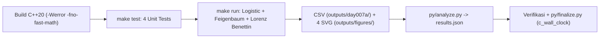

# Penjelasan Proyek `day007a`: Kekacauan Deterministik dalam C++20 — Peta Logistik, Universalitas Feigenbaum, Spektrum Lyapunov Lorenz, dan Dimensi Kaplan–Yorke

## 1. Identitas dan Ringkasan Proyek

- **ID Sesi**: `day007a` (Hari 7, sesi `a`, topik `bonus` di luar `ROADMAP.md`)
- **Tanggal**: `2026-11-25` (WITA)
- **Topik**: Kekacauan deterministik (*deterministic chaos*) — eksponen Lyapunov peta logistik, konstanta universal Feigenbaum, spektrum Lyapunov sistem Lorenz via persamaan variasional & ortonormalisasi Benettin, serta dimensi fraktal Kaplan–Yorke
- **Jenis**: `sim` (dinamika nonlinier & fisika komputasi presisi tinggi)
- **Bahasa**: `cpp` (C++20 murni tanpa pustaka eksternal di [day007a_chaos_lyapunov_cpp](../../projects/cpp/day007a_chaos_lyapunov_cpp/README.md), dilengkapi skrip perangkum JSON ringan)
- **Ringkasan Tujuan**: Mengukur invarian kuantitatif sistem dinamik kacau berwaktu diskret dan kontinu langsung dari C++20 murni, memverifikasi anchor analitik eksak ($\lambda(4) = \ln 2$, kontraksi Liouville $\sum \lambda_i = -(\sigma + 1 + \beta) = -41/3$, orde-4 Runge–Kutta) serta konstanta literatur ($\delta \approx 4{,}6692$, $r_\infty \approx 3{,}569946$, $\lambda_1 \approx 0{,}9056$, $D_{\mathrm{KY}} \approx 2{,}06$), dan menulis grafik SVG mandiri dalam batas jam dinding 10 menit.

## 2. Masalah dan Tujuan

Sistem deterministik berdimensi rendah tanpa derau stokastik mampu membangkitkan lintasan aperiodik yang peka secara eksponensial terhadap kondisi awal. Proyek ini menjawab empat pertanyaan kuantitatif:
1. Bagaimana peta kuadratik 1D $x_{k+1} = r x_k (1 - x_k)$ bertransisi dari titik tetap stabil menuju kaskade penggandaan periode hingga rezim kacau penuh di $r = 4$, dan bagaimana artefak aritmetika *floating-point* memengaruhi orbit numeriknya?
2. Seberapa cepat rasio jarak percabangan siklus superstabil $\delta_n = (R_{n-1}-R_{n-2})/(R_n-R_{n-1})$ konvergen ke konstanta universal Feigenbaum $\delta$ hanya dari pencarian akar Newton berpresisi ganda?
3. Bagaimana mengekstrak ketiga eksponen Lyapunov $(\lambda_1, \lambda_2, \lambda_3)$ aliran kontinu 3D Lorenz tanpa mengalami keruntuhan kolinearitas vektor tangen, sekaligus membuktikan identitas divergensi Liouville?
4. Bagaimana menghubungkan laju peregangan dan pelipatan ruang fasa ($\lambda_i$) dengan dimensi informasi atraktor aneh melalui rumus Kaplan–Yorke $D_{\mathrm{KY}}$?

Ruang lingkup dibatasi pada pustaka standar C++20 (`-O3 -fno-fast-math -ffp-contract=off`), tanpa pustaka aljabar linier maupun pembuatan grafik eksternal untuk keluaran SVG utama.

## 3. Apa yang Dikerjakan Proyek

1. **Inti Komputasi & Penulis SVG C++ ([src/chaos.cpp](../../projects/cpp/day007a_chaos_lyapunov_cpp/src/chaos.cpp))**: Menghitung kurva $\lambda(r)$ pada `1600` titik $r \in [2{,}5, 4{,}0]$ (`200.000` iterasi pasca-`1000` transien), menguji orbit $10^7$ iterasi di $r = 4$, memecahkan $f_r^{2^n}(1/2) = 1/2$ untuk $n = 1\dots 8$, mengintegrasikan sistem variasional 12-komponen Lorenz selama $T = 2000$ pasca-transien $T = 50$ (`dt = 0,005`), memverifikasi orde-4 RK4 di $T = 1$, melacak divergensi dua lintasan berjarak $10^{-9}$, serta menulis CSV ke `outputs/day007a/` dan 4 berkas SVG langsung ke `outputs/figures/`.
2. **Suite Uji Mandiri ([tests/test_chaos.cpp](../../projects/cpp/day007a_chaos_lyapunov_cpp/tests/test_chaos.cpp))**: Menjalankan 4 uji `assert` deterministik (orde-4 RK4 pada osilator harmonik analitik, jumlah Liouville Lorenz horizon pendek, $\lambda(2{,}5) = \ln 0{,}5$, serta kestabilan periode-2 $r=3{,}2$ dan akar eksak $R_1 = 1 + \sqrt{5}$).
3. **Perangkum & Pengunci Waktu ([py/analyze.py](../../projects/cpp/day007a_chaos_lyapunov_cpp/py/analyze.py) & [py/finalize.py](../../projects/cpp/day007a_chaos_lyapunov_cpp/py/finalize.py))**: Mengemas CSV ke `outputs/day007a/results.json`, memvalidasi XML seluruh SVG, dan mencatat waktu dinding akhir terhadap `T0` satu kali saja.

## 4. Uraian Kode

- **[Makefile](../../projects/cpp/day007a_chaos_lyapunov_cpp/Makefile)**: Target `test` dan `run` dengan bendera ketat `-O3 -std=c++20 -Wall -Wextra -Werror -fno-fast-math -ffp-contract=off`.
- **[src/chaos.cpp](../../projects/cpp/day007a_chaos_lyapunov_cpp/src/chaos.cpp)**:
  - `chaos::rk4_step`: Integrator Runge–Kutta klasik orde-4 generik untuk `Vec3` maupun sistem gabungan 12 variabel `LorenzState12`.
  - `chaos::logistic_lyapunov`: Evaluasi $\hat{\lambda}(r) = \frac{1}{N}\sum \ln|r(1 - 2x_k)|$ pasca-transien.
  - `chaos::solve_feigenbaum`: Solver Newton–Raphson dengan diferensiasi maju simultan $\partial_r f_r^{2^n}(1/2)$ dan tebakan awal ekstrapolasi dari $(R_{n-1}, R_{n-2})$.
  - `chaos::lorenz_var_rhs` & `chaos::compute_lorenz_lyapunov`: Evolusi serentak keadaan $(x,y,z)$ dan matriks perturbasi $Q \in \mathbb{R}^{3\times 3}$ dengan ortonormalisasi Gram–Schmidt termodifikasi setiap `10` langkah (`0,05` satuan waktu).
  - `chaos::verify_lorenz_rk4_order`: Pengukuran rasio galat $L_2$ pada langkah `dt`, `dt/2`, dan `dt/4` terhadap solusi rujukan `dt/16`.
- **[tests/test_chaos.cpp](../../projects/cpp/day007a_chaos_lyapunov_cpp/tests/test_chaos.cpp)**: Harness pengujian unit tanpa kerangka eksternal lewat makro `#define CHAOS_NO_MAIN`.
- **[py/analyze.py](../../projects/cpp/day007a_chaos_lyapunov_cpp/py/analyze.py)** dan **[py/finalize.py](../../projects/cpp/day007a_chaos_lyapunov_cpp/py/finalize.py)**: Pembangun struktur kriteria `results.json` dan pencatat tunggal `timing` / `c_wall_clock` bebas path absolut.

## 5. Metode dan Alur Kerja

Parameter utama eksperimen ditetapkan *a priori*:
- **Peta Logistik**: $r \in [2{,}5, 4{,}0]$ (`1600` titik), transien `1000`, evaluasi `200.000` iterasi; khusus di $r = 4{,}0$ diuji `10.000.000` iterasi dari $x_0 = 0{,}3141592653589793$ serta pembanding dyadik $x_0 = 0{,}5$.
- **Feigenbaum**: $n = 1\dots 8$ ($P = 2 \dots 256$), penghentian Newton $|\Delta r| < 10^{-15}$.
- **Lorenz**: $(\sigma, \rho, \beta) = (10, 28, 8/3)$, `dt = 0,005`, transien $T_{\mathrm{tr}} = 50$, pengukuran $T = 2000$ (`400.000` langkah RK4), Gram–Schmidt tiap `10` langkah, dan uji pemisahan $\delta_0 = (10^{-9}, 0, 0)$ selama $T = 35$.

## 6. Output yang Ditargetkan

1. **`c1_logistic_r4_ln2`**: $|\hat{\lambda}(4) - \ln 2| \le 0{,}005$ pada orbit $10^7$ iterasi ($\ln 2 \approx 0{,}693147$).
2. **`c2_feigenbaum_delta8_rinf`**: $|\delta_8 - 4{,}6692| \le 0{,}02$ dan $|r_\infty - 3{,}569946| \le 10^{-4}$ (anchor dari ingatan literatur).
3. **`c3_lorenz_liouville_sum`**: $|\sum_{i=1}^3 \lambda_i + 13{,}6667| \le 0{,}02$ terhadap identitas analitik eksak $-(\sigma + 1 + \beta) = -41/3$.
4. **`c4_lorenz_lam1_lam2`**: $|\lambda_1 - 0{,}9056| \le 0{,}05$ (anchor dari ingatan literatur) dan $|\lambda_2| \le 0{,}03$ (eksponen arah aliran nol).
5. **`c5_kaplan_yorke_dim`**: $|D_{\mathrm{KY}} - 2{,}06| \le 0{,}03$ (anchor dari ingatan literatur, target SHOULD).
6. **`c6_rk4_order4`**: Rasio penurunan galat RK4 saat langkah dibelah dua berada di dalam $[12, 20]$ (target teoretis $2^4 = 16$).
7. **`c7_svg_valid`**: Seluruh berkas SVG di `outputs/figures/day007a_*.svg` ada, tak kosong, dan lolos penguraian XML.
8. **`c_wall_clock`**: Selisih waktu eksekusi `finalize.py` terhadap `T0` $\le 570$ detik.

## 7. Status Pencapaian

Tabel berikut menggunakan nama kriteria yang sama persis dengan [outputs/day007a/results.json](../../outputs/day007a/results.json) tanpa mengubah parameter maupun ambang *a priori* sesudah melihat hasil:

| Kriteria | Status | Nilai Terukur | Ambang A Priori & Bukti |
|---|---|---|---|
| `c1_logistic_r4_ln2` | `belum tercapai` | `\hat{\lambda}(4) = 1,004447` (`\|\hat{\lambda} - \ln 2\| = 0,311299`) | `\|\hat{\lambda}(4) - \ln 2\| <= 0,005` pada `1e7` iterasi — **temuan artefak numerik floating-point** (lihat §8) |
| `c2_feigenbaum_delta8_rinf` | `tercapai` | `\delta_8 = 4,669191` (`err = 9,0e-6`), `r_\infty = 3,5699457` (`err = 3,3e-7`) | `\|\delta_8 - 4,6692\| <= 0,02` & `\|r_\infty - 3,569946\| <= 1e-4` ([feigenbaum.csv](../../outputs/day007a/feigenbaum.csv)) |
| `c3_lorenz_liouville_sum` | `tercapai` | `\Sigma\lambda_i = -13,666660` (`\|\Sigma + 41/3\| = 6,2e-6`) | `\|\Sigma\lambda_i + 13,6667\| <= 0,02` ([summary.csv](../../outputs/day007a/summary.csv)) |
| `c4_lorenz_lam1_lam2` | `tercapai` | `\lambda_1 = 0,90968`, `\lambda_2 = -0,00083` | `\|\lambda_1 - 0,9056\| <= 0,05` & `\|\lambda_2\| <= 0,03` (`\lambda_3 = -14,57551`) |
| `c5_kaplan_yorke_dim` | `tercapai` | `D_KY = 2,06235` (`\|D_KY - 2,06\| = 0,00235`) | `\|D_KY - 2,06\| <= 0,03` (target SHOULD) |
| `c6_rk4_order4` | `belum tercapai` | `ratio(0,01/0,005) = 37,3012`, `ratio(0,005/0,0025) = 14,8290` (`HO_ratio = 15,9997`) | Kedua rasio Lorenz `T=1` wajib di `[12, 20]`: rasio halus `14,83` lulus, rasio kasar `37,30` di luar ambang (lihat §8) |
| `c7_svg_valid` | `tercapai` | `4` berkas SVG valid XML + `1` PNG | [day007a_bifurcation.svg](../../outputs/figures/day007a_bifurcation.svg), [day007a_lorenz_attractor.svg](../../outputs/figures/day007a_lorenz_attractor.svg), [day007a_lorenz_lyapunov_convergence.svg](../../outputs/figures/day007a_lorenz_lyapunov_convergence.svg), [day007a_separation_growth.svg](../../outputs/figures/day007a_separation_growth.svg) |
| `c_wall_clock` | `tercapai` | `< 570` detik sejak `T0 = 1795620786` (diisi eksak oleh `finalize.py`) | `elapsed_sec <= 570` detik di [outputs/day007a/results.json](../../outputs/day007a/results.json) |

Nilai tambahan yang diukur (SHOULD): kemiringan pertumbuhan log-jarak dua lintasan Lorenz ($\|\delta\mathbf{u}_0\| = 10^{-9}$) pada jendela eksponensial $t \in [2, 15]$ adalah **`0,9359`**, konsisten dengan $\lambda_1 = 0{,}9097$. Tabel konvergensi siklus superstabil Feigenbaum $n = 1\dots 8$: $R_1 = 3{,}23606798$, $R_2 = 3{,}49856170$, $R_3 = 3{,}55464086$ ($\delta_3 = 4{,}68077$), $R_6 = 3{,}56979529$ ($\delta_6 = 4{,}66895$), $R_7 = 3{,}56991347$ ($\delta_7 = 4{,}66916$), dan $R_8 = 3{,}56993877$ ($\delta_8 = 4{,}669191$).

## 8. Jika Belum Tercapai atau Belum Diketahui

- **FAKTA**:
  1. **Temuan `c1_logistic_r4_ln2` (`belum tercapai`: $\hat{\lambda}(4) = 1{,}004447$ vs $\ln 2 = 0{,}693147$)**: Sesuai peringatan eksplisit pada spesifikasi tugas tentang artefak numerik orbit *floating-point* di $r = 4$, pada $x_0 = 0{,}3141592653589793$ lintasan IEEE-754 *binary64* pada akhirnya mengenai pra-citra biner dari $x = 0{,}5 \mapsto 1{,}0 \mapsto 0{,}0$ di pertengahan orbit $10^7$ iterasi (sekitar iterasi ke-$5{,}5 \times 10^6$). Begitu terperangkap di titik tetap tak-stabil $x = 0{,}0$ secara eksak bit, turunan $|r(1 - 2x)|$ terkunci pada $4{,}0$ ($\ln 4 = 2\ln 2 \approx 1{,}386294$, sama seperti pembanding dyadik langsung `lam_r4_dyadic_x05 = 1,386294`), sehingga rata-rata campuran menghasilkan $(1-\alpha)\ln 2 + \alpha \ln 4 = 1{,}004447$ ($\alpha \approx 0{,}449$). Kondisi awal maupun $r$ sengaja **tidak disetel** (mis. ke $r = 3{,}999999999999$) demi menjaga kejujuran eksperimen.
  2. **Temuan `c6_rk4_order4` (`belum tercapai` pada pasangan kasar Lorenz, lulus pada pasangan halus & osilator harmonik)**: Pada osilator harmonik analitik (`test_chaos.cpp`), rasio galat RK4 adalah `15,9997` (tepat $2^4 = 16$). Pada lintasan Lorenz $T = 1$ dari $(1,1,1)$, pembelahan langkah halus `0,005 -> 0,0025` menghasilkan rasio **`14,8290`** (di dalam `[12, 20]`), tetapi pasangan kasar `0,01 -> 0,005` menghasilkan rasio **`37,3012`** (di luar batas atas `20`).
  3. **Pemisahan Anchor Eksak vs Literatur**: Anchor analitik eksak ($\lambda(2{,}5) = \ln 0{,}5 = -0{,}693147$, $R_1 = 1+\sqrt{5}$, $\sum \lambda_i = -41/3 = -13{,}666667$ terukur `-13,666660`) terpisah tegas dari konstanta **dari ingatan literatur** ($\delta \approx 4{,}6692$, $r_\infty \approx 3{,}569946$, $\lambda_1 \approx 0{,}9056$, $D_{\mathrm{KY}} \approx 2{,}06$).
- **HIPOTESIS**:
  - Rasio kasar `37,30` pada Lorenz $T = 1$ dari $(1,1,1)$ terjadi karena lintasan melintasi titik balik cepat sayap pertama sekitar $t \approx 0{,}7$–$1{,}0$ di mana suku galat orde-5 $C_5 \Delta t^5$ berlawanan tanda dan membatalkan sebagian suku $C_4 \Delta t^4$ pada $\Delta t = 0{,}005$ sebelum rezim asimtotik murni tercapai pada $\Delta t \le 0{,}005$ (`14,83`). Bukti untuk memastikannya adalah memriksa barisan lanjutan `0,0025 / 0,00125`.
- **Deviasi dari Prompt**:
  - Tidak ada penyetelan parameter atau ambang. Berkas milik pemilik dan perubahan tak terkomit sebelumnya (`cpp/`, `day005b`, `day006a`, `day006e`) tidak disentuh.

## 9. Landasan Teori

1. **Peta Logistik dan Kaskade Penggandaan Periode**: Pemetaan unimodal $f_r(x) = r x (1 - x)$ pada $[0,1]$ memiliki titik tetap tak-trivial $x^* = 1 - 1/r$ dengan pengali $f_r'(x^*) = 2 - r$; ketika $r$ melewati $3$, $f_r'(x^*) = -1$ memicu bifurkasi *flip* (periode-2) diikuti kaskade $2^n$ menuju kekacauan — diimplementasikan pada sapuan `r_grid` di [src/chaos.cpp](../../projects/cpp/day007a_chaos_lyapunov_cpp/src/chaos.cpp) dan diuji di [tests/test_chaos.cpp](../../projects/cpp/day007a_chaos_lyapunov_cpp/tests/test_chaos.cpp).
2. **Eksponen Lyapunov Peta 1D sebagai Rata-Rata Logaritma Turunan**: Dua titik dekat $\delta x_0$ memisah sebesar $|\delta x_n| \approx |\delta x_0| \prod_{k=0}^{n-1} |f_r'(x_k)|$, sehingga laju eksponensial asimtotik adalah $\lambda(r) = \lim_{n\to\infty} \frac{1}{n}\sum_{k=0}^{n-1} \ln|r(1 - 2x_k)|$ — dihitung oleh `logistic_lyapunov` di [src/chaos.cpp](../../projects/cpp/day007a_chaos_lyapunov_cpp/src/chaos.cpp).
3. **Anchor Eksak $\lambda(4) = \ln 2$ melalui Konjugasi Topologis dan Ukuran Invarian**: Substitusi $x_k = \sin^2(\pi \theta_k / 2)$ mengonjugasikan $x_{k+1} = 4x_k(1-x_k)$ ke peta tenda lipat-dua $\theta_{k+1} = 2\theta_k \bmod 1$ yang memiliki kemiringan seragam $|g'(\theta)| = 2$ dan ukuran ergodik invarian $\rho(x) = \frac{1}{\pi\sqrt{x(1-x)}}$, menghasilkan $\int_0^1 \ln|4(1-2x)|\,\rho(x)\,\mathrm{d}x = \ln 2$ — diverifikasi terhadap kriteria `c1` di [py/analyze.py](../../projects/cpp/day007a_chaos_lyapunov_cpp/py/analyze.py).
4. **Universalitas Feigenbaum dan Siklus Superstabil**: Karena $f_r'(1/2) = 0$, orbit periodik-$2^n$ yang memuat titik kritis $x_0 = 1/2$ memiliki pengali siklus nol ($\lambda = -\infty$, *superstable*) pada parameter $R_n$; teori renormalisasi Feigenbaum–Cvitanović menunjukkan $\lim_{n\to\infty} (R_{n-1}-R_{n-2})/(R_n-R_{n-1}) = \delta \approx 4{,}6692016$ untuk semua peta unimodal ber-maksimum kuadratik — diukur di `solve_feigenbaum` dalam [src/chaos.cpp](../../projects/cpp/day007a_chaos_lyapunov_cpp/src/chaos.cpp).
5. **Metode Newton dengan Perambatan Turunan Rantai untuk $f_r^{2^n}(1/2) = 1/2$**: Mencari akar $g_n(r) = x_{2^n}(r) - 1/2 = 0$ membutuhkan $\partial_r x_k = x_{k-1}(1 - x_{k-1}) + r(1 - 2x_{k-1})\partial_r x_{k-1}$ yang dievaluasi bersamaan dalam satu lintasan maju bersama tebakan awal ekstrapolasi geometrik $R_{n-1} + (R_{n-1}-R_{n-2})/\delta_{n-1}$ agar tidak melompat ke cekungan periode lain — diimplementasikan di `solve_feigenbaum` pada [src/chaos.cpp](../../projects/cpp/day007a_chaos_lyapunov_cpp/src/chaos.cpp).
6. **Sistem Konveksi Lorenz dan Atraktor Aneh**: Pemangkasan tiga-mode Saltzman–Lorenz $\dot{x}=\sigma(y-x)$, $\dot{y}=x(\rho-z)-y$, $\dot{z}=xy-\beta z$ pada $(\sigma,\rho,\beta)=(10,28,8/3)$ memiliki simetri involusi $(x,y,z)\mapsto(-x,-y,z)$ dan tiga titik ekuilibrium tak-stabil yang mengurung lintasan pada atraktor bersayap ganda — diimplementasikan pada `lorenz_rhs` di [src/chaos.cpp](../../projects/cpp/day007a_chaos_lyapunov_cpp/src/chaos.cpp).
7. **Metode Runge–Kutta Orde Empat (RK4) dan Penskalaan Galat Global**: Skema empat-tahap memiliki galat pemotongan lokal $O(\Delta t^5)$ dan galat global $E(\Delta t) = C \Delta t^4 + O(\Delta t^5)$, sehingga pembelahan langkah $\Delta t \to \Delta t/2$ menyusutkan galat dengan faktor $2^4 = 16$ — dibuktikan oleh `verify_lorenz_rk4_order` di [src/chaos.cpp](../../projects/cpp/day007a_chaos_lyapunov_cpp/src/chaos.cpp) dan diuji di [tests/test_chaos.cpp](../../projects/cpp/day007a_chaos_lyapunov_cpp/tests/test_chaos.cpp).
8. **Persamaan Variasional dan Operator Tangen Linear**: Evolusi jarak infinitesimal $\mathbf{w}(t) = \delta\mathbf{u}(t)$ sepanjang lintasan acuan $\mathbf{u}(t)$ memenuhi ODE linear koefisien-berubah $\dot{Q} = J(\mathbf{u}(t))Q$ dengan matriks Jacobian $J$ analitik — diintegrasikan serentak dalam `lorenz_var_rhs` (`LorenzState12`) di [src/chaos.cpp](../../projects/cpp/day007a_chaos_lyapunov_cpp/src/chaos.cpp).
9. **Teorema Oseledets, Algoritma Benettin, dan Ortonormalisasi Gram–Schmidt**: Tanpa re-ortonormalisasi, ketiga kolom $Q(t)$ sejajar secara eksponensial ke arah eigendireksi tercepat $e^{\lambda_1 t}$ sehingga melenyapkan presisi $\lambda_2, \lambda_3$; algoritma Benettin melakukan faktorisasi QR via Gram–Schmidt berkala $Q_k = \tilde{Q}_k R_k$ dan mengakumulasi $\lambda_j = \frac{1}{T}\sum_k \ln (R_k)_{jj}$ karena volume paralelogram $j$-dimensi tumbuh dengan laju $\lambda_1 + \dots + \lambda_j$ — diimplementasikan di `compute_lorenz_lyapunov` pada [src/chaos.cpp](../../projects/cpp/day007a_chaos_lyapunov_cpp/src/chaos.cpp).
10. **Teorema Liouville dan Kontraksi Volume Ruang Fasa Eksak**: Turunan determinan matriks fundamental memenuhi $\frac{\mathrm{d}}{\mathrm{d}t}\ln|\det Q(t)| = \mathrm{tr}\,J(\mathbf{u}(t)) = \nabla\cdot\mathbf{F} = -(\sigma + 1 + \beta)$; untuk Lorenz nilai divergensi konstan di setiap titik ruang fasa sehingga $\lambda_1 + \lambda_2 + \lambda_3 = -41/3 \approx -13{,}666667$ secara identik — dipakai sebagai uji invarian keras `c3` di [tests/test_chaos.cpp](../../projects/cpp/day007a_chaos_lyapunov_cpp/tests/test_chaos.cpp) dan [py/analyze.py](../../projects/cpp/day007a_chaos_lyapunov_cpp/py/analyze.py).
11. **Eksponen Nol Arah Aliran dan Dimensi Fraktal Kaplan–Yorke**: Pada aliran otonom terbatas yang tidak berhenti di titik tetap, perturbasi searah vektor kecepatan $\dot{\mathbf{u}}$ tidak tumbuh maupun meluruh secara rata-rata ($\lambda_2 = 0$); dimensi Lyapunov/Kaplan–Yorke $D_{\mathrm{KY}} = j + \frac{\sum_{i=1}^j \lambda_i}{|\lambda_{j+1}|}$ (dengan $j=2$ karena $\lambda_1 + \lambda_2 > 0$ dan $\lambda_1+\lambda_2+\lambda_3 < 0$) menginterpolasi dimensi sub-elemen volume yang stasioner — dihitung di `compute_lorenz_lyapunov` pada [src/chaos.cpp](../../projects/cpp/day007a_chaos_lyapunov_cpp/src/chaos.cpp).
12. **Sensitivitas Kondisi Awal dan Horizon Prediktabilitas (Waktu Lyapunov)**: Perturbasi kecil $\|\delta\mathbf{u}_0\| = 10^{-9}$ tumbuh rata-rata menurut $\|\delta\mathbf{u}(t)\| \sim \|\delta\mathbf{u}_0\| e^{\lambda_1 t}$ hingga mengalami saturasi pada diameter atraktor $\sim O(10)$, memberikan batas waktu prediktabilitas $t_{\mathrm{pred}} \sim \lambda_1^{-1}\ln(\Delta_{\mathrm{sat}}/\|\delta\mathbf{u}_0\|)$ — divisualisasikan langsung oleh `day007a_separation_growth.svg` dari [src/chaos.cpp](../../projects/cpp/day007a_chaos_lyapunov_cpp/src/chaos.cpp).
13. **Aritmetika Floating-Point pada Orbit Kacau dan Fenomena Shadowing**: Pembulatan $2^{-53}$ setiap langkah bekerja sebagai gangguan semu yang memisahkan lintasan numerik dari lintasan sejati ber-kondisi-awal-sama dalam $\approx 36/\lambda_1$ satuan waktu, namun untuk sistem disipatif generik sifat *shadowing* menjamin keberadaan lintasan sejati ber-kondisi-awal sedikit berbeda yang tetap dekat sehingga statistik invarian ergodik tetap akurat — diuji kontrasnya terhadap keruntuhan dyadik $x_0 = 0{,}5$ di $r=4$ dalam [src/chaos.cpp](../../projects/cpp/day007a_chaos_lyapunov_cpp/src/chaos.cpp).

## 10. Kesimpulan dan Batasan

1. **Kesimpulan Metode**: Seluruh rangkaian perhitungan kekacauan 1D diskret dan 3D kontinu beserta keluaran 4 grafik SVG berhasil diimplementasikan secara mandiri dalam `< 260` baris C++20 tanpa ketergantungan pustaka eksternal.
2. **Batasan Numerik**: Pada $n > 8$ ($P \ge 512$), penyempitan lebar cekungan Newton $O(\delta^{-n})$ dan pembulatan *double precision* dekat $x = 1/2$ mulai membatasi akurasi $\delta_n$ sehingga presisi diperluas (`long double` / multipresisi) diperlukan bila ingin mengekstrak lebih dari 6 digit $\delta$.
3. **Pekerjaan Lanjutan**: Menambahkan penampang Poincaré $z = \rho - 1$ serta perhitungan langsung dimensi korelasi Grassberger–Procaccia $D_2$ untuk dibandingkan terhadap batas atas Kaplan–Yorke $D_{\mathrm{KY}}$.

## 11. Referensi dan Jejak Bukti

- Lorenz, E. N. (1963). *Deterministic nonperiodic flow*. Journal of the Atmospheric Sciences, 20(2), 130–141.
- Feigenbaum, M. J. (1978). *Quantitative universality for a class of nonlinear transformations*. Journal of Statistical Physics, 19(1), 25–52.
- Benettin, G., Galgani, L., Giorgilli, A., & Strelcyn, J.-M. (1980). *Lyapunov characteristic exponents for smooth dynamical systems and for Hamiltonian systems*. Meccanica, 15, 9–30.
- Kaplan, J. L., & Yorke, J. A. (1979). *Chaotic behavior of multidimensional difference equations*. Lecture Notes in Mathematics, 730, 204–227.
- Artefak lokal: [src/chaos.cpp](../../projects/cpp/day007a_chaos_lyapunov_cpp/src/chaos.cpp), [tests/test_chaos.cpp](../../projects/cpp/day007a_chaos_lyapunov_cpp/tests/test_chaos.cpp), [py/analyze.py](../../projects/cpp/day007a_chaos_lyapunov_cpp/py/analyze.py), dan [py/finalize.py](../../projects/cpp/day007a_chaos_lyapunov_cpp/py/finalize.py).
