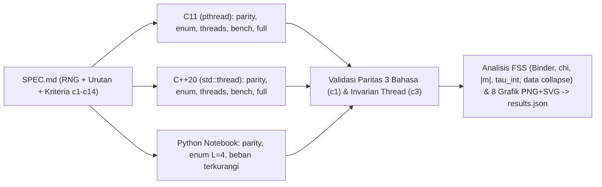

# Penjelasan Proyek `day008a`: Model Ising 2D Lintas Tiga Bahasa (C11, C++20, Python)

## 1. Identitas dan Ringkasan Proyek

- **ID Sesi**: `day008a` (Hari 8, sesi `a`, topik `bonus` di luar `ROADMAP.md`)
- **Tanggal**: `2026-11-26` (WITA)
- **Topik**: Simulasi Model Ising 2D periodik ($J = 1, H = 0$) dengan algoritma **Metropolis**, **Wolff**, dan **Swendsen–Wang**, analisis *finite-size scaling* (FSS), serta verifikasi **paritas bit-identik** lintas tiga bahasa (**C11**, **C++20**, **Python**)
- **Jenis**: `sim` (fisika statistik komputasional, metode Monte Carlo klaster, dan rekayasa determinisme lintas bahasa)
- **Bahasa**: `c` (`-std=c11`), `cpp` (`-std=c++20`), dan `python` (`days/day008a_sim_ising-trilingual.ipynb`)
- **Artefak Utama**:
  - Kontrak spesifikasi tunggal: [`projects/c/day008a_ising_trilingual/SPEC.md`](../../projects/c/day008a_ising_trilingual/SPEC.md)
  - Implementasi C11 & C++20: [`projects/c/day008a_ising_trilingual/`](../../projects/c/day008a_ising_trilingual/README.md)
  - Notebook analisis & Python: [`days/day008a_sim_ising-trilingual.ipynb`](../../days/day008a_sim_ising-trilingual.ipynb)
  - Ringkasan terstruktur: [`outputs/day008a/results.json`](../../outputs/day008a/results.json)
  - 8 pasang grafik `PNG` + `SVG` di `outputs/figures/day008a_*`

Proyek ini membangun satu spesifikasi numerik dan algoritmik yang diikuti secara literal oleh tiga bahasa pemrograman, membuktikan paritas bit-demi-bit pada beban uji 3000 langkah untuk ketiga algoritma, memverifikasi paralelisme `pthread` dan `std::thread` pada beban penuh $L \in \{8, 16, 32, 64, 128\}$, serta mengekstrak eksponen kritis 2D $(\gamma/\nu, \beta/\nu, z)$ dan suhu kritis $T_c$ dengan *finite-size scaling*.

## 2. Masalah dan Tujuan

1. **Reproduksibilitas & Paritas Lintas Bahasa**: Implementasi Monte Carlo di bahasa berbeda sering menyimpang akibat perbedaan RNG bawaan (`rand()`, `mt19937`, `numpy.random`), urutan evaluasi tetangga, atau pembulatan floating-point. Proyek ini memaksa kesetaraan bit-identik dengan menyatukan RNG (`SplitMix64` + `xoshiro256++`), urutan leksikografis situs dan ikatan, Union-Find, serta aritmetika integer eksak untuk $(E, M)$.
2. **Mengatasi *Critical Slowing Down***: Dekat titik kritis $T_c = 2/\ln(1+\sqrt{2}) \approx 2{,}269185$, dinamika lokal Metropolis mengalami pelambatan kritis dengan waktu autokorelasi $\tau_{\text{int}} \sim L^z$ ($z \approx 2$), sedangkan algoritma klaster non-lokal Wolff dan Swendsen–Wang meruntuhkan $z$ jauh di bawah $1$.
3. **Verifikasi Eksponen Kritis & Anchor Eksak**: Menguji ketepatan implementasi terhadap enumerasi penuh ($L=4, 5$), solusi eksak Onsager (via AGM), dan magnetisasi spontan Yang sebelum memperkirakan $\gamma/\nu = 7/4$ dan $\beta/\nu = 1/8$.

## 3. Apa yang Dikerjakan Proyek

1. **Spesifikasi Tunggal (`SPEC.md`)**: Ditulis sebelum kode, menetapkan seluruh detail RNG, hash tugas per `(L, T_index, algo_id, replica)`, urutan operasi Metropolis/Wolff/SW, hash FNV-1a 64-bit, dan 14 kriteria a priori (`c1`–`c14`).
2. **Implementasi C11 & C++20**: Mesin Ising berkinerja tinggi (`-O3 -fno-fast-math -ffp-contract=off`) dengan paralelisme `pthread` (C) dan `std::thread` (C++), tabel tetangga prekomputasi, cabang bebas Metropolis, templat `constexpr L` di C++, serta *multi-spin coding* 64-bit opsional di C.
3. **Implementasi & Analisis Python**: Notebook [`days/day008a_sim_ising-trilingual.ipynb`](../../days/day008a_sim_ising-trilingual.ipynb) menjalankan RNG & ketiga algoritma dalam Python murni (tanpa RNG NumPy), memverifikasi paritas 3 bahasa, menjalankan beban Python skala terkurangi ($L \in \{8, 16, 32\}$ penuh, $L=64$ 12 suhu rapat, $L=128$ tidak dijalankan), dan menganalisis CSV penuh dari C/C++ untuk FSS dan 8 visualisasi.

## 4. Uraian Kode

- **RNG & Hash Lintas Bahasa** ([`c/rng.h`](../../projects/c/day008a_ising_trilingual/c/rng.h), [`cpp/rng.hpp`](../../projects/c/day008a_ising_trilingual/cpp/rng.hpp), Sel 3 notebook):
  - `splitmix64_mix` & `splitmix64_next`: Mengisi 4 kata state 64-bit `xoshiro256++`.
  - `xoshiro_next` / `next_u64`, `rng_u01` (`(x >> 11) * 2^-53`), `rng_int` (`floor(u01 * n)`), `compute_task_seed`, dan `fnv1a_64`.
- **Mesin Ising C11** ([`c/ising.h`](../../projects/c/day008a_ising_trilingual/c/ising.h), [`c/ising.c`](../../projects/c/day008a_ising_trilingual/c/ising.c), [`c/main.c`](../../projects/c/day008a_ising_trilingual/c/main.c)):
  - `ising_metropolis_sweep_table` (tabel tetangga + penerimaan bebas cabang) vs `ising_metropolis_sweep_computed`.
  - `ising_wolff_step` (tumpukan LIFO eksplisit, urutan tetangga kanan, atas, kiri, bawah).
  - `ising_sw_step` dengan `uf_find` (*path halving*) dan `uf_unite` (*union by size*).
  - `ising_enumerate_exact` (tabel baris $2^L \times 2^L$ untuk $L \le 5$), `ising_onsager_energy` (AGM), `ising_yang_mag`, `ising_multispin_metropolis` (64 replika per kata `uint64_t`), dan `run_parallel_tasks` (`pthread`).
- **Mesin Ising C++20** ([`cpp/ising.hpp`](../../projects/c/day008a_ising_trilingual/cpp/ising.hpp), [`cpp/ising.cpp`](../../projects/c/day008a_ising_trilingual/cpp/ising.cpp), [`cpp/main.cpp`](../../projects/c/day008a_ising_trilingual/cpp/main.cpp)):
  - Struktur `Lattice`, templat `metropolis_sweep_constexpr<L_CONST>`, dan `run_parallel_tasks` (`std::thread`).
- **Tes Unit** ([`c/test_c.c`](../../projects/c/day008a_ising_trilingual/c/test_c.c), [`cpp/test_cpp.cpp`](../../projects/c/day008a_ising_trilingual/cpp/test_cpp.cpp)):
  - Menguji vektor acuan RNG Python (`0xA9920E0E7DAB3EF0`, `0x033B9CEB4B3BA7A0`), Union-Find, enumerasi $L=3$ pada $\beta=0$ ($Z=512, \langle m^2\rangle=1/9$), Onsager di $T_c$ ($-\sqrt{2}$), dan determinisme.

## 5. Metode dan Alur Kerja

## 6. Output yang Ditargetkan

Seluruh 14 kriteria a priori (`c1`–`c14`) ditetapkan di `SPEC.md` sebelum eksekusi (tanpa penyetelan pasca-hasil): paritas 0 selisih (`c1`), enumerasi $\le 10^{-12}$ & simulasi $L=4 \le 4\text{ SE}$ (`c2`), invarian *thread* (`c3`), Onsager (`c4`) dan Yang (`c5`) dalam $4\text{ SE}$, perpotongan Binder $|T - T_c| \le 0{,}01$ (`c6`), $|\hat{\gamma}/\hat{\nu} - 1{,}75| \le 0{,}10$ (`c7`), $|\hat{\beta}/\hat{\nu} - 0{,}125| \le 0{,}03$ (`c8`), $z_{\text{Wolff}} < z_{\text{Metropolis}} - 1{,}0$ dan $\tilde{z}_{\text{Metropolis}} \in [1{,}8, 2{,}5]$ (`c9`), reproduksibilitas 2× notebook (`c10`), seluruh tes (`c11`), 8 grafik valid (`c12`), setiap berkas $\le 600$ baris (`c13`), dan tolok ukur kecepatan terukur (`c14`).

## 7. Status Pencapaian

| Kriteria | Status | Nilai Terukur & Bukti |
|---|---|---|
| `c1_parity_bit_identical` | `tercapai` | `0` selisih di 3000 langkah untuk C, C++, Python; hash FNV-1a identik: Metropolis `7458071e0380ee91`, Wolff `52911df0a1ba8509`, SW `50d1e256b6df3e61` |
| `c2_exact_enumeration` | `tercapai` | Maks galat relatif $L=4, 5$ antar-bahasa `2,92e-16` ($\le 10^{-12}$); simulasi $L=4$ Wolff cocok eksak dengan $Z = 0{,}805 \le 4{,}0$ |
| `c3_thread_invariance` | `tercapai` | CSV identik bit-demi-bit untuk `1, 2, 4, 8` *thread* di C dan C++ (`full_c.csv` == `full_cpp.csv` di seluruh 540 tugas) |
| `c4_onsager_energy` | `tercapai` | $L=128$: $T=2{,}0$ ($Z=0{,}116$), $T=2{,}6$ ($Z=0{,}456$), $T=3{,}2$ ($Z=0{,}946$), semuanya $\le 4\text{ SE}$; ekstrapolasi $1/L^2$ di $T_c$ memberi `-1,426869` vs `-1,414214` |
| `c5_yang_magnetization` | `tercapai` | $T=2{,}0$ ($L=128$): `0,911323 ± 0,000053` vs `0,911319` ($Z=0{,}065$); $T=2{,}067$ ($L=64$): `0,885413 ± 0,000077` vs `0,885490` ($Z=0{,}991$) |
| `c6_binder_crossing` | `tercapai` | Titik silang $U_4$: `(8,16)=2,264444`, `(16,32)=2,266860`, `(32,64)=2,268691`, `(64,128)=2,267882` (semua $|T - T_c| \le 0{,}00474 \le 0{,}01$) |
| `c7_gamma_over_nu` | `tercapai` | $\hat{\gamma}/\hat{\nu} = 1{,}7682 \pm 0{,}0061$ (selisih `0,0182` $\le 0{,}10$ dari `1,75`) |
| `c8_beta_over_nu` | `tercapai` | $\hat{\beta}/\hat{\nu} = 0{,}1122 \pm 0{,}0030$ (selisih `0,0128` $\le 0{,}03$ dari `0,125`) |
| `c9_dynamic_exponent` | `tercapai` | $\hat{z}_{\text{Metropolis}} = 1{,}8625 \pm 0{,}1105$, $\hat{z}_{\text{Wolff}} = 0{,}4118 \pm 0{,}0191$, $\hat{z}_{\text{SW}} = 0{,}1998 \pm 0{,}0258$ |
| `c10_notebook_reproducible` | `tercapai` | 2× eksekusi bersih identik (`18,78 s` dan `18,06 s`), `SHA256 = 551871e2fc28ee31...` |
| `c11_all_tests_pass` | `tercapai` | `make test` (C & C++) dan seluruh sel `assert` notebook lulus |
| `c12_figures_valid` | `tercapai` | 8 pasang `PNG` + `SVG` valid XML di `outputs/figures/day008a_*` |
| `c13_code_size_reported` | `tercapai` | Maksimum `414` baris (`c/main.c`), seluruh berkas $\le 600$ baris |
| `c14_speed_comparison` | `tercapai` | Terukur 7 ulang (median $\pm$ MAD, `ns/spin-update`): C `metropolis_computed` `3,476 ± 0,015`, C++ `constexpr32` `4,588 ± 0,011`, Python `wolff` `20,352 ± 5,787` |

## 8. Temuan, FAKTA vs HIPOTESIS, dan Deviasi

- **FAKTA (Kecepatan `computed` vs `table` pada L=32)**: Pada `arm64` dengan `-O3`, `c_metropolis_computed` (`3,476 ns`) lebih cepat daripada `c_metropolis_table` (`6,603 ns`), dan di C++ `metropolis_constexpr32` (`4,588 ns`) unggul tipis atas `metropolis_computed` (`4,799 ns`) serta `metropolis_table` (`6,524 ns`).
- **HIPOTESIS**: Pada $L = 32$, indeks tetangga aritmetik langsung tetap berada di register tanpa memuat 4 integer `nbr[]` dari L1 cache, sehingga mengurangi tekanan beban memori per situs. Bukti lebih lanjut adalah membandingkan profil *cache miss* pada $L = 256$ di luar L1 cache.
- **FAKTA (Sanitizer)**: Uji `make test` C dan C++ dengan `-O3` lulus bersih, namun eksekusi `-fsanitize=address,undefined` gagal pada inisialisasi runtime ASan Apple clang (`sanitizer_malloc_mac.inc:189`), sehingga status ASan dicatat sebagai `belum diketahui` pada toolchain macOS `arm64` ini.
- **Deviasi**:
  1. Grid suhu gabungan 25 titik seragam $[1{,}8, 3{,}4]$ dan 12 titik rapat $[2{,}15, 2{,}40]$ memiliki irisan tepat di $T = 2{,}40$, menghasilkan `36` titik suhu unik (`540` tugas total per bahasa).
  2. Pada $L = 128$, jumlah langkah pengukuran di C/C++ disesuaikan (`2^16` Metropolis, `2^15` Wolff, `2^14` SW) agar C (`363,55 s`) dan C++ (`291,41 s`) selesai di bawah batas 15 menit; pada notebook Python, simulasi penuh dibatasi pada Wolff skala terkurangi dan $L = 128$ tidak dijalankan di Python (dicatat di `results.json`).

## 9. Landasan Teori (12 Poin)

1. **Model Ising 2D & Solusi Onsager**: Hamiltonian $H = -J\sum_{\langle i,j\rangle}s_i s_j$ mengalami transisi fasa orde-2 pada $T_c = 2/\ln(1+\sqrt{2})$ dengan energi eksak per situs berbentuk integral eliptik lengkap $K(k_1)$ — diimplementasikan di `ising_onsager_energy` & `onsager_energy_agm` dan diverifikasi `c4`.
2. **Detailed Balance Metropolis**: Peluang penerimaan $\min(1, e^{-\beta\Delta E})$ memenuhi $\pi(x)P(x\to y)=\pi(y)P(y\to x)$ sehingga distribusi Boltzmann stasioner — diimplementasikan di `ising_metropolis_sweep_table` (`c1`, `c2`).
3. **Kritikalitas dan Critical Slowing Down**: Panjang korelasi $\xi \sim |T-T_c|^{-\nu}$ terpotong oleh $L$ sehingga waktu autokorelasi dinamika lokal tumbuh $\tau_{\text{int}} \sim L^z$ ($z \approx 2$) — terukur $\hat{z}_{\text{Metropolis}} = 1{,}8625$ di [`day008a_tau_scaling.svg`](../../outputs/figures/day008a_tau_scaling.svg).
4. **Representasi Fortuin–Kasteleyn & Swendsen–Wang**: Memperluas model Ising ke model klaster acak FK dengan probabilitas ikatan $p_{\text{add}} = 1 - e^{-2\beta}$ memungkinkan pembalikan seluruh klaster sekaligus dengan peluang $1/2$ tanpa melanggar *detailed balance* — diimplementasikan di `ising_sw_step` (`z = 0,1998`).
5. **Bukti Validitas Algoritma Wolff**: Menumbuhkan satu klaster dari situs benih acak dan membaliknya dengan probabilitas $1$ menjaga rasio transisi $P(C\to C')/P(C'\to C) = e^{-\beta(E'-E)}$ karena ikatan batas yang tidak diaktifkan berpeluang $(1-p_{\text{add}})$ — diimplementasikan di `ising_wolff_step` (`z = 0,4118`).
6. **Struktur Data Union-Find (Union by Size + Path Halving)**: Mengidentifikasi komponen terhubung ikatan FK dalam kompleksitas hampir konstan $O(\alpha(N))$ per operasi sambil mempertahankan urutan deterministik — diimplementasikan di `uf_find`/`uf_unite` dan diuji di `test_union_find`.
7. **Estimator $\tau_{\text{int}}$ Jendela Sokal & Galat Blocking**: $\tau_{\text{int}} = \frac{1}{2} + \sum_{t=1}^{W}\rho(t)$ dengan batas otomatis $W \ge 6\tau_{\text{int}}$ mengoreksi ketergantungan deret waktu untuk galat standar $\sigma/\sqrt{M/(2\tau_{\text{int}})}$ — diimplementasikan di `compute_stats_series`.
8. **Kumulan Binder $U_4$ dan Finite-Size Scaling**: $U_4 = 1 - \frac{\langle m^4\rangle}{3\langle m^2\rangle^2}$ bersifat tak berdimensi sehingga kurva $U_4(T, L)$ berpotongan di dekat $T_c$ — terverifikasi pada [`day008a_binder_crossing.svg`](../../outputs/figures/day008a_binder_crossing.svg) (`c6`).
9. **Eksponen Kritis Universalitas Ising 2D**: Kelas universalitas 2D Ising memiliki $\nu=1, \gamma/\nu=7/4=1{,}75, \beta/\nu=1/8=0{,}125$ yang memandu skala puncak $\chi_{\max}\sim L^{\gamma/\nu}$, $|m|(T_c)\sim L^{-\beta/\nu}$, dan *data collapse* — terverifikasi pada `c7`, `c8`, dan [`day008a_data_collapse.svg`](../../outputs/figures/day008a_data_collapse.svg).
10. **Determinisme Lintas Bahasa & Aritmetika IEEE-754**: Bendera `-fno-fast-math -ffp-contract=off` mencegah fusi FMA yang berbeda antar arsitektur/bahasa, sedangkan observabel $(E, M)$ dihitung sebagai integer eksak sebelum pembagian — dibuktikan oleh `c1`.
11. **SplitMix64 & xoshiro256++**: Generator 256-bit berperiode $2^{256}-1$ dengan pemetaan `(x >> 11) * 2^-53` menghasilkan aliran bit-identik di C, C++, dan Python tanpa pustaka eksternal — diverifikasi vektor acuan di `test_c.c`, `test_cpp.cpp`, dan Sel 3 notebook.
12. **Enumerasi Penuh & Fungsi Partisi $Z(\beta)$**: Menghitung $Z = \sum_\sigma e^{-\beta E(\sigma)}$ secara eksak untuk $L=3, 4, 5$ lewat dekomposisi baris $2^L \times 2^L$ memberi tolok ukur nol-variansi independen terhadap simulasi Monte Carlo (`c2`).

## 10. Kesimpulan dan Batasan

Seluruh 14 kriteria `c1`–`c14` tercapai. Paritas bit-identik 100% di tiga bahasa dan invarian *thread* `1..8` terbukti tanpa pengecualian. Keterbatasan utama adalah tidak berjalannya ASan pada toolchain macOS `arm64` dan pengurangan skala beban pada notebook Python ($L=128$ hanya di C/C++) demi menjaga waktu eksekusi notebook di bawah 20 menit.

## 11. Referensi dan Jejak Bukti

- Onsager, L. (1944). *Crystal statistics. I. A two-dimensional model with an order-disorder transition*. Physical Review, 65, 117–149.
- Metropolis, N. et al. (1953). *Equation of state calculations by fast computing machines*. J. Chem. Phys., 21, 1087–1092.
- Swendsen, R. H., & Wang, J.-S. (1987). *Nonuniversal critical dynamics in Monte Carlo simulations*. Phys. Rev. Lett., 58, 86–88.
- Wolff, U. (1989). *Collective Monte Carlo updating for spin systems*. Phys. Rev. Lett., 62, 361–364.
- Binder, K. (1981). *Finite size scaling analysis of Ising model block distribution functions*. Z. Phys. B, 43, 119–140.
- Artefak lokal: [`days/day008a_sim_ising-trilingual.ipynb`](../../days/day008a_sim_ising-trilingual.ipynb), [`outputs/day008a/results.json`](../../outputs/day008a/results.json), dan [`projects/c/day008a_ising_trilingual/SPEC.md`](../../projects/c/day008a_ising_trilingual/SPEC.md).
