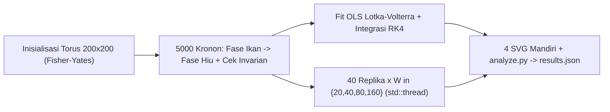

# Penjelasan Proyek `day008b`: Simulasi Wa-Tor di C++20 dan Hubungannya dengan Lotka–Volterra

## 1. Identitas dan Ringkasan Proyek

- **ID Sesi**: `day008b` (Hari 8, sesi `b`, topik `bonus` di luar `ROADMAP.md`)
- **Tanggal**: `2026-11-26` (WITA)
- **Topik**: Simulasi mangsa–pemangsa **Wa-Tor** (ikan vs hiu) di dunia torus $W \times H$ dalam C++20 murni, fit parameter model kontinu **Lotka–Volterra** (RK4), serta studi kepunahan stokastik terhadap ukuran grid
- **Jenis**: `sim` (automata seluler ekologi, sistem dinamik nonlinier, dan efek ukuran hingga)
- **Bahasa**: `cpp` (`-O3 -std=c++20 -Wall -Wextra -Werror -fno-fast-math -ffp-contract=off`, `438` baris sumber di `src/`)
- **Artefak Utama**: [`projects/cpp/day008b_wator_cpp/`](../../projects/cpp/day008b_wator_cpp/README.md), [`outputs/day008b/results.json`](../../outputs/day008b/results.json), dan 4 berkas SVG mandiri di `outputs/figures/day008b_*.svg`.

## 2. Masalah dan Tujuan

1. Memodelkan dinamika spasial mangsa–pemangsa diskret **Wa-Tor** (Dewdney, 1984) tanpa bias arah pemindaian menggunakan fase terpisah ikan–hiu berurutan acak (*Fisher–Yates*).
2. Menghubungkan simulasi diskret berbasis agen dengan persamaan diferensial biasa **Lotka–Volterra** (LV) dengan mengefit parameter $(a, b, c, d)$ langsung dari laju perubahan relatif simulasi menggunakan kuadrat terkecil biasa (OLS).
3. Mengukur peluang kepunahan stokastik pada ukuran kisi terbatas $W \in \{20, 40, 80, 160\}$ selama 5000 langkah.

## 3. Apa yang Dikerjakan Proyek

1. **Simulator Wa-Tor (`src/wator.hpp`)**: Grid torus $200 \times 200$, `fish_breed = 3`, `shark_breed = 10`, `shark_init_energy = 5`, `fish_energy = 3`, kepadatan awal 30% ikan dan 5% hiu, berjalan `5000` kronon sambil memverifikasi invarian di setiap langkah.
2. **Fit Lotka–Volterra & RK4**: Regresi OLS untuk $(a, b, c, d)$ pada $t \ge 200$, integrasi RK4 ($\Delta t = 0{,}1$), dan perbandingan periode autokorelasi simulasi vs $T_{\text{LV}} = 2\pi/\sqrt{ac}$.
3. **Studi Ukuran Hingga (`std::thread`) & SVG Mandiri (`src/main.cpp`)**: 40 replika per ukuran $W \in \{20, 40, 80, 160\}$ dengan interval Wilson 95% dan 4 grafik SVG yang ditulis langsung oleh C++.

## 4. Uraian Kode

- [`src/wator.hpp`](../../projects/cpp/day008b_wator_cpp/src/wator.hpp) (`212` baris): `splitmix64_mix`, `Xoshiro256pp`, `World::wrap_nbr`, `World::check_invariants`, `World::shuffle_species`, `World::step`, `fit_lv_ols`, `rk4_lv_step`, dan `lv_first_integral`.
- [`src/main.cpp`](../../projects/cpp/day008b_wator_cpp/src/main.cpp) (`226` baris): `acf_second_peak`, 4 penulis SVG (`write_svg_timeseries`, `write_svg_phase`, `write_svg_snapshots`, `write_svg_extinction`), eksekusi baku 5000 langkah, dan kolam `std::thread` 40 replika.
- [`tests/test_wator.cpp`](../../projects/cpp/day008b_wator_cpp/tests/test_wator.cpp): 4 tes unit (`test_rng_python_reference`, `test_torus_wrap`, `test_invariants_and_determinism`, `test_lv_rk4_conservation`).
- [`py/analyze.py`](../../projects/cpp/day008b_wator_cpp/py/analyze.py): Memvalidasi XML SVG dan menyusun [`outputs/day008b/results.json`](../../outputs/day008b/results.json).

## 5. Metode dan Alur Kerja

## 6. Output yang Ditargetkan

Kriteria a priori (`c1`–`c7`): `c1` invarian setiap langkah, `c2` determinisme bit-identik, `c3` puncak kedua ACF $> 0{,}2$, `c4` periode simulasi vs LV dalam faktor $2$, `c5` kepunahan $W=160 \le W=20$, `c6` 4 SVG valid XML, dan `c7` seluruh tes lulus.

## 7. Status Pencapaian

| Kriteria | Status | Nilai Terukur & Bukti |
|---|---|---|
| `c1_invariants_all_steps` | `tercapai` | `invariants_ok = 1` di seluruh 5000 langkah baku dan seluruh 160 replika |
| `c2_bit_identical_determinism` | `tercapai` | `test_invariants_and_determinism` lulus identik bit-demi-bit |
| `c3_oscillation_detected` | `tercapai` | Puncak kedua ACF `0,6902 > 0,2` pada periode `99` langkah |
| `c4_period_vs_lv_factor2` | `tercapai` | `sim_period = 99` vs `lv_period = 88,46` (rasio `1,119 <= 2,0`) |
| `c5_extinction_decreases_with_size` | `tercapai` | Kepunahan turun dari `1,00` ($W=20, 40$) → `0,65` ($W=80$) → `0,10` ($W=160$) |
| `c6_svg_valid` | `tercapai` | 4 SVG (`timeseries`, `phase_portrait`, `snapshots`, `extinction_size`) valid XML |
| `c7_tests_pass` | `tercapai` | `make test` (`test_wator`) lulus `4/4` |

## 8. FAKTA vs HIPOTESIS dan Deviasi

- **FAKTA**: Periode osilasi Wa-Tor terukur `99` kronon (`acf = 0,6902`), lebih panjang ~12% dari periode Lotka–Volterra linierisasi $2\pi/\sqrt{ac} = 88{,}46$ (dengan $a = 0{,}1240, b = 2{,}709\times 10^{-5}, c = 0{,}04067, d = 7{,}522\times 10^{-6}$). Pada $W \in \{20, 40\}$, seluruh `40/40` replika mengalami kepunahan dalam 5000 langkah, turun menjadi `26/40` ($W=80$) dan `4/40` ($W=160$).
- **HIPOTESIS**: Selisih periode (`99` vs `88,46`) muncul karena Wa-Tor memiliki daya dukung spasial terbatas ($N = 40{.}000$ sel), waktu tunda diskret reproduksi (`fish_breed=3, shark_breed=10`), serta gelombang spasial lokal yang memperlambat kontak mangsa–pemangsa dibanding asumsi *well-mixed* LV kontinu.
- **Deviasi**: Bagian opsional `SHOULD` peta parameter `fish_breed × shark_breed` tidak dijalankan demi menjaga mode santai dan batas 3 commit; paralelisme `std::thread` pada replika tetap diimplementasikan.

## 9. Landasan Teori (12 Poin)

1. **Aturan Wa-Tor dan Automata Seluler**: Sistem agen-berbasis-kisi Dewdney (1984) dengan dua spesies dan aturan lokal reproduksi/predasi diskret — diimplementasikan di `World::step`.
2. **Geometri Torus dan Syarat Batas Periodik**: Indeks $(x \bmod W, y \bmod H)$ menghilangkan efek dinding tepi sehingga seluruh situs ekivalen — diimplementasikan di `World::wrap_nbr` dan diuji di `test_torus_wrap`.
3. **Persamaan Lotka–Volterra dan Integral Pertama**: Sistem $\dot{F} = (a - bS)F$, $\dot{S} = (-c + dF)S$ memiliki konstanta gerak $H(F,S) = dF - c\ln F + bS - a\ln S$ yang menghasilkan orbit periodik tertutup — diimplementasikan di `lv_first_integral`.
4. **Metode Runge–Kutta Orde 4 (RK4)**: Integrator eksplisit berkesalahan lokal $O(\Delta t^5)$ menjaga kekekalan $H(F,S)$ hingga $< 10^{-6}$ pada uji `test_lv_rk4_conservation`.
5. **Fit Kuadrat Terkecil Biasa (OLS)**: Mengestimasi $(a, b)$ dari $(F_{t+1}-F_t)/F_t \approx a - bS_t$ dan $(c, d)$ dari $(S_{t+1}-S_t)/S_t \approx -c + dF_t$ — diimplementasikan di `fit_lv_ols`.
6. **Autokorelasi dan Deteksi Periode**: Puncak positif kedua fungsi autokorelasi $\rho(\tau)$ setelah lintasan nol pertama mengukur periode dominan `99` langkah — diimplementasikan di `acf_second_peak`.
7. **Pembaruan Sinkron Dua-Fase vs Bias Urutan**: Memisahkan fase ikan dan hiu serta mengacak urutan sel tiap fase mencegah penyapuan terarah buatan — diimplementasikan di `World::shuffle_species`.
8. **Pengacakan Fisher–Yates**: Permutasi seragam $O(N)$ tanpa pengulangan menggunakan `rng.rand_int(i + 1)` — dipakai saat inisialisasi dan tiap fase kronon.
9. **SplitMix64 dan xoshiro256++**: Generator 256-bit deterministik dengan `u01 = (x >> 11) * 2^-53` — diverifikasi identik terhadap vektor Python di `test_rng_python_reference`.
10. **Kepunahan Stokastik dan Efek Ukuran Hingga**: Fluktuasi demografis beramplitudo $\sim N^{-1/2}$ mendorong populasi kecil ke penghalang serap nol ($100\%$ punah di $W \le 40$, turun ke $10\%$ di $W=160$).
11. **Interval Kepercayaan Wilson 95%**: Memberikan batas proporsi kepunahan yang valid bahkan saat $\hat{p} = 1{,}0$ ($[0{,}912, 1{,}000]$) — dihitung di `src/main.cpp`.
12. **Ruang Fase dan Siklus Batas Spasial**: Proyeksi $(F_t, S_t)$ menunjukkan spiral/siklus stokastik di sekitar titik ekuilibrium $(c/d, a/b)$ — divisualisasikan di [`day008b_phase_portrait.svg`](../../outputs/figures/day008b_phase_portrait.svg).

## 10. Kesimpulan dan Batasan

Seluruh 7 kriteria `c1`–`c7` tercapai: Wa-Tor menghasilkan osilasi teratur berperiode `99` langkah yang selaras dengan periode Lotka–Volterra hasil fit (`88,46`), dan ukuran grid yang lebih besar menekan kepunahan stokastik dari `100%` ($W \le 40$) menjadi `10%` ($W = 160$).

## 11. Referensi dan Jejak Bukti

- Dewdney, A. K. (1984). *Computer Recreations: Sharks and fish wage an ecological war on the toroidal planet Wa-Tor*. Scientific American, 251(6), 14–22.
- Lotka, A. J. (1925). *Elements of Physical Biology*; Volterra, V. (1926). *Variazioni e fluttuazioni del numero d'individui in specie animali conviventi*.
- Artefak lokal: [`projects/cpp/day008b_wator_cpp/src/wator.hpp`](../../projects/cpp/day008b_wator_cpp/src/wator.hpp), [`outputs/day008b/results.json`](../../outputs/day008b/results.json), dan `outputs/figures/day008b_*.svg`.
