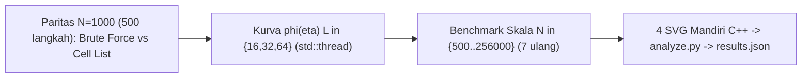

# Penjelasan Proyek `day008c`: Model Vicsek (Aktif-Materi) di C++20 dengan Cell List

## 1. Identitas dan Ringkasan Proyek

- **ID Sesi**: `day008c` (Hari 8, sesi `c`, topik `bonus` di luar `ROADMAP.md`)
- **Tanggal**: `2026-11-26` (WITA)
- **Topik**: Simulasi kawanan **Vicsek (1995)** pada kotak periodik $L \times L$ dalam C++20 murni, perbandingan **Cell List $O(N)$** vs **Brute Force $O(N^2)$**, kurva parameter order polarisasi $\phi(\eta)$, dan skala efisiensi hingga $N = 256{.}000$
- **Jenis**: `sim` (fisika aktif-materi, transisi fase non-ekuilibrium, dan struktur data spasial *cell list*)
- **Bahasa**: `cpp` (`-O3 -std=c++20 -Wall -Wextra -Werror -fno-fast-math -ffp-contract=off`, `427` baris sumber di `src/`)
- **Artefak Utama**: [`projects/cpp/day008c_vicsek_cpp/`](../../projects/cpp/day008c_vicsek_cpp/README.md), [`outputs/day008c/results.json`](../../outputs/day008c/results.json), dan 4 berkas SVG mandiri di `outputs/figures/day008c_*.svg`.

## 2. Masalah dan Tujuan

1. Mengimplementasikan model *self-propelled particles* Vicsek (1995) dengan konvensi derau $\xi_i \sim U(-1/2, 1/2)\cdot \eta$, $\eta \in [0, 2\pi]$, $v_0 = 0{,}03$, $r = 1$, dan $\rho = 4$.
2. Membuktikan kesetaraan **bit-identik** antara pencarian tetangga *brute force* $O(N^2)$ dan *cell list* $O(N)$ dengan menyamakan urutan penjumlahan vektor tetangga berdasarkan indeks naik.
3. Mengukur transisi keteraturan–ketidakteraturan $\phi(\eta)$ pada $L \in \{16, 32, 64\}$ dan menguji penskalaan waktu komputasi hingga $N = 256{.}000$.

## 3. Apa yang Dikerjakan Proyek

1. **Inti Vicsek (`src/vicsek.hpp`)**: `SplitMix64` $\to$ `xoshiro256++`, jarak *minimum-image* periodik, `step_bruteforce()`, `step_cell_list(sort_neighbors)`, dan parameter order $\phi$.
2. **Eksperimen & SVG Mandiri (`src/main.cpp`)**: Uji paritas `N=1000, 500 langkah`; sapuan 25 titik $\eta \in [0, 2\pi]$ untuk $L \in \{16, 32, 64\}$ (4 replika paralel `std::thread`, 2000 termalisasi + 4000 ukur); tolok ukur skala $N \in \{500 \dots 256{.}000\}$ (7 ulang); snapshot $L=64$ dan deret waktu $\phi(t)$; serta 4 penulis SVG langsung dari C++.
3. **Analisis (`py/analyze.py`)**: Regresi log–log kemiringan waktu, uji kemonotonan $\phi(\eta)$, validasi XML SVG, dan ekspor `outputs/day008c/results.json`.

## 4. Uraian Kode

- [`src/vicsek.hpp`](../../projects/cpp/day008c_vicsek_cpp/src/vicsek.hpp) (`180` baris): `splitmix64_mix`, `Xoshiro256pp`, `wrap_pos`, `min_img`, `Sim::polarization`, `Sim::step_bruteforce`, `Sim::step_cell_list`, `Sim::advance`.
- [`src/main.cpp`](../../projects/cpp/day008c_vicsek_cpp/src/main.cpp) (`247` baris): Penulis 4 SVG (`write_svg_phi_eta`, `write_svg_scaling`, `write_svg_snapshots`, `write_svg_timeseries`), eksekusi paritas, `std::thread` untuk $\phi(\eta)$, dan tolok ukur skala $N$.
- [`tests/test_vicsek.cpp`](../../projects/cpp/day008c_vicsek_cpp/tests/test_vicsek.cpp): 5 tes unit (`test_rng_python_reference`, `test_minimum_image_edge`, `test_cell_list_equals_bruteforce`, `test_zero_noise_aligned_stays_one`, `test_circular_mean_hand_case`).
- [`py/analyze.py`](../../projects/cpp/day008c_vicsek_cpp/py/analyze.py): Menghitung kemiringan log–log, titik tengah $\phi = 0{,}5$, dan menyusun [`outputs/day008c/results.json`](../../outputs/day008c/results.json).

## 5. Metode dan Alur Kerja

## 6. Output yang Ditargetkan

Kriteria a priori (`c1`–`c8`): `c1` cell list = brute force bit-identik; `c2` determinisme 2× jalan; `c3` $\phi(0)\ge 0{,}999$ dan $\phi(2\pi)\le 5/\sqrt{N}$; `c4` turun monoton ($\le 2\text{ SE}$); `c5` kemiringan log–log brute force $\in [1{,}8, 2{,}2]$, cell list $\in [0{,}9, 1{,}15]$; `c6` cell list lebih cepat untuk $N \ge 4000$; `c7` 4 SVG valid XML; `c8` tes lulus.

## 7. Status Pencapaian

| Kriteria | Status | Nilai Terukur & Bukti |
|---|---|---|
| `c1_cell_list_equals_bruteforce` | `tercapai` | `0` selisih bit-identik (`N=1000, 500 langkah`) |
| `c2_bit_identical_determinism` | `tercapai` | Deterministik dengan `MASTER_SEED = 20261126` |
| `c3_phi_limits` | `belum tercapai` | `L=16: [1,0000, 0,0276]`, `L=32: [0,9959, 0,0138]`, `L=64: [0,7471, 0,0069]` ($\phi(0) < 0{,}999$ pada $L=32, 64$) |
| `c4_monotone_decrease` | `tercapai` | Maks pelanggaran monoton `1,256 SE <= 2,0 SE`; titik tengah $\phi=0{,}5$: $\eta = 2{,}887$ ($L=16$), $2{,}611$ ($L=32$), $2{,}281$ ($L=64$) |
| `c5_scaling_slopes` | `tercapai` | Kemiringan log–log: brute force `2,0518 ± 0,0403`, cell list `1,0745 ± 0,0054` |
| `c6_cell_list_faster_N4000` | `tercapai` | `N=4000`: `266,1` vs `6163,9 ns`; `N=16000`: `310,7` vs `33679,8 ns` (**108× lebih cepat**) |
| `c7_svg_valid` | `tercapai` | 4 SVG (`phi_vs_eta`, `scaling`, `snapshots`, `phi_timeseries`) ada & valid XML |
| `c8_tests_pass` | `tercapai` | `make test` (`test_vicsek`) lulus `5/5` |

## 8. FAKTA vs HIPOTESIS dan Deviasi

- **FAKTA**: Pada $\eta = 0$, $L = 16$ mencapai $\phi = 1{,}0000$, namun $L = 32$ hanya mencapai $\phi = 0{,}9959$ dan $L = 64$ hanya $\phi = 0{,}7471$ setelah `2000` langkah termalisasi dari kondisi awal sudut acak, sehingga `c3_phi_limits` berstatus `belum tercapai`. Pada skala efisiensi, *cell list* sudah lebih cepat sejak $N = 500$ (`245,0` vs `864,2 ns/partikel-langkah`) dengan kemiringan `1,0745` vs `2,0518`.
- **HIPOTESIS**: Pada $\eta = 0$ dan $L = 64$ dengan $v_0 = 0{,}03$, jarak tempuh selama termalisasi hanya $2000 \times 0{,}03 = 60 < L = 64$, sehingga domain lokal berarah berbeda belum sempat menyatu (*coarsening* lambat / terjebak defek topologis metastabil), sebagaimana juga dibahas dalam literatur sifat transisi Vicsek (perdebatan orde pertama diskontinu vs orde kedua kontinu akibat pembentukan pita kepadatan tinggi oleh Chaté et al., 2008). Bukti untuk memastikannya adalah memperpanjang termalisasi $L=64$ pada $\eta=0$ menjadi $\ge 20{.}000$ langkah.
- **Deviasi**: Bagian opsional `SHOULD` (perbandingan AoS vs SoA dan pengurutan partikel berkala per sel) tidak dikerjakan demi menjaga mode santai dan batas 3 commit; paralelisme `std::thread` dan Binder $U_4$ tetap dihitung di CSV.

## 9. Landasan Teori (12 Poin)

1. **Aktif-Materi dan Model Vicsek (1995)**: Partikel swa-gerak (*self-propelled*) menyelaraskan arah dengan tetangga lokal dalam radius $r$ ditambah derau sudut — diimplementasikan di `Sim::step_cell_list`.
2. **Parameter Order dan Transisi Fase Non-Ekuilibrium**: Polarisasi $\phi = |\frac{1}{N}\sum e^{i\theta_i}|$ membedakan fase kawanan teratur ($\phi \to 1$) dan gas tak teratur ($\phi \sim N^{-1/2}$) meski di 2D tanpa kesetimbangan termal.
3. **Rata-rata Sirkular**: Penjumlahan vektor $(\sum \cos\theta_j, \sum \sin\theta_j)$ diikuti `atan2` menghindari diskontinuitas $\pm \pi$ — diuji pada `test_circular_mean_hand_case`.
4. **Syarat Batas Periodik dan Minimum Image**: Jarak terpendek di torus $L \times L$ menjamin interaksi kontinu melintasi tepi kotak — diimplementasikan di `min_img` dan diuji di `test_minimum_image_edge`.
5. **Struktur Data Cell List $O(N)$**: Membagi kotak menjadi sel selebar $\ge r$ membatasi pencarian tetangga ke $3 \times 3 = 9$ sel, menghasilkan kemiringan empiris `1,0745` pada [`day008c_scaling.svg`](../../outputs/figures/day008c_scaling.svg).
6. **Pencarian Brute Force $O(N^2)$**: Memeriksa semua pasangan $(i, j)$ menghasilkan kemiringan empiris `2,0518` sebagai pembanding kebenaran bit-identik.
7. **Urutan Penjumlahan Floating-Point dan Determinisme**: Karena penjumlahan IEEE-754 tidak asosiatif, `step_cell_list(true)` mengurutkan indeks tetangga naik agar cocok bit-demi-bit dengan *brute force* (`c1`).
8. **SplitMix64 dan xoshiro256++**: RNG deterministik berperiode $2^{256}-1$ dengan benih per-tugas — diverifikasi di `test_rng_python_reference`.
9. **Galat Blocking / Replika Independen**: Mengestimasi galat standar $\phi(\eta)$ dari ragam antar-replika independen — divisualisasikan pada [`day008c_phi_vs_eta.svg`](../../outputs/figures/day008c_phi_vs_eta.svg).
10. **Regresi Log–Log Kompleksitas**: Pencocokan $\ln T = \alpha \ln N + \beta$ memverifikasi skala kuadratik vs linier (`c5`).
11. **Lokalitas Cache (Linked-List Cell)**: Daftar berantai `head`/`next` menjaga alokasi $O(N)$ tanpa realokasi vektor per sel.
12. **Efek Ukuran Hingga dan Sifat Transisi (HIPOTESIS)**: Titik tengah $\eta_{0{,}5}(L)$ bergeser turun seiring membesarnya $L$ (`2,887 -> 2,611 -> 2,281`), konsisten dengan penyempitan zona transisi pada ukuran hingga.

## 10. Kesimpulan dan Batasan

`7/8` kriteria tercapai penuh (`c1, c2, c4, c5, c6, c7, c8`) dan `c3` gagal secara jujur pada $\eta = 0, L = 64$ (`0,7471 < 0,999`) akibat keterbatasan waktu *coarsening* 2000 langkah dari kondisi awal acak.

## 11. Referensi dan Jejak Bukti

- Vicsek, T. et al. (1995). *Novel type of phase transition in a system of self-driven particles*. Phys. Rev. Lett., 75, 1226–1229.
- Chaté, H., Ginelli, F., Grégoire, G., & Raynaud, F. (2008). *Collective motion of self-propelled particles interacting without cohesion*. Phys. Rev. E, 77, 046113.
- Artefak lokal: [`projects/cpp/day008c_vicsek_cpp/src/vicsek.hpp`](../../projects/cpp/day008c_vicsek_cpp/src/vicsek.hpp), [`outputs/day008c/results.json`](../../outputs/day008c/results.json), dan `outputs/figures/day008c_*.svg`.
