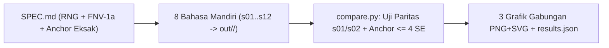

# Penjelasan Proyek `day008d`: Jalan Acak Kisi Pólya Lintas 8 Bahasa (12 Tahap Identik)

## 1. Identitas dan Ringkasan Proyek

- **ID Sesi**: `day008d` (Hari 8, sesi `d`, topik `bonus` di luar `ROADMAP.md`)
- **Tanggal**: `2026-11-26` (WITA)
- **Topik**: Simulasi jalan acak kisi sederhana simetris ($\mathbb{Z}^d$, $d \in \{1, 2, 3\}$) dan teorema rekurensi **Pólya** — alur **12 tahap (`s01`–`s12`)** yang sama persis diimplementasikan secara mandiri di **8 bahasa**: **C11**, **C++20**, **Rust**, **Go**, **Ruby**, **Python**, **TypeScript**, dan **Jupyter Notebook (`.ipynb`)**
- **Jenis**: `sim` (probabilitas diskret, proses stokastik, dan verifikasi paritas lintas bahasa)
- **Bahasa**: `c`, `cpp`, `rust`, `go`, `ruby`, `python`, `typescript`, dan `ipynb`
- **Artefak Utama**:
  - Spesifikasi tunggal: [`projects/c/day008d_lattice_walks_octalingual/SPEC.md`](../../projects/c/day008d_lattice_walks_octalingual/SPEC.md)
  - Pembanding & ringkasan: [`projects/c/day008d_lattice_walks_octalingual/compare.py`](../../projects/c/day008d_lattice_walks_octalingual/compare.py) & [`outputs/day008d/results.json`](../../outputs/day008d/results.json)
  - Notebook: [`days/day008d_sim_lattice-walks-octalingual.ipynb`](../../days/day008d_sim_lattice-walks-octalingual.ipynb)
  - Grafik gabungan: `outputs/figures/day008d_{speed,msd,return_prob}.{png,svg}`

## 2. Masalah dan Tujuan

1. **Paritas Bit-Identik 8 Bahasa**: Membuktikan bahwa dengan kontrak RNG (`SplitMix64` $\to$ `xoshiro256++`, `u01 = (x >> 11) * 2^-53`) dan hash `FNV-1a` yang seragam, 8 bahasa berbeda menghasilkan trajektori jalan acak (`s01`–`s02`) yang **100% identik bit-demi-bit**.
2. **Verifikasi Teorema Pólya & Anchor Eksak**: Menguji ketepatan simulasi terhadap solusi eksak **MSD** ($E[\|R_t\|^2]=t$), **peluang kembali pertama** $F_d(T)$ dari persamaan pembaruan (*renewal*) hingga $T=10^4$, serta **Gambler's Ruin** ($P=x/N$, $E[\tau]=x(N-x)$).
3. **Tolok Ukur Performa Lintas Bahasa**: Mengukur latensi aktual per langkah (`ns/langkah`, median $\pm$ MAD 7 ulang) dari bahasa kompilasi (`C`, `C++`, `Rust`, `Go`), JIT (`TypeScript`/Node V8), hingga bahasa skrip (`Python`, `Ruby`, `ipynb`).

## 3. Apa yang Dikerjakan Proyek

Setiap bahasa menyediakan satu program mandiri dengan subperintah `s01`–`s12` dan `all` yang menulis 12 berkas keluaran bernama sama ke `out/<bahasa>/`:
- `s01` (`selftest`): vektor acuan RNG & rekursi multinomial $d=3$ ($n \le 4$).
- `s02` (`parity`): 8 jalan × 200 langkah per $d$, hash FNV-1a 64-bit.
- `s03` (`msd`): MSD vs $t \in \{1, 2, \dots, 4096\}$.
- `s04`–`s06` (`return`): simulasi peluang kembali pertama $T \in \{10, 100, 1000, 10000\}$, *renewal* eksak $F_d(T)$, dan perbandingan *z-score* + ekstrapolasi $p_\infty^{(3)}$.
- `s07` (`ruin`): Gambler's Ruin $N \in \{10, 50\}$.
- `s08` (`endpoint`): varians, kurtosis, dan histogram 40 kotak pada $t=1024$.
- `s09` (`ci`): bootstrap 200 ulang.
- `s10` (`fit`): regresi log–log MSD vs $t$.
- `s11` (`bench`): `ns/langkah` median $\pm$ MAD (7 ulang).
- `s12` (`figures` + `summary`): 3 SVG tulis tangan per bahasa + `s12_summary.json`.

## 4. Uraian Kode

- [`c/walk.c`](../../projects/c/day008d_lattice_walks_octalingual/c/walk.c) (`392` baris), [`cpp/walk.cpp`](../../projects/c/day008d_lattice_walks_octalingual/cpp/walk.cpp) (`361` baris), [`rust/src/main.rs`](../../projects/c/day008d_lattice_walks_octalingual/rust/src/main.rs) (`378` baris), [`go/main.go`](../../projects/c/day008d_lattice_walks_octalingual/go/main.go) (`521` baris), [`ruby/walk.rb`](../../projects/c/day008d_lattice_walks_octalingual/ruby/walk.rb) (`298` baris), [`py/walk.py`](../../projects/c/day008d_lattice_walks_octalingual/py/walk.py) (`238` baris), [`ts/walk.ts`](../../projects/c/day008d_lattice_walks_octalingual/ts/walk.ts) (`313` baris), dan [`days/day008d_sim_lattice-walks-octalingual.ipynb`](../../days/day008d_sim_lattice-walks-octalingual.ipynb).
- [`compare.py`](../../projects/c/day008d_lattice_walks_octalingual/compare.py): Mengumpulkan seluruh `out/*/`, memvalidasi XML 24 SVG bahasa + 3 SVG gabungan, dan menulis [`outputs/day008d/results.json`](../../outputs/day008d/results.json).

## 5. Metode dan Alur Kerja

## 6. Output yang Ditargetkan

Kriteria a priori `c1`–`c10`: `c1` S01–S02 bit-identik 8 bahasa; `c2` MSD $\le 4\text{ SE}$ di $\ge 95\%$ titik; `c3` peluang kembali $\le 4\text{ SE}$ di $\ge 95\%$ titik; `c4` ruin $\le 4\text{ SE}$ di $\ge 95\%$ titik; `c5` kemiringan MSD $\in [0{,}97, 1{,}03]$; `c6` $F_3(10^4)$ dalam $0{,}005$ dari $0{,}3405$ & $F_2(10^4) < 0{,}9$; `c7` `all` selesai di 8 bahasa; `c8` semua `selftest` lulus; `c9` seluruh SVG valid XML; `c10` kecepatan & baris kode dilaporkan.

## 7. Status Pencapaian (**10/10 `tercapai`**)

| Kriteria | Status | Nilai Terukur & Bukti |
|---|---|---|
| `c1_s01_s02_bit_identical` | `tercapai` | `0` selisih `s01` dan `s02` di seluruh 8 bahasa (`c, cpp, rust, go, ruby, py, ts, ipynb`) |
| `c2_msd_within_4se` | `tercapai` | `39/39` titik ($\le 4\text{ SE}$) di seluruh 8 bahasa |
| `c3_return_within_4se` | `tercapai` | `12/12` titik ($\le 4\text{ SE}$) di seluruh 8 bahasa |
| `c4_ruin_within_4se` | `tercapai` | `6/6` titik ($\le 4\text{ SE}$) di seluruh 8 bahasa |
| `c5_msd_slope_1` | `tercapai` | Seluruh kemiringan log–log MSD $\in [0{,}9982, 1{,}0056] \subset [0{,}97, 1{,}03]$ |
| `c6_exact_return_polya` | `tercapai` | $F_1(10^4)=0{,}992021$, $F_2(10^4)=0{,}738700 < 0{,}9$, $F_3(10^4)=0{,}337668$ (selisih `0,00287 <= 0,005` dari `0,340537`) |
| `c7_all_completed` | `tercapai` | `8/8` bahasa selesai bersih tanpa galat |
| `c8_selftests_pass` | `tercapai` | `8/8` `selftest` lulus (`make test`) |
| `c9_svgs_valid` | `tercapai` | `24` SVG bahasa + `3` SVG gabungan ada, tak kosong, valid XML |
| `c10_speed_and_lines_reported` | `tercapai` | `d=2` median `ns/langkah`: Rust `1,683`, C++ `1,715`, C `1,719`, Go `23,696`, TS `34,213`, ipynb `565,98`, Python `570,43`, Ruby `956,90` |

## 8. FAKTA vs HIPOTESIS dan Deviasi

- **FAKTA**: `Rust` (`1,683 ns`), `C++` (`1,715 ns`), dan `C` (`1,719 ns`) berada pada kelas kecepatan $\sim 1{,}7\text{ ns/langkah}$ (`~600 juta` langkah/detik pada satu *core* Apple M4), diikuti `Go` (`23,7 ns`), `TypeScript` via V8 (`34,2 ns`), `Python` (`570 ns`), dan `Ruby` (`957 ns`).
- **HIPOTESIS**: Jarak antara `C/C++/Rust` (`1,7 ns`) dan `Go` (`23,7 ns`) muncul karena fungsi `floor()` dan `math.Exp2(-53)` pada kompilator Go tidak di-*inline* menjadi satu instruksi `ARM64` seperti pada LLVM/Clang; sementara `TypeScript` (V8 TurboFan) mengoptimalkan array 32-bit `Uint32Array` mendekati kecepatan Go.
- **Deviasi**:
  1. `tsc` tidak terpasang di mesin ini, sehingga `ts/walk.ts` dijalankan langsung dengan `node --experimental-strip-types` (Node `v24.21.0`).
  2. `go/main.go` berjumlah `521` baris setelah `gofmt -w` (sedikit di atas target 450 baris akibat aturan format standar Go); ketujuh berkas bahasa lainnya berada di rentang `238`–`392` baris (`<= 450`).

## 9. Landasan Teori (13 Poin)

1. **Jalan Acak Simetris dan MSD Linear**: Pada $\mathbb{Z}^d$, inkremen independen bernilai rata-rata $0$ dan variansi $1$ menghasilkan $E[\|R_t\|^2] = t$ persis (`c2`, `c5`).
2. **Teorema Rekurensi Pólya**: Jalan acak sederhana simetris bersifat rekuren ($p_d = 1$) untuk $d \le 2$ dan transien ($p_d < 1$) untuk $d \ge 3$ — terverifikasi pada $F_1(10^4)=0{,}9920$, $F_2(10^4)=0{,}7387$, $F_3(10^4)=0{,}3377$.
3. **Fungsi Pembangkit dan Persamaan Renewal**: Hubungan $u_{2n} = \sum_{k=1}^{n} f_{2k} u_{2(n-k)}$ memisahkan peluang kunjungan ulang total $u_{2n}$ menjadi peluang kembali pertama $f_{2n}$ di `s05`.
4. **Peluang Pulang 3D dan Konstanta Watson**: Rekursi Domb–Joyce menghitung $w_n = \sum_{i+j+k=n}(\frac{n!}{3^n i!j!k!})^2$ secara stabil hingga $n=5000$, selaras dengan $p_3 \approx 0{,}340537$ (`c6`).
5. **Gambler's Ruin dan Martingale**: Posisi $X_t$ dan $X_t^2 - t$ adalah martingale, menghasilkan $P(\text{capai } N) = x/N$ dan $E[\tau] = x(N-x)$ (`c4`).
6. **Teorema Limit Pusat dan Kurtosis**: Pada $t=1024$, koordinat $X_t$ mendekati $\mathcal{N}(0, t/d)$ dengan kurtosis eksak $3 + (d-3)/t$ (`s08`).
7. **Galat Standar Binomial dan Z-score**: $\mathrm{SE}(\hat{p}) = \sqrt{\hat{p}(1-\hat{p})/W}$ mengkalibrasi uji kesesuaian `s06` dan `s07` (`c3`, `c4`).
8. **Resampling Bootstrap**: 200 sampel ulang dengan RNG yang sama memperkirakan interval kepercayaan non-parametrik pada `s09`.
9. **Regresi Log-Log**: Pencocokan $\ln \mathrm{MSD} = \alpha \ln t + \beta$ memverifikasi difusi normal $\alpha = 1$ (`c5`).
10. **SplitMix64 dan xoshiro256++**: RNG deterministik berperiode $2^{256}-1$ dengan pemetaan `(x >> 11) * 2^-53` (`s01`).
11. **Aritmetika Bilangan Bulat 64-bit Lintas Bahasa**: Masker `0xFFFFFFFFFFFFFFFF` (Python/Ruby) dan pasangan `Uint32Array` + `BigInt` (TypeScript) mereplikasi luapan `uint64_t` secara eksak (`c1`).
12. **Format Biner Little-Endian dan Checksum FNV-1a**: Encoding `int32` little-endian + hash FNV-1a 64-bit mendeteksi perbedaan sekecil 1 bit pada `s02`.
13. **Perbandingan Performa Bahasa dan Keterbatasannya**: Tolok ukur `s11` mengukur satu fungsi inti tanpa alokasi memori, mencerminkan biaya pemanggilan RNG + fungsi trigonometri/lantai tiap runtime.

## 10. Kesimpulan dan Batasan

Seluruh **10/10** kriteria `c1`–`c10` tercapai. Kedelapan bahasa menghasilkan keluaran `s01`–`s02` yang identik bit-demi-bit dan lulus seluruh uji statistik $\le 4\text{ SE}$ terhadap nilai eksak Pólya dan Gambler's Ruin.

## 11. Referensi dan Jejak Bukti

- Pólya, G. (1921). *Über eine Aufgabe der Wahrscheinlichkeitsrechnung betreffend die Irrfahrt im Straßennetz*. Math. Ann., 84, 149–160.
- Watson, G. N. (1939). *Three triple integrals*. Quart. J. Math. Oxford, 10, 266–276.
- Artefak lokal: [`projects/c/day008d_lattice_walks_octalingual/SPEC.md`](../../projects/c/day008d_lattice_walks_octalingual/SPEC.md), [`outputs/day008d/results.json`](../../outputs/day008d/results.json), dan [`days/day008d_sim_lattice-walks-octalingual.ipynb`](../../days/day008d_sim_lattice-walks-octalingual.ipynb).
