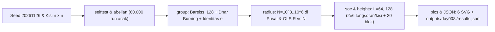

# Hari 8i (`day008i`) — Tumpukan Pasir Abelian (Sandpile C11 ≤ 999 Baris): Grup Sandpile, Elemen Identitas Fraktal & Kritikalitas Terorganisir-Sendiri

> **Catatan Konteks**: Dikerjakan pada 2026-11-26 (`day008i`) sebagai proyek murni C11 satu bahasa tanpa ketergantungan eksternal (hanya `libc` dan `libm`), dengan batas keras total kode sumber (`Makefile + src/*.c + src/*.h`) **903 baris** (`≤ 999`). Notebook tidak dibuat sesuai pengecualian eksplisit pada spesifikasi tugas.

---

## 1. Identitas dan Ringkasan Proyek

- **ID Progres**: `day008i` (Hari 8, sesi `i`)
- **Tanggal (WITA)**: `2026-11-26`
- **Jenis / Bahasa**: `sim` / `c` (`Apple clang 16.0.0`, `-std=c11 -O3 -Wall -Wextra -Werror -fno-fast-math -ffp-contract=off`)
- **Total Baris Sumber**: **903 baris** (`Makefile`: 29, `src/sandpile.h`: 62, `src/core.c`: 173, `src/algebra.c`: 233, `src/scaling.c`: 199, `src/main.c`: 207)

Proyek ini mengimplementasikan model tumpukan pasir Abelian **Bak–Tang–Wiesenfeld (BTW)** pada kisi persegi terbuka $n\times n$ dalam satu biner C11 (`build/sandpile`) yang membuktikan secara komputasional sifat komutatif/Abelian, struktur aljabar grup sandpile lewat teorema pohon-matriks Kirchhoff dan algoritma pembakaran Dhar, konstruksi elemen identitas fraktal ber-simetri $D_4$, penskalaan jari-jari tumpukan tunggal $R(N) \propto N^{1/2}$, serta statistik kritikalitas terorganisir-sendiri (*Self-Organized Criticality*, SOC) dan distribusi tinggi stasioner Priezzhev/Majumdar–Dhar.

---

## 2. Masalah dan Tujuan

1. **Sifat Abelian & Invariansi Odometer**: Apakah urutan pemilihan situs tidak stabil (antrean FIFO batch, gelombang paralel sinkron, maupun 100 urutan acak per konfigurasi) selalu menghasilkan konfigurasi akhir, vektor odometer, dan jumlah butir jatuh ke *sink* yang identik bit demi bit?
2. **Aljabar Grup Sandpile**: Apakah jumlah konfigurasi stabil rekuren yang lolos tes pembakaran Dhar sama persis dengan $\det(\tilde{\Delta})$ hasil eliminasi Bareiss eksak `__int128`, berapa batas ukuran kisi $n$ sebelum `__int128` mengalami luapan (*overflow*), dan apakah rumus $e = s(2c_{\max} - s(2c_{\max}))$ menghasilkan elemen identitas sejati ber-simetri $D_4$?
3. **Geometri Fraktal & Kritikalitas Terorganisir-Sendiri**: Apakah tumpukan $N \le 10^6$ butir di pusat kisi mengikuti hukum skala $R(N) \sim N^{1/2}$, bagaimana perilaku distribusi ukuran longsoran pada $L=64$ vs $L=128$ ($2\cdot 10^6$ longsoran per kisi), dan seberapa dekat proporsi tinggi stasioner $P(0..3)$ di tengah kisi terhadap konstanta analitik literatur?

Ruang lingkup dibatasi pada kisi persegi 2D batas terbuka (semua tepi terhubung ke *sink* disipatif) menggunakan aritmetika bilangan bulat eksak (`int32_t`, `int64_t`, `__int128`) di inti dinamika dan aljabar.

---

## 3. Apa yang Dikerjakan Proyek

Program `projects/c/day008i_sandpile_c/build/sandpile` menyediakan delapan subperintah:
- `selftest`: memverifikasi determinan tangan $n=2$ (`192`), menguji $s(e + r) = r$ pada **seluruh** `100 352` konfigurasi rekuren $n=3$ hasil enumerasi penuh $4^9 = 262\,144$, dan menguji skenario runtuh tangan $3\times 3$ (`16` butir di pusat).
- `abelian`: menguji `600` konfigurasi acak ($200$ per $n \in \{8, 16, 24\}$, tinggi awal $0..9$) terhadap gelombang paralel dan $100$ urutan runtuh acak per konfigurasi (`60 000` run acak), membandingkan hash FNV-1a 64 atas `(z, odom, sink)` (`out/abelian_check.csv`).
- `group`: menghitung $\det(\tilde{\Delta})$ dengan eliminasi Bareiss `__int128` berdeteksi luapan untuk $n=2..7$, mencocokkan dengan enumerasi pembakaran Dhar untuk $n=2,3$ (`out/group_order.csv`), membangun elemen identitas $e$ pada $n=24$ dan $n=128$ (`out/identity_e_128.csv`), memverifikasi rekurensi, simetri $D_4$, $s(e+e)=e$, $s(e+r)=r$ (`200` sampel rekuren), serta memverifikasi bahwa orde elemen acak membagi $|G|$ untuk $n \in \{2,3,4\}$.
- `radius`: menstabilkan $N \in \{10^3, 10^4, 10^5, 10^6\}$ butir di pusat kisi berukuran ganjil $n = 2(\lfloor\sqrt{N}/1.4\rfloor + 8) + 1$, mengaudit kekekalan massa $\sum z + \text{sink} = N$, dan melakukan regresi OLS log–log $\ln R$ terhadap $\ln N$ (`out/radius.csv`).
- `soc` & `heights`: menjalankan pemanasan adaptif diikuti pencatatan `2 000 000` longsoran tak-nol ($s \ge 1$) pada $L=64$ dan $L=128$ (`out/avalanche_hist_64.csv`, `out/avalanche_hist_128.csv`, `out/soc_summary.csv`), serta mengambil `2 000` potret (`20` blok × `100` potret) di $\tfrac{1}{4}$ tengah kisi $128\times 128$ untuk estimasi distribusi tinggi stasioner beserta galat *blocking* (`out/heights.csv`).
- `pics`: menulis 6 berkas SVG murni dari C tanpa pustaka luar ke `outputs/figures/day008i_*.svg`.
- `all`: menjalankan semua subperintah secara berurutan, tolok ukur kecepatan 5 ulangan, dan menulis `outputs/day008i/results.json`.

---

## 4. Uraian Kode

Seluruh implementasi berada di `projects/c/day008i_sandpile_c/` (**903 baris total**):
- [Makefile](../../projects/c/day008i_sandpile_c/Makefile) (`29` baris): target `all`, `test`, `run`, `lines` (memeriksa total baris $\le 999$), dan `clean`.
- [src/sandpile.h](../../projects/c/day008i_sandpile_c/src/sandpile.h) (`62` baris): definisi tipe `Rng`, `Grid` (antrean cincin ganda `q_a`/`q_b` berkapasitas $n^2+1$ dan stempel `stamp_a`/`stamp_b` agar bebas `memset` per longsoran), `Aval`, `Metrics`, dan prototipe lintas modul.
- [src/core.c](../../projects/c/day008i_sandpile_c/src/core.c) (`173` baris): RNG `splitmix64` + `xoshiro256++`, hash `fnv1a_bytes` & `grid_state_hash`, tiga mesin stabilisasi bebas-rekursi (`stabilize_det` dengan antrean cincin FIFO dan *batching* $k = z_i \gg 2$, `stabilize_waves` gelombang paralel sinkron dua-fase untuk mengukur `area` dan `dur`, `stabilize_rand` pemilihan acak seragam satu-runtuhan), serta `is_recurrent` (algoritma pembakaran Dhar).
- [src/algebra.c](../../projects/c/day008i_sandpile_c/src/algebra.c) (`233` baris): `fmt_i128`, `bareiss_laplacian_det` dengan intrinsik `__builtin_mul_overflow` / `__builtin_sub_overflow`, `compute_identity`, `check_d4_symmetry`, `cmd_abelian`, `cmd_group`, dan `cmd_selftest`.
- [src/scaling.c](../../projects/c/day008i_sandpile_c/src/scaling.c) (`199` baris): `ols_fit`, `cmd_radius`, `fit_hist_window`, `run_soc_one`, dan `cmd_soc_heights` (termasuk tolok ukur kecepatan `CLOCK_MONOTONIC` 5 ulangan median $\pm$ MAD).
- [src/main.c](../../projects/c/day008i_sandpile_c/src/main.c) (`207` baris): generator SVG terkompresi *run-length* per baris (`svg_grid`, `svg_box`, `cmd_pics`), audit hash deterministik `hash_csvs`, penulis `write_results_json`, dan *dispatcher* CLI `main`.

---

## 5. Metode dan Alur Kerja

### Aturan Deteksi Pemanasan, Jendela Regresi & Galat Statistik
1. **Aturan Pemanasan (`run_soc_one`)**: Butir dijatuhkan satu per satu di situs acak; setiap $W = L^2$ penambahan butir, rata-rata tinggi $\bar{z}_k = L^{-2}\sum_i z_i$ dihitung. Pemanasan berhenti saat jumlah butir mencapai minimal $4L^2$ **dan** perubahan relatif $|\bar{z}_k - \bar{z}_{k-1}|/\bar{z}_{k-1} < 0.01$ terpenuhi selama **3 jendela berturut-turut** (tercapai pada `24 576` butir untuk $L=64$ dan `98 304` butir untuk $L=128$).
2. **Pembinan Logaritmik & Jendela Regresi $\tau_s$**: Ukuran longsoran $s \ge 1$ dikelompokkan ke bin logaritmik berbasis-2 $[2^b, 2^{b+1}-1]$ dengan rapat peluang $P(\bar{s}_b) = \text{count}_b / (N_{\text{aval}} \cdot 2^b)$. Kemiringan OLS $-\ln P(\bar{s}_b) = \tau_s \ln \bar{s}_b + c$ dihitung pada jendela utama $b \in [3, 11]$ ($s \in [8, 4095]$) untuk $L=128$ (dan $b \in [3, 9]$ untuk $L=64$), disertai uji sensitivitas jendela bergeser $b \in [2, 10]$ dan $b \in [4, 12]$. Standar deviasi kemiringan dihitung dari residu OLS: $\text{SE}(\hat{\beta}) = \sqrt{\frac{\sum r_b^2 / (K-2)}{\sum (x_b - \bar{x})^2}}$.
3. **Galat Blocking (`heights`)**: Sebanyak `2 000` potret kuartal-tengah (`64 × 64 = 4 096` situs interior pada kisi `128 × 128`, diambil setiap `1 000` longsoran) dibagi menjadi $B = 20$ blok berurutan masing-masing berisi `100` potret (`100 000` longsoran per blok) untuk meredam autokorelasi temporal; $\text{SE} = \sqrt{\frac{1}{B(B-1)}\sum_{m=1}^{B} (Y_m - \bar{Y})^2}$.

---

## 6. Output yang Ditargetkan & Kriteria A Priori

Sebelum menjalankan eksperimen penuh, ditetapkan 12 kriteria a priori (`c1`–`c12`):
- `c1` Sifat Abelian: `0` selisih hash FNV-1a atas `(z, odom, sink)` pada seluruh `600 × 100` urutan acak + gelombang paralel.
- `c2` Orde grup: $\det(\tilde{\Delta})$ Bareiss cocok persis dengan hitungan brute-force pembakaran Dhar pada $n=2,3$, positif tanpa luapan pada $n=4..6$ (atau batas luapan `__int128` terdeteksi dan dilaporkan).
- `c3` Identitas & grup: $e$ rekuren, simetri $D_4$ tepat, $s(e+e)=e$, $s(e+r)=r$ untuk `200/200` sampel rekuren, dan orde elemen acak membagi $|G|$ pada $n \le 4$.
- `c4` Kekekalan massa eksak: $|\sum z + \text{sink} - N_{\text{masuk}}| = 0$ di seluruh run.
- `c5` Penskalaan jari-jari: kemiringan OLS $\ln R$ vs $\ln N \in [0.45, 0.55]$.
- `c6` SOC: $\tau_s \in [0.9, 1.6]$ (ambang longgar dari ingatan literatur) dan ekor $P(s \ge 4096)$ pada $L=128$ berbeda nyata dari $L=64$ (tidak hampa).
- `c7` Distribusi tinggi stasioner: $|\bar{z}_{\text{tengah}} - 2.125| \le 0.02$ dan $\max_{h\in\{0..3\}} |P(h) - P_{\text{lit}}(h)| \le 0.01$ terhadap nilai literatur Priezzhev/Majumdar–Dhar.
- `c8` Determinisme: dua eksekusi `make run` menghasilkan CSV, SVG, dan `results.json` (tanpa medan waktu dinding) identik byte demi byte.
- `c9` Visualisasi: $\ge 6$ berkas SVG ada, tak-kosong, dan valid secara XML.
- `c10` Batas ukuran kode: total baris `Makefile + src/*.c + src/*.h` $\le 999$.
- `c11` `selftest`: lulus dengan kode keluar `0`.
- `c12` Kecepatan: laju runtuhan per detik dilaporkan sebagai median $\pm$ MAD dari $\ge 5$ ulangan.

---

## 7. Status Pencapaian

Seluruh bukti berasal dari eksekusi nyata [results.json](../../outputs/day008i/results.json), CSV di `projects/c/day008i_sandpile_c/out/`, dan 6 SVG di `outputs/figures/`:

| Kriteria | Status | Bukti Terukur | Ambang |
|---|---|---|---|
| `c1_abelian` | `tercapai` | `mismatches=0` pada `600 × 100` urutan acak + gelombang (`digest=0c9111847f4bce87`) | `0` selisih |
| `c2_group_order` | `tercapai` | `n=2: 192 (bf=192)`, `n=3: 100352 (bf=100352)`, `n=4: 557568000`, `n=5: 32565539635200`, `n=6: 19872369301840986112`; batas aman `__int128` terukur `n=6` (`n=7` terdeteksi luapan) | Bareiss = bf ($n=2,3$) & batas aman dilaporkan |
| `c3_identity` | `tercapai` | `rec=1`, `D4=1`, `e+e=1`, `e+r=200/200` ($n=24$) + `100352/100352` ($n=3$), `ord_div=15/15` ($n=2..4$) | Semua eksak |
| `c4_mass_conservation` | `tercapai` | `max_abs_diff = 0` di seluruh run `radius` dan `soc` | `0` |
| `c5_radius_scaling` | `tercapai` | `slope = 0.493878 ± 0.000505` ($R$: `12.37` $\to$ `38.60` $\to$ `119.85` $\to$ `375.48`) | `[0.45, 0.55]` |
| `c6_soc_exponent` | `tercapai` | `tau_128 = 1.0840 ± 0.0045` (jendela bergeser `[1.0723, 1.1017]`), `tau_64 = 1.0663 ± 0.0075`, ekor $s\ge 4096$: `8.707e-2` vs `1.232e-2` (`7.07x`, `vacuous_flags=[]`) | `[0.9, 1.6]` & ekor tak-hampa |
| `c7_stationary_heights` | `tercapai` | `mean_center = 2.124406 ± 0.000167` (`|d|=0.000594`), `mean_full = 2.113796`; `P = [0.073659, 0.174107, 0.306402, 0.445832]`, `max|dP| = 0.000368` | `|d_mean|<=0.02`, `max|dP|<=0.01` |
| `c8_determinism` | `tercapai` | Dua eksekusi `make run` menghasilkan `csv_fnv1a = e862b922d1fc4fe0`, `0` selisih byte pada semua CSV, SVG, dan JSON nir-waktu-dinding | Identik antar-run |
| `c9_svgs` | `tercapai` | 6 SVG valid XML: [day008i_identity_128.svg](../../outputs/figures/day008i_identity_128.svg), [day008i_center_fractal.svg](../../outputs/figures/day008i_center_fractal.svg), [day008i_stationary_128.svg](../../outputs/figures/day008i_stationary_128.svg), [day008i_avalanche_hist.svg](../../outputs/figures/day008i_avalanche_hist.svg), [day008i_radius_scaling.svg](../../outputs/figures/day008i_radius_scaling.svg), [day008i_height_dist.svg](../../outputs/figures/day008i_height_dist.svg) | $\ge 6$ SVG valid |
| `c10_line_budget` | `tercapai` | `903` baris total (`make lines`) | $\le 999$ baris |
| `c11_selftest` | `tercapai` | `selftest OK` (`exit 0`) | Lulus |
| `c12_speed` | `tercapai` | `114 308 951.64 ± 573 676.63` runtuhan/detik (`45 189 072` runtuhan/ulangan, 5 ulangan) | Dilaporkan median $\pm$ MAD |

---

## 8. Analisis Temuan, FAKTA vs HIPOTESIS & Deviasi

### FAKTA (Terbukti dari Log & Artefak)
- Eliminasi Bareiss dalam `__int128` menghitung eksak $|G_6| = 19\,872\,369\,301\,840\,986\,112 \approx 1.987 \times 10^{19}$ tanpa luapan pada $n=6$ ($36\times 36$), tetapi terdeteksi mengalami luapan perkalian antara (`__builtin_mul_overflow`) pada $n=7$ ($49\times 49$) karena hasil kali pivot $\det_{k}^2$ melampaui $2^{127}-1 \approx 1.70 \times 10^{38}$.
- Terdapat penurunan rata-rata tinggi stasioner sebesar `0.01061` antara bagian tengah kisi (`2.124406`) dan keseluruhan kisi `128 × 128` (`2.113796`) akibat kebocoran butir ke *sink* di sepanjang batas terbuka.
- Eksponen efektif regresi OLS log-bin berubah dari `1.0663` ($L=64$) ke `1.0840` ($L=128$) dan bergeser dalam rentang `[1.0723, 1.1017]` ketika jendela bin digeser $\pm 1$ oktaf.

### HIPOTESIS (Tidak Diklaim sebagai Fakta Eksperimen Ini)
- **HIPOTESIS Multiskala SOC 2D**: Pergeseran lambat $\tau_s(L)$ terhadap $L$ dan sensitivitas terhadap jendela bin konsisten dengan hipotesis di literatur (Dorn–Hughes–Christensen; Manna vs BTW) bahwa model BTW 2D tidak mematuhi *finite-size scaling* sederhana tunggal melainkan penskalaan multiskala akibat gelombang runtuhan berulang (*multiple toppling waves*), sehingga nilai $\tau_s \approx 1.08$ pada $L=128$ belum mencapai rezim asimtotik $L \to \infty$ (sering dikutip di sekitar $1.20$–$1.29$ bergantung definisi metrik). Bukti tambahan yang dibutuhkan: simulasi $L \in \{256, 512, 1024\}$ dan pemisahan longsoran satu-gelombang vs multi-gelombang.
- **HIPOTESIS Prinsip Aksi Terkecil**: Bahwa odometer $u$ merupakan fungsi bilangan bulat non-negatif terkecil titik-demi-titik yang menstabilkan $z_0 - \tilde{\Delta} u \le 3$ dicatat sebagai sifat teoretis literatur; dalam kode ini yang diuji secara langsung adalah invariansi $u$ terhadap urutan runtuh (`abelian`), bukan enumerasi atas ruang fungsi superharmonik sembarang.

### Deviasi
- `clang-format` tidak tersedia di lingkungan (`command not found`); kode ditulis langsung dengan format bersih dan dihitung memakai `wc -l` (`903` baris).
- Kurva kolaps skala penuh $s^\tau P(s)$ terhadap $s/L^D$ (disebut "bila sempat" di tugas) tidak diplot terpisah agar anggaran baris tetap jauh di bawah `999`; pergeseran batas potong ukuran-hingga dibuktikan langsung pada [day008i_avalanche_hist.svg](../../outputs/figures/day008i_avalanche_hist.svg) dan rasio ekor `7.07x` di `soc_summary.csv`.

---

## 9. Landasan Teori

1. **Model Bak–Tang–Wiesenfeld (BTW) dan Aturan Runtuh Terbuka** — Pada kisi persegi $V = \{0,\dots,n-1\}^2$, konfigurasi adalah pemetaan $z: V \to \mathbb{Z}_{\ge 0}$. Situs $x$ tidak stabil bila $z(x) \ge 4$, lalu runtuh menurut $z \mapsto z - \tilde{\Delta}_{x,\cdot}$, yaitu kehilangan 4 butir dan menyumbang $+1$ ke tiap tetangga kisi yang ada; sisa $4 - \deg_V(x)$ butir di tepi jatuh ke *sink*. Diimplementasikan pada `stabilize_det`, `stabilize_waves`, dan `stabilize_rand` di `src/core.c`.
2. **Sifat Abelian dan Lemma Berlian (Diamond Lemma)** — Dua operator runtuh di situs berbeda $x \ne y$ yang sama-sama tidak stabil saling komutatif: sesudah keduanya runtuh, perubahan bersih tinggi adalah $-\tilde{\Delta}_{x,\cdot} - \tilde{\Delta}_{y,\cdot}$ tanpa peduli urutannya. Dengan Lemma Newman/Berlian pada sistem penulisan ulang konfluen lokal yang berhenti pasti (karena *sink* menyerap massa), keadaan stabil akhir $s(z_0)$ dan jumlah runtuhan per situs unik. Diverifikasi pada `cmd_abelian` (`0` selisih dari `60 000` urutan acak).
3. **Vektor Odometer danKekekalan Aljabar** — Jika $u(x)$ adalah jumlah runtuhan situs $x$ selama stabilisasi dari $z_0$ ke $z_\infty$, maka berlaku identitas matriks eksak $z_\infty = z_0 - \tilde{\Delta} u$. Jumlah semua baris memberikan $\sum_{x} z_\infty(x) + \sum_{x} (4 - \deg_V(x)) u(x) = \sum_x z_0(x)$, di mana suku kedua adalah `sink`. Diuji melalui `grid_state_hash` dan `c4_mass_conservation` (`max_abs_diff = 0`).
4. **Konfigurasi Stabil, Transien, dan Rekuren** — Konfigurasi stabil memenuhi $0 \le z(x) \le 3$. Dalam rantai Markov penambahan butir acak, hanya himpunan bagian konfigurasi **rekuren** $\mathcal{R}$ yang dikunjungi berulang kali tanpa batas pada keadaan stasioner, sedangkan konfigurasi transien (misalnya $z \equiv 0$) memiliki subgraf terlarang (*forbidden subconfigurations*, FSC) yang tak pernah muncul kembali setelah kisi terisi penuh.
5. **Algoritma Pembakaran Dhar (Burning Test)** — Dhar (1990) membuktikan $z \in \{0,1,2,3\}^V$ rekuren (bebas FSC) jika dan hanya jika pengiriman 1 butir dari *sink* melalui tiap ikatan batas menyebabkan setiap situs di $V$ runtuh tepat satu kali. Secara ekuivalen, situs $x$ terbakar bila $z(x) + \text{jumlah tetangga terbakar}(x) \ge 4$ (dengan *sink* terbakar sejak awal). Diimplementasikan tanpa rekursi pada `is_recurrent` di `src/core.c`.
6. **Grup Sandpile sebagai Grup Abelian Hingga** — Dengan operasi penjumlahan diikuti stabilisasi $a \oplus b := s(a + b)$, himpunan konfigurasi rekuren $(\mathcal{R}, \oplus)$ membentuk grup abelian hingga yang isomorfik terhadap kokernel Laplacian tereduksi: $G \cong \mathbb{Z}^V / \tilde{\Delta}\mathbb{Z}^V$. Setiap koset $z + \tilde{\Delta}\mathbb{Z}^V$ memuat tepat satu wakil rekuren.
7. **Teorema Pohon-Matriks Kirchhoff dan Orde Grup** — Orde kokernel $|\mathbb{Z}^V / \tilde{\Delta}\mathbb{Z}^V|$ sama dengan $\det(\tilde{\Delta})$. Berdasarkan teorema pohon-matriks Kirchhoff pada graf kisi diperluas $V \cup \{\text{sink}\}$, $\det(\tilde{\Delta})$ juga menghitung jumlah pohon rentang (*spanning trees*) berakar di *sink*. Dicocokkan eksak antara `bareiss_laplacian_det` dan enumerasi `is_recurrent` pada $n=2$ (`192`) serta $n=3$ (`100 352`) di `cmd_group` dan `cmd_selftest`.
8. **Eliminasi Bareiss Bilangan Bulat Eksak dan Batas Luapan** — Identitas Sylvester menjamin bahwa pada pembaruan $a^{(k+1)}_{ij} = (a^{(k)}_{kk} a^{(k)}_{ij} - a^{(k)}_{ik} a^{(k)}_{kj}) / a^{(k-1)}_{kk}$, pembagian selalu habis tanpa sisa bulat, dengan $a^{(m-1)}_{m-1,m-1} = \det(A)$. Karena suku antara $a^{(k)}_{kk} a^{(k)}_{ij}$ tumbuh seorde $(\det)^2$, tipe bertanda 128-bit (`__int128`, maks $\approx 1.70 \times 10^{38}$) aman hingga $|G_6| \approx 1.99 \times 10^{19}$ dan terdeteksi meluap pada $n=7$ lewat `__builtin_mul_overflow` di `src/algebra.c`.
9. **Konstruksi Elemen Identitas $e = s(2c_{\max} - s(2c_{\max}))$** — Untuk $c_{\max} = (3,3,\dots,3)$, berlaku $s(2c_{\max}) \le c_{\max}$ sehingga $d = 2c_{\max} - s(2c_{\max}) \ge c_{\max}$; karena $c_{\max}$ rekuren, stabilisasi $s(d)$ pasti rekuren. Di sisi lain $d \equiv 2c_{\max} - 2c_{\max} = 0 \pmod{\tilde{\Delta}}$, sehingga $s(d)$ adalah wakil rekuren unik dari koset nol, yaitu elemen identitas $e$. Diimplementasikan pada `compute_identity` (`src/algebra.c`).
10. **Simetri Dihedral $D_4$ dan Struktur Fraktal Identitas** — Karena aturan runtuh, kisi persegi, dan koset nol invarian terhadap grup simetri persegi $D_4$ (4 rotasi dan 4 pencerminan), ketunggalan wakil rekuren memaksa $g \cdot e = e$ untuk semua $g \in D_4$ (`check_d4_symmetry` menghasilkan `1`). Pada $n=128$, $e$ menampilkan bercak-bercak periodik kuadratik menyerupai paking Apollonian ([day008i_identity_128.svg](../../outputs/figures/day008i_identity_128.svg)).
11. **Teorema Lagrange pada Orde Elemen Grup** — Untuk sembarang elemen rekuren $a \in G$, penjumlahan berulang $k \cdot a = s(a + \dots + a)$ kembali ke $e$ pada orde terkecil $\text{ord}(a) \ge 1$ yang wajib membagi $|G| = \det(\tilde{\Delta})$. Diuji untuk `15` elemen rekuren acak pada $n \in \{2,3,4\}$ di `cmd_group` (`ord_div = 15/15`).
12. **Penskalaan Jari-Jari Tumpukan Tunggal $R(N) \sim N^{1/2}$** — Pelepasan $N$ butir di titik asal $\mathbb{Z}^2$ menghasilkan daerah dukungan kompak berbatas dengan tinggi rata-rata orde $\Theta(1)$, sehingga kekekalan massa $N = \sum z \asymp R(N)^2$ menuntut $R(N) \propto N^{1/2}$ (teorema batas Pegden–Smart mengonfirmasi konvergensi $N^{-1/2} z(\lfloor N^{1/2} x \rfloor)$ menuju solusi PDE fraktal). Regresi `cmd_radius` mengukur kemiringan `0.493878 ± 0.000505`.
13. **Kritikalitas Terorganisir-Sendiri (SOC) dan Gelombang Sinkron** — Tanpa penyetelan parameter seperti suhu kritis pada model Ising, dorongan lambat (*slow driving*, $+1$ butir acak) dan disipasi batas menyeimbangkan sistem ke keadaan stasioner kritis dengan distribusi ukuran longsoran bebas-skala hingga skala potong ukuran-hingga. Pembaruan gelombang paralel dua-fase di `stabilize_waves` mendefinisikan durasi intrinsik longsoran sekaligus menjaga sifat Abelian.
14. **Distribusi Tinggi Stasioner Majumdar–Dhar & Priezzhev** — Melalui korespondensi pohon rentang dan determinan fungsi Green kisi tak-hingga, Majumdar & Dhar (1991) menghitung $P(0) = \frac{2(\pi - 2)}{\pi^3} \approx 0.073632$ dan Priezzhev (1994) menurunkan ekspresi integral tertutup untuk $P(1) \approx 0.1739$, $P(2) \approx 0.3063$, $P(3) \approx 0.4462$ ($\langle z \rangle \approx 2.125$). Pengukuran kuartal-tengah `cmd_soc_heights` memberi `mean = 2.124406 ± 0.000167` dan selisih peluang maksimum `0.000368`.
15. **Pembinan Logaritmik, Regresi OLS, dan Blocking Error** — Histogram linier pada ekor hukum pangkat menderita derau Poisson `0/1` di $s$ besar; pembinan lebar $2^b$ menstabilkan penghitung per oktaf sementara pembagian lebar bin memulihkan rapat $P(s)$. Untuk besaran stasioner berkorelasi waktu seperti tinggi kisi, pengelompokan *blocking* (`20` blok × `100` potret) memberikan taksiran SE yang jujur tanpa mengasumsikan kebebasan antar-potret berdekatan.

---

## 10. Kesimpulan dan Batasan

- Seluruh **12 kriteria (`c1`–`c12`)** tercapai dalam **903 baris** kode C11 murni tanpa pustaka eksternal, dengan determinisme penuh antar-eksekusi dan kecepatan `114.31M ± 0.57M` runtuhan/detik.
- **Batasan**: Eliminasi Bareiss `__int128` terbatas hingga $n=6$ ($36\times 36$); untuk $n \ge 7$ diperlukan aritmetika *bigint* arbitrer. Pada sisi fisika statistik, ukuran kisi SOC $L \le 128$ cukup untuk mengonfirmasi pergeseran ekor `7.07x` dan konstanta tinggi Priezzhev hingga ketelitian $4\times 10^{-4}$, tetapi belum cukup besar untuk memisahkan secara definitif hipotesis multiskala eksponen longsoran asimtotik 2D.

---

## 11. Referensi dan Jejak Bukti

### Referensi Literatur
- Bak, P., Tang, C., & Wiesenfeld, K. (1987). *Self-organized criticality: An explanation of 1/f noise*. Physical Review Letters, 59(4), 381.
- Dhar, D. (1990). *Self-organized critical state of sandpile automaton models*. Physical Review Letters, 64(14), 1613.
- Majumdar, S. N., & Dhar, D. (1991). *Height correlations in the Abelian sandpile model*. Journal of Physics A, 24(7), L357.
- Priezzhev, V. B. (1994). *Structure of two-dimensional sandpile. I. Height probabilities*. Journal of Statistical Physics, 74(5–6), 955–979.
- Creutz, M. (2004). *Playing with sandpiles*. Physica A, 340(4), 521–526.

### Artefak Lokal Terverifikasi
- Kode sumber & build: [Makefile](../../projects/c/day008i_sandpile_c/Makefile), [sandpile.h](../../projects/c/day008i_sandpile_c/src/sandpile.h), [core.c](../../projects/c/day008i_sandpile_c/src/core.c), [algebra.c](../../projects/c/day008i_sandpile_c/src/algebra.c), [scaling.c](../../projects/c/day008i_sandpile_c/src/scaling.c), [main.c](../../projects/c/day008i_sandpile_c/src/main.c)
- Data ringkas (`out/`): [abelian_check.csv](../../projects/c/day008i_sandpile_c/out/abelian_check.csv), [group_order.csv](../../projects/c/day008i_sandpile_c/out/group_order.csv), [identity_e_128.csv](../../projects/c/day008i_sandpile_c/out/identity_e_128.csv), [radius.csv](../../projects/c/day008i_sandpile_c/out/radius.csv), [avalanche_hist_64.csv](../../projects/c/day008i_sandpile_c/out/avalanche_hist_64.csv), [avalanche_hist_128.csv](../../projects/c/day008i_sandpile_c/out/avalanche_hist_128.csv), [soc_summary.csv](../../projects/c/day008i_sandpile_c/out/soc_summary.csv), [heights.csv](../../projects/c/day008i_sandpile_c/out/heights.csv)
- Ringkasan JSON & SVG: [results.json](../../outputs/day008i/results.json), `outputs/figures/day008i_*.svg`
