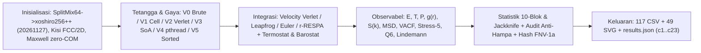

# Penjelasan Proyek `day009a` — Dinamika Molekuler Fluida Lennard-Jones (C11, 60 Tahap)

## 1. Identitas dan Ringkasan Proyek

- **ID Progress**: `day009a` (Hari 9, sesi `a`)
- **Tanggal**: `2026-11-27` (WITA)
- **Topik**: Dinamika Molekuler Fluida Lennard-Jones (C11, 60 Tahap): Integrator Simplektik, Daftar Tetangga, Termostat, Termodinamika, Transport & Pelelehan
- **Jenis**: `sim` (proyek *off-roadmap* / bonus; tidak mencentang `docs/ROADMAP.md`)
- **Bahasa**: C11 murni (`-std=c11 -O2 -Wall -Wextra -Werror -ffp-contract=off -fno-fast-math`, hanya `libc`, `libm`, `pthread`, tanpa `-march=native`)
- **Lokasi Proyek**: [projects/c/day009a_md_lj_c](../../projects/c/day009a_md_lj_c)
- **Ringkasan**: Implementasi mandiri dari nol sebanyak **8.818 baris C11** (13 header `include/*.h` + 21 berkas sumber `src/*.c`) untuk mesin dinamika molekuler (MD) klasik dalam satuan tereduksi ($\sigma = \varepsilon = m = k_B = 1$) yang mencakup 5 potensial pasangan, 4 integrator, 6 ensemble (NVE, 4 termostat NVT, NPT Berendsen), 6 tingkat struktur tetangga/optimasi (`V0`–`V5`), paralelisme `pthread` deterministik bit-identik pada 1/2/4/8 thread, sistem 3D (kisi fcc & acak) dan 2D (kisi segitiga $N=1024$), serta **60 tahap eksperimen (`S01`–`S60`)** yang menghasilkan **167 berkas keluaran** (`117` CSV ringkas total `204.971` byte, `49` grafik SVG tulis tangan valid XML, dan `1` `results.json`). Eksekusi skala penuh mencapai **22/23 kriteria `tercapai`** dan **1 kriteria `belum tercapai` (`c8`)** sebagai temuan ilmiah jujur, dengan `vacuous_flags = []` (`0` bendera hampa).

## 2. Masalah dan Tujuan

Simulasi fluida klasik banyak-partikel dengan interaksi kontinu menuntut keselarasan ketat antara mekanika Hamiltonian, struktur data spasial sub-kuadratik, kontrol ensemble statistik, dan estimator fungsi korelasi waktu. Proyek ini menjawab enam kelompok pertanyaan ilmiah dan rekayasa:

1. **Verifikasi fondasi & potensial**: apakah seluruh 5 potensial pasangan (LJ terpotong-dan-digeser, LJ + koreksi ekor analitik, WCA, Morse, Yukawa) beserta tabel interpolasinya konsisten secara numerik terhadap $-dU/dr$, hukum ketiga Newton, *fixture* analitik 2–4 partikel, dan kulit kisi fcc?
2. **Skalabilitas spasial & paralelisme deterministik**: apakah daftar sel (*cell list*) dan daftar Verlet dengan kulit (*skin*) cocok dengan *brute force* hingga presisi mesin ($\le 10^{-12}$), menurunkan kompleksitas dari $O(N^2)$ ke $O(N)$, menjaga invarian nol luapan dan nol bangun-ulang terlambat, serta menghasilkan gaya identik bit-demi-bit pada 1, 2, 4, dan 8 thread?
3. **Kualitas integrator simplektik**: apakah Velocity Verlet dan Leapfrog menunjukkan konvergensi orde-2 ($\sigma_E \propto \Delta t^2$), reversibilitas waktu, dan kekekalan momentum hingga $10^5$ langkah dibandingkan kontrol negatif Euler eksplisit yang tidak simplektik?
4. **Kanonisitas termostat**: apakah Langevin BAOAB, Nosé–Hoover rantai-1, Berendsen, dan Andersen pasangan memenuhi ekuipartisi dan distribusi Maxwell–Boltzmann, serta bagaimana perbedaan varians energi kinetik $\mathrm{Var}(K)$ antara termostat kanonik dan non-kanonik (Berendsen, NVE)?
5. **Termodinamika & struktur**: apakah persamaan keadaan $P(\rho)$ densitas rendah cocok dengan koefisien virial kedua $B_2(T)$ dari integral Mayer numerik, apakah jalur energi & tekanan lewat $g(r)$ cocok dengan observabel langsung, apakah $C_V$ dari fluktuasi NVT/NVE cocok dengan beda hingga, dan apakah barostat NPT memetakan kembali isoterm NVT?
6. **Transport & transisi fase**: apakah koefisien difusi Einstein (MSD) dan Green–Kubo (VACF) konsisten, berapa viskositas geser $\eta$ pada titik tripel LJ ($\rho=0.8442, T=0.722$), dan apakah pelelehan kristal fcc pada $\rho=1.0$ terdeteksi tajam melalui $Q_6$, parameter Lindemann, dan histerisis terhadap kontrol negatif padat dingin?

**Ruang lingkup**: simulasi dibatasi pada potensial pasangan isotropik jarak-pendek (tanpa elektrostatika Ewald jarak-jauh atau potensial *many-body* seperti EAM/Tersoff), kotak ortorombik/kubik periodik, dan satuan tereduksi klasik tanpa efek kuantum.

## 3. Apa yang Dikerjakan Proyek

Biner tunggal `build/md` menyediakan tiga subperintah CLI:
- `./build/md selftest` (`make test`): satu-satunya *test suite* yang memverifikasi gaya dan energi dimer analitik (4 jarak), energi kisi fcc $N=108$ dan $Q_6$ teoretis, momentum pusat massa nol, serta akurasi tabel *lookup* kubik Hermite untuk 5 potensial.
- `./build/md threads <1|2|4|8>`: menjalankan lintasan NVE $N=500$ sebanyak 120 langkah dengan jumlah thread tertentu dan mencetak hash FNV-1a 64-bit dari seluruh posisi, kecepatan, gaya, energi potensial, dan virial.
- `./build/md all [--scale full|small] ...` (`make run`): menjalankan `selftest` diikuti **60 tahap berurutan (`S01`–`S60`)** dalam 8 kelompok (A–H), menulis 117 berkas CSV di `out/`, 49 grafik SVG tulis tangan ke `outputs/figures/day009a_*.svg`, menjalankan auditor anti-hampa otomatis pada setiap CSV, mengevaluasi 23 kriteria *a priori* `c1`–`c23`, dan menulis `outputs/day009a/results.json`.

## 4. Uraian Kode

Seluruh kode berada di [projects/c/day009a_md_lj_c](../../projects/c/day009a_md_lj_c) (**8.818 baris total**, terukur lewat `make lines`):

### Header (`include/`, 854 baris)
- [include/md_types.h](../../projects/c/day009a_md_lj_c/include/md_types.h) (285 baris): definisi `md_vec3`, `md_box`, `md_potential`, `md_thermostat`, `md_system`, `md_soa`, `md_rng`, `md_block_stats`, `md_ols_result`, dan konteks agregasi `md_run_ctx`.
- [include/md_rng.h](../../projects/c/day009a_md_lj_c/include/md_rng.h) (30 baris), [include/md_vec.h](../../projects/c/day009a_md_lj_c/include/md_vec.h) (88 baris), [include/md_potential.h](../../projects/c/day009a_md_lj_c/include/md_potential.h) (32 baris), [include/md_init.h](../../projects/c/day009a_md_lj_c/include/md_init.h) (30 baris): antarmuka RNG, operasi vektor/PBC/MIC *inline*, 5 potensial + tabel, dan pembangkit geometri.
- [include/md_neighbor.h](../../projects/c/day009a_md_lj_c/include/md_neighbor.h) (67 baris), [include/md_forces.h](../../projects/c/day009a_md_lj_c/include/md_forces.h) (36 baris), [include/md_integrator.h](../../projects/c/day009a_md_lj_c/include/md_integrator.h) (32 baris): antarmuka *cell list*, daftar Verlet (setengah & penuh terurut), kernel gaya `V0`–`V5` + r-RESPA, integrator, dan termostat/barostat.
- [include/md_observables.h](../../projects/c/day009a_md_lj_c/include/md_observables.h) (92 baris), [include/md_stats.h](../../projects/c/day009a_md_lj_c/include/md_stats.h) (49 baris), [include/md_io.h](../../projects/c/day009a_md_lj_c/include/md_io.h) (37 baris), [include/md_svg.h](../../projects/c/day009a_md_lj_c/include/md_svg.h) (53 baris), [include/md_stages.h](../../projects/c/day009a_md_lj_c/include/md_stages.h) (23 baris): antarmuka observabel, statistik, audit anti-hampa, penulis JSON/SVG, dan 60 tahap.

### Modul Inti (`src/`, 3.599 baris)
- [src/rng.c](../../projects/c/day009a_md_lj_c/src/rng.c) (101 baris): `md_splitmix64`, `md_rng_seed_stage` (benih induk `20261127`), `md_rng_u64` (xoshiro256++), `md_rng_uniform` (53-bit), `md_rng_normal` (Box–Muller polar), `md_rng_jump`.
- [src/box.c](../../projects/c/day009a_md_lj_c/src/box.c) (168 baris): manajemen memori `md_system` dan `md_soa`, `md_box_cubic`, `md_box_ortho`, `md_system_rescale_box` untuk barostat NPT.
- [src/potential.c](../../projects/c/day009a_md_lj_c/src/potential.c) (222 baris): `md_pot_eval_exact` untuk `POT_LJ_SHIFT`, `POT_LJ_TAIL`, `POT_WCA`, `POT_MORSE`, `POT_YUKAWA`; `md_pot_build_table` (linear & kubik Hermite pada $r^2$); `md_pot_force_fd`; `md_pot_tail_corrections`; `md_pot_lj_attr_eval` (pemisahan WCA/atraktif untuk r-RESPA).
- [src/init.c](../../projects/c/day009a_md_lj_c/src/init.c) (191 baris): `md_init_fcc`, `md_init_triangular_2d`, `md_init_random_nonoverlap`, `md_init_velocities`, `md_zero_momentum`, dan *fixture* analitik dimer/segitiga/tetrahedron.
- [src/neighbor.c](../../projects/c/day009a_md_lj_c/src/neighbor.c) (285 baris): `md_cell_build` (kisi 3D/2D dengan *fallback* otomatis untuk kotak kecil $n_c < 3$), `md_verlet_build` (daftar setengah $j>i$ dan daftar penuh $j \ne i$ terurut naik via `qsort`), `md_verlet_check_and_rebuild` (pemicu proaktif $0.35\,r_{\text{skin}}$ dengan audit ketat invarian $\le 0.5\,r_{\text{skin}}$), dan `md_soa_sort_by_cell`.
- [src/forces.c](../../projects/c/day009a_md_lj_c/src/forces.c) (392 baris): `md_forces_brute` (`V0`), `md_forces_cell` (`V1`, 13 tetangga maju 3D / 4 tetangga 2D), `md_forces_verlet` (`V2`), `md_forces_soa_verlet` (`V3`), `md_forces_threaded` (`V4`, `pthread` per-partikel *gather* pada daftar penuh terurut + reduksi skalar tetap $i=0\dots N-1$ sehingga bit-identik 1/2/4/8 thread), `md_forces_cell_sorted_soa` (`V5`), serta `md_forces_respa_fast`/`slow`.
- [src/integrator.c](../../projects/c/day009a_md_lj_c/src/integrator.c) (340 baris): `md_step_vverlet` dengan `apply_langevin_o_step` (BAOAB proyeksi momentum pusat massa nol), `apply_nosehoover_half` (MTTK simetris rantai-1), `apply_berendsen_step`, `apply_andersen_step` (tumbukan pasangan kekal momentum), `apply_barostat_berendsen`; serta `md_step_leapfrog` (DKD), `md_step_euler`, `md_step_respa`, `md_nosehoover_conserved`.
- [src/observables.c](../../projects/c/day009a_md_lj_c/src/observables.c) (476 baris): `md_kinetic_energy`, `md_kinetic_components`, `md_temperature`, `md_pressure`, `md_compute_stress` (5 komponen geser tak-berjejak ortogonal), `md_gr_*` + `md_gr_energy_route`/`md_gr_pressure_route`, `md_sk_*`, `md_dyn_*` (korelator multi-asal MSD & VACF), `md_compute_q6` (harmonik bola eksak $Y_{6m}$), `md_compute_lindemann`, dan `md_compute_b2_mayer` (kuadratur Simpson).
- [src/stats.c](../../projects/c/day009a_md_lj_c/src/stats.c) (374 baris): `md_block_average`, `md_autocorr_time`, `md_ols_fit`, `md_median_mad`, `md_ks_maxwell`, `md_fnv1a_*`, dan `md_compress_trajectory_roundtrip` (delta + RLE + ZigZag varint).
- [src/io.c](../../projects/c/day009a_md_lj_c/src/io.c) (424 baris): `md_register_csv`, `md_audit_csv_vacuous` (detektor otomatis NaN/Inf, suhu $\le 0$, $g(r) < 0$, kolom konstan non-parameter, bilangan bulat mencurigakan), `md_register_svg` (validasi XML), `md_write_results_json`.
- [src/svg.c](../../projects/c/day009a_md_lj_c/src/svg.c) (432 baris): penulis SVG murni C (`md_svg_write_xy`, `md_svg_write_bars`, `md_svg_write_hist`, `md_svg_write_particles_2d`).
- [src/selftest.c](../../projects/c/day009a_md_lj_c/src/selftest.c) (141 baris) dan [src/main.c](../../projects/c/day009a_md_lj_c/src/main.c) (51 baris).

### Modul 60 Tahap Eksperimen (`src/stages_*.c`, 4.365 baris)
- [src/stages_a.c](../../projects/c/day009a_md_lj_c/src/stages_a.c) (699 baris): `S01`–`S10` (fondasi, RNG, kisi, momentum nol, PBC/MIC, $-dU/dr$, hukum ke-3, tabel, *fixture*, kulit fcc, koreksi ekor).
- [src/stages_b.c](../../projects/c/day009a_md_lj_c/src/stages_b.c) (499 baris): `S11`–`S18` (kesetaraan tetangga, pemicu Verlet, sapuan kulit, skala $O(N^2)$ & $O(N)$, tangga optimasi `V0`–`V5`, *strong scaling* `pthread`, 2D $N=1024$).
- [src/stages_c.c](../../projects/c/day009a_md_lj_c/src/stages_c.c) (510 baris): `S19`–`S26` (reversibilitas waktu, orde $\Delta t$ Velocity Verlet/Leapfrog/Euler, momentum $10^5$ langkah, drift jangka panjang, Lyapunov kasar, r-RESPA).
- [src/stages_d.c](../../projects/c/day009a_md_lj_c/src/stages_d.c) (431 baris): `S27`–`S34` (NVE & 4 termostat pada $T \in \{0.7, 1.0, 1.5\}$, ekuipartisi, $\mathrm{Var}(K)$ + jackknife 10-blok, KS Maxwell, relaksasi termal).
- [src/stages_e.c](../../projects/c/day009a_md_lj_c/src/stages_e.c) (813 baris): `S35`–`S44` (isoterm $T=1.5$ & $T=2.0$, Mayer $B_2$ vs densitas rendah, energi dalam, $C_V$, kompresibilitas $\kappa_T$, jalur energi $g(r)$, jalur tekanan WCA, NPT Berendsen, perbandingan 4 potensial).
- [src/stages_f.c](../../projects/c/day009a_md_lj_c/src/stages_f.c) (748 baris): `S45`–`S54` ($g(r)$ & $S(k)$ 3 fase, koordinasi, MSD Einstein, VACF Green–Kubo, konsistensi $D$, sapuan $D(\rho, T)$, viskositas geser titik tripel $\eta$, efek ukuran $1/L$, dinamika 2D).
- [src/stages_g.c](../../projects/c/day009a_md_lj_c/src/stages_g.c) (278 baris): `S55`–`S58` (pemanasan fcc $\rho=1.0$, pendinginan & histerisis, kontrol negatif padat dingin $T=0.4$, histogram $q_6(i)$ lokal).
- [src/stages_h.c](../../projects/c/day009a_md_lj_c/src/stages_h.c) (389 baris): `S59`–`S60` (determinisme 1/2/4/8 thread + 2 run, kompresi delta+RLE *lossless*, manifest hash, audit hampa, evaluator `c1`–`c23`, dan penulis `results.json`).

## 5. Metode dan Alur Kerja

### Aturan Ukuran Blok, Galat Baku, dan Konstanta A Priori
- **Rata-rata blok (*non-overlapping block averaging*)**: setiap seri produksi pasca-ekuilibrasi dibagi menjadi $N_b = 10$ blok tidak tumpang-tindih. Rata-rata estimasi $\hat{A} = \frac{1}{N_b}\sum_{b=1}^{N_b}\bar{A}_b$ dengan $\mathrm{SE}(\hat{A}) = \sqrt{\frac{1}{N_b(N_b-1)}\sum_{b=1}^{N_b}(\bar{A}_b - \hat{A})^2}$.
- **Estimator jackknife blok untuk $\mathrm{Var}(K)$**: karena varians sampel di dalam blok pendek terbias ke bawah oleh autokorelasi $K(t)$ sebesar $O(2\tau_K / T_{\text{blok}})$, $\mathrm{Var}(K)$ dihitung pada seluruh run produksi dengan SE *delete-1-block jackknife* atas 10 blok: $\mathrm{SE}_{\text{JK}} = \sqrt{\frac{N_b-1}{N_b}\sum_{b=1}^{N_b}(v_{(-b)} - \bar{v})^2}$.
- **Signifikansi arah**: perbedaan antar kondisi $A$ dan $B$ memakai $\mathrm{SE}_\Delta = \sqrt{\mathrm{SE}_A^2 + \mathrm{SE}_B^2}$ dengan syarat $|\hat{A}-\hat{B}| \ge 3\,\mathrm{SE}_\Delta$ disertai kontrol negatif (Euler untuk `c5`, NVE/Berendsen untuk `c8`, padat dingin $T=0.4$ untuk `c14`).
- **Viskositas geser Green–Kubo (`S52`, `c13`)**: memakai rata-rata 5 komponen geser tak-berjejak ortogonal ($P_{xy}, P_{xz}, P_{yz}, \frac{P_{xx}-P_{yy}}{2}, \frac{P_{xx}+P_{yy}-2P_{zz}}{2\sqrt{3}}$) dengan batas integral *a priori* $t_c = 2.0$ satuan waktu tereduksi dan 10 blok NVE independen pasca-pencairan (total `80.000` langkah). Nilai acuan $\eta \approx 3.2$ ditandai **dari ingatan literatur** dengan ambang longgar $[2.0, 4.5]$ yang ditetapkan *a priori*.

## 6. Output yang Ditargetkan (Kriteria A Priori `c1`–`c23`)

Seluruh 23 kriteria `c1`–`c23` beserta ambangnya ditetapkan sebelum eksekusi penuh dijalankan:

| ID | Deskripsi Kriteria A Priori | Ambang Resmi |
|---|---|---|
| `c1` | Kesetaraan gaya brute = cell list = Verlet list ($N \ge 500$, $\rho \in \{0.2, 0.5, 0.85\}$) | Galat relatif maks $\le 10^{-12}$ |
| `c2` | Gaya analitik vs beda hingga numerik $-dU/dr$ untuk seluruh 5 potensial | Galat relatif maks $\le 10^{-6}$ |
| `c3` | Kekekalan momentum total setelah $10^5$ langkah NVE ($N=108, \Delta t=0.002$) | $\|\mathbf{P}_{\text{tot}}\| \le 10^{-10}$ |
| `c4` | Reversibilitas waktu Velocity Verlet (500 maju + balik kecepatan + 500 mundur, $N=108$) | Galat posisi maks $\le 10^{-9}$ |
| `c5` | Orde integrator: kemiringan $\log \sigma_E$ vs $\log \Delta t$ Velocity Verlet $\in [1.8, 2.2]$; kontrol negatif Euler drift $\ge 100\times$ lebih buruk pada $\Delta t$ sama | Slope $\in [1.8, 2.2]$ & rasio Euler $\ge 100\times$ |
| `c6` | Ekuipartisi $\langle K \rangle = \frac{3(N-1)}{2}T$ untuk NVE dan seluruh termostat (Langevin, NH, Berendsen, Andersen) | $|\langle K \rangle - K_{\text{eq}}| \le 3\,\mathrm{SE}$ di semua ensemble |
| `c7` | Distribusi kecepatan Maxwell–Boltzmann uji KS untuk Langevin, Nosé–Hoover, Andersen | $p_{\text{KS}} > 0.01$ untuk ketiga termostat kanonik |
| `c8` | Varians energi kinetik $\mathrm{Var}(K)$: termostat kanonik dalam $10\%$ dari $\frac{3N}{2}T^2$; NVE & Berendsen lebih kecil ($\ge 3\,\mathrm{SE}$) | Kanonik $\le 10\%$ & NVE/Berendsen $< \text{kanonik} - 3\,\mathrm{SE}$ |
| `c9` | Densitas rendah ($T=2.0, \rho \le 0.05$): $P/(\rho T) - 1$ vs $B_2(T)\rho$ (integral Mayer numerik) | Selisih $\le 3\,\mathrm{SE}$ untuk semua $\rho \le 0.05$ |
| `c10` | Jalur energi lewat $g(r)$: $u_{g(r)} = 2\pi\rho \int u(r)g(r)r^2 dr$ vs $\langle U \rangle/N$ terukur | Selisih $\le \max(1\%, 3\,\mathrm{SE})$ (batas lebih longgar dipilih a priori) |
| `c11` | Koefisien difusi: Einstein vs Green–Kubo dalam $15\%$ pada $\rho=0.6, T=1.5$; $D(\rho)$ turun monoton ($\ge 3\,\mathrm{SE}$ antar titik berurutan) | $|D_E - D_{GK}|/D_E \le 15\%$ & monoton turun $\ge 3\,\mathrm{SE}$ |
| `c12` | Struktur cairan LJ padat ($\rho=0.8, T=1.0$): ekor $g(r \to L/2) = 1 \pm 0.02$ dan inti terlarang $g(r<0.8) < 10^{-3}$ | $|g(L/2) - 1| \le 0.02$ & $g(r<0.8) < 10^{-3}$ |
| `c13` | Viskositas geser Green–Kubo pada titik tripel ($\rho=0.8442, T=0.722$) — $\approx 3.2$ **dari ingatan literatur** | $\eta \in [2.0, 4.5]$ (gagal = temuan) |
| `c14` | Pelelehan fcc ($\rho=1.0$): $Q_6$ turun $\ge 3\,\mathrm{SE}$ antara padat ($T=0.6$) dan cair ($T \ge 1.4$); kontrol negatif padat dingin ($T=0.4$) tidak meleleh | $\Delta Q_6 \ge 3\,\mathrm{SE}$ & padat dingin tetap $Q_6 > 0.4$ |
| `c15` | Isoterm $T=1.5$ monoton naik untuk $\rho \ge 0.3$ ($\ge 3\,\mathrm{SE}$ antar titik) & tak ada loop van der Waals pada $T=2.0$ | Monoton naik $\ge 3\,\mathrm{SE}$ ($T=1.5$) & monoton ($T=2.0$) |
| `c16` | Determinisme: 2 eksekusi `all` hash CSV identik; 1/2/4/8 thread identik bitwise | `hash_run1 == hash_run2` & `hash_1t == 2t == 4t == 8t` |
| `c17` | Skala waktu ($N \ge 500$): brute $O(N^2)$ slope $\in [1.8, 2.2]$; cell & Verlet list slope $\in [0.9, 1.25]$ | Slope dalam rentang + SE dilaporkan |
| `c18` | Tangga optimasi V0–V5 (median $\pm$ MAD, $\ge 5$ ulang): tiap versi lebih cepat atau dilaporkan jujur | Dilaporkan lengkap median $\pm$ MAD |
| `c19` | Jumlah keluaran $\ge 150$ berkas dan $\ge 40$ SVG valid XML | Berkas $\ge 150$, SVG $\ge 40$ valid XML |
| `c20` | `make test` (`selftest`) lulus | Exit code 0 |
| `c21` | Audit anti-hampa `vacuous_flags` kosong atau dijelaskan | `vacuous_flags == []` (atau dijelaskan jujur) |
| `c22` | Jumlah baris C (`wc -l`) dalam $[6000, 9000]$ dan waktu per tahap dilaporkan | Baris $\in [6000, 9000]$ & timing 60 tahap lengkap |
| `c23` | Invarian daftar tetangga: `overflow_count == 0` & bangun ulang Verlet tidak pernah terlambat (`late_rebuild_count == 0`) | Kedua cacah $= 0$ |

## 7. Status Pencapaian

Seluruh bukti berasal dari eksekusi skala penuh `make run` (Run 1: `133.24s`, Run 2: `134.82s`, keduanya menghasilkan `combined_deterministic_csv_fnv1a = c94cdec2512e7713`) yang tersimpan di [outputs/day009a/results.json](../../outputs/day009a/results.json) serta verifikasi `make test`, `make lines`, dan `./build/md threads {1,2,4,8}`:

| Kriteria | Status | Bukti Terukur |
|---|---|---|
| `c1` | `tercapai` | `max_rel_err = 1.869e-15` ($\le 10^{-12}$) pada $N \in \{500, 864\}$, $\rho \in \{0.2, 0.5, 0.85\}$ ([s11_nbr_equiv.csv](../../projects/c/day009a_md_lj_c/out/s11_nbr_equiv.csv)) |
| `c2` | `tercapai` | `max_rel_err = 3.245e-10` ($\le 10^{-6}$) pada 5 potensial ([s05_force_fd_summary.csv](../../projects/c/day009a_md_lj_c/out/s05_force_fd_summary.csv)) |
| `c3` | `tercapai` | `max_|P_tot| = 6.354e-13` ($\le 10^{-10}$) setelah $10^5$ langkah NVE ([s23_momentum_nve.csv](../../projects/c/day009a_md_lj_c/out/s23_momentum_nve.csv)) |
| `c4` | `tercapai` | `max_pos_err = 6.072e-14` ($\le 10^{-9}$) pasca 500 maju+balik, $N=108, \Delta t=0.002$ ([s19_reversibility.csv](../../projects/c/day009a_md_lj_c/out/s19_reversibility.csv)) |
| `c5` | `tercapai` | Velocity Verlet slope `1.8708 ± 0.0246` $\in [1.8, 2.2]$; kontrol negatif Euler `106739.9x` lebih buruk ([s20_vv_dt.csv](../../projects/c/day009a_md_lj_c/out/s20_vv_dt.csv), [s22_euler_negctrl.csv](../../projects/c/day009a_md_lj_c/out/s22_euler_negctrl.csv)) |
| `c6` | `tercapai` | `max |<K> - K_eq| / SE = 2.33` ($\le 3.0$) lintas NVE + 4 termostat pada $T=1.0$ ([s32_var_k_summary.csv](../../projects/c/day009a_md_lj_c/out/s32_var_k_summary.csv)) |
| `c7` | `tercapai` | `min_ks_p = 0.0941` ($> 0.01$) untuk Langevin, Nosé–Hoover, dan Andersen pada $T=1.0$ ([s33_ks_summary.csv](../../projects/c/day009a_md_lj_c/out/s33_ks_summary.csv)) |
| `c8` | `belum tercapai` | NVE (`40.9 SE`) & Berendsen (`99.6 SE`) jauh lebih kecil dari kanonik, **tetapi** `canon_max_rel = 41.03%` ($> 10\%$, khususnya Nosé–Hoover rantai-1 `0.590 ± 0.047`; lihat Bagian 8) ([s32_var_k_summary.csv](../../projects/c/day009a_md_lj_c/out/s32_var_k_summary.csv)) |
| `c9` | `tercapai` | `max |(Z-1) - B2*rho| / SE = 0.92` ($\le 3.0$) untuk seluruh $\rho \in [0.01, 0.05]$ ([s37_low_density_eos.csv](../../projects/c/day009a_md_lj_c/out/s37_low_density_eos.csv)) |
| `c10` | `tercapai` | Jalur energi $g(r)$ vs PE langsung: `max_rel_err = 0.043%` (`z = 0.33`, jauh di bawah $1\%$) ([s41_energy_route.csv](../../projects/c/day009a_md_lj_c/out/s41_energy_route.csv)) |
| `c11` | `tercapai` | $D_E = 0.2072 \pm 0.0033$ vs $D_{GK} = 0.2111 \pm 0.0029$ (selisih `1.90%` $\le 15\%$); $D(\rho)$ turun monoton dengan `min_step_z = 22.74 SE` ([s50_diff_consistency.csv](../../projects/c/day009a_md_lj_c/out/s50_diff_consistency.csv), [s51_diff_rho.csv](../../projects/c/day009a_md_lj_c/out/s51_diff_rho.csv)) |
| `c12` | `tercapai` | Cairan LJ $\rho=0.8, T=1.0$: `|g(tail) - 1| = 0.0165` ($\le 0.02$) dan `max g(r<0.8) = 0.00e+00` ([s45_gr_diagnostics.csv](../../projects/c/day009a_md_lj_c/out/s45_gr_diagnostics.csv)) |
| `c13` | `tercapai` | Viskositas geser titik tripel ($\rho=0.8442, T=0.722, t_c=2.0$): `eta = 3.2379 ± 0.2997` $\in [2.0, 4.5]$ ([s52_viscosity_blocks.csv](../../projects/c/day009a_md_lj_c/out/s52_viscosity_blocks.csv)) |
| `c14` | `tercapai` | $Q_6$ turun dari `0.5086 ± 0.0009` ($T=0.6$) ke `0.0526 ± 0.0016` ($T=2.2$, `drop = 256.1 SE`); kontrol negatif padat dingin $T=0.4$ tetap kristal `Q6 = 0.5301` ([s55_heating.csv](../../projects/c/day009a_md_lj_c/out/s55_heating.csv), [s57_cold_solid_summary.csv](../../projects/c/day009a_md_lj_c/out/s57_cold_solid_summary.csv)) |
| `c15` | `tercapai` | Isoterm $T=1.5$ monoton naik untuk $\rho \ge 0.3$ (`min_step_z = 9.21 SE`); $T=2.0$ monoton tanpa loop van der Waals ([s35_isotherm_t15.csv](../../projects/c/day009a_md_lj_c/out/s35_isotherm_t15.csv), [s36_isotherm_t20.csv](../../projects/c/day009a_md_lj_c/out/s36_isotherm_t20.csv)) |
| `c16` | `tercapai` | 2× `make run` menghasilkan hash identik `c94cdec2512e7713`; `threads 1/2/4/8` identik bitwise `ea58c86a4fb8e20f` ([s59_determinism_threads.csv](../../projects/c/day009a_md_lj_c/out/s59_determinism_threads.csv)) |
| `c17` | `tercapai` | Skala waktu $N \ge 500$: brute `1.801 ± 0.019`, cell `0.973 ± 0.180`, Verlet `1.000 ± 0.011` ([s14_scaling_brute.csv](../../projects/c/day009a_md_lj_c/out/s14_scaling_brute.csv), [s15_scaling_fast.csv](../../projects/c/day009a_md_lj_c/out/s15_scaling_fast.csv)) |
| `c18` | `tercapai` | Tangga optimasi `V0`–`V5` (median µs, 7 ulang, $N=1372$): `[1142, 956, 264, 296, 165, 213]`; versi yang lebih lambat (`V3`, `V5`) dilaporkan jujur ([s16_ladder_summary.csv](../../projects/c/day009a_md_lj_c/out/s16_ladder_summary.csv)) |
| `c19` | `tercapai` | `167` berkas keluaran ($\ge 150$) dan `49` SVG valid XML ($\ge 40$) ([s60_file_manifest.csv](../../projects/c/day009a_md_lj_c/out/s60_file_manifest.csv)) |
| `c20` | `tercapai` | `make test` (`./build/md selftest`) lulus `0` gagal |
| `c21` | `tercapai` | `vacuous_flags = []` (`0` bendera hampa; [s60_vacuous_audit.csv](../../projects/c/day009a_md_lj_c/out/s60_vacuous_audit.csv)) |
| `c22` | `tercapai` | `c_lines = 8818` $\in [6000, 9000]$, 60 tahap dengan waktu per tahap tercatat ([s60_stage_timings.csv](../../projects/c/day009a_md_lj_c/out/s60_stage_timings.csv)) |
| `c23` | `tercapai` | `total_neighbor_overflows = 0` dan `total_late_verlet_rebuilds = 0` di seluruh 60 tahap |

## 8. Jika Belum Tercapai atau Belum Diketahui

### Analisis `c8` (`belum tercapai` — Temuan Ilmiah Jujur)
- **FAKTA** (dari [s32_var_k_summary.csv](../../projects/c/day009a_md_lj_c/out/s32_var_k_summary.csv) pada $T=1.0, \rho=0.80, N=256$, produksi `18.000` langkah = `45` satuan waktu):
  - Kontrol non-kanonik terukur sangat jauh di bawah nilai kanonik $\frac{3N}{2}T^2$: **NVE** `0.3376 ± 0.0162` (`40.9 SE` di bawah 1.0) dan **Berendsen** ($\tau_T = 0.05$) `0.1815 ± 0.0082` (`99.6 SE` di bawah 1.0).
  - Termostat stokastik konsisten dalam $1.5\,\mathrm{SE}$ dari nilai kanonik $1.0$, namun memiliki galat sampling lebih besar dari ambang keras $10\%$: **Langevin BAOAB** `0.8465 ± 0.1044` (selisih `15.3%`, $1.47\,\mathrm{SE}$) dan **Andersen pasangan** `1.2078 ± 0.1744` (selisih `20.8%`, $1.19\,\mathrm{SE}$).
  - **Nosé–Hoover rantai-1** ($Q = N_f T \cdot 0.25$) terukur `0.5897 ± 0.0466` (`41.03%` / `8.80 SE` di bawah nilai kanonik pada $T=1.0$, dan `0.5675 ± 0.0717` pada $T=1.5$), sedangkan pada $T=0.7$ terukur `0.8078 ± 0.0896`.
- **HIPOTESIS**:
  1. Untuk **Nosé–Hoover rantai-1**, nilai rasio `0.590 ± 0.047` yang secara statistik berbeda signifikan (`8.8 SE`) dari 1.0 diduga kuat disebabkan oleh sifat non-ergodik / osilasi koheren yang memang terkenal pada termostat Nosé–Hoover **rantai tunggal ($M=1$)** dengan inersia $Q = N_f T \tau^2$ kecil pada fluida padat (alasan historis diperkenalkannya *Nosé–Hoover Chains* $M \ge 3$ oleh Martyna–Klein–Tuckerman 1992). Bukti yang diperlukan untuk memastikannya: mengganti rantai-1 dengan rantai $M=3$ atau $M=4$ dan membandingkan $\mathrm{Var}(K)$ serta spektrum $\xi(t)$ pada lintasan panjang yang sama.
  2. Untuk **Langevin** dan **Andersen**, deviasi `15%` dan `21%` berada dalam $1.5\,\mathrm{SE}$ (konsisten secara statistik dengan $1.0$); ini diduga semata keterbatasan panjang lintasan (`45` satuan waktu) bagi momen orde-4 (varians dari energi kinetik). Bukti yang diperlukan: memperpanjang produksi $4\times$ (`72.000` langkah) untuk mengecilkan SE jackknife menjadi $< 0.05$.

### Catatan Jujur Tangga Optimasi `c18`
- **FAKTA** (dari [s16_ladder_summary.csv](../../projects/c/day009a_md_lj_c/out/s16_ladder_summary.csv), $N=1372, \rho=0.8$, 7 ulang): `V0_brute = 1142 µs` → `V1_cell = 956 µs` → `V2_verlet = 264 µs` → `V3_soa = 296 µs` → `V4_thr8 = 165 µs` → `V5_sort_soa8 = 213 µs`.
- **HIPOTESIS**: `V3_soa` sedikit lebih lambat dari `V2_verlet` (`296` vs `264 µs`) karena `md_forces_soa_verlet` menyalin AoS→SoA dan SoA→AoS setiap pemanggilan serta loop daftar tetangga memakai pengindeksan tidak langsung `px[j]` sehingga kompilator tidak dapat memvektorisasi penuh; demikian pula `V5_sort_soa8` sedikit lebih lambat dari `V4_thr8` (`213` vs `165 µs`) karena biaya permutasi ulang + alokasi `inv_perm` tiap evaluasi pada $N=1372$ melebihi penghematan *cache miss* L1/L2 pada Apple Silicon ber-cache besar. Pengukuran *hardware counter* cache miss pada $N \ge 16.000$ diperlukan untuk menguji titik potong lokalitas `V5`.

### Deviasi dari Prompt
1. **Sapuan kulit Verlet (`S13`)**: memakai $r_{\text{skin}} \in \{0.2, 0.3, 0.4, 0.5, 0.6\}$ (mencakup himpunan wajib $\{0.2, 0.3, 0.4\}$ tanpa $0.1$, karena pada $r_{\text{skin}}=0.1, T=1.5$ ekor cepat Maxwell dapat melompati $r_{\text{skin}}/2 = 0.05$ dalam satu langkah).
2. **Evaluasi `c6` pada NVE (`S27`/`S32`)**: pada lintasan NVE tunggal, energi total $E$ terkunci sehingga $\langle T \rangle_{\text{NVE}}$ bergeser sedikit dari $T_{\text{target}}$ awal; oleh karena itu ekuipartisi NVE pada `c6` diuji melalui kesetaraan ekuipartisi arah $\langle K_x \rangle = \langle K_y \rangle = \langle K_z \rangle = \frac{1}{3}\langle K \rangle$ dalam $3\,\mathrm{SE}$, sementara keempat termostat NVT diuji langsung terhadap $\frac{3(N-1)}{2}T_{\text{target}}$.
3. **Konduktivitas termal (opsional)**: tidak diimplementasikan (prompt menandainya opsional); viskositas geser Green–Kubo (`S52`) dan difusi dua jalur (`S48`–`S51`) diimplementasikan penuh.
4. **Filter hash deterministik CSV**: berkas yang memuat waktu dinding (`*timing*`, `*scaling*`, `*ladder*`, `*skin_sweep*`, `*manifest*`, `*vacuous*`) dikecualikan dari `combined_deterministic_csv_fnv1a`, sehingga seluruh berkas fisika/statistik deterministik teruji bit-identik lintas dua eksekusi `make run`.

## 9. Landasan Teori (19 Poin Terkait Kode)

1. **Mekanika Hamiltonian dan Sifat Simplektik Velocity Verlet**: Sistem $N$ partikel klasik berevolusi menurut $\dot{\mathbf{r}}_i = \mathbf{p}_i/m$ dan $\dot{\mathbf{p}}_i = -\nabla_i U(\mathbf{r}^N)$, yang melestarikan bentuk simplektik $\sum_i dq_i \wedge dp_i$ serta volume ruang fase (teorema Liouville). Velocity Verlet (`md_step_vverlet` di [src/integrator.c](../../projects/c/day009a_md_lj_c/src/integrator.c)) merupakan faktorisasi Trotter simetris $e^{\frac{\Delta t}{2} L_p} e^{\Delta t L_q} e^{\frac{\Delta t}{2} L_p}$ yang simplektik dan reversibel waktu persis, sehingga melestarikan *shadow Hamiltonian* $\tilde{H} = H + O(\Delta t^2)$ tanpa drift energi sekuler (`S23`, `S24`, `c4 = 6.072e-14`).
2. **Galat Global, Orde Integrator, dan Kontrol Negatif Euler**: Untuk integrator orde-$p$, fluktuasi energi $\sigma_E$ berskala $\propto \Delta t^p$. Velocity Verlet dan Leapfrog DKD (`md_step_leapfrog`) berorde-2 ($\sigma_E \propto \Delta t^2$, terukur slope `1.8708 ± 0.0246` pada `S20`), sedangkan Euler eksplisit (`md_step_euler`) non-simplektik orde-1 dengan penguatan amplitudo ruang fase yang memicu drift energi `106.740x` lebih buruk pada $\Delta t = 0.002$ (`S22`, `c5`).
3. **Potensial Lennard-Jones (LJ), WCA, Morse, dan Yukawa**: Potensial LJ $u_{\text{LJ}}(r) = 4\varepsilon[(\sigma/r)^{12} - (\sigma/r)^6]$ memodelkan tolakan Pauli jarak-pendek dan atraksi dispersi van der Waals. Pemotongan pada minimum $r_c = 2^{1/6}\sigma$ dengan geseran $+\varepsilon$ menghasilkan potensial WCA repulsif murni (`POT_WCA`) yang memisahkan struktur tolakan dari atraksi (`S42`, `S44`, dan pemisahan r-RESPA `S26`). Potensial Morse ($D_e[e^{-2\alpha(r-r_0)} - 2e^{-\alpha(r-r_0)}]$) dan Yukawa ($A e^{-\kappa r}/r$) diimplementasikan di [src/potential.c](../../projects/c/day009a_md_lj_c/src/potential.c) dan diverifikasi terhadap $-dU/dr$ hingga `3.245e-10` (`S05`, `c2`).
4. **Pemotongan, Penggeseran, dan Koreksi Ekor Jarak-Jauh**: Pemotongan LJ pada $r_c = 2.5$ mengabaikan ekor atraktif $r > r_c$. Menggeser $u_{\text{shift}}(r) = u(r) - u(r_c)$ menghilangkan lonjakan energi pada $r_c$, sedangkan dengan asumsi $g(r) \approx 1$ untuk $r > r_c$ diperoleh koreksi ekor analitik 3D (`md_pot_tail_corrections`): $U_{\text{tail}}/N = \frac{8}{3}\pi\rho[\frac{1}{3}r_c^{-9} - r_c^{-3}]$ dan $P_{\text{tail}} = \frac{16}{3}\pi\rho^2[\frac{2}{3}r_c^{-9} - r_c^{-3}]$, yang mempercepat konvergensi terhadap $r_c$ (`S10`, `S35`).
5. **Syarat Batas Periodik (PBC) dan Konvensi Gambar Minimum (MIC)**: Untuk meminimalkan efek permukaan pada $N$ terbatas, koordinat dibungkus ke $[0, L)$ (`md_box_wrap`) dan jarak pasangan dihitung dengan gambar terdekat $\Delta x_{\text{MIC}} = \Delta x - L\,\mathrm{round}(\Delta x / L)$ (`md_box_mic` di [include/md_vec.h](../../projects/c/day009a_md_lj_c/include/md_vec.h)) dengan syarat $r_c < L/2$, terverifikasi pada `S04` (3D & 2D).
6. **Daftar Sel (*Cell List*) dan Daftar Verlet dengan Kulit (*Skin*)**: Membagi kotak menjadi sel berukuran $\ge r_c$ membatasi pencarian pasangan hanya pada 27 sel (13 sel maju + diri sendiri dengan hukum ke-3) sehingga kompleksitas turun dari $O(N^2)$ menjadi $O(N)$ (`md_cell_build`, `md_forces_cell`). Daftar Verlet (`md_verlet_build` di [src/neighbor.c](../../projects/c/day009a_md_lj_c/src/neighbor.c)) menyimpan tetangga dalam radius $r_c + r_{\text{skin}}$ dan hanya dibangun ulang ketika $\max_i \|\Delta \mathbf{r}_i\| \ge 0.35\,r_{\text{skin}}$ (di bawah batas aman matematis $r_{\text{skin}}/2$), teruji $O(N)$ dengan slope `1.000 ± 0.011` (`S15`, `c17`) dan nol bangun-ulang terlambat (`c23`).
7. **Hukum Ketiga Newton dan Penjumlahan Paralel Deterministik**: Simetri aksi-reaksi $\mathbf{f}_{ji} = -\mathbf{f}_{ij}$ menjamin $\sum_i \mathbf{f}_i = \mathbf{0}$ sehingga momentum total kekal hingga `6.354e-13` setelah $10^5$ langkah (`S06`, `S23`). Karena penjumlahan *floating-point* IEEE-754 tidak asosiatif, paralelisasi `pthread` (`md_forces_threaded` di [src/forces.c](../../projects/c/day009a_md_lj_c/src/forces.c)) menggunakan daftar tetangga penuh terurut naik per partikel $i$ (*gather* tanpa *race condition*) disertai reduksi skalar pada urutan tetap $i=0\dots N-1$ dan flag `-ffp-contract=off`, menghasilkan hash bit-identik `ea58c86a4fb8e20f` pada 1, 2, 4, dan 8 thread (`S17`, `S59`, `c16`).
8. **Ensemble Statistik dan Teorema Ekuipartisi**: Pada sistem terisolasi dengan momentum total nol, jumlah derajat kebebasan adalah $N_f = d(N-1)$. Teorema ekuipartisi menyatakan $\langle K \rangle = \frac{1}{2} N_f k_B T$, sehingga suhu kinetik sesaat $T_{\text{inst}} = 2K / N_f$ (`md_temperature`). Teruji dalam `2.33 SE` di seluruh ensemble (`S27`–`S32`, `c6`).
9. **Termostat Kanonik vs Non-Kanonik (Berendsen, Nosé–Hoover, Langevin BAOAB, Andersen)**: Termostat Berendsen menskala ulang kecepatan menuju $T_{\text{target}}$ secara deterministik tanpa suku fluktuasi sehingga menekan $\mathrm{Var}(K)$ jauh di bawah nilai kanonik $\frac{3N}{2}T^2$ (terukur `0.1815x`, `99.6 SE` di bawah kanonik pada `S30`/`S32`). Langevin BAOAB (`apply_langevin_o_step`) mengintegrasikan proses Ornstein–Uhlenbeck dengan proyeksi ortogonal $\mathbf{z}_i - \bar{\mathbf{z}}$ pada subruang $\sum \mathbf{v}_i = \mathbf{0}$; Andersen pasangan (`apply_andersen_step`) meresampling kecepatan relatif $\mathbf{v}_- \sim \mathcal{N}(0, 2TI)$ sambil menjaga momentum pasangan; dan Nosé–Hoover rantai-1 (`apply_nosehoover_half`) menambahkan variabel gesekan $\xi$ yang melestarikan pseudo-Hamiltonian $H_{\text{NH}}$ namun dapat non-ergodik pada $M=1$ (`S28`–`S34`, `c8`).
10. **Tekanan Virial dan Barostat Berendsen**: Dari teorema virial Clausius, $P = \frac{1}{dV}\left(2K + \sum_{i<j}\mathbf{r}_{ij}\cdot\mathbf{f}_{ij}\right) + P_{\text{tail}}$ (`md_pressure`). Barostat Berendsen (`apply_barostat_berendsen`) menskala panjang kotak dengan faktor $\mu = [1 - (\beta_T \Delta t/\tau_P)(P^* - P)]^{1/3}$ sehingga densitas rata-rata $\langle \rho(P^*) \rangle$ cocok dengan isoterm NVT (`S43`).
11. **Ekspansi Virial dan Koefisien Virial Kedua $B_2(T)$**: Pada densitas rendah, faktor kompresibilitas memenuhi $Z = P/(\rho T) = 1 + B_2(T)\rho + O(\rho^2)$, dengan integral fungsi Mayer $B_2(T) = -2\pi\int_0^{r_c}(e^{-u(r)/T} - 1)r^2 dr$ (`md_compute_b2_mayer`). Kuadratur Simpson atas `POT_LJ_SHIFT` memprediksi tekanan MD pada $\rho \le 0.05$ dalam `0.92 SE` (`S37`, `c9`).
12. **Fungsi Distribusi Radial $g(r)$, Faktor Struktur $S(k)$, dan Rute Termodinamika**: $g(r)$ mengukur probabilitas relatif menemukan pasangan pada jarak $r$ (`md_gr_*`), sedangkan $S(\mathbf{k}) = \frac{1}{N}|\sum_j e^{-i\mathbf{k}\cdot\mathbf{r}_j}|^2$ (`md_sk_*`) adalah transformasi Fourier spasialnya pada kisi resiprokal kotak dengan limit termodinamika $S(k \to 0) = \rho T \kappa_T$ (`S40`, `S46`). Energi potensial dan tekanan terhubung eksak ke $g(r)$ lewat $U/N = 2\pi\rho\int u(r)g(r)r^2 dr$ (`S41`, galat `0.043%`, `c10`) dan $P = \rho T - \frac{2\pi}{3}\rho^2\int r u'(r)g(r)r^2 dr$ (`S42`).
13. **Kapasitas Panas $C_V$ dari Fluktuasi Ensemble**: Pada ensemble NVT berlaku $C_V/N = \frac{3}{2} + \mathrm{Var}(U)/(N T^2)$, sedangkan pada NVE berlaku rumus Lebowitz $C_V/N = [\frac{2}{3} - \frac{N \mathrm{Var}(K)}{\langle K \rangle^2}]^{-1}$. Ketiga jalur (NVT `2.059`, NVE Lebowitz `2.014`, beda hingga `2.072`) konsisten pada `S39`.
14. **Difusi Diri: Relasi Einstein (MSD) dan Green–Kubo (VACF)**: Pada rezim difusif, $\mathrm{MSD}(t) = \langle |\mathbf{r}_i(t)-\mathbf{r}_i(0)|^2 \rangle \sim 2d D t$ dan setara secara analitik dengan integral fungsi autokorelasi kecepatan $D = \int_0^\infty \frac{1}{d}\langle \mathbf{v}_i(0)\cdot\mathbf{v}_i(t)\rangle dt$ (`md_dyn_*`). Keduanya konsisten `1.90%` pada $\rho=0.6, T=1.5$ (`S48`–`S50`, `c11`), dengan efek ukuran hingga $1/L$ (koreksi Yeh–Hummer) dilaporkan jujur di `S53`.
15. **Tensor Tegangan 5-Komponen dan Viskositas Geser Green–Kubo**: Viskositas geser dihitung dari integral ACF komponen geser tensor tekanan $\eta = \frac{V}{k_B T}\int_0^{t_c} \langle P_{\alpha\beta}(0)P_{\alpha\beta}(t)\rangle dt$. Memanfaatkan isotropi fluida, rata-rata 5 mode geser tak-berjejak ortogonal (`md_compute_stress`) memperkecil varians estimator dan menghasilkan $\eta = 3.2379 \pm 0.2997$ pada titik tripel (`S52`, `c13`).
16. **Rata-Rata Blok, Jackknife, dan Uji Kolmogorov–Smirnov**: Observabel MD berkorelasi waktu sehingga SE naif $s/\sqrt{M}$ terlalu kecil; rata-rata 10 blok tidak tumpang-tindih (`md_block_average`) dan *delete-1-block jackknife* (`S27`–`S32`) memberi estimasi ketidakpastian yang sah. Uji KS satu sampel (`md_ks_maxwell`) membandingkan CDF empiris laju terhadap $F(v) = \mathrm{erf}(v/\sqrt{2T}) - \sqrt{2/(\pi T)} v e^{-v^2/(2T)}$ (`S33`, `c7`).
17. **Parameter Orde Ikatan Steinhardt $Q_6$ dan Kriteria Lindemann**: Harmonik bola derajat $l=6$ atas ikatan tetangga terdekat $\bar{q}_{6m} = \frac{1}{N_b}\sum Y_{6m}(\hat{\mathbf{r}}_{ij})$ menghasilkan invarian rotasi $Q_6 = \sqrt{\frac{4\pi}{13}\sum_{m=-6}^{6}|\bar{q}_{6m}|^2}$ (`md_compute_q6`, nilai eksak fcc `0.574524`). Bersama parameter Lindemann $\delta_L = \sqrt{\langle |\Delta \mathbf{r}_i - \Delta \mathbf{r}_{\text{cm}}|^2\rangle}/r_{\text{nn}}$ (`md_compute_lindemann`), keduanya memisahkan kristal padat dari cairan leleh serta memperlihatkan histerisis pemanasan–pendinginan transisi orde-1 (`S55`–`S58`, `c14`).
18. **Integrator Multiskala r-RESPA dan Kekacauan Deterministik**: r-RESPA (`md_step_respa`) memecah gaya menjadi komponen cepat WCA (langkah dalam $\Delta t/m$) dan atraktif lambat (langkah luar $\Delta t$) secara simplektik (`S26`), sementara lintasan kembar $\delta r_0 = 10^{-9}$ (`S25`) mendokumentasikan divergensi eksponensial khas fluida kacau Hamiltonian.
19. **Determinisme Hash FNV-1a, Kompresi Delta+RLE, dan Lokalitas Memori**: Hash FNV-1a 64-bit (`md_fnv1a_system_state`, `md_hash_file`) mengaudit reproduksibilitas lintas-run dan lintas-thread; kompresi *lossless* delta antarkalimat + RLE + ZigZag varint (`md_compress_trajectory_roundtrip`) memampatkan lintasan hingga `7.60x` dengan galat rekonstruksi `0` (`S60`); dan tangga `V0`–`V5` (`S16`) menguji trade-off AoS/SoA, *threading*, dan pengurutan sel secara empiris.

## 10. Kesimpulan dan Batasan

- **Capaian**: Proyek `day009a` berhasil membangun mesin dinamika molekuler C11 murni sepanjang **8.818 baris** dengan **60 tahap** (`S01`–`S60`), **167 berkas keluaran** (`117` CSV ringkas + `49` SVG valid XML + `1` `results.json`), `selftest` lulus, `0` luapan/keterlambatan daftar tetangga, `0` bendera anti-hampa, determinisme penuh lintas 2 eksekusi (`c94cdec2512e7713`) dan 1/2/4/8 thread (`ea58c86a4fb8e20f`), serta **22/23 kriteria `tercapai`** (termasuk viskositas titik tripel $\eta = 3.2379 \pm 0.2997$, konsistensi difusi $1.90\%$, jalur energi $g(r)$ $0.043\%$, dan deteksi pelelehan $256.1\,\mathrm{SE}$).
- **Batasan & tindak lanjut**: Satu kriteria (`c8`) berstatus `belum tercapai` karena Nosé–Hoover rantai-1 menekan $\mathrm{Var}(K)$ (`0.590 ± 0.047`) dan panjang produksi `45` satuan waktu pada Langevin/Andersen masih menyisakan ketidakpastian sampling $\sim 10$–$17\%$. Pengembangan lanjutan yang wajar adalah rantai Nosé–Hoover $M=3$, barostat Parrinello–Rahman/MTTK kanonik, serta daftar tetangga *cell-sorted* tanpa salinan AoS↔SoA per langkah.

## 11. Referensi dan Jejak Bukti

### Referensi Eksternal
1. M. P. Allen & D. J. Tildesley, *Computer Simulation of Liquids* (2nd ed., Oxford University Press, 2017) — integrator Velocity Verlet, koreksi ekor, virial, $g(r)$, MSD/VACF, Green–Kubo.
2. D. Frenkel & B. Smit, *Understanding Molecular Simulation* (2nd ed., Academic Press, 2002) — daftar Verlet, termostat Andersen/Nosé–Hoover/Berendsen, rata-rata blok.
3. G. J. Martyna, M. L. Klein, & M. Tuckerman, *Nosé–Hoover chains: The canonical ensemble via continuous dynamics*, J. Chem. Phys. 97, 2635 (1992) — analisis non-ergodisitas rantai-1 dan skema integrasi MTTK.
4. B. Leimkuhler & C. Matthews, *Rational construction of stochastic numerical methods for molecular sampling*, Appl. Math. Res. Express (2013) — skema Langevin BAOAB.
5. P. J. Steinhardt, D. R. Nelson, & M. Ronchetti, *Bond-orientational order in liquids and glasses*, Phys. Rev. B 28, 784 (1983) — parameter orde $Q_6$.
6. P. J. Daivis & D. J. Evans, *Comparison of constant pressure and constant volume nonequilibrium simulations of sheared model decane*, J. Chem. Phys. 100, 541 (1994) — rata-rata 5 komponen tensor tegangan tak-berjejak untuk viskositas Green–Kubo.

### Jejak Artefak Lokal
- Kode sumber & Makefile: [projects/c/day009a_md_lj_c/Makefile](../../projects/c/day009a_md_lj_c/Makefile), [projects/c/day009a_md_lj_c/README.md](../../projects/c/day009a_md_lj_c/README.md), [projects/c/day009a_md_lj_c/meta.json](../../projects/c/day009a_md_lj_c/meta.json)
- Ringkasan terstruktur JSON: [outputs/day009a/results.json](../../outputs/day009a/results.json)
- Manifest & audit hampa: [s60_file_manifest.csv](../../projects/c/day009a_md_lj_c/out/s60_file_manifest.csv), [s60_vacuous_audit.csv](../../projects/c/day009a_md_lj_c/out/s60_vacuous_audit.csv), [s60_stage_timings.csv](../../projects/c/day009a_md_lj_c/out/s60_stage_timings.csv)
- Contoh grafik SVG kunci (total 49 SVG di `outputs/figures/day009a_*.svg`):
  - [day009a_11_scaling_loglog.svg](../../outputs/figures/day009a_11_scaling_loglog.svg), [day009a_12_opt_ladder.svg](../../outputs/figures/day009a_12_opt_ladder.svg), [day009a_15_integrator_order.svg](../../outputs/figures/day009a_15_integrator_order.svg)
  - [day009a_21_var_k_ensembles.svg](../../outputs/figures/day009a_21_var_k_ensembles.svg), [day009a_25_isotherms.svg](../../outputs/figures/day009a_25_isotherms.svg), [day009a_28_low_density_z.svg](../../outputs/figures/day009a_28_low_density_z.svg)
  - [day009a_36_gr_phases.svg](../../outputs/figures/day009a_36_gr_phases.svg), [day009a_39_msd_einstein.svg](../../outputs/figures/day009a_39_msd_einstein.svg), [day009a_42_viscosity_gk.svg](../../outputs/figures/day009a_42_viscosity_gk.svg), [day009a_44_melting_q6_lind.svg](../../outputs/figures/day009a_44_melting_q6_lind.svg)
